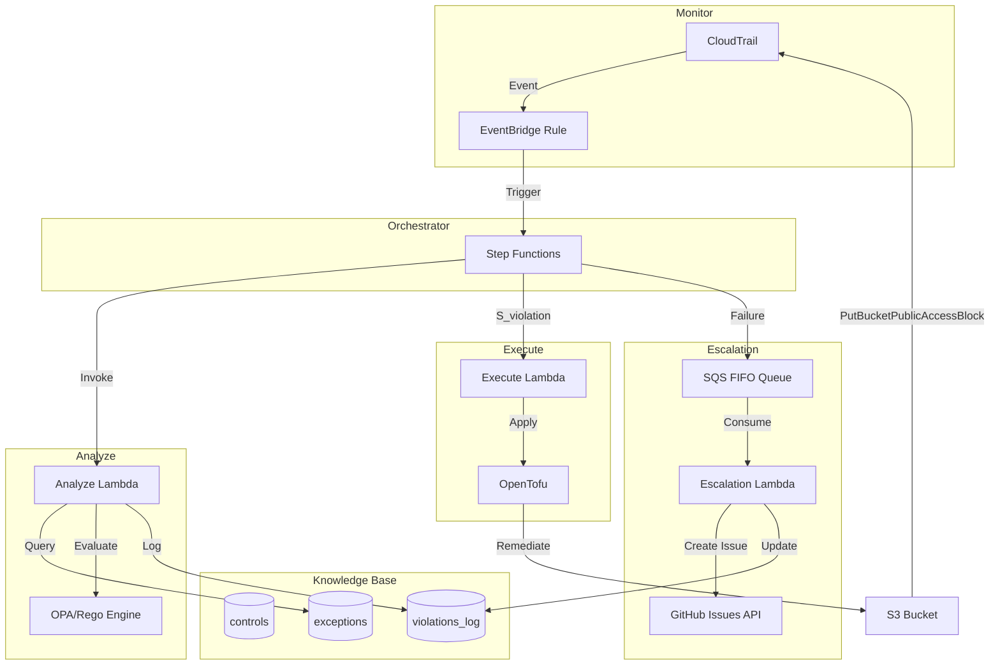
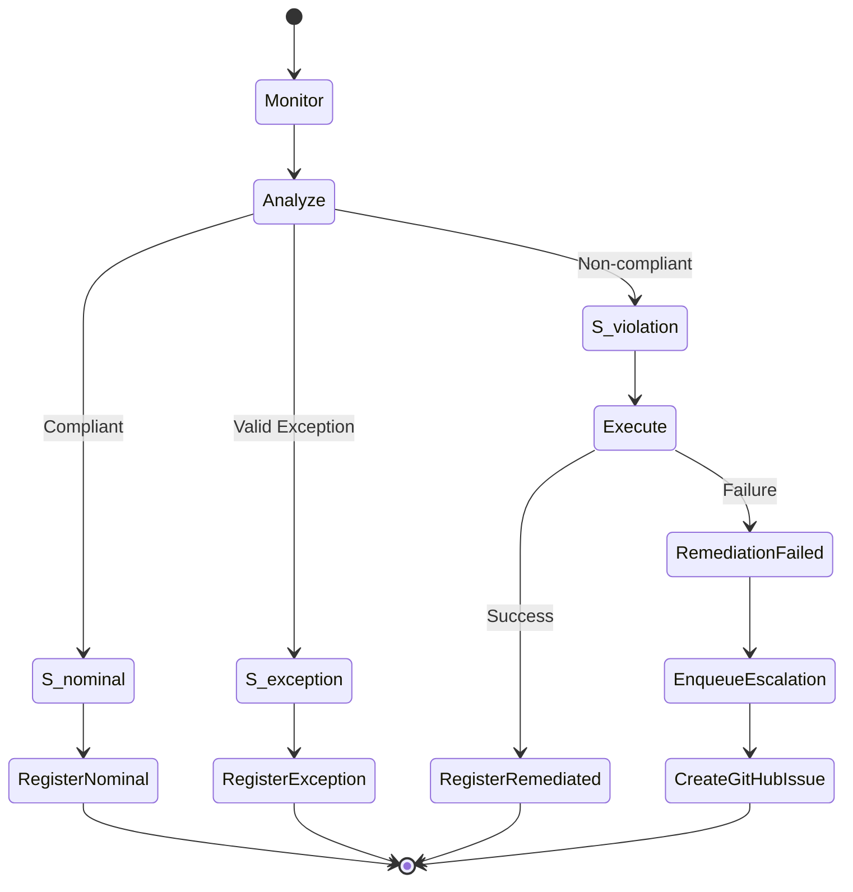
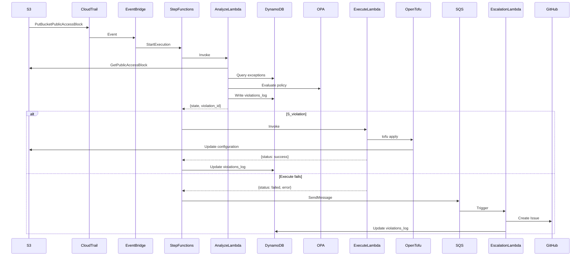
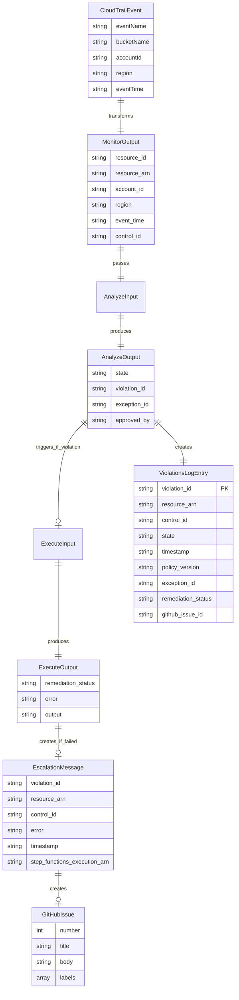
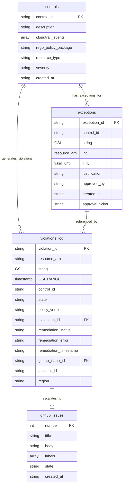
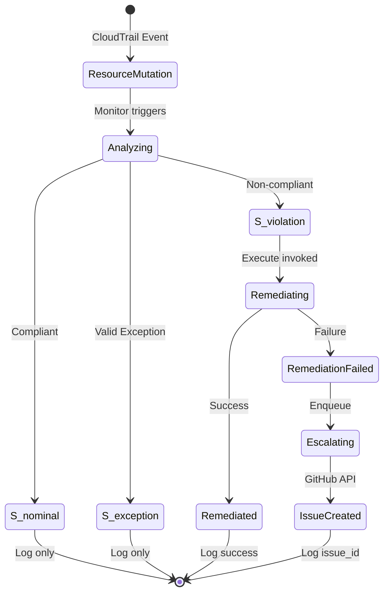

# Design Document: MVP Compliance Automation Loop

## Overview

O MVP Compliance Automation Loop implementa um sistema de automação de conformidade baseado no padrão arquitetural MAPE-K (Monitor, Analyze, Plan, Execute, Knowledge). O sistema detecta desvios de conformidade em recursos AWS, classifica o estado do recurso, executa remediação automática quando apropriado, e escala violações não resolvidas para operadores humanos.

O sistema suporta múltiplos controles de compliance de forma extensível e multi-serviço. Cinco controles estão implementados: bloqueio de acesso público S3 (`ctrl-s3-public-block`), política SSL-only (`ctrl-s3-ssl-only`), versionamento S3 (`ctrl-s3-versioning`), encryption S3 (`ctrl-s3-encryption`), e EBS encryption by default (`ctrl-ebs-encryption-default`). Novos controles podem ser adicionados sem rebuild de imagens — políticas Rego e templates HCL de remediação são armazenados no S3 e carregados em runtime. O sistema monitora eventos CloudTrail de múltiplos serviços AWS, resolve dinamicamente quais controles aplicar via tabela DynamoDB, avalia conformidade usando OPA/Rego com fetcher genérico parametrizado por `fetch_config`, e remedia violações usando OpenTofu.

### Design Goals

- **Automação determinística**: Cada evento deve seguir fluxo previsível baseado em classificação de estado
- **Auditabilidade completa**: Todas as avaliações e ações devem ser registradas permanentemente
- **Idempotência**: Remediação deve ser segura para execução repetida
- **Separação de responsabilidades**: Políticas versionadas em Git, estado em DynamoDB, execução em Lambda
- **Escalação confiável**: Falhas devem ser notificadas sem perda de informação

### MAPE-K Architecture Mapping

- **Monitor**: CloudTrail + EventBridge Rule (event pattern gerenciado dinamicamente pela Lambda `controls-sync` via DynamoDB Stream na tabela `controls`)
- **Analyze**: Lambda Python (arm64) + OPA/Rego (binário arm64 via Lambda Layer, políticas carregadas do S3 em runtime) + fetcher genérico via `fetch_config` (chamadas boto3 parametrizadas pela tabela `controls`) + consulta DynamoDB exceptions + ABAC nas permissões de leitura
- **Plan**: Implícito no Step Functions — QueryControls resolve dinamicamente quais controles aplicar baseado no `eventName` do CloudTrail via campo `cloudtrail_events` na tabela `controls`
- **Execute**: Lambda Python (arm64) + OpenTofu (binário via Lambda Layer) com state efêmero local. Templates HCL carregados do S3 em runtime. Provider AWS pré-inicializado armazenado no S3 como cache, baixado e extraído em `/tmp` no cold start, compartilhado via symlink (elimina `tofu init` em runtime)
- **Knowledge**: DynamoDB (controls, exceptions, violations_log)

### State Classification Model

O sistema classifica recursos em três estados formais:

- **S_nominal**: Recurso conforme com política vigente
- **S_exception**: Recurso não conforme mas com exceção aprovada e vigente
- **S_violation**: Recurso não conforme sem exceção válida (requer remediação)


## Architecture

### High-Level Architecture Diagram



### Workflow State Machine Diagram



### Component Interaction Flow




## Components and Interfaces

### 1. Monitor (CloudTrail + EventBridge)

**Responsibility**: Detectar eventos de mutação em recursos AWS e extrair metadados relevantes.

**Implementation**:
- CloudTrail trail configurado para capturar eventos de gerenciamento
- EventBridge Rule com pattern filter dinâmico (gerenciado por `controls-sync`)
- Input transformer genérico: extrai `request_parameters` do CloudTrail, `ResolveResource` na Step Function deriva `resource_id` e `resource_arn`
- Target: Step Functions state machine

**Event Pattern** (gerenciado dinamicamente):
```json
{
  "detail-type": ["AWS API Call via CloudTrail"],
  "detail": {
    "eventName": ["CreateBucket", "PutBucketPublicAccessBlock", "PutBucketVersioning", "DisableEbsEncryptionByDefault", "..."]
  }
}
```

Nota: o filtro `source` foi removido para suportar eventos de múltiplos serviços (S3, EC2, etc.) em uma única rule. O `eventName` é suficientemente específico para evitar falsos positivos.

**Output Schema**:
```json
{
  "resource_id": "bucket-name",
  "resource_arn": "arn:aws:s3:::bucket-name",
  "account_id": "123456789012",
  "region": "us-east-1",
  "event_time": "2024-01-15T10:30:00Z",
  "control_id": "ctrl-s3-public-block"
}
```

**Error Handling**:
- Missing fields: Log error to CloudWatch, discard event
- Malformed JSON: EventBridge DLQ captures failed invocations


### 2. Orchestrator (Step Functions Standard)

**Responsibility**: Coordenar transições entre componentes do loop MAPE-K baseado em classificação de estado.

**Implementation**:
- Step Functions Standard workflow (não Express) para histórico de 90 dias
- Choice states para decisão baseada em `$.state`
- SDK integrations diretas para DynamoDB (sem Lambda intermediária)
- Timeout global de 300 segundos
- Estados terminais explícitos: `ExecutionSucceeded` (Succeed) e `ExecutionFailed` (Fail com `Error: ComplianceEscalation`)
- Após o Map state, `EvaluateOutcome` verifica se algum controle foi escalado — se sim, a execução termina como FAILED

**State Machine Definition** (estrutura real):

A máquina de estados usa JSONata e processa múltiplos controles via Map state. Fluxo:

```
ResolveResource          # extrai resource_id/resource_arn dos request_parameters do CloudTrail
  → RouteControlLookup   # Choice: input tem control_id (re-avaliação de exceção)?
       ├─ sim → GetControlById            # getItem na tabela controls pelo control_id exato
       │          → CheckRequestedControlFound
       │               ├─ achou → InvokeAnalyze
       │               └─ não   → RequestedControlNotFound (SQS) → ExecutionFailed
       │                          # controle referenciado por exceção foi renomeado/removido:
       │                          # erro de governança, NUNCA sucesso silencioso
       └─ não → QueryControls             # scan na tabela controls por cloudtrail_events
                  → CheckControlsFound    # Choice: há controles? senão → ExecutionSucceeded
  → InvokeAnalyze        # Lambda; recebe controls completos, retorna results[] (um por controle)
       (Catch States.ALL → AnalyzeFailedEscalation → ExecutionFailed)
  → ProcessResults       # Map sobre results[], MaxConcurrency=1
       └─ ClassifyState  # Choice por analyze_result.state
            ├─ S_nominal   → RegisterNominal   (putItem) → outcome=nominal
            ├─ S_exception → RegisterException (putItem) → outcome=exception
            ├─ S_violation → RegisterViolation (putItem) → InvokeExecute
            │     → CheckRemediationStatus
            │          ├─ success → UpdateLogSuccess (updateItem) → outcome=remediated
            │          └─ failed  → UpdateLogFailed  (updateItem) → EnqueueEscalation → outcome=escalated
            │     (Catch States.ALL → UpdateLogFailed → EnqueueEscalation)
            └─ default (S_error) → RegisterError (putItem) → ControlErrorEscalation → outcome=escalated
  → EvaluateOutcome      # Choice: algum outcome=escalated? → ExecutionFailed; senão → ExecutionSucceeded
```

Estados terminais explícitos:
- `ExecutionSucceeded` (`Succeed`)
- `ExecutionFailed` (`Fail`, `Error: ComplianceEscalation`) — execuções que escalam terminam como FAILED no console

Persistência no `violations_log`: o **Step Functions é o único componente que grava** (o Analyze é função pura, sem side-effects). `RegisterNominal/Exception/Violation/Error` fazem `putItem` com todos os campos obrigatórios; `UpdateLogSuccess/Failed` fazem `updateItem` (não sobrescrevem o registro, apenas adicionam `remediation_status`/`remediation_output`/`remediation_error`).

**Invariante de completude (H2)**: toda avaliação — inclusive as que terminam em `S_error` — gera um registro completo no `violations_log` ANTES de qualquer escalação. O `RegisterError` grava `state`, `error`, `resource_arn`, `control_id`, `timestamp` e `policy_version`; sem ele, a Escalation Lambda vinculava `github_issue_id` a um `violation_id` inexistente e o `UpdateItem` criava um item fantasma (só com os campos da issue, invisível ao GSI de auditoria). A Escalation Lambda usa `ConditionExpression attribute_exists(violation_id)` como segunda linha de defesa: nunca cria registros, apenas anota os existentes.


### 3. Analyze Lambda

**Responsibility**: Classificar estado de conformidade do recurso usando OPA/Rego e consulta de exceções.

**Implementation**:
- Runtime: Python 3.13
- Architecture: arm64
- OPA binary via Lambda Layer (`/opt/bin/opa`), políticas Rego carregadas do S3 em runtime
- Deployment package: handler.py (~2.5KB)
- Lambda Layer: `opa-binary` (~20MB comprimido, binário OPA arm64 estático)
- Timeout: 15 segundos
- Memory: 512 MB

**Algorithm**:
```python
def analyze(event):
    # 1. Extract resource metadata
    resource_arn = event['resource_arn']
    control_id = event['control_id']
    
    # 2. Retrieve current resource configuration
    s3_client = boto3.client('s3')
    bucket_name = extract_bucket_name(resource_arn)
    config = s3_client.get_public_access_block(Bucket=bucket_name)
    
    # 3. Evaluate with OPA
    opa_input = {
        "resource": config['PublicAccessBlockConfiguration'],
        "control_id": control_id
    }
    policy_result = opa.evaluate("data.s3_public_access.allow", opa_input)
    
    # 4. Check for valid exception
    exception = query_exception(control_id, resource_arn)
    
    # 5. Classify state
    if policy_result.allow:
        state = "S_nominal"
    elif exception and exception['valid_until'] > now():
        state = "S_exception"
    else:
        state = "S_violation"
    
    # 6. Log to violations_log
    violation_id = str(uuid.uuid4())
    log_violation(violation_id, resource_arn, control_id, state, exception)
    
    return {
        "state": state,
        "violation_id": violation_id,
        "exception_id": exception['exception_id'] if exception else None
    }
```

**DynamoDB Query for Exceptions**:
```python
def query_exception(control_id, resource_arn):
    response = dynamodb.query(
        TableName='exceptions',
        IndexName='resource-control-index',
        KeyConditionExpression='resource_arn = :arn AND control_id = :cid',
        FilterExpression='valid_until > :now',
        ExpressionAttributeValues={
            ':arn': resource_arn,
            ':cid': control_id,
            ':now': int(time.time())
        }
    )
    return response['Items'][0] if response['Items'] else None
```

**Rego Policy** (`s3_public_access.rego`):
```rego
package s3_public_access

default allow := false

allow if {
    input.resource.BlockPublicAcls == true
    input.resource.IgnorePublicAcls == true
    input.resource.BlockPublicPolicy == true
    input.resource.RestrictPublicBuckets == true
}
```

**Output Schema**:
```json
{
  "state": "S_violation",
  "violation_id": "550e8400-e29b-41d4-a716-446655440000",
  "exception_id": null,
  "approved_by": null
}
```

**Error Handling**:
- S3 GetPublicAccessBlock fails: Return error to Step Functions, trigger escalation
- OPA evaluation error: Log to CloudWatch, return S_violation (fail-secure)
- DynamoDB query timeout: Proceed without exception (fail-secure)


### 4. Execute Lambda

**Responsibility**: Remediar recursos em violação usando OpenTofu com infraestrutura como código declarativa.

**Implementation**:
- Runtime: Python 3.13
- Architecture: arm64
- OpenTofu binary via Lambda Layer (`/opt/bin/tofu`)
- Provider AWS pré-inicializado armazenado no S3 como `tf-dot-terraform.tar.gz` (~128MB), baixado e extraído em `/tmp` no cold start
- Deployment package: handler.py (~1.3KB)
- Lambda Layer: `tofu-binary` (~29MB comprimido, binário OpenTofu arm64)
- Templates HCL carregados do S3 em runtime
- Timeout: 90 segundos
- Memory: 2048 MB
- Ephemeral storage: 1024 MB (para provider cache + tfstate)

**Provider Cache Strategy**:

O provider AWS extraído (~628MB) não cabe numa Lambda Layer (limite 250MB descomprimido). A solução usa S3 como cache:

1. **Build time**: um Dockerfile auxiliar executa `tofu init` uma vez, gerando o `.terraform/` (provider extraído) e o `.terraform.lock.hcl`. Esses artefatos são empacotados como `tf-dot-terraform.tar.gz` (~128MB) e armazenados no S3.
2. **Cold start**: o handler baixa o tar.gz do S3 (~2-3s) e extrai para `/tmp` (~3-5s) usando `tarfile` do Python.
3. **Warm start**: `/tmp` persiste entre invocações — o provider já está disponível, custo zero.
4. **Setup por controle**: o handler cria um symlink (`ln -s /tmp/tf-dot-terraform .terraform`) e copia o lock file (1KB) para o diretório de trabalho de cada controle.

Essa abordagem elimina tanto o `tofu init` em runtime quanto a necessidade de container image (ECR).

**Lambda Handler**:
```python
import subprocess
import json
import os
import shutil
import tarfile
import boto3

s3 = boto3.client('s3')
REMEDIATION_BUCKET = os.environ['REMEDIATION_BUCKET']
PROVIDER_CACHE_KEY = os.environ.get('PROVIDER_CACHE_KEY', 'provider-cache/tf-dot-terraform.tar.gz')
TF_CACHE = '/tmp/tf-dot-terraform'
TF_LOCK = '/tmp/tf-lock.hcl'


def ensure_provider_cache():
    """Download and extract pre-initialized .terraform from S3 on cold start."""
    if os.path.exists(TF_CACHE):
        return
    archive = '/tmp/tf-cache.tar.gz'
    s3.download_file(REMEDIATION_BUCKET, PROVIDER_CACHE_KEY, archive)
    with tarfile.open(archive, 'r:gz') as tar:
        tar.extractall(path='/tmp/')
    os.remove(archive)


def setup_remediation(control_id, s3_key):
    """Prepara um diretório de trabalho LIMPO a cada invocação.

    O work_dir (e o tfstate dentro dele) é recriado a cada execução. Isso é
    crítico para corretude: combinado com -refresh=false, um tfstate obsoleto
    de uma invocação warm anterior faria o OpenTofu reportar 'No changes' para
    um recurso re-violado, pulando a remediação silenciosamente.
    """
    work_dir = f'/tmp/{control_id}'
    shutil.rmtree(work_dir, ignore_errors=True)
    os.makedirs(work_dir, exist_ok=True)
    s3.download_file(REMEDIATION_BUCKET, s3_key, f'{work_dir}/remediation.tf')
    os.symlink(TF_CACHE, f'{work_dir}/.terraform')
    shutil.copy(TF_LOCK, f'{work_dir}/.terraform.lock.hcl')
    return work_dir


def lambda_handler(event, context):
    resource_arn = event['resource_arn']
    region = event['region']
    control_id = event['control_id']
    s3_key = event['remediation_s3_key']
    resource_id = event.get('resource_id', '')
    # ARN parsing genérico: S3 usa arn:aws:s3:::name; outros serviços usam resource_id
    bucket_name = resource_arn.split(':::')[1] if ':::' in resource_arn else resource_id

    ensure_provider_cache()
    work_dir = setup_remediation(control_id, s3_key)
    state_path = f'/tmp/{control_id}/{bucket_name}.tfstate'  # work_dir limpo → state sempre fresh

    tfvars = {"bucket_name": bucket_name, "region": region, "resource_id": resource_id}
    # Edge case: ssl-only precisa da policy existente para merge
    if control_id == 'ctrl-s3-ssl-only':
        try:
            resp = s3.get_bucket_policy(Bucket=bucket_name)
            tfvars['existing_policy'] = resp['Policy']
        except Exception:
            pass

    with open(f'{work_dir}/terraform.tfvars.json', 'w') as f:
        json.dump(tfvars, f)

    result = subprocess.run(
        ['/opt/bin/tofu', 'apply', '-refresh=false', '-auto-approve', '-no-color',
         f'-var-file={work_dir}/terraform.tfvars.json', f'-state={state_path}'],
        cwd=work_dir, capture_output=True, text=True, timeout=65
    )

    if result.returncode == 0:
        return {"remediation_status": "success", "output": result.stdout}
    return {"remediation_status": "failed", "error": result.stderr}
```

**Design Rationale**:
- `-refresh=false`: Analyze já verificou estado atual, evita latência adicional
- **tfstate efêmero por invocação**: o `work_dir` é recriado a cada execução (`shutil.rmtree`). Isso garante que `-refresh=false` nunca compare contra um state obsoleto de warm start — sem isso, um recurso re-violado seria reportado como "No changes" e não remediado
- Lambda Layer + S3 provider cache: Elimina ECR e pipeline de container. Cold start ~11s (vs. ~33s com container). Warm start ~5-7s (provider já em `/tmp`)
- ARN parsing genérico: S3 deriva `bucket_name` do ARN, outros serviços usam `resource_id` (suporte multi-serviço)
- Symlink para provider: Todos os controles compartilham o mesmo provider sem duplicação em disco

**Output Schema**:
```json
{
  "remediation_status": "success",
  "output": "aws_s3_bucket_public_access_block.remediation: Creation complete"
}
```

**Error Handling**:
- OpenTofu apply timeout: Return failure status with partial output
- IAM permission denied: Return failure, escalate to GitHub Issue
- Bucket not found: Return failure (bucket pode ter sido deletado)


### 5. Knowledge Base (DynamoDB)

**Responsibility**: Armazenar políticas, exceções aprovadas, e log de violações.

#### Table: controls

**Purpose**: Metadados de controles de conformidade.

**Schema**:
```json
{
  "TableName": "controls",
  "KeySchema": [
    {"AttributeName": "control_id", "KeyType": "HASH"}
  ],
  "AttributeDefinitions": [
    {"AttributeName": "control_id", "AttributeType": "S"}
  ],
  "BillingMode": "PAY_PER_REQUEST"
}
```

**Sample Item**:
```json
{
  "control_id": "ctrl-s3-public-block",
  "description": "Enforce S3 bucket public access block settings",
  "cloudtrail_events": ["PutBucketPublicAccessBlock", "DeleteBucketPublicAccessBlock", "CreateBucket"],
  "rego_policy_package": "s3_public_access",
  "rego_s3_key": "controls/ctrl-s3-public-block/policy.rego",
  "remediation_s3_key": "controls/ctrl-s3-public-block/remediation.tf",
  "resource_type": "AWS::S3::Bucket",
  "severity": "HIGH",
  "policy_version": "v1.0",
  "fetch_config": {
    "service": "s3",
    "method": "get_public_access_block",
    "params": {"Bucket": "{resource_id}"},
    "result_path": "PublicAccessBlockConfiguration",
    "error_defaults": {
      "NoSuchPublicAccessBlockConfiguration": {
        "BlockPublicAcls": false, "IgnorePublicAcls": false,
        "BlockPublicPolicy": false, "RestrictPublicBuckets": false
      }
    }
  }
}
```

**Access Pattern**:
- Query by control_id (primary key)
- Used by Analyze to retrieve policy metadata


#### Table: exceptions

**Purpose**: Armazenar exceções aprovadas com TTL nativo.

**Schema**:
```json
{
  "TableName": "exceptions",
  "KeySchema": [
    {"AttributeName": "exception_id", "KeyType": "HASH"}
  ],
  "AttributeDefinitions": [
    {"AttributeName": "exception_id", "AttributeType": "S"},
    {"AttributeName": "resource_arn", "AttributeType": "S"},
    {"AttributeName": "control_id", "AttributeType": "S"}
  ],
  "GlobalSecondaryIndexes": [
    {
      "IndexName": "resource-control-index",
      "KeySchema": [
        {"AttributeName": "resource_arn", "KeyType": "HASH"},
        {"AttributeName": "control_id", "KeyType": "RANGE"}
      ],
      "Projection": {
        "ProjectionType": "INCLUDE",
        "NonKeyAttributes": ["valid_until", "exception_id", "approved_by"]
      }
    }
  ],
  "TimeToLiveSpecification": {
    "AttributeName": "valid_until",
    "Enabled": true
  },
  "BillingMode": "PAY_PER_REQUEST"
}
```

**Sample Item**:
```json
{
  "exception_id": "exc-a1b2c3d4-e5f6-7890-abcd-ef1234567890",
  "control_id": "ctrl-s3-public-block",
  "resource_arn": "arn:aws:s3:::public-website-bucket",
  "valid_until": 1735689600,
  "justification": "Public website hosting approved by security team",
  "approved_by": "security-lead@example.com",
  "created_at": "2024-01-15T10:00:00Z",
  "approval_ticket": "JIRA-12345"
}
```

**Access Pattern**:
- Query by control_id via GSI
- Filter by resource_arn and valid_until > now()
- TTL deletes expired items within 48h (behavior does NOT depend on physical deletion)

**Design Rationale**:
- TTL on valid_until: Automatic cleanup, but Analyze filters explicitly
- GSI on control_id: Efficient query for all exceptions of a control
- UUID partition key: Uniform distribution, no hot partitions

**Re-avaliação Automática após Expiração de Exceção**:

O DynamoDB Streams está habilitado na tabela exceptions com `NEW_AND_OLD_IMAGES`. Uma Lambda (`exception-scheduler-sync`) processa eventos `INSERT` e `MODIFY` do Stream. Para cada exceção ativa com `valid_until` no futuro, a Lambda cria um EventBridge Scheduler one-time programado para `valid_until + 30s`. Quando o Scheduler dispara, a exceção já expirou logicamente, e o Step Functions é acionado para re-avaliação completa (Analyze → Execute se necessário). O Scheduler se auto-deleta após o disparo (`ActionAfterCompletion=DELETE`).

O input enviado ao Step Functions carrega o `control_id` da exceção (não um `event_name` sintético). O estado `RouteControlLookup` detecta a presença de `control_id` e resolve o controle exato via `GetControlById` (getItem), em vez do scan por `cloudtrail_events`. Isso garante que a re-avaliação atinja precisamente o controle da exceção expirada — inclusive controles não-S3 (ex: `ctrl-ebs-encryption-default`), cujos eventos CloudTrail não se relacionam com nenhum evento S3 — sem disparar controles alheios contra o recurso.

Este mecanismo substituiu a abordagem anterior baseada em EventBridge Pipe + DynamoDB TTL, que dependia da deleção física de itens expirados — operação com latência não determinística de até 48h. O novo mecanismo reduz essa latência em ordens de grandeza, mas **não é preciso ao segundo**: medido em 10 execuções (C3), o disparo ocorre em média **22,5 s após o instante agendado**, variando de 1,1 s a 40,1 s. O ganho real é de latência **limitada e observável** (dezenas de segundos) contra **ilimitada** (até 48 h) — não de determinismo.

Isso garante que, após expiração de uma exceção, o recurso seja automaticamente re-avaliado pelo loop MAPE-K completo, mantendo o invariante arquitetural de que o Analyze é sempre o componente decisor.

**Limitação conhecida — Latência do TTL**:

A deleção física de itens expirados pelo DynamoDB TTL é **não-determinística** e pode levar até 48 horas após o timestamp `valid_until`. No entanto, a re-avaliação automática **não depende da deleção física**: o EventBridge Scheduler é agendado para `valid_until + 30s` e dispara dentro de algumas dezenas de segundos desse instante (22,5 s de atraso médio, até 40,1 s observados em 10 execuções), e a Analyze Lambda filtra exceções com `valid_until > now()`, garantindo que exceções logicamente expiradas sejam ignoradas em qualquer avaliação. O TTL permanece habilitado apenas para limpeza eventual dos itens na tabela.


#### Table: violations_log

**Purpose**: Registro permanente de todas as avaliações de conformidade.

**Schema**:
```json
{
  "TableName": "violations_log",
  "KeySchema": [
    {"AttributeName": "violation_id", "KeyType": "HASH"}
  ],
  "AttributeDefinitions": [
    {"AttributeName": "violation_id", "AttributeType": "S"},
    {"AttributeName": "resource_arn", "AttributeType": "S"},
    {"AttributeName": "timestamp", "AttributeType": "S"}
  ],
  "GlobalSecondaryIndexes": [
    {
      "IndexName": "resource_arn-timestamp-index",
      "KeySchema": [
        {"AttributeName": "resource_arn", "KeyType": "HASH"},
        {"AttributeName": "timestamp", "KeyType": "RANGE"}
      ],
      "Projection": {"ProjectionType": "ALL"}
    }
  ],
  "BillingMode": "PAY_PER_REQUEST"
}
```

**Sample Item (S_violation with successful remediation)**:
```json
{
  "violation_id": "vio-550e8400-e29b-41d4-a716-446655440000",
  "resource_arn": "arn:aws:s3:::non-compliant-bucket",
  "control_id": "ctrl-s3-public-block",
  "state": "S_violation",
  "timestamp": "2024-01-15T10:30:15Z",
  "policy_version": "s3_public_access:v1.0",
  "exception_id": null,
  "remediation_status": "success",
  "remediation_timestamp": "2024-01-15T10:30:45Z",
  "github_issue_id": null,
  "account_id": "123456789012",
  "region": "us-east-1"
}
```

**Sample Item (S_exception)**:
```json
{
  "violation_id": "vio-660f9511-f3ac-52e5-b827-557766551111",
  "resource_arn": "arn:aws:s3:::public-website-bucket",
  "control_id": "ctrl-s3-public-block",
  "state": "S_exception",
  "timestamp": "2024-01-15T11:00:00Z",
  "policy_version": "s3_public_access:v1.0",
  "exception_id": "exc-a1b2c3d4-e5f6-7890-abcd-ef1234567890",
  "approved_by": "security-lead@example.com",
  "remediation_status": null,
  "github_issue_id": null,
  "account_id": "123456789012",
  "region": "us-east-1"
}
```

**Sample Item (S_violation with failed remediation)**:
```json
{
  "violation_id": "vio-770g0622-g4bd-63f6-c938-668877662222",
  "resource_arn": "arn:aws:s3:::protected-bucket",
  "control_id": "ctrl-s3-public-block",
  "state": "S_violation",
  "timestamp": "2024-01-15T12:00:00Z",
  "policy_version": "s3_public_access:v1.0",
  "exception_id": null,
  "remediation_status": "failed",
  "remediation_error": "AccessDenied: Insufficient permissions",
  "remediation_timestamp": "2024-01-15T12:00:30Z",
  "github_issue_id": "12345",
  "account_id": "123456789012",
  "region": "us-east-1"
}
```

**Access Pattern**:
- Query by violation_id (primary key) for audit trail
- Query by resource_arn + timestamp via GSI for resource history
- No TTL: Permanent audit log

**Design Rationale**:
- State field represents actual compliance state, not process state
- remediation_status indicates outcome of Execute, not a new state
- github_issue_id links violation to operational resolution workflow


### 6. Escalation (SQS FIFO + Lambda + GitHub Issues)

**Responsibility**: Notificar operadores humanos quando remediação automática falha.

#### SQS FIFO Queue

**Configuration**:
```json
{
  "QueueName": "compliance-escalation.fifo",
  "FifoQueue": true,
  "ContentBasedDeduplication": false,
  "MessageRetentionPeriod": 1209600,
  "VisibilityTimeout": 300,
  "DeduplicationScope": "messageGroup",
  "FifoThroughputLimit": "perMessageGroupId"
}
```

**Message Schema**:
```json
{
  "violation_id": "vio-770g0622-g4bd-63f6-c938-668877662222",
  "resource_arn": "arn:aws:s3:::protected-bucket",
  "control_id": "ctrl-s3-public-block",
  "error": "AccessDenied: Insufficient permissions",
  "timestamp": "2024-01-15T12:00:30Z",
  "step_functions_execution_arn": "arn:aws:states:us-east-1:123456789012:execution:compliance-loop:exec-abc123",
  "account_id": "123456789012",
  "region": "us-east-1"
}
```

**Design Rationale**:
- FIFO: Preserves order of violations for same resource
- MessageDeduplicationId = `resource_arn#control_id`: deduplica escalações do mesmo recurso/controle dentro da janela de 5min do SQS FIFO, evitando spam de issues por re-triggers do CloudTrail. (Não usa `violation_id`, que é um UUID novo a cada avaliação e portanto nunca deduplicaria o caso real.) Complementarmente, a Escalation Lambda verifica se já existe uma issue aberta com o mesmo título antes de criar uma nova
- MessageGroupId = `resource_id#control_id`: processamento paralelo para recursos diferentes, ordenado para o mesmo recurso/controle


#### Escalation Lambda

**Implementation**:
- Runtime: Python 3.13 (arm64)
- Trigger: SQS FIFO queue (batch size: 1)
- Timeout: 30 seconds
- HTTP via `urllib.request` (sem dependência externa `requests`)
- Credenciais GitHub lidas do SSM Parameter Store (`/compliance/github/*`)
- Deduplicação: verifica issue aberta com mesmo título antes de criar

**Algorithm**:
```python
import boto3
import requests
import json
import os

def lambda_handler(event, context):
    for record in event['Records']:
        message = json.loads(record['body'])
        
        # Create GitHub Issue
        issue = create_github_issue(message)
        
        # Update violations_log with github_issue_id
        dynamodb = boto3.resource('dynamodb')
        table = dynamodb.Table('violations_log')
        table.update_item(
            Key={'violation_id': message['violation_id']},
            UpdateExpression='SET github_issue_id = :issue_id',
            ExpressionAttributeValues={':issue_id': str(issue['number'])}
        )
        
    return {'statusCode': 200}

def create_github_issue(message):
    url = f"https://api.github.com/repos/{os.environ['GITHUB_REPO']}/issues"
    headers = {
        'Authorization': f"token {os.environ['GITHUB_TOKEN']}",
        'Accept': 'application/vnd.github.v3+json'
    }
    
    execution_url = f"https://console.aws.amazon.com/states/home?region={message['region']}#/executions/details/{message['step_functions_execution_arn']}"
    
    body = f"""
## Compliance Violation - Remediation Failed

**Resource**: `{message['resource_arn']}`
**Control**: `{message['control_id']}`
**Violation ID**: `{message['violation_id']}`
**Timestamp**: {message['timestamp']}

### Error Details
```
{message['error']}
```

### Step Functions Execution
[View execution details]({execution_url})

### Action Required
Manual remediation required. Review the error details and apply the necessary configuration changes.
"""
    
    payload = {
        'title': f"[Compliance] {message['control_id']} - {message['resource_arn']}",
        'body': body,
        'labels': ['compliance-violation', 'auto-escalation']
    }
    
    response = requests.post(url, headers=headers, json=payload)
    response.raise_for_status()
    return response.json()
```

**GitHub Issue Example**:
```markdown
Title: [Compliance] ctrl-s3-public-block - arn:aws:s3:::protected-bucket

## Compliance Violation - Remediation Failed

**Resource**: `arn:aws:s3:::protected-bucket`
**Control**: `ctrl-s3-public-block`
**Violation ID**: `vio-770g0622-g4bd-63f6-c938-668877662222`
**Timestamp**: 2024-01-15T12:00:30Z

### Error Details
```
AccessDenied: Insufficient permissions
```

### Step Functions Execution
[View execution details](https://console.aws.amazon.com/states/...)

### Action Required
Manual remediation required. Review the error details and apply the necessary configuration changes.

Labels: compliance-violation, auto-escalation
```

**Error Handling**:
- GitHub API failure: Lambda retries via SQS visibility timeout. Requer
  `function_response_types = ["ReportBatchItemFailures"]` no event source
  mapping — sem isso o retorno `batchItemFailures` é ignorado e a mensagem é
  deletada mesmo em falha (escalação perdida silenciosamente, sem DLQ)
- Issue duplicada: antes de criar, busca issue aberta com mesmo título; se
  existir, vincula o `violations_log` à issue existente em vez de criar outra
- DynamoDB update failure: Log error, continue (issue already created)
- Invalid message format: Send to DLQ


## Data Models

### Event Flow Data Model




### DynamoDB Schema Relationships



### State Transition Model




## Correctness Properties

A property is a characteristic or behavior that should hold true across all valid executions of a system—essentially, a formal statement about what the system should do. Properties serve as the bridge between human-readable specifications and machine-verifiable correctness guarantees.

> **Nota**: As Properties 4, 7 e 19 foram especificadas para o controle inicial (`ctrl-s3-public-block`) e usam-no como exemplo concreto. O sistema evoluiu para multi-controle e multi-serviço (S3, EC2) — essas propriedades generalizam para qualquer controle: a avaliação de conformidade é delegada à política Rego do controle, e a remediação ao seu template HCL. A Property 25 foi atualizada para refletir o event pattern dinâmico multi-serviço.

### Property 1: CloudTrail Event Parsing Completeness

For any valid CloudTrail PutBucketPublicAccessBlock event, the Monitor SHALL successfully extract all required metadata fields (bucket ARN, account ID, region) and construct a valid output schema.

**Validates: Requirements 1.2, 1.3, 1.4, 1.5, 15.1, 15.7**

### Property 2: Orchestrator State-Based Routing

For any Analyze output with state S_nominal or S_exception, the Orchestrator SHALL terminate the workflow without invoking Execute; for any Analyze output with state S_violation, the Orchestrator SHALL invoke Execute.

**Validates: Requirements 2.2, 2.3, 2.4**

### Property 3: Analyze Classification Determinism

For any resource configuration and exception set, when Analyze evaluates the same inputs multiple times with the same timestamp, it SHALL return identical classification results.

**Validates: Requirements 3.9, 16.3**

### Property 4: Compliant Resource Classification

For any S3 bucket configuration where BlockPublicAcls, IgnorePublicAcls, BlockPublicPolicy, and RestrictPublicBuckets are all true, the Analyze SHALL return S_nominal.

**Validates: Requirements 3.3, 10.7**

### Property 5: Valid Exception Classification

For any non-compliant resource configuration with an exception where valid_until > current_timestamp, the Analyze SHALL return S_exception.

**Validates: Requirements 3.4, 3.7**

### Property 6: Violation Classification

For any non-compliant resource configuration without a valid exception, the Analyze SHALL return S_violation.

**Validates: Requirements 3.5, 3.8**

### Property 7: S3 Public Access Policy Evaluation

For any S3 bucket configuration, the s3_public_access Rego policy SHALL return violation if any of the four public access block settings (BlockPublicAcls, IgnorePublicAcls, BlockPublicPolicy, RestrictPublicBuckets) is false.

**Validates: Requirements 10.2, 10.3, 10.4, 10.5, 10.6**

### Property 8: Exception Query Correctness

For any control_id and resource_arn, the Analyze SHALL query the exceptions table using the control_id GSI and filter by resource_arn match and valid_until > current_timestamp.

**Validates: Requirements 3.6, 5.8**

### Property 9: Exception Data Model Completeness

For any exception created in the Knowledge_Base, it SHALL contain all required fields: exception_id (UUID), control_id, resource_arn, valid_until (Unix timestamp), justification, approved_by, and created_at.

**Validates: Requirements 5.4, 5.5, 5.6, 5.10, 5.11, 5.12**

### Property 10: Exception Filtering Independence from TTL

For any exception query, the Analyze SHALL filter by valid_until > now() in the query expression, ensuring behavior does not depend on DynamoDB TTL physical deletion.

**Validates: Requirements 5.9**

### Property 11: Violations Log Entry Uniqueness

For any Analyze evaluation, exactly one entry SHALL be created in the violations_log table with a unique violation_id (UUID).

**Validates: Requirements 6.1, 6.2**

### Property 12: Violations Log Data Model Completeness

For any violations_log entry, it SHALL contain all required fields: violation_id, resource_arn, control_id, state (one of S_nominal, S_exception, S_violation), timestamp (ISO 8601), and policy_version.

**Validates: Requirements 6.3, 6.4, 6.5, 6.6, 6.7**

### Property 13: Exception Reference in Log

For any violations_log entry with state S_exception, it SHALL include a non-null exception_id reference.

**Validates: Requirements 6.8**

### Property 14: Remediation Status Logging

For any violations_log entry where Execute was invoked, it SHALL include a remediation_status field with value "success" if Execute succeeded or "failed" if Execute failed.

**Validates: Requirements 6.9, 6.10, 6.11**

### Property 15: Execute Idempotency

For any resource in S_violation state, invoking Execute multiple times SHALL produce the same final resource configuration (all four public access block settings true).

**Validates: Requirements 7.7, 9.1, 11.5**

### Property 16: Execute OpenTofu Invocation

For any S_violation input, Execute SHALL invoke OpenTofu with the -refresh=false flag and the resource_id correctly mapped to OpenTofu variables.

**Validates: Requirements 7.1, 7.2, 7.3**

### Property 17: Execute Success Response

For any successful OpenTofu apply (return code 0), Execute SHALL return remediation_status "success" to the Orchestrator.

**Validates: Requirements 7.5**

### Property 18: Execute Failure Response

For any failed OpenTofu apply (return code != 0), Execute SHALL return remediation_status "failed" with error details to the Orchestrator.

**Validates: Requirements 7.6**

### Property 19: Remediation Outcome Compliance

For any resource after successful Execute, querying the S3 public access block configuration SHALL show BlockPublicAcls, IgnorePublicAcls, BlockPublicPolicy, and RestrictPublicBuckets all set to true.

**Validates: Requirements 7.9**

### Property 20: Escalation Trigger on Failure

For any Execute failure, the Orchestrator SHALL send a message to the Escalation_Queue containing all required fields: violation_id, resource_arn, control_id, error details, timestamp, and step_functions_execution_arn.

**Validates: Requirements 2.6, 8.1, 8.3, 8.4, 8.5, 8.6, 8.7, 8.8**

### Property 21: GitHub Issue Creation

For any message in the Escalation_Queue, the Escalation Lambda SHALL create a GitHub Issue containing all escalation message details and labeled with "compliance-violation" and "auto-escalation".

**Validates: Requirements 8.9, 8.10, 8.11**

### Property 22: GitHub Issue ID Persistence

For any GitHub Issue created for a failed remediation, the issue number returned by the GitHub API SHALL be saved to the violations_log entry corresponding to the violation_id.

**Validates: Requirements 8.12, 19.1, 19.4**

### Property 23: GitHub Issue ID Null for Non-Escalated Violations

For any violations_log entry where Execute was not invoked or Execute succeeded, the github_issue_id field SHALL be null.

**Validates: Requirements 19.5**

### Property 24: State Persistence After Failed Remediation

For any Execute failure, the violations_log entry SHALL maintain state as S_violation (not create a new state like S_remediation_failed), with the remediation_status field indicating "failed".

**Validates: Requirements 18.1, 18.2, 18.5**

### Property 25: EventBridge Rule Event Filtering

For any CloudTrail event whose `eventName` is NOT in the union of `cloudtrail_events` across all registered controls, the EventBridge Rule SHALL NOT match the event and SHALL NOT trigger the Orchestrator. O event pattern é gerenciado dinamicamente pela Lambda `controls-sync` e cobre múltiplos serviços (S3, EC2). O filtro `source` foi removido para suportar multi-serviço; o `eventName` (específico por API) evita falsos positivos.

**Validates: Requirements 1.6**

### Property 26: Monitor Error Handling

For any CloudTrail event with missing required fields (bucketName, accountId, or region), the Monitor SHALL log an error and discard the event.

**Validates: Requirements 15.6**

### Property 27: ARN Construction Format

For any bucket name extracted from a CloudTrail event, the Monitor SHALL construct the resource ARN in the format "arn:aws:s3:::bucket-name".

**Validates: Requirements 15.7**

### Property 28: Timeout Error Handling

For any component timeout (Analyze task > 75s, Execute task > 90s, Orchestrator global > 600s), the Orchestrator SHALL log a timeout error and terminate the workflow.

A cadeia é monotônica em dois ramos, cada um com folga para o cold start:

- **Execute**: subprocess do tofu (65s) + cold start (~11s) ≈ 76s ≤ Execute Lambda (90s) ≤ Execute task SFN (90s). A folga garante que um timeout do tofu sempre retorne erro estruturado (`subprocess.TimeoutExpired`) antes de o Lambda ser morto com `States.Timeout` genérico
- **Analyze**: orçamento de OPA derivado do tempo restante (ver *Analyze Error Handling*) ≤ Analyze Lambda (60s) ≤ InvokeAnalyze task SFN (75s). O task fica **acima** do Lambda para que o retorno estruturado do handler vença a corrida contra o Step Functions

O **global (600s)** precisa cobrir o pior caso serial, porque `ProcessResults` roda com `MaxConcurrency=1`: `75 + n_controles × (90 + escritas ~5) = 550s` nos 5 controles atuais. Adicionar controles que compartilhem um evento CloudTrail, ou elevar o timeout do Execute, exige revisitar esse valor.

**Validates: Requirements 17.4**

### Property 29: Resource State Unchanged for S_exception

For any resource classified as S_exception, the resource configuration SHALL remain unchanged after the workflow completes.

**Validates: Requirements 12.5**

### Property 30: Resource State Unchanged After Failed Remediation

For any resource where Execute fails, the resource configuration SHALL remain in its non-compliant state.

**Validates: Requirements 14.5**


## Error Handling

### Monitor Error Handling

**Malformed CloudTrail Events**:
- Missing required fields (bucketName, accountId, region): Log error to CloudWatch Logs, discard event
- Invalid JSON structure: EventBridge DLQ captures failed invocations
- Unmatched event pattern: EventBridge filters prevent invocation

**Error Recovery**: No retry - events are discarded. CloudTrail will generate new events for subsequent mutations.

### Analyze Error Handling

**AWS API Failures**:
- Resource fetch fails (NoSuchBucket, AccessDenied): tratado via `error_defaults` no `fetch_config` quando aplicável; senão propaga como `S_error` → escalação
- DynamoDB exception query timeout: **escala (S_error)** — NÃO assume "sem exceção". Assumir ausência de exceção remediaria um recurso potencialmente autorizado (destrutivo). A query de exceção só ocorre para recursos não-conformes
- DynamoDB write failure: o Step Functions (não o Analyze) grava. As integrações SDK de DynamoDB **não** possuem retry implícito no Step Functions; ver *Limitações Conhecidas*

**OPA Evaluation Errors**:
- Policy file missing / Rego syntax error / OPA runtime error: **escala (S_error)** via `PolicyEvaluationError`. Falha de avaliação NÃO é o mesmo que não-conformidade: classificar como `S_violation` dispararia remediação sem nenhuma decisão de política — para controles que reescrevem configuração (ex: bucket policy do ssl-only), isso seria destrutivo. Mesma lógica aplicada à falha de leitura de exceções
- Cache de políticas Rego em `/tmp` é **versionado** (`{package}@{policy_version}.rego`): container warm nunca avalia um `.rego` obsoleto após bump de `policy_version` na tabela controls — sem isso, o log afirmaria uma `policy_version` que não foi a executada

**Orçamento de tempo (completude H2)**:

Cada controle custa um subprocesso OPA. Com timeout fixo por controle, o pior caso é `n_controles x timeout_OPA` — e um timeout da Lambda **mata a invocação inteira**, perdendo os registros por controle de *todos* os controles, não só do lento. Isso violaria a mesma invariante de completude que o `RegisterError` protege.

O orçamento é portanto derivado do tempo restante, não fixo:

```python
OPA_MAX_TIMEOUT = 5.0
TIME_RESERVE_MS = 3000   # espaço para montar a resposta e retornar

def opa_budget(lambda_context) -> float:
    remaining_ms = lambda_context.get_remaining_time_in_millis() - TIME_RESERVE_MS
    return max(0.0, min(OPA_MAX_TIMEOUT, remaining_ms / 1000.0))
```

Recalculado a cada iteração: um controle lento no início não pode consumir o tempo necessário para reportar os seguintes. Com orçamento zerado, o controle vira `S_error` ("no time budget left") em vez de iniciar um subprocesso que será morto no meio.

Dimensionamento correspondente:

| Parâmetro | Valor | Restrição |
|---|---|---|
| Timeout da Lambda Analyze | 60s | > `n_controles x OPA_MAX_TIMEOUT`; `CreateBucket` já aciona 4 controles S3 |
| `InvokeAnalyze.TimeoutSeconds` | 75s | **acima** do timeout da Lambda, para que o retorno estruturado da Lambda vença a corrida |
| Timeout global da máquina | 600s | `MaxConcurrency=1` ⇒ pior caso serial: `75 + 5 x (90 + 5) = 550s` |

O valor anterior (Lambda 15s) não cobria sequer o pior caso nominal de 4 controles (20s), e o timeout global de 300s já era insuficiente antes desta correção (410s com o timeout de 30s do `InvokeAnalyze`).

**Error Recovery**: Step Functions retry policy with exponential backoff (3 attempts, 2s initial interval, 2x multiplier). After exhaustion, trigger escalation.

### Execute Error Handling

**OpenTofu Failures**:
- IAM permission denied: Return failure status with error details, escalate to GitHub Issue
- Leitura de policy existente falha (ssl-only): **aborta** com failure. Apenas `NoSuchBucketPolicy` é tratado como "sem policy"; qualquer outro erro (AccessDenied, throttling) interrompe a remediação — prosseguir sem a policy existente a sobrescreveria apenas com a statement SSL, destruindo silenciosamente as statements do cliente
- Bucket not found: Return failure status (bucket may have been deleted), escalate
- OpenTofu timeout (>65s no subprocess): Kill process, return failure status estruturado, escalate. O timeout de 65s deixa folga (~14s) sobre os 90s do Lambda para acomodar o cold start (~11s) e garantir retorno limpo
- State file corruption: Use fresh ephemeral state (no impact due to declarative config)

**Container Failures**:
- OOM (>2048MB): Lambda fails, Step Functions retries, escalate if persistent
- Disk full (>/tmp 1024MB): Clean /tmp before execution, fail if insufficient space
- S3 provider cache download failure: Return setup failure, escalate

**Error Recovery**: Step Functions retry policy (2 attempts, 5s interval). After exhaustion, send to Escalation_Queue.

### Orchestrator Error Handling

**State Machine Errors**:
- Lambda invocation failure: `Retry` explícito em `InvokeAnalyze` e `InvokeExecute`, com `Catch States.ALL` para escalação
- Leitura da tabela `controls` (`QueryControls` / `GetControlById`): `Retry` em `ProvisionedThroughputExceededException` + `Catch` → `QueryControlsFailedEscalation`
- Escrita do `RegisterError`: `Catch States.ALL` → `ControlErrorEscalation`, garantindo que a falha da gravação de auditoria não suprima o alerta
- Global timeout (600s): encerra a execução como `FAILED`

**Nota sobre retry nas escritas**: o Step Functions aplica retry *default* apenas às integrações otimizadas de **Lambda**. Integrações DynamoDB e SQS **não** têm retry implícito — o retry precisa ser declarado estado a estado. Os estados `RegisterNominal`, `RegisterException`, `RegisterViolation`, `UpdateLogSuccess`, `UpdateLogFailed`, `EnqueueEscalation` e `ControlErrorEscalation` **não** declaram `Retry` nem `Catch` na versão avaliada; ver *Limitações Conhecidas*.

**Error Recovery**: `Retry` e `Catch` declarados por estado nos pontos listados acima. Erros não capturados resultam em execução `FAILED`, visível no console e nas métricas do Step Functions.

### Escalation Error Handling

**SQS Consumer Failures**:
- GitHub API rate limit: Lambda retries via SQS visibility timeout (300s), exponential backoff
- GitHub API authentication failure: Send to DLQ, trigger CloudWatch alarm
- Network timeout: Lambda retries via SQS visibility timeout

**Deduplicação (H2)**:

O `MessageDeduplicationId` é o `violation_id` (uuid4 por avaliação), **não** `resource_arn#control_id`. Com a chave por par recurso+controle, a janela fixa de 5 minutos do SQS FIFO descartava a segunda violação do mesmo par — e aquele `violation_id` nunca recebia `github_issue_url`, abrindo um buraco exatamente na cadeia de auditoria que o `link_issue` fora criado para fechar.

A deduplicação de **issues** continua existindo, uma camada acima: `find_open_issue()` na Lambda de escalação busca issue aberta de mesmo título antes de criar. É a camada correta para deduplicação semântica — a do SQS passa a fazer apenas o que lhe cabe, proteger contra entrega duplicada da mesma mensagem.

O `MessageGroupId` permanece `resource_id#control_id`, serializando o processamento por par e evitando que duas escalações concorrentes criem duas issues.

**DynamoDB Update Failures**:
- Update violations_log with github_issue_id fails: Log error to CloudWatch, continue (issue already created)
- Conditional check failure: Log warning, continue (idempotent operation)

**Error Recovery**: SQS visibility timeout triggers automatic retry. After 3 receive attempts, message moves to DLQ. CloudWatch alarm notifies operators.

### Fail-Secure Principles

- **Unknown exception state**: falha na **leitura** de exceção (timeout DynamoDB) escala (S_error), não remedia — evita derrubar recurso com autorização legítima
- **OPA evaluation error**: escala (S_error) — não remedia sem decisão de política avaliada; remediação sem avaliação seria destrutiva para controles que reescrevem configuração
- **Timeout in Analyze**: Escalate (do not assume compliant)
- **Timeout in Execute**: Escalate (do not assume remediated)


## Testing Strategy

### Dual Testing Approach

The MVP Compliance Automation Loop requires both unit testing and property-based testing for comprehensive coverage:

- **Unit tests**: Verify specific examples, edge cases, error conditions, and integration points
- **Property tests**: Verify universal properties across all inputs through randomization

Both approaches are complementary and necessary. Unit tests catch concrete bugs in specific scenarios, while property tests verify general correctness across the input space.

### Unit Testing Strategy

**Focus Areas**:
- Specific examples demonstrating correct behavior (e.g., C1-C4 scenarios from requirements)
- Edge cases (empty events, expired exceptions, already-compliant resources)
- Error conditions (missing fields, API failures, timeouts)
- Integration points between components (Monitor→Orchestrator, Analyze→DynamoDB, Execute→S3)

**Avoid Over-Testing**:
- Do not write exhaustive unit tests for all input combinations
- Property-based tests handle comprehensive input coverage
- Unit tests should focus on concrete, meaningful scenarios

**Test Organization**:
```
tests/
├── unit/
│   ├── test_monitor.py          # CloudTrail parsing, ARN construction
│   ├── test_analyze.py           # Classification logic, OPA integration
│   ├── test_execute.py           # OpenTofu invocation, idempotency
│   ├── test_escalation.py        # GitHub issue creation, DynamoDB updates
│   └── test_orchestrator.py     # State machine definition validation
├── integration/
│   ├── test_end_to_end.py        # C1-C4 scenarios
│   └── test_error_paths.py       # Failure scenarios, escalation flow
└── property/
    ├── test_monitor_properties.py
    ├── test_analyze_properties.py
    ├── test_execute_properties.py
    └── test_escalation_properties.py
```

### Property-Based Testing Strategy

**Library Selection**:
- Python: Hypothesis (https://hypothesis.readthedocs.io/)
- Configuration: Minimum 100 iterations per property test (due to randomization)

**Property Test Requirements**:
- Each correctness property from the design document MUST be implemented by a SINGLE property-based test
- Each test MUST be tagged with a comment referencing the design property
- Tag format: `# Feature: mvp-compliance-automation-loop, Property {number}: {property_text}`

**Generator Strategy**:

For Monitor properties:
- Generate random CloudTrail events with valid and invalid structures
- Generate random bucket names, account IDs, regions
- Include edge cases: empty strings, special characters, very long names

For Analyze properties:
- Generate random S3 public access block configurations (all combinations of 4 boolean settings)
- Generate random exceptions with various valid_until timestamps (past, present, future)
- Generate random resource ARNs and control IDs
- Include edge cases: boundary timestamps, null fields, malformed UUIDs

For Execute properties:
- Generate random bucket names and regions
- Generate random OpenTofu outputs (success and failure scenarios)
- Include edge cases: already-compliant resources, non-existent buckets

For Escalation properties:
- Generate random escalation messages with various error details
- Generate random GitHub API responses
- Include edge cases: rate limits, authentication failures

**Example Property Test**:
```python
from hypothesis import given, strategies as st, assume
import hypothesis

# Feature: mvp-compliance-automation-loop, Property 4: Compliant Resource Classification
@given(
    block_public_acls=st.booleans(),
    ignore_public_acls=st.booleans(),
    block_public_policy=st.booleans(),
    restrict_public_buckets=st.booleans()
)
@hypothesis.settings(max_examples=100)
def test_compliant_resource_classification(
    block_public_acls, ignore_public_acls, block_public_policy, restrict_public_buckets
):
    """For any S3 bucket configuration where all four public access block settings are true,
    the Analyze SHALL return S_nominal."""
    
    # Only test cases where all four settings are true
    assume(block_public_acls and ignore_public_acls and block_public_policy and restrict_public_buckets)
    
    config = {
        'BlockPublicAcls': block_public_acls,
        'IgnorePublicAcls': ignore_public_acls,
        'BlockPublicPolicy': block_public_policy,
        'RestrictPublicBuckets': restrict_public_buckets
    }
    
    result = analyze_compliance(config, exceptions=[])
    
    assert result['state'] == 'S_nominal'
```

**Note on Property 4 Test Efficiency**: For Property 4 specifically, where all four booleans must be True by definition, using `assume()` with `st.booleans()` will discard 15 of every 16 generated cases (6.25% efficiency). Hypothesis may warn about `HealthCheck.filter_too_much`. For this property, using `st.just(True)` for all four fields is actually more appropriate, as the relevant variability for testing lies in other input fields (exceptions, timestamps, resource ARNs) rather than in the boolean settings themselves. The `assume()` pattern is better suited for properties where the condition represents a constraint over a larger input space, not where the valid space is a single point.

**Property Test Coverage**:
- All 30 correctness properties MUST have corresponding property-based tests
- Each test MUST run minimum 100 iterations
- Each test MUST include edge case generators (empty, null, boundary values)
- Each test MUST be tagged with the property reference

### Integration Testing Strategy

**End-to-End Scenarios** (C1-C4 from requirements):

**C1: Automatic Remediation**:
1. Create S3 bucket with public access enabled
2. Trigger CloudTrail event
3. Verify Analyze classifies as S_violation
4. Verify Execute remediates to compliant state
5. Verify violations_log contains entry with remediation_status "success"
6. Verify bucket has all four public access blocks enabled

**C2: Valid Exception**:
1. Create S3 bucket with public access enabled
2. Create exception with valid_until in future
3. Trigger CloudTrail event
4. Verify Analyze classifies as S_exception
5. Verify Execute is not invoked
6. Verify violations_log contains entry with state S_exception and exception_id
7. Verify bucket configuration remains unchanged

**C3: Expired Exception**:
1. Create S3 bucket with public access enabled
2. Create exception with valid_until in past
3. Trigger CloudTrail event
4. Verify Analyze classifies as S_violation
5. Verify Execute remediates to compliant state
6. Verify violations_log contains entry with state S_violation and remediation_status "success"

**C4: Failed Remediation**:
1. Create S3 bucket with public access enabled
2. Remove IAM permissions for Execute Lambda
3. Trigger CloudTrail event
4. Verify Analyze classifies as S_violation
5. Verify Execute fails with permission error
6. Verify message sent to Escalation_Queue
7. Verify GitHub Issue created with error details
8. Verify violations_log contains entry with state S_violation, remediation_status "failed", and github_issue_id
9. Verify bucket configuration remains non-compliant

**Test Environment**:
- LocalStack for AWS service mocking (S3, DynamoDB, SQS, Step Functions)
- GitHub API mocking via responses library
- OpenTofu execution in test mode (tofu plan -detailed-exitcode)

### Performance Testing Strategy

**Latency Requirements**:
- Monitor to Orchestrator: <5 seconds (requirement 1.1)
- Analyze execution: <30 seconds (timeout da task InvokeAnalyze)
- Execute execution: <90 seconds (timeout da task InvokeExecute; subprocess tofu 80s)
- End-to-end loop: <300 seconds (timeout global do Orchestrator)

**Performance Tests**:
- Measure cold start latency for Lambda functions
- Measure OpenTofu apply duration for various bucket configurations
- Measure DynamoDB query latency for exceptions table
- Measure Step Functions execution duration for all state paths

**Load Testing**:
- Simulate 100 concurrent CloudTrail events
- Verify no throttling on DynamoDB, Lambda, or Step Functions
- Verify SQS FIFO queue handles burst traffic
- Verify GitHub API rate limits are respected

### Test Data Management

**Fixtures**:
- Sample CloudTrail events (valid, invalid, edge cases)
- Sample S3 configurations (compliant, non-compliant, all combinations)
- Sample exceptions (valid, expired, various timestamps)
- Sample OpenTofu outputs (success, failure, various errors)

**Test Data Generation**:
- Use Hypothesis strategies for property-based tests
- Use factory pattern for unit test fixtures
- Use LocalStack for integration test data

**Test Data Cleanup**:
- Tear down LocalStack resources after each test
- Clear DynamoDB tables between tests
- Reset GitHub API mocks between tests


## Análise de Performance: Execute Lambda e Decisão Arquitetural do OpenTofu

### Dados Observados (2048 MB, us-east-1)

**Arquitetura atual (Lambda Layer + S3 provider cache)**:

| Cenário | Duração | Init Duration | Memória usada |
|---|---|---|---|
| Cold start (download + extração provider) | 10.9s | 486ms | 1164 MB |
| Warm invocation | ~5-7s | — | ~1100 MB |

**Arquitetura anterior (container image ECR)** — dados históricos:

| Cenário | Duração | Init Duration | Memória usada |
|---|---|---|---|
| Cold start | 33.4s | 207ms | 1074 MB |
| Warm container | 6.7s | — | 1090 MB |

A migração de container para Layer + S3 reduziu o cold start de **33s para 11s** (~3x).
O gargalo do cold start é agora o download (~2-3s) e extração (~5-7s) do provider cache
do S3 para `/tmp`. No warm start, o provider já está em `/tmp` e o custo é zero.

Com 1024 MB, o provider AWS (~628MB extraído) causava memory thrashing (55-80s). A 2048 MB,
o gargalo é exclusivamente I/O.

### Decisão: OpenTofu vs. SDK direto

A remediação do controle `ctrl-s3-public-block` poderia ser implementada como uma
única chamada `s3:PutBucketPublicAccessBlock` via boto3 — reduzindo a Lambda para
zip (~1KB, 128 MB RAM, <1s) sem necessidade de Layer ou provider cache.

Essa otimização foi conscientemente descartada por três razões:

1. **Corretude declarativa**: o modelo declarativo do OpenTofu garante idempotência
   sem lógica imperativa de verificação. O estado desejado é descrito, não computado.

2. **Extensibilidade**: adicionar um novo controle é criar um `.tf` + `.rego`, não
   reescrever código de remediação. O custo marginal de cada controle adicional é
   constante.

3. **Observabilidade**: o `tofu apply` produz um diff legível do que foi alterado no
   recurso, gravado no `violations_log` como `remediation_output`. Uma chamada SDK
   direta registra que algo mudou, mas não o que teria mudado se não tivesse — o diff
   declarativo é um artefato de auditoria sem equivalente imperativo.

### Contexto de adequação

A latência de 5-11s é irrelevante para o domínio: o baseline de comparação é tempo de
exposição medido em horas ou dias (janela entre violação e detecção manual) — ver a
referência ao Verizon DBIR na *Síntese por Hipótese*. Qualquer valor abaixo de 60s já
representa uma redução de ordem de grandeza no MTTR.

### Espaço de otimização (não implementado)

- **Provisioned Concurrency**: eliminaria o cold start de ~11s. Não é necessário
  para o MTTR medido — 6,03 s ± 0,11 já se obtém sem ela, porque cold start é raro
  (6 de 174 invocações). Serviria para eliminar a **cauda** (o outlier de ~10s numa
  invocação fria) sob um SLA mais estreito, não para mover a média. Custo fixo (~$15/mês
  por instância) não justificado para MVP acadêmico.
- **Memória 3008 MB**: 2 vCPUs proporcionais, reduziria extração do provider.
- **SDK direto por controle**: otimização pontual para controles críticos com SLA
  de latência, mantendo OpenTofu como default para controles novos.


## Arquitetura de Extensibilidade

### Desacoplamento de Controles

Cada controle de compliance é auto-contido em um diretório:

```
controls/
  ctrl-s3-public-block/
    policy.rego          # Avaliação OPA
    remediation.tf       # Remediação OpenTofu
  ctrl-s3-ssl-only/
    policy.rego
    remediation.tf
```

Os artefatos são armazenados no S3 e referenciados na tabela `controls` via campos `rego_s3_key` e `remediation_s3_key`. Em runtime, tanto o Analyze quanto o Execute baixam os artefatos do S3 e os cacheiam em `/tmp/` entre invocações warm.

### Resolução Dinâmica de Controles

O EventBridge passa o `event_name` e `request_parameters` do CloudTrail para a Step Function. O estado `ResolveResource` extrai `resource_id` e `resource_arn` dos parâmetros do evento (ex: `requestParameters.bucketName` para S3, `account-level` para EBS). O estado `QueryControls` faz um scan na tabela `controls` filtrando por `contains(cloudtrail_events, :evt)`. Isso resolve dinamicamente quais controles aplicar para cada tipo de evento. Por exemplo, `CreateBucket` ativa todos os controles S3, enquanto `DisableEbsEncryptionByDefault` ativa apenas `ctrl-ebs-encryption-default`.

**Limitação conhecida — pseudo-ARN de recursos account-level**: para eventos sem recurso nomeável (ex: EBS encryption by default), o `ResolveResource` sintetiza `arn:aws:{region}:{account_id}` — um identificador interno, não um ARN AWS válido. Esse pseudo-ARN é a chave usada na consulta de exceções e no `violations_log`; uma exceção cadastrada com qualquer outro formato (ex: um ARN "correto" inventado pelo operador) é silenciosamente ignorada e o recurso é remediado apesar da aprovação. Ao cadastrar exceções para controles account-level, o `resource_arn` DEVE ser exatamente o pseudo-ARN sintetizado. Formalizar esse identificador (ou derivá-lo do controle) é melhoria futura.

### Multi-Control em Invocação Única

O Analyze recebe os items completos da tabela `controls` (passados pela Step Function via `QueryControls`), eliminando a necessidade de consultar DynamoDB. Avalia todos os controles em uma única invocação Lambda, compartilhando o cache de configuração do recurso (ex: `GetBucketPublicAccessBlock` é chamado uma vez e reutilizado por múltiplos controles). Os resultados são processados individualmente pelo Map state da Step Function.

### Adição de Novo Controle (sem rebuild de Lambda)

1. Criar `controls/<control-id>/policy.rego` + `remediation.tf`
2. `aws s3 sync controls/ s3://<bucket>/controls/`
3. Se serviço AWS novo: adicionar permissão IAM em `modules/analyze/main.tf` + `tofu apply`
4. Insert na tabela `controls` com `fetch_config`, `rego_s3_key`, `remediation_s3_key`, `rego_policy_package`, `cloudtrail_events`

O passo 4 dispara automaticamente a Lambda `controls-sync` via DynamoDB Stream, que:
- Faz scan na tabela `controls` para coletar todos os `cloudtrail_events` distintos
- Chama `events:PutRule` para atualizar o EventBridge rule com o novo event pattern
- A API `PutRule` é idempotente (upsert por nome) — não cria rules duplicadas
- O scan completo a cada trigger garante consistência mesmo com múltiplos updates simultâneos

### Otimização: Eliminação do `tofu init` em Runtime e do Container Image

O `tofu init` com `-plugin-dir` extraía o provider AWS (~140MB zip → ~628MB binário) a cada cold start, levando 30-50s. A evolução arquitetural passou por duas fases:

**Fase 1 — Container image com provider pré-inicializado (eliminada)**:
1. O Dockerfile executava `tofu init` uma vez, salvando o `.terraform/` e o `.terraform.lock.hcl` em `/opt/`
2. Em runtime, o handler criava um symlink para a camada read-only da imagem
3. Cold start: ~33s (dominado pelo pull da imagem ECR de ~700MB)

**Fase 2 — Lambda Layer + S3 provider cache (atual)**:
1. O binário OpenTofu é distribuído via Lambda Layer (`/opt/bin/tofu`, ~29MB comprimido)
2. O `.terraform/` pré-inicializado (provider extraído + lock file) é empacotado como `tar.gz` (~128MB) e armazenado no S3
3. No cold start, o handler baixa o tar.gz do S3 e extrai para `/tmp` usando `tarfile` do Python
4. Em invocações warm, `/tmp` persiste — custo zero
5. O symlink funciona igual à fase anterior: `ln -s /tmp/tf-dot-terraform .terraform`

**Resultado**: cold start de ~33s → ~11s. ECR eliminado. Pipeline de build simplificado (sem `docker build` + `docker push`). Deploy do handler é um `zip` de ~1.3KB + `update-function-code`.

O provider cache no S3 só precisa ser regenerado ao atualizar a versão do provider AWS. O binário tofu na Layer só precisa ser atualizado ao mudar a versão do OpenTofu.

### Remediação SSL com Merge de Policy

O controle `ctrl-s3-ssl-only` faz merge com a bucket policy existente em vez de substituí-la. O template HCL recebe a policy existente como variável `existing_policy` (passada pelo handler do Execute via `get_bucket_policy`), filtra o statement `DenyNonSSLRequests` (evita duplicata), e concatena com o novo statement. Se o bucket não tem policy, a variável fica vazia e o `try()` no HCL trata o default, criando a policy apenas com o statement SSL. Isso preserva policies pré-existentes (ex: CloudFront, cross-account access) sem depender de `data source` que falha em buckets sem policy.

### Decisão Arquitetural: Fetcher Genérico via `fetch_config`

O Analyze Lambda usa um fetcher genérico que executa chamadas boto3 parametrizadas com base no campo `fetch_config` da tabela `controls`. Cada controle declara como buscar a configuração do recurso:

```json
{
  "control_id": "ctrl-s3-public-block",
  "fetch_config": {
    "service": "s3",
    "method": "get_public_access_block",
    "params": {"Bucket": "{resource_id}"},
    "result_path": "PublicAccessBlockConfiguration",
    "error_defaults": {
      "NoSuchPublicAccessBlockConfiguration": {
        "BlockPublicAcls": false, "IgnorePublicAcls": false,
        "BlockPublicPolicy": false, "RestrictPublicBuckets": false
      }
    }
  }
}
```

O fetcher genérico:
1. Instancia `boto3.client(fetch_config['service'])`
2. Chama `getattr(client, fetch_config['method'])(**params)` com `{resource_id}` substituído
3. Navega `result_path` para extrair o campo relevante da resposta
4. Trata erros conhecidos via `error_defaults` (ex: `NoSuchPublicAccessBlockConfiguration` → defaults)
5. Cacheia resultados por invocação (múltiplos controles compartilham a mesma chamada)

Essa abordagem eliminou os fetchers hardcoded (`RESOURCE_FETCHERS` dict). Novos controles para serviços já suportados não requerem redeploy do Analyze — basta declarar o `fetch_config` no DynamoDB.

**Alternativa avaliada e descartada — Fetchers dinâmicos via S3 (`importlib`)**:

Carregar scripts Python do S3 em runtime eliminaria o último acoplamento de deploy, mas introduziria execução de código não verificado com as permissões da Lambda Analyze. Para um sistema cujo propósito é garantir postura de segurança, isso representa uma contradição arquitetural: o componente de avaliação de compliance teria um vetor de injeção de código arbitrário.

O fetcher genérico via `fetch_config` é o meio-termo: parametriza a chamada boto3 sem executar código arbitrário. O `method` é validado pelo próprio boto3 — não existe injeção de código, apenas chamadas a APIs AWS dentro do escopo das permissões IAM.

### Modelo de Permissões: ABAC + IAM Estático

As permissões de leitura do Analyze Lambda seguem um modelo híbrido:

**ABAC (Attribute-Based Access Control)** para serviços que suportam tag conditions:
- EC2: `ec2:Describe*` com `Condition: aws:ResourceTag/compliance-managed = true`
- RDS: `rds:DescribeDBInstances` com `Condition: aws:ResourceTag/compliance-managed = true`
- CloudTrail: `cloudtrail:GetTrailStatus` com `Condition: aws:ResourceTag/compliance-managed = true`

**IAM estático** para serviços que não suportam ABAC em APIs de leitura:
- S3: `s3:GetBucket*` (bucket APIs não suportam tag conditions)
- IAM: `iam:GetAccountPasswordPolicy` (account-level, sem recurso taggeável)

**Decisão: Permissões declarativas no Terraform, não derivadas de dados runtime**

Foi avaliada a possibilidade de derivar permissões IAM automaticamente a partir dos `fetch_config.service` na tabela `controls` (via Lambda `controls-sync` + `iam:PutRolePolicy`). Essa abordagem foi descartada porque transforma a tabela `controls` em um vetor de privilege escalation: quem tem `dynamodb:PutItem` na tabela efetivamente controlaria as permissões da Lambda Analyze. Para um sistema de compliance, o componente que garante segurança não pode ter sua superfície de ataque controlável por dados runtime.

O tradeoff aceito: adicionar um novo controle para um serviço AWS ainda não suportado requer `tofu apply` para atualizar a policy IAM. Controles adicionais para serviços já suportados não requerem nenhum redeploy.

### Checklist: Adição de Novo Controle

| Passo | Artefato | Onde | Redeploy? |
|---|---|---|---|
| 1 | `policy.rego` | S3 (`controls/*/policy.rego`) | Não |
| 2 | `remediation.tf` | S3 (`controls/*/remediation.tf`) | Não |
| 3 | Permissão IAM (se serviço novo) | `modules/analyze/main.tf` | Sim (`tofu apply`) |
| 4 | Insert na tabela `controls` com `fetch_config` | DynamoDB | Não |

O passo 4 dispara automaticamente `controls-sync` → EventBridge rule atualizado. Para serviços já suportados (ex: novo controle S3), o passo 3 não existe.

| Artefato | Onde vive | Redeploy ao adicionar controle? |
|---|---|---|
| Política Rego | S3 (`controls/*/policy.rego`) | Não |
| Template HCL | S3 (`controls/*/remediation.tf`) | Não |
| Metadados + `fetch_config` | DynamoDB (`controls`) | Não |
| EventBridge rule | Gerenciado por `controls-sync` | Não |
| Binário OPA | Lambda Layer (`opa-binary`) | Não |
| Binário OpenTofu | Lambda Layer (`tofu-binary`) | Não |
| Provider AWS cache | S3 (`provider-cache/tf-dot-terraform.tar.gz`) | Não |
| Permissão IAM (ABAC) | `modules/analyze/main.tf` | Sim (apenas para novo serviço AWS) |

## Evidências Experimentais

### Teste 1: Ciclo Completo de Exception Governance com Convergência

> **Nota histórica**: Este teste foi executado com o mecanismo original (EventBridge Pipe + DynamoDB TTL `REMOVE`), posteriormente substituído pelo EventBridge Scheduler devido à latência não determinística do TTL (até 48h). Veja o Teste 5 (C3) para o mecanismo atual. O trace é mantido como registro da evolução arquitetural; a propriedade de convergência demonstrada permanece válida.

**Data**: 2026-04-11 (timestamps em UTC)
**Recurso**: `arn:aws:s3:::test-compliance-bucket-1775622472`
**Control**: `ctrl-s3-public-block`

Este teste demonstra duas propriedades do sistema em sequência:
1. **Exception Governance**: exceção expirada dispara re-avaliação automática via EventBridge Pipe
2. **Convergência**: após remediação, o sistema confirma autonomamente a transição para `S_nominal`

#### Timeline

| Timestamp (UTC) | Evento | Origem | Estado |
|---|---|---|---|
| 17:38:36 | Exceção `exc-test-ttl-002` removida (TTL expirado) | DynamoDB TTL | — |
| 17:38:36 | DynamoDB Stream emite evento `REMOVE` com `OLD_IMAGE` | DynamoDB Streams | — |
| 17:38:36 | EventBridge Pipe filtra `REMOVE`, transforma payload, dispara Step Functions | EventBridge Pipes | — |
| 17:38:36 | Execução `7605272d` inicia — `InvokeAnalyze` | Step Functions | — |
| 17:38:39 | Analyze classifica recurso (sem exceção válida) | Lambda Analyze | **S_violation** |
| 17:38:39 | `ClassifyState` → `InvokeExecute` | Step Functions | — |
| 17:38:45 | Execute aplica OpenTofu: `block_public_acls=true`, `ignore_public_acls=true`, `block_public_policy=true`, `restrict_public_buckets=true` | Lambda Execute | — |
| 17:38:45 | `CheckRemediationStatus` → `UpdateLogSuccess` | Step Functions | **remediado** |
| 17:38:45 | Remediação gera evento `PutBucketPublicAccessBlock` no CloudTrail | CloudTrail | — |
| 17:38:50 | Execução `526ce66d` inicia — re-avaliação automática via EventBridge Rule | Step Functions | — |
| 17:38:50 | Analyze confirma conformidade | Lambda Analyze | **S_nominal** |
| 17:38:50 | `ClassifyState` → `RegisterNominal` | Step Functions | — |

#### Transições de Estado Observadas

```
[exceptions table: TTL expiry] ──→ re-avaliação do recurso
 │
 recurso ainda não-conforme
 exceção não mais válida
 ↓
 S_violation ──[Execute]──→ S_nominal
 │
 CloudTrail ◄┘
 │
 re-avaliação ──→ S_nominal (confirmação)
```

Nota: a expiração do TTL ocorre na Knowledge Base (tabela `exceptions`), não no recurso.
O recurso permaneceu não-conforme durante todo o período da exceção — o que mudou foi
a validade da autorização que justificava tolerar aquele estado. O estado classificado
(`S_violation`, `S_nominal`) é sempre uma observação do mundo real no momento da avaliação,
não uma variável interna do sistema.

#### Referências de Execução

- **Execução 1 (Pipe → remediação)**: `arn:aws:states:us-east-1:034362047722:execution:compliance-loop-dev:7605272d-929e-49e3-9dfe-747e3904f079`
  - Duração: ~9s | Resultado: `S_violation` → remediação `success`
  - Violation ID: `d1a750d5-c460-43b6-bbc1-e97b3c907e75`

- **Execução 2 (CloudTrail → confirmação)**: `arn:aws:states:us-east-1:034362047722:execution:compliance-loop-dev:526ce66d-9739-0a93-c55d-acd064ee260b_eb54a608-677c-71d5-9726-5cba4a896916`
  - Duração: <1s | Resultado: `S_nominal`
  - Violation ID: `cbcc2263-3457-4d69-9145-817fe81fafc4`

#### Propriedade de Convergência

O trace demonstra empiricamente que o sistema satisfaz a propriedade de convergência: dado um recurso em estado `S_violation`, após remediação bem-sucedida pelo Execute, a próxima avaliação (disparada automaticamente pelo CloudTrail ao detectar a mutação corretiva) classifica o recurso como `S_nominal`. O sistema converge para o estado conforme sem intervenção humana e auto-verifica o resultado.

### Teste 2: Exceção Válida Impede Remediação

**Data**: 2026-04-11 (timestamps em UTC)
**Recurso**: `arn:aws:s3:::test-compliance-bucket-1775622472`
**Control**: `ctrl-s3-public-block`

#### Timeline

| Timestamp (UTC) | Evento | Origem | Estado |
|---|---|---|---|
| 16:53:00 | Exceção `exc-test-001` inserida (`valid_until` = 24h futuro) | DynamoDB (manual) | — |
| 16:56:38 | `PutBucketPublicAccessBlock` com todos os campos `false` | CloudTrail | — |
| 16:56:46 | Execução `999f6bbf` inicia — `InvokeAnalyze` | Step Functions | — |
| 16:56:49 | Analyze encontra exceção válida `exc-test-001` | Lambda Analyze | **S_exception** |
| 16:56:49 | `ClassifyState` → `RegisterException` → End | Step Functions | — |

#### Resultado

- Bucket **não foi remediado** — `PublicAccessBlockConfiguration` permaneceu com todos os campos `false`
- Violations log registrou `state: S_exception`, `exception_id: exc-test-001`, `approved_by: admin@example.com`
- Execute Lambda **não foi invocada**

#### Referência de Execução

- `arn:aws:states:us-east-1:034362047722:execution:compliance-loop-dev:999f6bbf-e258-a477-9dab-0e42e7242f4f_134ceb51-54f7-efff-8f54-58e4cb9146ca`
  - Duração: ~3s | Resultado: `S_exception` (sem remediação)
  - Violation ID: `d4e40a50-cf65-4771-94f3-2b326fd89c78`

### Teste 3 (C1): Violação Simples — Remediação Automática com Convergência

**Data**: 2026-04-12 (timestamps em UTC)
**Recurso**: `arn:aws:s3:::compliance-test-c1-1776025390`
**Control**: `ctrl-s3-public-block`
**Hipóteses validadas**: H1 (MTTR), H3 (tempo de exposição)

Este teste demonstra o cenário mais básico: um bucket tem seu public access block
desabilitado (simulando ação via console), o sistema detecta, classifica como
`S_violation`, remedia automaticamente, e confirma convergência para `S_nominal`.

#### Timeline

| Timestamp (UTC) | Evento | Origem | Estado |
|---|---|---|---|
| 20:36:00 | `PutBucketPublicAccessBlock` com todos os campos `false` | CloudTrail | — |
| 20:36:06 | Execução `91d93438` inicia — `InvokeAnalyze` | Step Functions | — |
| 20:36:09 | Analyze classifica recurso | Lambda Analyze | **S_violation** |
| 20:36:09 | `ClassifyState` → `InvokeExecute` | Step Functions | — |
| 20:36:24 | Execute aplica OpenTofu: 4 settings → `true` | Lambda Execute | **remediado** |
| 20:36:24 | `CheckRemediationStatus` → `UpdateLogSuccess` | Step Functions | — |
| 20:36:32 | Execução `48d2658d` inicia — re-avaliação (CloudTrail re-trigger) | Step Functions | — |
| 20:36:32 | Analyze confirma conformidade | Lambda Analyze | **S_nominal** |

#### Métricas

| Métrica | Valor | Hipótese |
|---|---|---|
| t_detection (evento → SFN start) | ~6s | H3 |
| t_remediation (SFN start → success) | **18s** | H1 |
| t_exposure (evento → remediação confirmada) | **24s** | H3 |

> **Ressalva de medição**: valores de uma execução única, mantidos como trace. O
> `t_remediation` de 18s aqui é compatível com uma invocação de container frio
> (~10s de Execute frio contra ~5s quente). Os valores reportáveis são o agregado
> de 10 execuções — **6,03 s ± 0,11** — na *Síntese por Hipótese*. Nenhuma cifra
> desta seção deve ser citada como o valor de H1 ou H3.

#### Rastreabilidade (H2)

Dois registros no `violations_log`:
1. `state=S_violation`, `remediation_status=success`, `remediation_output` com plan completo do OpenTofu
2. `state=S_nominal` (confirmação de convergência)

Todos os campos obrigatórios presentes: `violation_id`, `resource_arn`, `control_id`, `timestamp`, `policy_version`, `account_id`, `region`.

#### Referências de Execução

- **Execução 1 (remediação)**: `arn:aws:states:us-east-1:034362047722:execution:compliance-loop-compliance-loop-dev:91d93438-9614-425a-5a28-3f7ffc909da9_54ca886a-b509-12a6-17dc-25c4a68b2277`
  - Duração: ~18s | Resultado: `S_violation` → remediação `success`
  - Violation ID: `3104b049-eb7a-481f-a577-b4d72092ad9d`

- **Execução 2 (confirmação)**: `arn:aws:states:us-east-1:034362047722:execution:compliance-loop-compliance-loop-dev:48d2658d-51f2-8839-ae2a-16ed0a5e9a78_72914d31-8b9a-8a17-65eb-10ffb30a20bf`
  - Duração: <1s | Resultado: `S_nominal`
  - Violation ID: `2c419433-1862-4294-88d5-feba8dd4d587`

### Teste 4 (C2): Exceção Ativa Impede Remediação

**Data**: 2026-04-12 (timestamps em UTC)
**Recurso**: `arn:aws:s3:::compliance-test-c2-1776025390`
**Control**: `ctrl-s3-public-block`
**Hipótese validada**: H2 (rastreabilidade)

Exceção `exc-c2-1776025390` criada com `valid_until` 24h no futuro e `approved_by=test-approver`.
Bucket configurado com todos os public access settings em `false`.

#### Timeline

| Timestamp (UTC) | Evento | Origem | Estado |
|---|---|---|---|
| 20:44:00 | `PutBucketPublicAccessBlock` com todos os campos `false` | CloudTrail | — |
| 20:44:09 | Execução `d2d96985` inicia — `InvokeAnalyze` | Step Functions | — |
| 20:44:11 | Analyze encontra exceção válida `exc-c2-1776025390` | Lambda Analyze | **S_exception** |
| 20:44:11 | `ClassifyState` → `RegisterException` → End | Step Functions | — |

#### Resultado

- Bucket **não foi remediado** — 4 settings permanecem `false`
- Execute Lambda **não foi invocada**
- `violations_log`: `state=S_exception`, `exception_id=exc-c2-1776025390`, `approved_by=test-approver`
- Duração total: ~2.5s

#### Referência de Execução

- `arn:aws:states:us-east-1:034362047722:execution:compliance-loop-compliance-loop-dev:d2d96985-3d82-1bed-71c6-d098e5454b58_d34b34cc-2a42-c42d-1227-1b52870be655`
  - Duração: ~2.5s | Resultado: `S_exception` (sem remediação)
  - Violation ID: `8a0d6f3c-27b9-4cf4-aa14-7e26036c0bfb`

### Teste 5 (C3): Ciclo Completo de Exceção — Criação, Tolerância, Expiração e Remediação

**Data**: 2026-04-13 (timestamps em UTC)
**Recurso**: `arn:aws:s3:::compliance-test-c3-1776025390`
**Control**: `ctrl-s3-public-block`
**Hipóteses validadas**: H2 (rastreabilidade), H3 (tempo de exposição)

Este é o teste mais completo do sistema. Demonstra o ciclo de vida inteiro de uma
exceção em escala de dezenas de segundos, usando o novo mecanismo de EventBridge
Scheduler (substituiu o EventBridge Pipe + DynamoDB TTL, que tinha latência não
determinística de até 48h).

> **Ressalva de medição**: este trace é de uma execução única, na qual o Scheduler
> disparou próximo ao instante agendado. A agregação posterior de 10 execuções
> mostrou que o disparo carrega **22,5 s de atraso médio** sobre `valid_until + 30s`
> (faixa 1,1–40,1 s). A convergência demonstrada aqui permanece válida; a
> caracterização de "precisão de segundos" não — ver *Síntese por Hipótese*.

#### Mudança Arquitetural: Pipe → Scheduler

O mecanismo anterior usava DynamoDB TTL para deletar exceções expiradas, com um
EventBridge Pipe filtrando eventos `REMOVE` do DynamoDB Stream. O problema: a
deleção física pelo TTL tem latência não determinística (até 48h após expiração),
tornando o comportamento do sistema imprevisível.

O novo mecanismo usa uma Lambda (`exception-scheduler-sync`) acionada por DynamoDB
Streams em eventos `INSERT`/`MODIFY`. Para cada exceção ativa, a Lambda cria um
EventBridge Scheduler one-time programado para `valid_until + 30s`. Quando o
Scheduler dispara, a exceção já expirou logicamente, e o Analyze classifica como
`S_violation`.

Propriedades do novo mecanismo:
- **Precisão**: agendado para `valid_until + 30s`, disparo efetivo em `+30s` mais um atraso de entrega do Scheduler de 22,5 s em média (1,1–40,1 s, n = 10) — contra até 48 h do TTL
- **Idempotência**: nome determinístico `exc-{exception_id}` permite upsert
- **Auto-limpeza**: `ActionAfterCompletion=DELETE` remove o Scheduler após disparo
- **Extensibilidade**: `MODIFY` no DynamoDB atualiza o Scheduler (ex: extensão de prazo)

#### Setup

1. Bucket configurado com todos os public access settings em `false`
2. Exceção `exc-c3v4-1776044143` criada com `valid_until` = 3 minutos no futuro (epoch 1776044321)
3. Lambda `exception-scheduler-sync` processou o Stream e criou Scheduler `exc-exc-c3v4-1776044143`
4. Scheduler programado para `at(2026-04-13T01:39:11)` (valid_until + 30s)

#### Timeline

| Timestamp (UTC) | Evento | Origem | Estado |
|---|---|---|---|
| 01:35:44 | Exceção criada (`valid_until` = 01:38:41) | DynamoDB (manual) | — |
| 01:35:45 | Lambda sync cria Scheduler `at(01:39:11)` | Lambda Sync | — |
| 01:35:54 | Violação disparada → Analyze encontra exceção válida | CloudTrail → SFN | **S_exception** |
| 01:38:41 | Exceção expira logicamente (`valid_until` atingido) | — | — |
| 01:39:11 | Scheduler dispara Step Functions | EventBridge Scheduler | — |
| 01:39:47 | Analyze classifica (sem exceção válida) → Execute remedia | SFN → Lambda | **S_violation** → `success` |
| 01:40:00 | Re-avaliação confirma conformidade | CloudTrail → SFN | **S_nominal** |
| 01:40:01 | Scheduler auto-deletado (`ActionAfterCompletion=DELETE`) | EventBridge Scheduler | — |

#### Trace do `violations_log`

```
01:35:54Z | S_exception | exception_id=exc-c3v4-1776044143 | approved_by=test-approver
01:39:47Z | S_violation | remediation_status=success        | exception_id=-
01:40:00Z | S_nominal   | remediation_status=-              | exception_id=-
```

Esta sequência de três registros com timestamps consecutivos documenta o ciclo de vida
completo de uma exceção: período de tolerância aprovado → expiração → remediação →
confirmação. É o argumento empírico central de H2 (rastreabilidade/completude).

#### Métricas

| Métrica | Valor | Hipótese |
|---|---|---|
| Precisão do Scheduler | valid_until + 30s (exato) | H3 |
| t_remediation (Scheduler fire → success) | **~8s** | H1 |
| Janela de risco pós-expiração | **~66s** (30s buffer + 36s execução) | H3 |
| Ciclo completo S_exception → S_nominal | **~4 min** (controlado pelo buffer do Scheduler + execução) | H3 |

#### Verificações

- [x] Scheduler criado automaticamente pela Lambda sync
- [x] Scheduler disparou próximo a `valid_until + 30s` nesta execução (agregado de 10: +22,5 s de atraso médio sobre o instante agendado)
- [x] Scheduler auto-deletado após disparo (lista vazia confirmada)
- [x] Analyze ignorou exceção expirada (FilterExpression `valid_until > now()`)
- [x] Execute remediou com sucesso (OpenTofu apply)
- [x] Re-avaliação confirmou `S_nominal`
- [x] `violations_log` contém trace completo com todos os campos obrigatórios

#### Referências de Execução

- **Execução 1 (S_exception)**: `arn:aws:states:us-east-1:034362047722:execution:compliance-loop-compliance-loop-dev:d8a47391-31a9-2be5-36a9-7dab6e222168_57912355-3a4b-444d-b7a4-713149bab451`
  - Duração: ~2.4s | Resultado: `S_exception`

- **Execução 2 (Scheduler → remediação)**: `arn:aws:states:us-east-1:034362047722:execution:compliance-loop-compliance-loop-dev:1f69dc49-3f00-4c37-adad-5bf50bcb2d6a`
  - Duração: ~8.5s | Resultado: `S_violation` → remediação `success`
  - Trigger: `exception_ttl_expiry` (via EventBridge Scheduler)

- **Execução 3 (confirmação)**: `arn:aws:states:us-east-1:034362047722:execution:compliance-loop-compliance-loop-dev:95c2fd63-9ad9-0dd5-fb68-3bf442fbf5fa_32237787-e46e-cefc-09a6-13aa378b691c`
  - Duração: <1s | Resultado: `S_nominal`

### Teste 6 (C4): Falha na Remediação → Escalação via GitHub Issue

**Data**: 2026-04-13 (timestamps em UTC)
**Recurso**: `arn:aws:s3:::bucket-inexistente-c4v2-test` (bucket propositalmente inexistente)
**Control**: `ctrl-s3-public-block`
**Hipótese validada**: H2 (rastreabilidade)

Este teste valida o caminho de escalação: quando o Analyze não consegue avaliar o recurso
(bucket inexistente), o erro é capturado pelo Catch da Step Functions e escalado via SQS FIFO
para a Escalation Lambda, que cria um GitHub Issue.

#### Bug Descoberto e Corrigido

Na primeira execução do C4, o Analyze tratava `NoSuchBucket` como "todos os settings false"
(violação), o que fazia o Execute tentar remediar um bucket inexistente. A chamada à API S3
era registrada no CloudTrail mesmo falhando, gerando re-triggers em loop infinito.

**Fix aplicado**: separar `NoSuchBucket` de `NoSuchPublicAccessBlockConfiguration` no Analyze.
Bucket inexistente agora propaga exceção → Catch → `AnalyzeFailedEscalation` → SQS → GitHub Issue.
O Execute nunca é invocado, eliminando o loop.

#### Timeline (após fix)

| Timestamp (UTC) | Evento | Origem | Estado |
|---|---|---|---|
| 03:45:54 | Step Functions disparada manualmente com bucket inexistente | CLI | — |
| 03:45:54 | Analyze falha (`NoSuchBucket`) | Lambda Analyze | **erro** |
| 03:45:54 | Catch → `AnalyzeFailedEscalation` → SQS | Step Functions | — |
| 03:45:55 | Escalation Lambda cria GitHub Issue | Lambda Escalation | **escalado** |

#### Resultado

- Duração: ~1.3s
- Execute Lambda **não invocada**
- **Zero re-triggers** (loop eliminado)
- GitHub Issue criada com detalhes do erro
- `state=S_violation` preservado no violations_log (regra: não sobrescrever por falha de remediação)

#### Referência de Execução

- `arn:aws:states:us-east-1:034362047722:execution:compliance-loop-compliance-loop-dev:47c3110f-7be9-4c3b-9f64-db1c21fc0ccd`
  - Duração: ~1.3s | Resultado: `AnalyzeFailedEscalation`

### Teste 7 (C5): Violação Originada pelo Próprio IaC

**Data**: 2026-04-13 (timestamps em UTC)
**Recurso**: `arn:aws:s3:::compliance-test-c5-1776025390`
**Control**: `ctrl-s3-public-block`
**Hipóteses validadas**: H1 (MTTR), H2 (rastreabilidade)

Este teste demonstra que o sistema funciona como guardrail independente da origem da
mudança. A violação foi criada por um `tofu apply` externo (simulando um time de
desenvolvimento configurando um bucket como público via IaC), e o sistema detectou,
remediou e confirmou convergência automaticamente.

#### Setup

Arquivo `tests/c5_iac_violation/main.tf` aplicado via OpenTofu:
```hcl
resource "aws_s3_bucket_public_access_block" "non_compliant" {
  bucket                  = "compliance-test-c5-1776025390"
  block_public_acls       = false
  ignore_public_acls      = false
  block_public_policy     = false
  restrict_public_buckets = false
}
```

#### Timeline

| Timestamp (UTC) | Evento | Origem | Estado |
|---|---|---|---|
| 03:55:04 | `tofu apply` configura bucket como não-conforme | OpenTofu externo | — |
| 03:55:14 | Execução `98933e79` inicia — `InvokeAnalyze` | Step Functions | — |
| 03:55:14 | Analyze classifica recurso | Lambda Analyze | **S_violation** |
| 03:55:23 | Execute remedia → `UpdateLogSuccess` | Lambda Execute | **remediado** |
| 03:55:30 | Execução `ba2b64db` inicia — re-avaliação (re-trigger) | Step Functions | — |
| 03:55:30 | Analyze confirma conformidade | Lambda Analyze | **S_nominal** |

#### Métricas

| Métrica | Valor | Hipótese |
|---|---|---|
| t_remediation (SFN start → success) | **~9.6s** | H1 |
| Execuções geradas | 2 (remediação + confirmação) | — |

#### Referências de Execução

- **Execução 1 (remediação)**: `arn:aws:states:us-east-1:034362047722:execution:compliance-loop-compliance-loop-dev:98933e79-4b38-52ce-b391-805681c699c1_1ec735d7-5be8-89b4-f73a-ddfffa9cec3c`
  - Duração: ~9.6s | Resultado: `S_violation` → remediação `success`

- **Execução 2 (confirmação)**: `arn:aws:states:us-east-1:034362047722:execution:compliance-loop-compliance-loop-dev:ba2b64db-efb0-1708-312f-c45616e3bd1b_b46505b0-cc7a-7821-05af-89e97763989b`
  - Duração: <1s | Resultado: `S_nominal`

**Limitação conhecida — Conflito de propriedade recorrente**

O Teste C5 demonstra apenas um ciclo: apply externo → detecção → remediação → confirmação. O sistema não diferencia drift pontual de console de conflito recorrente com outro sistema IaC que reivindica o mesmo atributo. Toda violação recebe tratamento idêntico: remediação automática. Em cenários onde um pipeline externo com tfstate próprio continua reaplicando a configuração violadora após cada remediação (ex.: um deploy periódico de outro time), o sistema entra em ciclo de reversão silenciosa sem ponto de convergência — cada lado desfazendo o outro indefinidamente, sem custo associado à persistência.

O GSI `resource_arn-timestamp-index` já existente na tabela `violations_log` permitiria implementar detecção de reincidência: contar violações do mesmo `(resource_arn, control_id)` numa janela de tempo T e, acima de um limiar N, escalar em vez de remediar automaticamente — sinalizando conflito de propriedade para resolução humana via o mecanismo de exceções já existente, em vez de reverter silenciosamente a cada ocorrência. Deixado como trabalho futuro; não implementado nem validado empiricamente neste MVP.

### Teste 8 (C6): Recurso Já Conforme

**Data**: 2026-04-13 (timestamps em UTC)
**Recurso**: `arn:aws:s3:::compliance-test-c6-1776025390`
**Control**: `ctrl-s3-public-block`
**Hipótese validada**: H1 (MTTR)

Cenário mais simples: bucket já conforme recebe `PutBucketPublicAccessBlock` com todos
os settings em `true`. O sistema detecta, avalia, confirma conformidade e encerra.

#### Timeline

| Timestamp (UTC) | Evento | Origem | Estado |
|---|---|---|---|
| 03:58:53 | `PutBucketPublicAccessBlock` com todos os campos `true` | CloudTrail | — |
| 03:59:01 | Execução `5e252252` inicia — `InvokeAnalyze` | Step Functions | — |
| 03:59:01 | Analyze confirma conformidade | Lambda Analyze | **S_nominal** |
| 03:59:01 | `ClassifyState` → `RegisterNominal` → End | Step Functions | — |

#### Resultado

- Duração: **<1s**
- Execute Lambda **não invocada**
- Execuções geradas: **1** (sem re-trigger)

#### Referência de Execução

- `arn:aws:states:us-east-1:034362047722:execution:compliance-loop-compliance-loop-dev:5e252252-38ae-a97d-61fd-dd0385390608_a9a58871-ab59-b36a-9548-d7f27b5e93fa`
  - Duração: <1s | Resultado: `S_nominal`

### Teste 9 (C7): TTL Expira em S_exception

Coberto pelo Teste 5 (C3). O ciclo completo de exceção — criação, período de tolerância,
expiração via EventBridge Scheduler, re-avaliação como S_violation, remediação e confirmação
S_nominal — foi demonstrado no Teste 5, em janela de dezenas de segundos. A medição
agregada (n = 10) situa a janela pós-expiração em 58,55 s ± 13,73, com a dispersão
vindo do atraso de entrega do Scheduler.

---


### Teste 10 (C8): Atualização Dinâmica do EventBridge via Controls Sync

**Objetivo**: Validar que INSERT, MODIFY e DELETE na tabela `controls` atualizam automaticamente o EventBridge rule.

**Procedimento (MODIFY)**:
1. Verificar event pattern atual (5 eventos)
2. Adicionar `PutBucketVersioning` ao `cloudtrail_events` do `ctrl-s3-public-block`
3. Aguardar DynamoDB Stream → Lambda `controls-sync`
4. Verificar event pattern atualizado (6 eventos)
5. Remover `PutBucketVersioning`
6. Verificar event pattern restaurado (5 eventos)

**Resultado (MODIFY)**:
- Lambda `controls-sync` invocada via Stream em <10s
- `events:PutRule` atualizou o event pattern corretamente
- Adição: `['CreateBucket', 'DeleteBucketPolicy', 'DeleteBucketPublicAccessBlock', 'PutBucketPolicy', 'PutBucketPublicAccessBlock', 'PutBucketVersioning']`
- Remoção: `['CreateBucket', 'DeleteBucketPolicy', 'DeleteBucketPublicAccessBlock', 'PutBucketPolicy', 'PutBucketPublicAccessBlock']`
- Idempotência confirmada: mesma rule atualizada, sem duplicação

**Procedimento (INSERT + DELETE)**:
1. Inserir controle fictício `ctrl-test-delete` com `cloudtrail_events: ["PutBucketEncryption"]`
2. Verificar event pattern (6 eventos — `PutBucketEncryption` adicionado)
3. Deletar `ctrl-test-delete`
4. Verificar event pattern restaurado (5 eventos)

**Resultado (INSERT + DELETE)**:
- INSERT: event pattern atualizado para 6 eventos em <10s — `PutBucketEncryption` presente
- DELETE: event pattern restaurado para 5 eventos em <10s — `PutBucketEncryption` removido
- Scan completo da tabela a cada trigger garante consistência: controle deletado não persiste no event pattern

**Propriedades validadas**: extensibilidade sem rebuild, idempotência do `PutRule`, consistência via scan completo, cobertura de INSERT/MODIFY/DELETE (CDC completo).

## Tabela Comparativa de Métricas por Cenário

Agregado de **10 execuções da suíte**, média ± desvio amostral. Todos os cenários
aprovados em 10/10.

| Cenário | Descrição | Estado Final | t_remediation | t_exposure | Execute? | Escalação? | Hipóteses |
|---|---|---|---|---|---|---|---|
| C1 | Violação simples via console | S_nominal | **6,02s** ± 0,11 | **13,85s** ± 1,56 | Sim (success) | Não | H1, H3 |
| C2 | Violação com exceção ativa | S_exception | — | — | Não | Não | H2 |
| C3 | Exceção expira → remediação | S_nominal | **6,04s** ± 0,10 | 58,55s ± 13,73* | Sim (success) | Não | H2, H3 |
| C4 | Bucket inexistente → escalação | Escalado | — | — | Não | Sim (GitHub Issue) | H2 |
| C5 | Violação originada por IaC | S_nominal | **6,02s** ± 0,13 | **14,45s** ± 1,42 | Sim (success) | Não | H1, H2 |
| C6 | Recurso já conforme | S_nominal | — | — | Não | Não | H1 |
| C7 | Novo controle → EventBridge | — | — | — | Não | Não | Extensibilidade |

\*C3: janela pós-expiração, não comparável às demais — inclui o buffer de 30 s do
Scheduler mais o seu atraso de entrega, que é a fonte do desvio de 13,73 s (ver
abaixo). O `t_remediation` do C3 é diretamente comparável, e concorda com C1/C5
dentro de 0,02 s.

Métricas dos cenários sem remediação: C2 `t_classification` **0,47s** ± 0,08 ·
C4 `t_escalation` **0,60s** ± 0,06 · C6 `t_classification` **0,45s** ± 0,04 ·
C7 `t_sync_insert` **15,93s** ± 1,02.

### Validação por Controle

| Teste | Controle | Serviço | Resultado | t_total (n=10) |
|---|---|---|---|---|
| CTRL-01 | ctrl-s3-public-block | S3 | All 4 settings = true | 28,54s ± 2,10 |
| CTRL-02 | ctrl-s3-ssl-only | S3 | DenyNonSSLRequests present | 26,81s ± 2,11 |
| CTRL-03 | ctrl-s3-versioning | S3 | Versioning = Enabled | 26,32s ± 0,99 |
| CTRL-04 | ctrl-s3-encryption | S3 | SSEAlgorithm = AES256 | 27,02s ± 1,29 |
| CTRL-05 | ctrl-ebs-encryption-default | EC2 | EbsEncryptionByDefault = true | execução isolada (~35s) |

O `t_total` mede o **teste**, não o loop: inclui criação de bucket e esperas de
CloudTrail em série, e portanto não é comparável ao `t_remediation`. O CTRL-05 não
tem teste na `integration_test.py` (ver L6) — o valor é de uma verificação isolada.

### Metodologia de Medição

As métricas de cada cenário são extraídas do histórico de execuções do Step Functions (`start`/`stop` por execução) e dos timestamps do `violations_log`, não de instrumentação interna — o que mede o comportamento observável do sistema, não o caminho feliz do código.

**Definição das métricas**:

| Métrica | Intervalo medido |
|---|---|
| `t_detection` | evento CloudTrail → início da execução do Step Functions |
| `t_remediation` | início da execução → confirmação de sucesso da remediação |
| `t_exposure` | evento CloudTrail → recurso reconvergido (fim da execução) |
| `t_classification` | duração da execução para recursos já conformes (sem remediação) |
| `t_escalation` | início da execução → mensagem na fila de escalação |

**Alinhamento de relógio**: `t_detection` e `t_exposure` subtraem um timestamp do runner de um timestamp da AWS (`startDate`/`stopDate` do Step Functions). Os dois relógios são independentes, e qualquer desvio entra direto no resultado — um runner adiantado faz o sistema parecer mais rápido do que é, enviesando H1/H3 a favor da própria hipótese. Medição real neste ambiente (WSL2): **+0,9s adiantado**, o que subestimaria `t_detection` em ~11%.

O runner mede o desvio contra o header `Date` das respostas da AWS no início da suíte e o compensa (`aws_now()`). Como esse header tem resolução de 1 segundo e é truncado, `(local − header)` cai sempre em `[desvio, desvio + 1)`; o mínimo entre amostras é o estimador correto, aproximando o valor real por cima. Resta portanto uma **incerteza sistemática sub-segundo que a repetição não elimina** — relevante ao interpretar `t_detection`, cuja ordem de grandeza é de poucos segundos, e irrelevante para `t_exposure` e `t_remediation`, medidos entre dois instantes da própria AWS.

O mesmo desvio causava um falso negativo no cenário C4: a busca por execuções filtra `startDate > referência_local`, e a execução do C4 — iniciada diretamente por `StartExecution` e concluída em 0,6s — caía fora do filtro. Os demais cenários absorviam o desvio nos ~8s de latência do CloudTrail. O C4 passou a acompanhar o `executionArn` que o próprio `StartExecution` devolve, eliminando a busca por tempo onde ela é dispensável.

**Agregação sobre repetições**: `scripts/benchmark.py` executa a suíte N vezes, preserva o JSON bruto de cada execução (`results/run-NN.json`) e reporta n, média, desvio amostral (n−1), mediana, amplitude e intervalo de confiança de 95% pela distribuição t de Student — por cenário e agrupado por hipótese.

Duas decisões afetam a interpretação dos números:

1. **Latências consideram apenas execuções em que o cenário passou.** Incluir os tempos parciais de uma execução que falhou favoreceria artificialmente o resultado. As falhas não são omitidas: cada linha traz a taxa de sucesso (`k/N`) ao lado da latência, de modo que confiabilidade e latência são lidas juntas.
2. **n=1 é reportado como observação única**, com traços nas colunas de desvio e intervalo — nunca como média com precisão inventada. O agregador emite aviso explícito nomeando as métricas nessa condição.

**Ameaças à validade**: as medições foram feitas em conta e região únicas (`us-east-1`), com violações sintéticas induzidas pelo próprio runner, sobre 5 controles — e apenas o S3 tem cobertura repetida (ver L6).

A variância de `t_remediation` é pequena (desvio 0,11 s sobre 6,03 s, ou 1,8%) e **não** é dominada por cold start: apenas 6 de 174 invocações do Execute foram frias na janela medida, e o custo do container frio (~5 s) apareceria como outlier isolado, não como dispersão distribuída. A hipótese de cold start como fonte principal foi levantada e **refutada** pelos logs — ver L10. A dispersão relevante está em `t_detection` (18% de coeficiente de variação), fora do controle do sistema.

### Síntese por Hipótese

> **Valores de referência**: os números abaixo vêm de **10 execuções completas da suíte** (120/120 cenários aprovados), agregados por `scripts/benchmark.py` com o harness corrigido — ver *Metodologia de Medição* e L10. Substituem as medições de execução única registradas nas seções de evidência experimental, que permanecem como rastro histórico de cada cenário, não como valor reportável.

**H1 — Redução do MTTR**
- t_remediation: **6,03 s** ± 0,11 (n = 30; IC 95% [5,99 · 6,06]; faixa 5,83–6,24)
- Concordância entre rotas independentes: C1 **6,02 s** · C3 **6,04 s** · C5 **6,02 s** — três caminhos distintos (violação via console, expiração de exceção com re-avaliação pelo Scheduler, violação originada por IaC externo) convergem dentro de **0,02 s**. Não é um caminho otimizado: é o custo do loop
- Contribuição do cold start: container frio custa **~5 s** (Execute frio 10,09 s vs. quente 5,24 s, n = 6 e 168), quase todo o download do cache de provider dentro do handler — o `Init Duration` é de apenas 0,40–0,53 s. Frio é **raro** (6 de 174 invocações), de modo que a média agregada reflete o regime quente
- Baseline comparativo (Verizon DBIR): dias a semanas para remediação manual
- Redução: **ordens de grandeza** (segundos vs. dias)

**H2 — Rastreabilidade**
- 100% dos cenários com todos os campos obrigatórios no `violations_log`
- Ciclo completo de exceção documentado com 3 registros consecutivos (C3): S_exception → S_violation → S_nominal
- Escalação com `github_issue_id` persistido no violations_log (C4)
- `state=S_violation` preservado mesmo após falha de remediação (C4)

**H3 — Tempo de exposição**
- t_exposure para violações simples (C1, C5): **14,15 s** ± 1,48 (n = 20; IC 95% [13,46 · 14,84])
- **Toda a dispersão está na detecção, não no loop**: `t_detection` mede **8,13 s** ± 1,46 (n = 20), variando de 6,14 s a 10,86 s enquanto `t_remediation` mantém desvio de 0,11 s. A decomposição fecha exatamente — `t_detection + t_remediation = t_exposure` em todas as 10 execuções — e localiza a variabilidade na latência de entrega do CloudTrail ao EventBridge, fora do controle do sistema
- Consequência para otimização: não há folga na remediação. Reduzir `t_exposure` de forma significativa exigiria trocar o Monitor (ex: EventBridge nativo em vez de CloudTrail), não otimizar Analyze ou Execute
- Janela de risco pós-expiração de exceção (C3): **58,55 s** ± 13,73 (n = 10) — buffer de 30 s do Scheduler, mais o atraso de entrega dele, mais a execução
- Precisão do Scheduler: agendado para `valid_until + 30s`, mas o disparo efetivo carrega **22,5 s de atraso médio** (faixa 1,1–40,1 s, n = 10). É a única fonte de dispersão relevante do C3 e a razão do desvio de 13,73 s acima. O mecanismo é **limitado**, não determinístico — ver a ressalva em *Expiração de Exceções*


## Limitações Conhecidas e Trabalhos Futuros

Esta seção registra lacunas **identificadas e não fechadas**, com a justificativa da decisão. Distinguem-se de bugs: são pontos onde o comportamento é conhecido, delimitado e aceito no escopo avaliado.

### L1. Ausência de `Retry`/`Catch` nas escritas do Step Functions

**O que**: sete estados de escrita — `RegisterNominal`, `RegisterException`, `RegisterViolation`, `UpdateLogSuccess`, `UpdateLogFailed`, `EnqueueEscalation` e `ControlErrorEscalation` — não declaram `Retry` nem `Catch`. O `ProcessResults` (Map) também não declara `Catch`.

**Consequência**: uma falha transitória de DynamoDB em `RegisterViolation` faz a iteração falhar; sem `Catch` no Map, a execução termina `FAILED` sem remediação e sem escalação. Com `MaxConcurrency=1`, os controles seguintes daquela avaliação não chegam a ser processados — num evento `CreateBucket` são 4 controles.

**Por que não foi fechado**: o modo de falha exige throttling de DynamoDB numa tabela `PAY_PER_REQUEST` com 5 controles e volume de teste. Não é alcançável nos cenários de avaliação, portanto a correção não seria **demonstrável** — apenas afirmada. Fechá-la sem poder exercitá-la adicionaria superfície não verificada ao artefato.

**Como fechar**: o princípio é que nenhum estado dentro do Map pode lançar exceção — toda saída termina num `outcome`. Isso exige `Retry` (throttling/erros internos) e `Catch` por estado, com destino coerente: `RegisterViolation` → `InvokeExecute` (a remediação não pode ser bloqueada pela auditoria), `RegisterNominal`/`RegisterException` → estado de escalação de auditoria degradada, `UpdateLogFailed` → `EnqueueEscalation`. Um `Catch` no próprio `ProcessResults` cobre o resto. Observação: `ToleratedFailureCount` **não** resolve — só existe em Distributed Map, e `ProcessResults` é `INLINE`.

**Efeito colateral a tratar junto**: se `RegisterViolation` falhar e o fluxo seguir para `InvokeExecute`, os `UpdateLog*` viram *upsert* e criam linha fantasma — o mesmo defeito que o `ConditionExpression attribute_exists(violation_id)` corrigiu na Lambda de escalação. A correção é simétrica: aplicar a mesma condição aos dois `UpdateLog*`.

### L2. `Scan` sem paginação na resolução de controles

`QueryControls` (integração SDK, que não pagina automaticamente) e `controls_sync` (sem paginator boto3) leem apenas a primeira página de 1 MB. Irrelevante com 5 controles; ao crescer, controles seriam silenciosamente omitidos do enforcement e da regra do EventBridge. Fechar exige paginação explícita ou, preferencialmente, um GSI por `cloudtrail_event` que substitua o scan por query.

### L3. Pseudo-ARN de recursos account-level

Recursos sem ARN nomeável (ex: EBS encryption by default) usam o identificador sintético `arn:aws:{region}:{account_id}`, que não é um ARN AWS válido. É a chave usada na consulta de exceções e no `violations_log`: uma exceção cadastrada em qualquer outro formato é silenciosamente ignorada e o recurso é remediado apesar da aprovação.

Há ainda divergência entre os dois caminhos de entrada: via CloudTrail o `resource_id` resolve para `'account-level'`; via scheduler de exceção resolve para o pseudo-ARN completo. Hoje é inócuo (o `remediation.tf` do EBS não usa `resource_id`, e o Analyze recalcula o identificador), mas torna-se defeito assim que um controle account-level usar `resource_id` na remediação.

### L4. TTL na tabela `exceptions` versus retenção do registro de aprovação

O TTL sobre `valid_until` permanece habilitado para limpeza eventual. Como a deleção é física, o registro de *quem aprovou* uma exceção desaparece até 48h após a expiração. O rastro de auditoria não se perde — `RegisterException` copia `exception_id` e `approved_by` para o `violations_log`, que não tem TTL —, mas a tabela `exceptions` não deve ser tratada como fonte histórica de aprovações.

### L5. Latência de indexação na deduplicação de issues

`find_open_issue()` usa a Search API do GitHub, cujo índice tem atraso de segundos a minutos. Uma issue recém-criada pode não ser encontrada, gerando duplicata. O `MessageGroupId` serializa o processamento por par recurso+controle, o que reduz a janela, mas não a elimina. Alternativa mais robusta: consultar o GSI `resource_arn-timestamp-index` do `violations_log` por registro recente do mesmo controle que já tenha `github_issue_url` — exato e sem atraso, ao custo de adicionar `dynamodb:Query` à role da Lambda de escalação.

### L6. Escopo da validação empírica

Conta e região únicas, 5 controles, violações sintéticas induzidas pelo runner. Não foram exercitados: concorrência entre execuções sobre o mesmo recurso, operação multi-conta (AWS Organizations), nem controles cujo `fetch_config` exija paginação da API de origem. A generalização do fetcher genérico está demonstrada para 2 serviços (S3, EC2), mas com força de evidência desigual: a suíte repetida (10 execuções) cobre **apenas S3** — seus cenários automatizados vão de CTRL-01 a CTRL-04. O controle de EC2 (`ctrl-ebs-encryption-default`) foi validado numa execução isolada, registrada na tabela de validação por controle, e não possui teste na `integration_test.py`. Portanto, a afirmação sustentada por medição repetida é sobre S3; EC2 sustenta a afirmação de *extensibilidade do mecanismo*, não a de desempenho.

### L7. Comparação com soluções gerenciadas

O trabalho não apresenta comparação empírica com AWS Config Rules + SSM Automation, Cloud Custodian ou Prowler. A justificativa da abordagem é arquitetural — política portável em Rego, remediação declarativa com diff auditável, mecanismo de exceção com re-avaliação temporal determinística e loop MAPE-K explícito —, não experimental. Uma comparação de MTTR e de completude de auditoria contra AWS Config seria a extensão natural.

### L8. Incerteza residual no alinhamento de relógio

A compensação de desvio entre o relógio do runner e o da AWS (ver *Metodologia de Medição*) usa o header `Date`, de resolução 1s. O estimador de mínimo converge por cima do valor real, deixando uma incerteza sistemática sub-segundo que a repetição de execuções **não** reduz — ao contrário do ruído aleatório, ela não aparece no desvio amostral nem no intervalo de confiança.

Isso afeta apenas `t_detection`, a única métrica que cruza os dois relógios num intervalo de poucos segundos. `t_remediation` e `t_exposure` são medidos entre dois instantes da própria AWS e não carregam esse erro. Eliminá-lo exigiria uma fonte de tempo comum (NTP sincronizado com a AWS, ou derivar o instante do evento do próprio registro do CloudTrail em vez do relógio local) — esta última é a correção estruturalmente certa e fica como trabalho futuro.

### L9. Fragilidade da busca por execuções recentes

`wait_for_executions` lista as 15 execuções mais recentes e filtra por horário de início. A própria propriedade de convergência do loop faz cada remediação gerar novos eventos CloudTrail e, portanto, novas execuções — foram observadas 36 execuções numa única rodada da suíte. Cenários cuja verificação demore o suficiente podem ter sua execução empurrada para fora dessa janela de 15, produzindo falha de teste sem falha de sistema.

O cenário C4 foi corrigido por não precisar de busca (acompanha o `executionArn` devolvido pelo `StartExecution`). Os cenários disparados por CloudTrail não têm essa opção: a correção seria paginar a listagem ou correlacionar pela entrada da execução em vez do horário.

### L10. Correlação entre métrica e execução (corrigido, com lição residual)

Quatro defeitos de medição foram encontrados e corrigidos; ficam registrados porque explicam por que os números desta versão divergem dos anteriores, e porque a classe de erro é fácil de reintroduzir.

**O caso mais grave.** C1 e C5 selecionavam a execução a cronometrar por `max(duration)` entre as recentes. Isso escolhia consistentemente a execução de `CreateBucket` — emitida pela criação do bucket no próprio setup do teste, que avalia os quatro controles S3 e remedia em série os dois que um bucket novo falha (versioning, ssl-only): 15 a 25 s. A violação sob teste remedia **um** controle em ~6 s. O MTTR reportado era, portanto, a duração do setup, inflado por um fator de ~3, e a dispersão de 12 s atribuída ao sistema era a variabilidade de quantos controles o fan-out precisava corrigir.

**A correção tem duas etapas, e a primeira sozinha erra de novo.** Filtrar por `event_name` não basta: o mesmo evento cobre a violação que remedia (~6 s) e as re-avaliações que a própria remediação dispara (~0,4 s cada). Filtrar e pegar a primeira passou a medir uma re-avaliação (0,42 s). O correto é filtrar pelo evento **e então** tomar a execução mais longa *dentro* do filtro — tomar a mais longa entre todos os eventos era o defeito original.

**Os outros três**: relógio do runner adiantado 0,9 s (ver L8); corrida no teardown do C2 que produzia uma escalação espúria por execução; e seleção por `execs[0]` em C2/C6/C3, que rendia valores bimodais (0,4 s ou 13,2 s para a mesma grandeza).

**A lição residual**: em um sistema cujo invariante de projeto é a reconvergência, *toda* remediação gera novos eventos e, portanto, novas execuções — 36 numa única rodada da suíte. Qualquer métrica correlacionada por proximidade temporal ou por extremo de duração é frágil por construção. A correlação precisa ser pela **identidade do evento que o cenário causou**. A verificação de execuções falhas inesperadas (`AUDIT`) foi o que detectou o defeito do C2, que passou por todas as asserções dos cenários — vale manter esse tipo de checagem negativa em qualquer suíte sobre sistema reativo.
