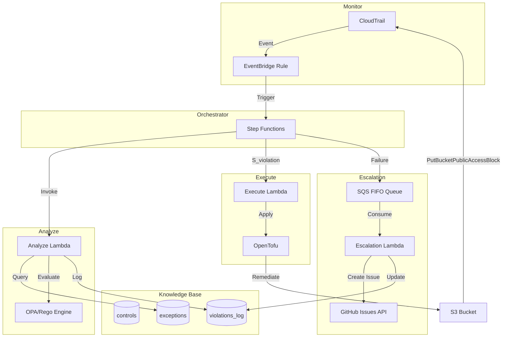
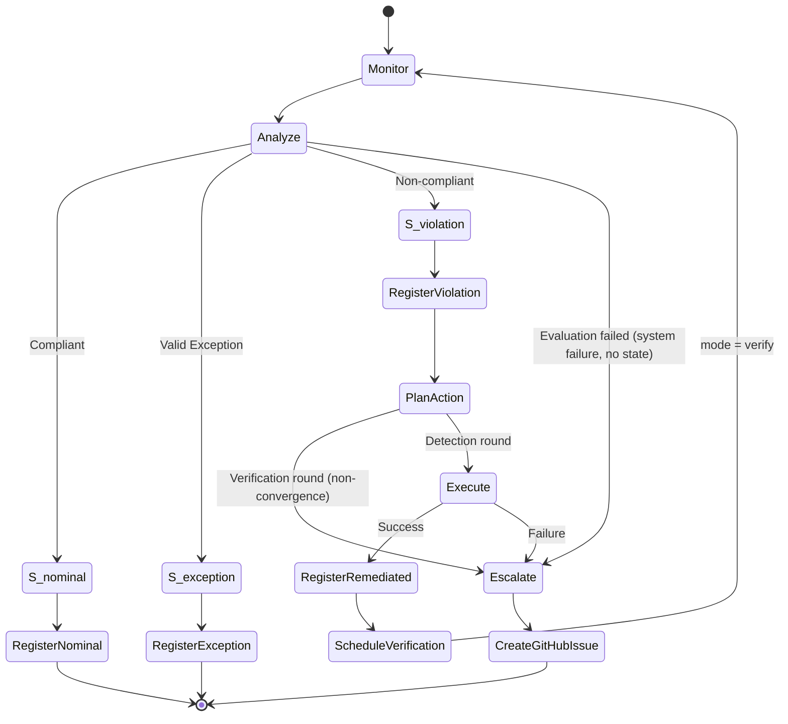
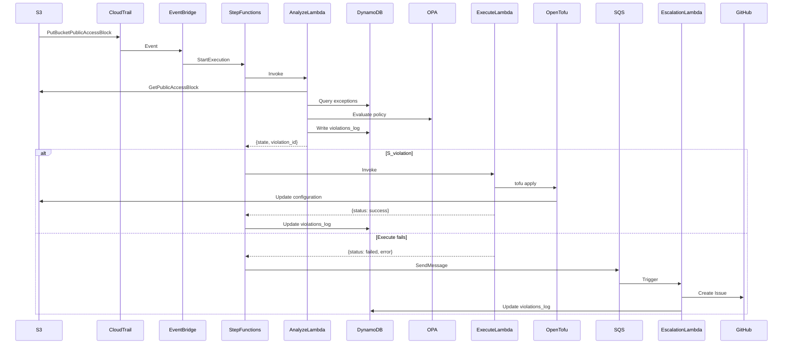
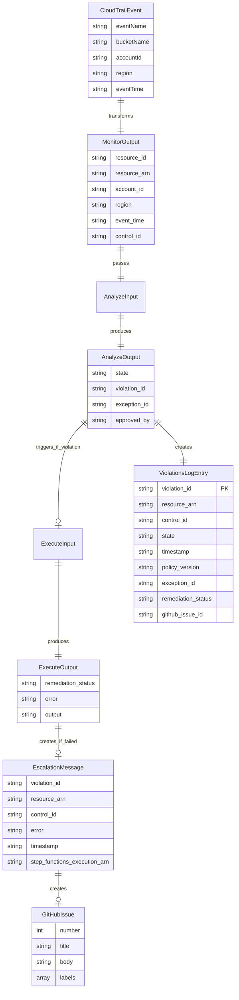
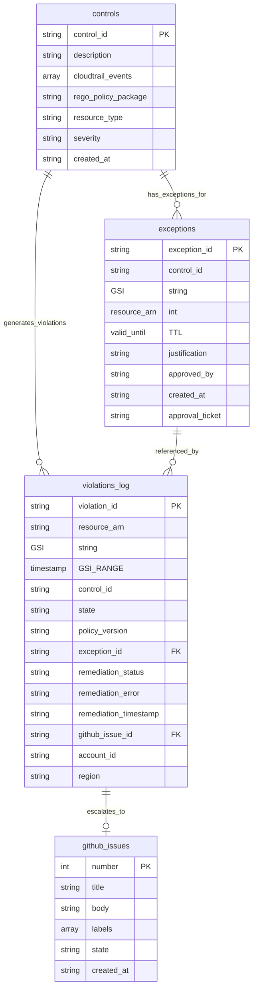
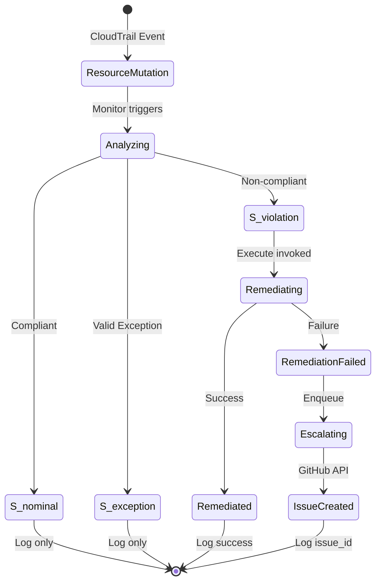

# Design Document: MVP Compliance Automation Loop

## Overview

O MVP Compliance Automation Loop implementa um sistema de automação de conformidade baseado no padrão arquitetural MAPE-K (Monitor, Analyze, Plan, Execute, Knowledge). O sistema detecta desvios de conformidade em recursos AWS, classifica o estado do recurso, executa remediação automática quando apropriado, e escala violações não resolvidas para operadores humanos.

O sistema suporta múltiplos controles de compliance de forma extensível e multi-serviço. Cinco controles estão implementados: bloqueio de acesso público S3 (`ctrl-s3-public-block`), política SSL-only (`ctrl-s3-ssl-only`), versionamento S3 (`ctrl-s3-versioning`), encryption S3 (`ctrl-s3-encryption`), e EBS encryption by default (`ctrl-ebs-encryption-default`). Novos controles podem ser adicionados sem rebuild de imagens — políticas Rego e templates HCL de remediação são armazenados no S3 e carregados em runtime. O sistema monitora eventos CloudTrail de múltiplos serviços AWS, resolve dinamicamente quais controles aplicar via tabela DynamoDB, avalia conformidade usando OPA/Rego com fetcher genérico parametrizado por `fetch_config`, e remedia violações usando OpenTofu.

### Design Goals

- **Automação determinística**: Cada evento deve seguir fluxo previsível baseado em classificação de estado
- **Auditabilidade completa**: Todas as avaliações e ações devem ser registradas permanentemente
- **Idempotência**: Remediação deve ser segura para execução repetida
- **Separação de responsabilidades**: Políticas versionadas em Git, estado em DynamoDB, execução em Lambda
- **Escalação confiável**: Falhas devem ser notificadas sem perda de informação

### MAPE-K Architecture Mapping

- **Monitor**: CloudTrail + EventBridge Rule (event pattern gerenciado dinamicamente pela Lambda `controls-sync` via DynamoDB Stream na tabela `controls`)
- **Analyze**: Lambda Python (arm64) + OPA/Rego (binário arm64 via Lambda Layer, políticas carregadas do S3 em runtime) + fetcher genérico via `fetch_config` (chamadas boto3 parametrizadas pela tabela `controls`) + consulta DynamoDB exceptions + ABAC nas permissões de leitura
- **Plan**: Implícito no Step Functions — QueryControls resolve dinamicamente quais controles aplicar baseado no `eventName` do CloudTrail via campo `cloudtrail_events` na tabela `controls`
- **Execute**: Lambda Python (arm64) + OpenTofu (binário via Lambda Layer) com state efêmero local. Templates HCL carregados do S3 em runtime. Provider AWS pré-inicializado armazenado no S3 como cache, baixado e extraído em `/tmp` no cold start, compartilhado via symlink (elimina `tofu init` em runtime)
- **Knowledge**: DynamoDB (controls, exceptions, violations_log)

### State Classification Model

O sistema classifica recursos em três estados formais:

- **S_nominal**: Recurso conforme com política vigente
- **S_exception**: Recurso não conforme mas com exceção aprovada e vigente
- **S_violation**: Recurso não conforme sem exceção válida (requer remediação)

Não há quarto estado. Um controle que não pôde ser avaliado — leitura da configuração falhou, OPA falhou, a consulta de exceções falhou, o orçamento de tempo acabou — tem estado **desconhecido**: é uma falha do sistema, não uma propriedade do recurso, e fica fora do modelo formal. O Analyze devolve esse controle sem `state`, e o orquestrador o escala como `system_failure`, sem registrá-lo no `violations_log` como se fosse um estado. Tampouco é uma `S_violation`: com a consulta de exceções falhando, o recurso pode estar autorizado, e com a leitura falhando pode estar conforme — remediar seria agir sem observação.

A rodada (detecção ou verificação) também não é estado: não muda a classificação do recurso, só a ação que o loop toma diante dela (ver *Orchestrator*). O mesmo vale para o disjuntor de reincidência e para os controles detectivos: uma violação reincidente e uma violação sem remediação automática continuam sendo `S_violation` — o que muda é o que o Plan decide fazer.


## Architecture

### High-Level Architecture Diagram



### Workflow State Machine Diagram



### Component Interaction Flow




## Components and Interfaces

### 1. Monitor (CloudTrail + EventBridge)

**Responsibility**: Detectar eventos de mutação em recursos AWS e extrair metadados relevantes.

**Implementation**:
- CloudTrail trail configurado para capturar eventos de gerenciamento
- EventBridge Rule com pattern filter dinâmico (gerenciado por `controls-sync`)
- Input transformer genérico: extrai `request_parameters` do CloudTrail, `ResolveResource` na Step Function deriva `resource_id` e `resource_arn`
- Target: Step Functions state machine

**Event Pattern** (gerenciado dinamicamente):
```json
{
  "detail-type": ["AWS API Call via CloudTrail"],
  "detail": {
    "eventName": ["CreateBucket", "PutBucketPublicAccessBlock", "PutBucketVersioning", "DisableEbsEncryptionByDefault", "..."]
  }
}
```

Nota: o filtro `source` foi removido para suportar eventos de múltiplos serviços (S3, EC2, etc.) em uma única rule. O `eventName` é suficientemente específico para evitar falsos positivos.

O padrão gerado pelo `controls-sync` inclui ainda uma cláusula de identidade: eventos cuja sessão foi emitida pelo role da Lambda Execute são descartados, para que as escritas da própria remediação não reiniciem o loop. A cláusula usa `$or` com `exists: false`, porque identidades sem emissor de sessão (usuários IAM, root) não casariam com um `anything-but` simples — ver *Fechamento do laço em duas rodadas*.

**Output Schema**:
```json
{
  "resource_id": "bucket-name",
  "resource_arn": "arn:aws:s3:::bucket-name",
  "account_id": "123456789012",
  "region": "us-east-1",
  "event_time": "2024-01-15T10:30:00Z",
  "control_id": "ctrl-s3-public-block"
}
```

**Error Handling**:
- Missing fields: Log error to CloudWatch, discard event
- Malformed JSON: EventBridge DLQ captures failed invocations


### 2. Orchestrator (Step Functions Standard)

**Responsibility**: Coordenar transições entre componentes do loop MAPE-K baseado em classificação de estado.

**Implementation**:
- Step Functions **Standard** (não Express) — ver *Por que Standard e não Express*
- Choice states para decisão baseada em `$.state`
- SDK integrations diretas para DynamoDB (sem Lambda intermediária)
- Timeout global de 600 segundos (ver a cadeia de timeouts em *Correctness Properties*)
- Estados terminais explícitos: `ExecutionSucceeded` (Succeed) e `ExecutionFailed` (Fail com `Error: ComplianceEscalation`)
- **Laço fechado em duas rodadas**: uma rodada de detecção que remediou algo agenda exatamente uma rodada de verificação (`mode = verify`), que confirma `S_nominal` ou escala — nunca remedeia de novo. Ver *Fechamento do laço em duas rodadas*
- Após o Map state, `EvaluateOutcome` verifica se algum controle foi escalado — se sim, a execução termina como FAILED

#### Por que Standard e não Express

A escolha não é por custo — nesse quesito o Express ganharia —, e sim por três propriedades de que o projeto depende. Nenhum recurso de orquestração exclusivo do Standard é usado (`.sync`, callback com token, `Wait` longo), então são essas três que justificam o tipo.

| Propriedade | Standard | Express | Onde o projeto depende dela |
|---|---|---|---|
| **Histórico consultável por API** | `DescribeExecution`, `GetExecutionHistory` e `ListExecutions`, por 90 dias | Não disponíveis; o histórico existe apenas nos CloudWatch Logs | Toda a medição — `integration_test.py`, `benchmark.py`, `classify_cold_starts.py`, `verification_consistency.py` — lê o histórico por API. Na auditoria (H2), a issue aponta o ARN da execução, que o Standard mantém consultável |
| **Semântica de execução** | Exatamente uma vez por disparo | Pelo menos uma vez quando iniciada de forma assíncrona (EventBridge, `startExecution`) | Uma violação deve gerar uma remediação, uma linha de `S_violation` e, se falhar, uma issue. Uma execução duplicada teria outro `violation_id` — gerado pelo Analyze a cada avaliação —, então nem a deduplicação da fila FIFO nem a de issues a pegariam: duas linhas e duas escalações para o mesmo incidente |
| **Duração máxima** | 1 ano | 5 minutos | O `TimeoutSeconds` global é 600 s porque o pior caso serial é 550 s (ver *Property 28*). O caso típico caberia com folga — a execução mais longa de uma rodada da suíte levou 19,4 s —, mas o limite existiria só no caso típico |

As três propriedades vêm da documentação do Step Functions; a primeira e a segunda são exercitadas por construção em cada execução da suíte, e a terceira pelo orçamento de timeouts.

**Custo, medido numa rodada real do benchmark** (`results/three-state/`, rodada 05, 43 execuções):

| | Transições por execução | Standard (US$ 0,025 por 1.000 transições) | Express (US$ 1 por milhão de requisições + GB-s; estimativa) |
|---|---|---|---|
| Rodada de detecção | 19,8 em média (máx. 30) | ~US$ 0,00050 | ~US$ 0,000006 |
| Rodada de verificação | 10,4 em média | ~US$ 0,00026 | ~US$ 0,000002 |
| Rodada inteira da suíte | 673 transições, 225 s somados | **~US$ 0,017** | **~US$ 0,0002** |

O Express seria ~100× mais barato. Em valor absoluto é irrelevante para a avaliação: as 4.000 transições mensais gratuitas cobrem ~6 rodadas da suíte. Em produção, a 100 mil incidentes por mês (~30 transições cada), o Standard custaria ~US$ 75/mês contra menos de US$ 1 do Express. A diferença encolhe por um motivo: o log da máquina já está em `level: ALL` com `includeExecutionData`, e o Express dependeria dele para ter qualquer histórico — o custo de ingestão no CloudWatch Logs passaria a pesar mais que as transições.

**Quando o Express seria a escolha**: alto volume de eventos curtos, com deduplicação própria (por exemplo, `violation_id` derivado do evento em vez de gerado por avaliação), auditoria reconstruída a partir dos logs e o pior caso de duração abaixo de 5 minutos. Nenhuma das três condições vale neste escopo.

**State Machine Definition** (estrutura real):

A máquina de estados usa JSONata e processa múltiplos controles via Map state. Fluxo:

```
ResolveResource          # extrai resource_id/resource_arn dos request_parameters do CloudTrail;
                         # normaliza mode (detect|verify) e a origem da rodada de verificação
  → RouteControlLookup   # Choice, em ordem:
       ├─ mode = verify e há controles → InvokeAnalyze   # lê imediatamente: consistência medida
       │                          # usa as definições dos controles remediados que a rodada
       │                          # de detecção carregou; não há consulta a fazer
       ├─ mode = verify sem controles → UnverifiableRemediationEscalation → ExecutionFailed
       │                          # uma verificação sem controles reavaliaria nada e passaria
       ├─ input tem control_id (re-avaliação de exceção) → GetControlById
       │          → CheckRequestedControlFound
       │               ├─ achou → InvokeAnalyze
       │               └─ não   → RequestedControlNotFound (SQS) → ExecutionFailed
       │                          # controle referenciado por exceção foi renomeado/removido:
       │                          # erro de governança, NUNCA sucesso silencioso
       │          (lookup falhou → ControlLookupFailedEscalation → ExecutionFailed)
       └─ não → QueryControls             # scan na tabela controls por cloudtrail_events
                  (falhou → ControlLookupFailedEscalation → ExecutionFailed)
                  → CheckControlsFound    # Choice: há controles? senão → ExecutionSucceeded
  → InvokeAnalyze        # Lambda; recebe controls completos, retorna results[] (um por controle)
       (Catch States.ALL → AnalyzeFailedEscalation → ExecutionFailed)
  → ProcessResults       # Map sobre results[], MaxConcurrency=1
       └─ ClassifyState  # Choice pelos três estados formais — e só por eles; a rodada não entra aqui
            ├─ S_nominal   → RegisterNominal   (putItem) → outcome=nominal | verified
            │                          # em mode=verify grava também round, origin_execution e
            │                          # verifies_violation_id: é a confirmação da convergência
            ├─ S_exception → RegisterException (putItem) → outcome=exception
            ├─ S_violation → RegisterViolation (putItem; em verify + remediation_status=not_converged)
            │     → CountRecentRemediations  # query no GSI: remediações com sucesso deste
            │     │                          # (recurso, controle) na janela do disjuntor
            │     → PlanAction   # Choice: o que fazer com a violação
            │          ├─ mode = verify        → Escalate (non_convergence) → outcome=escalated
            │          │                          # primeira regra de propósito: numa rodada de
            │          │                          # verificação uma violação nunca alcança InvokeExecute
            │          ├─ reincidências ≥ N    → Escalate (recurrent_violation)
            │          │                          # disjuntor: alguém desfaz a remediação; remediar
            │          │                          # de novo só manteria a gangorra
            │          ├─ controle detectivo   → Escalate (manual_remediation_required)
            │          │                          # remediation = manual: a correção é disruptiva
            │          └─ senão → InvokeExecute
            │                → CheckRemediationStatus
            │                     ├─ success → UpdateLogSuccess (updateItem) → outcome=remediated
            │                     └─ default → UpdateLogFailed  (updateItem) → Escalate (remediation_failed)
            │                                  # qualquer coisa que não seja success explícito
            │                (Catch States.ALL → UpdateLogFailed → Escalate)
            └─ default (sem estado) → Escalate (system_failure) → outcome=escalated
                                       # falha do sistema, fora do modelo: sem registro de estado
  → ScheduleVerificationIfNeeded   # Choice, em ordem:
       ├─ detecção, remediou, e os controles a verificar cobrem todos os remediados
       │     → ScheduleVerification  # states:startExecution na própria máquina (mode=verify)
       │          (Catch → UnverifiableRemediationEscalation → ExecutionFailed)
       ├─ detecção, remediou, mas faltam controles → UnverifiableRemediationEscalation
       │                          # uma verificação parcial passaria sem checar os que faltam
       └─ default → EvaluateOutcome
  → EvaluateOutcome      # Choice: algum outcome=escalated? → ExecutionFailed; senão → ExecutionSucceeded
```

#### Fechamento do laço em duas rodadas

Até esta versão, o laço se fechava por **eco**: cada escrita do Execute (`PutBucketPolicy`, `PutBucketVersioning`…) gerava o próprio evento no CloudTrail, e cada evento abria uma execução nova só para confirmar. O histórico de 6 buckets do C5 mostrou o custo: 2 eventos do teste produziam 4 remediações e 4 execuções de confirmação — 6 execuções por bucket, uma confirmação por controle remediado, sem ligação explícita com a violação confirmada. E, sem disjuntor, uma política mais estrita que a sua remediação oscilaria indefinidamente (L11).

O laço agora é explícito:

1. **O eco é filtrado na origem.** A regra do EventBridge descarta eventos cuja identidade é o role da Lambda Execute. Toda escrita de remediação chega ao CloudTrail como `AssumedRole` desse role — verificado no CloudTrail da conta — enquanto mudanças humanas chegam como `IAMUser`, **sem** `sessionContext.sessionIssuer`.
2. **A rodada de detecção agenda uma única verificação.** Se remediou algo, ela inicia a própria máquina em `mode = verify`, levando as definições dos controles remediados e o mapa controle → `violation_id`.
3. **A rodada de verificação não remedeia.** Reavalia imediatamente exatamente os controles remediados e registra `S_nominal` ligado à violação que confirma, ou registra a não convergência e escala.

Um incidente custa, portanto, **no máximo duas execuções**, e oscilar é estruturalmente impossível. Essas propriedades são verificadas estaticamente sobre o grafo em `tests/unit/test_state_machine.py`: a classificação tem exatamente os três estados formais e nenhuma regra por rodada; toda saída de `RegisterViolation` passa pelo `PlanAction`, cuja primeira regra manda a rodada de verificação para a escalação, de modo que ela não alcança `InvokeExecute`; e só uma rodada de detecção agenda verificação.

**A armadilha do filtro.** Um `anything-but` simples sobre o emissor da sessão descartaria justamente os eventos humanos, porque num campo ausente ele não casa. Medido com `aws events test-event-pattern`:

| padrão | IAMUser | role do Execute | outro role |
|---|---|---|---|
| só `anything-but` | **False** | False | True |
| `$or` com `exists: false` | True | False | True |

O primeiro padrão faria o sistema parar de detectar toda violação feita pelo console — o cenário C1 — sem nenhum erro. O `controls-sync` gera o segundo, e `tests/contract/test_event_pattern.py` avalia o padrão gerado no próprio EventBridge para as quatro identidades.

**Consistência de leitura: medida, não presumida.** A configuração de bucket do S3 é eventualmente consistente, e o eco escondia a questão — o evento chegava segundos depois da escrita. A primeira versão do laço explícito compensava com uma espera fixa de 15 s antes de reavaliar, um valor escolhido e não medido. A espera foi removida depois de medir o que acontece sem ela, com `scripts/verification_consistency.py`, que liga cada rodada de verificação ao fim da última remediação da execução de origem:

| | espera de 15 s | leitura imediata | três estados | sessão escopada | final |
|---|---|---|---|---|---|
| rodadas de verificação | 160 | 161 | 190 | 270 | 270 |
| leituras de controle `verified` | 280/280 | **283/283** | **320/320** | **430/430** | **430/430** |
| intervalo escrita → leitura | 15,41 s | **0,37 s** | **0,37 s** | **0,36 s** | **0,35 s** (0,23–0,66) |

Nenhuma leitura desatualizada nas **1.463 leituras imediatas das quatro séries sem espera**, feitas ~0,4 s depois da escrita: pela regra de três, a taxa de leitura desatualizada é inferior a ~0,2% por leitura, com 95% de confiança. A afirmação tem dois limites. Vale para os controles que foram de fato remediados e verificados — os três S3 (public-block, ssl-only, versioning) e, com 10 leituras, o de EBS; o `ctrl-s3-encryption` nunca precisou de remediação. E, se uma leitura desatualizada ocorrer, o erro cai do lado seguro — uma escalação de não convergência indevida, nunca um `S_nominal` falso. Para um controle futuro com propagação mais lenta, a mitigação é reavaliar com novas tentativas limitadas antes de escalar, não voltar a uma espera fixa para todos (ver L13).

#### Disjuntor de reincidência

As duas rodadas limitam **um incidente**; não limitam uma sequência deles. Um processo externo que reaplique a configuração violadora — um pipeline de outro time com tfstate próprio, um script agendado — produz uma gangorra: detecção, remediação, verificação `S_nominal`, reversão, tudo de novo. Cada incidente converge, o MTTR fica ótimo, nada escala, e o conflito de dono nunca chega a uma pessoa.

Antes de remediar, o `CountRecentRemediations` consulta o GSI `resource_arn-timestamp-index` e conta as remediações **bem-sucedidas deste mesmo par (recurso, controle)** na janela configurada. Passando do limiar, o `PlanAction` escala com `reason = recurrent_violation` em vez de remediar: o recurso fica como está e a decisão volta para quem pode resolver o conflito — corrigir a origem ou registrar uma exceção.

É o ponto em que o **Knowledge realimenta o Plan**: o histórico deixa de ser só registro de auditoria e passa a mudar a decisão. Até aqui, o `violations_log` era escrito e nunca lido para decidir.

Dois cuidados no desenho:

- **Falha aberta**: se a consulta falhar, a contagem vai a zero e o fluxo remedeia como antes. Um erro transitório do DynamoDB não deve transformar uma violação remediável numa violação parada.
- **Limiar e janela são parâmetros** (`recurrence_threshold`, `recurrence_window_minutes`, por padrão 3 e 10 minutos). A corrida `CreateBucket` + violação (L6) já produz duas remediações legítimas do mesmo par em segundos, então o limiar precisa ficar acima disso. A calibração é operacional, não medida (L16).

#### Controles detectivos

Nem toda violação tem remediação automática aceitável. Um volume EBS sem criptografia não pode ser corrigido no lugar: a correção é snapshot → cópia criptografada → volume novo → troca na instância, com parada e ID novo. Aplicar isso sozinho seria pior que a violação.

Um controle marca isso no próprio cadastro, com `"remediation": {"S": "manual"}` e sem `remediation.tf`. O Analyze repassa o campo, e o `PlanAction` roteia para `Escalate` com `reason = manual_remediation_required`. A classificação não muda: o recurso está em `S_violation` como qualquer outro, e a linha de auditoria é a mesma — o que muda é a ação planejada, que é avisar uma pessoa.

O `scripts/deploy_control.sh` recusa um controle sem `remediation.tf` que não se declare manual, e um teste de contrato exige a mesma coisa: um controle que simplesmente esqueceu a remediação não vira detectivo por acidente.

**O que continua possível**: duas mudanças *externas* simultâneas sobre o mesmo controle (a corrida `CreateBucket` + violação do C1/C5) ainda produzem duas rodadas de detecção e duas de verificação — limitado, mas não deduplicado (ver L6).

Estados terminais explícitos:
- `ExecutionSucceeded` (`Succeed`)
- `ExecutionFailed` (`Fail`, `Error: ComplianceEscalation`) — execuções que escalam terminam como FAILED no console

Persistência no `violations_log`: o **Step Functions é o único componente que grava** (o Analyze é função pura, sem side-effects). `RegisterNominal/Exception/Violation` fazem `putItem` com todos os campos obrigatórios; `UpdateLogSuccess/Failed` fazem `updateItem` (não sobrescrevem o registro, apenas adicionam `remediation_status`/`remediation_output`/`remediation_error`).

**Invariante de completude (H2)**: toda avaliação que produz um estado gera um registro completo no `violations_log` ANTES de qualquer ação ou escalação. Uma falha de sistema não produz estado e, portanto, não gera linha: o seu rastro é o histórico da execução e a issue, cuja mensagem carrega `reason = system_failure`, o erro e o ARN da execução. A Escalation Lambda usa `ConditionExpression attribute_exists(violation_id)`: nunca cria registros, apenas anota os existentes — para uma falha de sistema, a issue é aberta e fica sem vínculo no log, em vez de criar um item fantasma (só com os campos da issue, invisível ao GSI de auditoria), que era o defeito original.


### 3. Analyze Lambda

**Responsibility**: Classificar estado de conformidade do recurso usando OPA/Rego e consulta de exceções.

**Implementation**:
- Runtime: Python 3.13
- Architecture: arm64
- OPA binary via Lambda Layer (`/opt/bin/opa`), políticas Rego carregadas do S3 em runtime
- Deployment package: handler.py (~2.5KB)
- Lambda Layer: `opa-binary` (~20MB comprimido, binário OPA arm64 estático)
- Timeout: 15 segundos
- Memory: 512 MB

**Algorithm**:
```python
def analyze(event):
    # 1. Extract resource metadata
    resource_arn = event['resource_arn']
    control_id = event['control_id']
    
    # 2. Retrieve current resource configuration
    s3_client = boto3.client('s3')
    bucket_name = extract_bucket_name(resource_arn)
    config = s3_client.get_public_access_block(Bucket=bucket_name)
    
    # 3. Evaluate with OPA
    opa_input = {
        "resource": config['PublicAccessBlockConfiguration'],
        "control_id": control_id
    }
    policy_result = opa.evaluate("data.s3_public_access.allow", opa_input)
    
    # 4. Check for valid exception
    exception = query_exception(control_id, resource_arn)
    
    # 5. Classify state
    if policy_result.allow:
        state = "S_nominal"
    elif exception and exception['valid_until'] > now():
        state = "S_exception"
    else:
        state = "S_violation"
    
    # 6. Log to violations_log
    violation_id = str(uuid.uuid4())
    log_violation(violation_id, resource_arn, control_id, state, exception)
    
    return {
        "state": state,
        "violation_id": violation_id,
        "exception_id": exception['exception_id'] if exception else None
    }
```

**DynamoDB Query for Exceptions**:
```python
def query_exception(control_id, resource_arn):
    response = dynamodb.query(
        TableName='exceptions',
        IndexName='resource-control-index',
        KeyConditionExpression='resource_arn = :arn AND control_id = :cid',
        FilterExpression='valid_until > :now',
        ExpressionAttributeValues={
            ':arn': resource_arn,
            ':cid': control_id,
            ':now': int(time.time())
        }
    )
    return response['Items'][0] if response['Items'] else None
```

**Rego Policy** (`s3_public_access.rego`):
```rego
package s3_public_access

default allow := false

allow if {
    input.resource.BlockPublicAcls == true
    input.resource.IgnorePublicAcls == true
    input.resource.BlockPublicPolicy == true
    input.resource.RestrictPublicBuckets == true
}
```

**Output Schema**:
```json
{
  "state": "S_violation",
  "violation_id": "550e8400-e29b-41d4-a716-446655440000",
  "exception_id": null,
  "approved_by": null
}
```

**Error Handling**:
- S3 GetPublicAccessBlock fails: Return error to Step Functions, trigger escalation
- OPA evaluation error: Log to CloudWatch, return S_violation (fail-secure)
- DynamoDB query timeout: Proceed without exception (fail-secure)


### 4. Execute Lambda

**Responsibility**: Remediar recursos em violação usando OpenTofu com infraestrutura como código declarativa.

**Implementation**:
- Runtime: Python 3.13
- Architecture: arm64
- OpenTofu binary via Lambda Layer (`/opt/bin/tofu`)
- Provider AWS pré-inicializado armazenado no S3 como `tf-dot-terraform.tar.gz` (~128MB), baixado e extraído em `/tmp` no cold start
- Deployment package: handler.py (~1.3KB)
- Lambda Layer: `tofu-binary` (~29MB comprimido, binário OpenTofu arm64)
- Templates HCL carregados do S3 em runtime
- Timeout: 90 segundos
- Memory: 2048 MB
- Ephemeral storage: 1024 MB (para provider cache + tfstate)

**Provider Cache Strategy**:

O provider AWS extraído (~628MB) não cabe numa Lambda Layer (limite 250MB descomprimido). A solução usa S3 como cache:

1. **Build time**: um Dockerfile auxiliar executa `tofu init` uma vez, gerando o `.terraform/` (provider extraído) e o `.terraform.lock.hcl`. Esses artefatos são empacotados como `tf-dot-terraform.tar.gz` (~128MB) e armazenados no S3.
2. **Cold start**: o handler baixa o tar.gz do S3 (~2-3s) e extrai para `/tmp` (~3-5s) usando `tarfile` do Python.
3. **Warm start**: `/tmp` persiste entre invocações — o provider já está disponível, custo zero.
4. **Setup por controle**: o handler cria um symlink (`ln -s /tmp/tf-dot-terraform .terraform`) e copia o lock file (1KB) para o diretório de trabalho de cada controle.

Essa abordagem elimina tanto o `tofu init` em runtime quanto a necessidade de container image (ECR).

**Lambda Handler**:
```python
import subprocess
import json
import os
import shutil
import tarfile
import boto3

s3 = boto3.client('s3')
REMEDIATION_BUCKET = os.environ['REMEDIATION_BUCKET']
PROVIDER_CACHE_KEY = os.environ.get('PROVIDER_CACHE_KEY', 'provider-cache/tf-dot-terraform.tar.gz')
TF_CACHE = '/tmp/tf-dot-terraform'
TF_LOCK = '/tmp/tf-lock.hcl'


def ensure_provider_cache():
    """Download and extract pre-initialized .terraform from S3 on cold start."""
    if os.path.exists(TF_CACHE):
        return
    archive = '/tmp/tf-cache.tar.gz'
    s3.download_file(REMEDIATION_BUCKET, PROVIDER_CACHE_KEY, archive)
    with tarfile.open(archive, 'r:gz') as tar:
        tar.extractall(path='/tmp/')
    os.remove(archive)


def setup_remediation(control_id, s3_key):
    """Prepara um diretório de trabalho LIMPO a cada invocação.

    O work_dir (e o tfstate dentro dele) é recriado a cada execução. Isso é
    crítico para corretude: combinado com -refresh=false, um tfstate obsoleto
    de uma invocação warm anterior faria o OpenTofu reportar 'No changes' para
    um recurso re-violado, pulando a remediação silenciosamente.
    """
    work_dir = f'/tmp/{control_id}'
    shutil.rmtree(work_dir, ignore_errors=True)
    os.makedirs(work_dir, exist_ok=True)
    s3.download_file(REMEDIATION_BUCKET, s3_key, f'{work_dir}/remediation.tf')
    os.symlink(TF_CACHE, f'{work_dir}/.terraform')
    shutil.copy(TF_LOCK, f'{work_dir}/.terraform.lock.hcl')
    return work_dir


def lambda_handler(event, context):
    resource_arn = event['resource_arn']
    region = event['region']
    control_id = event['control_id']
    s3_key = event['remediation_s3_key']
    resource_id = event.get('resource_id', '')
    # ARN parsing genérico: S3 usa arn:aws:s3:::name; outros serviços usam resource_id
    bucket_name = resource_arn.split(':::')[1] if ':::' in resource_arn else resource_id

    ensure_provider_cache()
    work_dir = setup_remediation(control_id, s3_key)
    state_path = f'/tmp/{control_id}/{bucket_name}.tfstate'  # work_dir limpo → state sempre fresh

    tfvars = {"bucket_name": bucket_name, "region": region, "resource_id": resource_id}
    # Edge case: ssl-only precisa da policy existente para merge
    if control_id == 'ctrl-s3-ssl-only':
        try:
            resp = s3.get_bucket_policy(Bucket=bucket_name)
            tfvars['existing_policy'] = resp['Policy']
        except Exception:
            pass

    with open(f'{work_dir}/terraform.tfvars.json', 'w') as f:
        json.dump(tfvars, f)

    result = subprocess.run(
        ['/opt/bin/tofu', 'apply', '-refresh=false', '-auto-approve', '-no-color',
         f'-var-file={work_dir}/terraform.tfvars.json', f'-state={state_path}'],
        cwd=work_dir, capture_output=True, text=True, timeout=65
    )

    if result.returncode == 0:
        return {"remediation_status": "success", "output": result.stdout}
    return {"remediation_status": "failed", "error": result.stderr}
```

**Design Rationale**:
- `-refresh=false`: Analyze já verificou estado atual, evita latência adicional
- **tfstate efêmero por invocação**: o `work_dir` é recriado a cada execução (`shutil.rmtree`). Isso garante que `-refresh=false` nunca compare contra um state obsoleto de warm start — sem isso, um recurso re-violado seria reportado como "No changes" e não remediado
- Lambda Layer + S3 provider cache: Elimina ECR e pipeline de container. Cold start ~11s (vs. ~33s com container). Warm start ~5-7s (provider já em `/tmp`)
- ARN parsing genérico: S3 deriva `bucket_name` do ARN, outros serviços usam `resource_id` (suporte multi-serviço)
- Symlink para provider: Todos os controles compartilham o mesmo provider sem duplicação em disco

**Output Schema**:
```json
{
  "remediation_status": "success",
  "output": "aws_s3_bucket_public_access_block.remediation: Creation complete"
}
```

**Error Handling**:
- OpenTofu apply timeout: Return failure status with partial output
- IAM permission denied: Return failure, escalate to GitHub Issue
- Bucket not found: Return failure (bucket pode ter sido deletado)


### 5. Knowledge Base (DynamoDB)

**Responsibility**: Armazenar políticas, exceções aprovadas, e log de violações.

#### Table: controls

**Purpose**: Metadados de controles de conformidade.

**Schema**:
```json
{
  "TableName": "controls",
  "KeySchema": [
    {"AttributeName": "control_id", "KeyType": "HASH"}
  ],
  "AttributeDefinitions": [
    {"AttributeName": "control_id", "AttributeType": "S"}
  ],
  "BillingMode": "PAY_PER_REQUEST"
}
```

**Sample Item**:
```json
{
  "control_id": "ctrl-s3-public-block",
  "description": "Enforce S3 bucket public access block settings",
  "cloudtrail_events": ["PutBucketPublicAccessBlock", "DeleteBucketPublicAccessBlock", "CreateBucket"],
  "rego_policy_package": "s3_public_access",
  "rego_s3_key": "controls/ctrl-s3-public-block/policy.rego",
  "remediation_s3_key": "controls/ctrl-s3-public-block/remediation.tf",
  "resource_type": "AWS::S3::Bucket",
  "severity": "HIGH",
  "policy_version": "v1.0",
  "fetch_config": {
    "service": "s3",
    "method": "get_public_access_block",
    "params": {"Bucket": "{resource_id}"},
    "result_path": "PublicAccessBlockConfiguration",
    "error_defaults": {
      "NoSuchPublicAccessBlockConfiguration": {
        "BlockPublicAcls": false, "IgnorePublicAcls": false,
        "BlockPublicPolicy": false, "RestrictPublicBuckets": false
      }
    }
  }
}
```

**Access Pattern**:
- Query by control_id (primary key)
- Used by Analyze to retrieve policy metadata


#### Table: exceptions

**Purpose**: Armazenar exceções aprovadas com TTL nativo.

**Schema**:
```json
{
  "TableName": "exceptions",
  "KeySchema": [
    {"AttributeName": "exception_id", "KeyType": "HASH"}
  ],
  "AttributeDefinitions": [
    {"AttributeName": "exception_id", "AttributeType": "S"},
    {"AttributeName": "resource_arn", "AttributeType": "S"},
    {"AttributeName": "control_id", "AttributeType": "S"}
  ],
  "GlobalSecondaryIndexes": [
    {
      "IndexName": "resource-control-index",
      "KeySchema": [
        {"AttributeName": "resource_arn", "KeyType": "HASH"},
        {"AttributeName": "control_id", "KeyType": "RANGE"}
      ],
      "Projection": {
        "ProjectionType": "INCLUDE",
        "NonKeyAttributes": ["valid_until", "exception_id", "approved_by"]
      }
    }
  ],
  "TimeToLiveSpecification": {
    "AttributeName": "valid_until",
    "Enabled": true
  },
  "BillingMode": "PAY_PER_REQUEST"
}
```

**Sample Item**:
```json
{
  "exception_id": "exc-a1b2c3d4-e5f6-7890-abcd-ef1234567890",
  "control_id": "ctrl-s3-public-block",
  "resource_arn": "arn:aws:s3:::public-website-bucket",
  "valid_until": 1735689600,
  "justification": "Public website hosting approved by security team",
  "approved_by": "security-lead@example.com",
  "created_at": "2024-01-15T10:00:00Z",
  "approval_ticket": "JIRA-12345"
}
```

**Access Pattern**:
- Query by control_id via GSI
- Filter by resource_arn and valid_until > now()
- TTL deletes expired items within 48h (behavior does NOT depend on physical deletion)

**Design Rationale**:
- TTL on valid_until: Automatic cleanup, but Analyze filters explicitly
- GSI on control_id: Efficient query for all exceptions of a control
- UUID partition key: Uniform distribution, no hot partitions

**Re-avaliação Automática após Expiração de Exceção**:

O DynamoDB Streams está habilitado na tabela exceptions com `NEW_AND_OLD_IMAGES`. Uma Lambda (`exception-scheduler-sync`) processa eventos `INSERT` e `MODIFY` do Stream. Para cada exceção ativa com `valid_until` no futuro, a Lambda cria um EventBridge Scheduler one-time programado para `valid_until + 30s`. Quando o Scheduler dispara, a exceção já expirou logicamente, e o Step Functions é acionado para re-avaliação completa (Analyze → Execute se necessário). O Scheduler se auto-deleta após o disparo (`ActionAfterCompletion=DELETE`).

O input enviado ao Step Functions carrega o `control_id` da exceção (não um `event_name` sintético). O estado `RouteControlLookup` detecta a presença de `control_id` e resolve o controle exato via `GetControlById` (getItem), em vez do scan por `cloudtrail_events`. Isso garante que a re-avaliação atinja precisamente o controle da exceção expirada — inclusive controles não-S3 (ex: `ctrl-ebs-encryption-default`), cujos eventos CloudTrail não se relacionam com nenhum evento S3 — sem disparar controles alheios contra o recurso.

Este mecanismo substituiu a abordagem anterior baseada em EventBridge Pipe + DynamoDB TTL, que dependia da deleção física de itens expirados — operação com latência não determinística de até 48h. O novo mecanismo reduz essa latência em ordens de grandeza, mas **não é preciso ao segundo**: medido em três séries de 10 execuções (C3), o disparo ocorre em média **17,9 s a 29,5 s após o instante agendado**, conforme a série, com extremos de 0,1 s e 48,1 s. O ganho real é de latência **limitada e observável** (dezenas de segundos) contra **ilimitada** (até 48 h) — não de determinismo.

Isso garante que, após expiração de uma exceção, o recurso seja automaticamente re-avaliado pelo loop MAPE-K completo, mantendo o invariante arquitetural de que o Analyze é sempre o componente decisor.

**Limitação conhecida — Latência do TTL**:

A deleção física de itens expirados pelo DynamoDB TTL é **não-determinística** e pode levar até 48 horas após o timestamp `valid_until`. No entanto, a re-avaliação automática **não depende da deleção física**: o EventBridge Scheduler é agendado para `valid_until + 30s` e dispara dentro de algumas dezenas de segundos desse instante (atraso médio entre 17,9 s e 29,5 s em três séries de 10 execuções, até 48,1 s observados), e a Analyze Lambda filtra exceções com `valid_until > now()`, garantindo que exceções logicamente expiradas sejam ignoradas em qualquer avaliação. O TTL permanece habilitado apenas para limpeza eventual dos itens na tabela.


#### Table: violations_log

**Purpose**: Registro permanente de todas as avaliações de conformidade.

**Schema**:
```json
{
  "TableName": "violations_log",
  "KeySchema": [
    {"AttributeName": "violation_id", "KeyType": "HASH"}
  ],
  "AttributeDefinitions": [
    {"AttributeName": "violation_id", "AttributeType": "S"},
    {"AttributeName": "resource_arn", "AttributeType": "S"},
    {"AttributeName": "timestamp", "AttributeType": "S"}
  ],
  "GlobalSecondaryIndexes": [
    {
      "IndexName": "resource_arn-timestamp-index",
      "KeySchema": [
        {"AttributeName": "resource_arn", "KeyType": "HASH"},
        {"AttributeName": "timestamp", "KeyType": "RANGE"}
      ],
      "Projection": {"ProjectionType": "ALL"}
    }
  ],
  "BillingMode": "PAY_PER_REQUEST"
}
```

**Sample Item (S_violation with successful remediation)**:
```json
{
  "violation_id": "vio-550e8400-e29b-41d4-a716-446655440000",
  "resource_arn": "arn:aws:s3:::non-compliant-bucket",
  "control_id": "ctrl-s3-public-block",
  "state": "S_violation",
  "timestamp": "2024-01-15T10:30:15Z",
  "policy_version": "s3_public_access:v1.0",
  "exception_id": null,
  "remediation_status": "success",
  "remediation_timestamp": "2024-01-15T10:30:45Z",
  "github_issue_id": null,
  "account_id": "123456789012",
  "region": "us-east-1"
}
```

**Sample Item (S_exception)**:
```json
{
  "violation_id": "vio-660f9511-f3ac-52e5-b827-557766551111",
  "resource_arn": "arn:aws:s3:::public-website-bucket",
  "control_id": "ctrl-s3-public-block",
  "state": "S_exception",
  "timestamp": "2024-01-15T11:00:00Z",
  "policy_version": "s3_public_access:v1.0",
  "exception_id": "exc-a1b2c3d4-e5f6-7890-abcd-ef1234567890",
  "approved_by": "security-lead@example.com",
  "remediation_status": null,
  "github_issue_id": null,
  "account_id": "123456789012",
  "region": "us-east-1"
}
```

**Sample Item (S_violation with failed remediation)**:
```json
{
  "violation_id": "vio-770g0622-g4bd-63f6-c938-668877662222",
  "resource_arn": "arn:aws:s3:::protected-bucket",
  "control_id": "ctrl-s3-public-block",
  "state": "S_violation",
  "timestamp": "2024-01-15T12:00:00Z",
  "policy_version": "s3_public_access:v1.0",
  "exception_id": null,
  "remediation_status": "failed",
  "remediation_error": "AccessDenied: Insufficient permissions",
  "remediation_timestamp": "2024-01-15T12:00:30Z",
  "github_issue_id": "12345",
  "account_id": "123456789012",
  "region": "us-east-1"
}
```

**Access Pattern**:
- Query by violation_id (primary key) for audit trail
- Query by resource_arn + timestamp via GSI for resource history
- No TTL: Permanent audit log

**Design Rationale**:
- State field represents actual compliance state, not process state
- remediation_status indicates outcome of Execute, not a new state
- github_issue_id links violation to operational resolution workflow


### 6. Escalation (SQS FIFO + Lambda + GitHub Issues)

**Responsibility**: Notificar operadores humanos quando remediação automática falha.

#### SQS FIFO Queue

**Configuration**:
```json
{
  "QueueName": "compliance-escalation.fifo",
  "FifoQueue": true,
  "ContentBasedDeduplication": false,
  "MessageRetentionPeriod": 1209600,
  "VisibilityTimeout": 300,
  "DeduplicationScope": "messageGroup",
  "FifoThroughputLimit": "perMessageGroupId"
}
```

**Message Schema**:
```json
{
  "violation_id": "vio-770g0622-g4bd-63f6-c938-668877662222",
  "resource_arn": "arn:aws:s3:::protected-bucket",
  "control_id": "ctrl-s3-public-block",
  "error": "AccessDenied: Insufficient permissions",
  "timestamp": "2024-01-15T12:00:30Z",
  "step_functions_execution_arn": "arn:aws:states:us-east-1:123456789012:execution:compliance-loop:exec-abc123",
  "account_id": "123456789012",
  "region": "us-east-1"
}
```

**Design Rationale**:
- FIFO: Preserves order of violations for same resource
- MessageDeduplicationId = `resource_arn#control_id`: deduplica escalações do mesmo recurso/controle dentro da janela de 5min do SQS FIFO, evitando spam de issues por re-triggers do CloudTrail. (Não usa `violation_id`, que é um UUID novo a cada avaliação e portanto nunca deduplicaria o caso real.) Complementarmente, a Escalation Lambda verifica se já existe uma issue aberta com o mesmo título antes de criar uma nova
- MessageGroupId = `resource_id#control_id`: processamento paralelo para recursos diferentes, ordenado para o mesmo recurso/controle


#### Escalation Lambda

**Implementation**:
- Runtime: Python 3.13 (arm64)
- Trigger: SQS FIFO queue (batch size: 1)
- Timeout: 30 seconds
- HTTP via `urllib.request` (sem dependência externa `requests`)
- Credenciais GitHub lidas do SSM Parameter Store (`/compliance/github/*`)
- Deduplicação: verifica issue aberta com mesmo título antes de criar

**Algorithm**:
```python
import boto3
import requests
import json
import os

def lambda_handler(event, context):
    for record in event['Records']:
        message = json.loads(record['body'])
        
        # Create GitHub Issue
        issue = create_github_issue(message)
        
        # Update violations_log with github_issue_id
        dynamodb = boto3.resource('dynamodb')
        table = dynamodb.Table('violations_log')
        table.update_item(
            Key={'violation_id': message['violation_id']},
            UpdateExpression='SET github_issue_id = :issue_id',
            ExpressionAttributeValues={':issue_id': str(issue['number'])}
        )
        
    return {'statusCode': 200}

def create_github_issue(message):
    url = f"https://api.github.com/repos/{os.environ['GITHUB_REPO']}/issues"
    headers = {
        'Authorization': f"token {os.environ['GITHUB_TOKEN']}",
        'Accept': 'application/vnd.github.v3+json'
    }
    
    execution_url = f"https://console.aws.amazon.com/states/home?region={message['region']}#/executions/details/{message['step_functions_execution_arn']}"
    
    body = f"""
## Compliance Violation - Remediation Failed

**Resource**: `{message['resource_arn']}`
**Control**: `{message['control_id']}`
**Violation ID**: `{message['violation_id']}`
**Timestamp**: {message['timestamp']}

### Error Details
```
{message['error']}
```

### Step Functions Execution
[View execution details]({execution_url})

### Action Required
Manual remediation required. Review the error details and apply the necessary configuration changes.
"""
    
    payload = {
        'title': f"[Compliance] {message['control_id']} - {message['resource_arn']}",
        'body': body,
        'labels': ['compliance-violation', 'auto-escalation']
    }
    
    response = requests.post(url, headers=headers, json=payload)
    response.raise_for_status()
    return response.json()
```

**GitHub Issue Example**:
```markdown
Title: [Compliance] ctrl-s3-public-block - arn:aws:s3:::protected-bucket

## Compliance Violation - Remediation Failed

**Resource**: `arn:aws:s3:::protected-bucket`
**Control**: `ctrl-s3-public-block`
**Violation ID**: `vio-770g0622-g4bd-63f6-c938-668877662222`
**Timestamp**: 2024-01-15T12:00:30Z

### Error Details
```
AccessDenied: Insufficient permissions
```

### Step Functions Execution
[View execution details](https://console.aws.amazon.com/states/...)

### Action Required
Manual remediation required. Review the error details and apply the necessary configuration changes.

Labels: compliance-violation, auto-escalation
```

**Error Handling**:
- GitHub API failure: Lambda retries via SQS visibility timeout. Requer
  `function_response_types = ["ReportBatchItemFailures"]` no event source
  mapping — sem isso o retorno `batchItemFailures` é ignorado e a mensagem é
  deletada mesmo em falha (escalação perdida silenciosamente, sem DLQ)
- Issue duplicada: antes de criar, busca issue aberta com mesmo título; se
  existir, vincula o `violations_log` à issue existente em vez de criar outra
- DynamoDB update failure: Log error, continue (issue already created)
- Invalid message format: Send to DLQ


## Data Models

### Event Flow Data Model




### DynamoDB Schema Relationships



### State Transition Model




## Correctness Properties

A property is a characteristic or behavior that should hold true across all valid executions of a system—essentially, a formal statement about what the system should do. Properties serve as the bridge between human-readable specifications and machine-verifiable correctness guarantees.

> **Nota**: As Properties 4, 7 e 19 foram especificadas para o controle inicial (`ctrl-s3-public-block`) e usam-no como exemplo concreto. O sistema evoluiu para multi-controle e multi-serviço (S3, EC2) — essas propriedades generalizam para qualquer controle: a avaliação de conformidade é delegada à política Rego do controle, e a remediação ao seu template HCL. A Property 25 foi atualizada para refletir o event pattern dinâmico multi-serviço.

### Property 1: CloudTrail Event Parsing Completeness

For any valid CloudTrail PutBucketPublicAccessBlock event, the Monitor SHALL successfully extract all required metadata fields (bucket ARN, account ID, region) and construct a valid output schema.

**Validates: Requirements 1.2, 1.3, 1.4, 1.5, 15.1, 15.7**

### Property 2: Orchestrator State-Based Routing

For any Analyze output with state S_nominal or S_exception, the Orchestrator SHALL terminate the workflow without invoking Execute; for any Analyze output with state S_violation, the Orchestrator SHALL invoke Execute.

**Validates: Requirements 2.2, 2.3, 2.4**

### Property 3: Analyze Classification Determinism

For any resource configuration and exception set, when Analyze evaluates the same inputs multiple times with the same timestamp, it SHALL return identical classification results.

**Validates: Requirements 3.9, 16.3**

### Property 4: Compliant Resource Classification

For any S3 bucket configuration where BlockPublicAcls, IgnorePublicAcls, BlockPublicPolicy, and RestrictPublicBuckets are all true, the Analyze SHALL return S_nominal.

**Validates: Requirements 3.3, 10.7**

### Property 5: Valid Exception Classification

For any non-compliant resource configuration with an exception where valid_until > current_timestamp, the Analyze SHALL return S_exception.

**Validates: Requirements 3.4, 3.7**

### Property 6: Violation Classification

For any non-compliant resource configuration without a valid exception, the Analyze SHALL return S_violation.

**Validates: Requirements 3.5, 3.8**

### Property 7: S3 Public Access Policy Evaluation

For any S3 bucket configuration, the s3_public_access Rego policy SHALL return violation if any of the four public access block settings (BlockPublicAcls, IgnorePublicAcls, BlockPublicPolicy, RestrictPublicBuckets) is false.

**Validates: Requirements 10.2, 10.3, 10.4, 10.5, 10.6**

### Property 8: Exception Query Correctness

For any control_id and resource_arn, the Analyze SHALL query the exceptions table using the control_id GSI and filter by resource_arn match and valid_until > current_timestamp.

**Validates: Requirements 3.6, 5.8**

### Property 9: Exception Data Model Completeness

For any exception created in the Knowledge_Base, it SHALL contain all required fields: exception_id (UUID), control_id, resource_arn, valid_until (Unix timestamp), justification, approved_by, and created_at.

**Validates: Requirements 5.4, 5.5, 5.6, 5.10, 5.11, 5.12**

### Property 10: Exception Filtering Independence from TTL

For any exception query, the Analyze SHALL filter by valid_until > now() in the query expression, ensuring behavior does not depend on DynamoDB TTL physical deletion.

**Validates: Requirements 5.9**

### Property 11: Violations Log Entry Uniqueness

For any Analyze evaluation, exactly one entry SHALL be created in the violations_log table with a unique violation_id (UUID).

**Validates: Requirements 6.1, 6.2**

### Property 12: Violations Log Data Model Completeness

For any violations_log entry, it SHALL contain all required fields: violation_id, resource_arn, control_id, state (one of S_nominal, S_exception, S_violation), timestamp (ISO 8601), and policy_version.

**Validates: Requirements 6.3, 6.4, 6.5, 6.6, 6.7**

### Property 13: Exception Reference in Log

For any violations_log entry with state S_exception, it SHALL include a non-null exception_id reference.

**Validates: Requirements 6.8**

### Property 14: Remediation Status Logging

For any violations_log entry where Execute was invoked, it SHALL include a remediation_status field with value "success" if Execute succeeded or "failed" if Execute failed.

**Validates: Requirements 6.9, 6.10, 6.11**

### Property 15: Execute Idempotency

For any resource in S_violation state, invoking Execute multiple times SHALL produce the same final resource configuration (all four public access block settings true).

**Validates: Requirements 7.7, 9.1, 11.5**

### Property 16: Execute OpenTofu Invocation

For any S_violation input, Execute SHALL invoke OpenTofu with the -refresh=false flag and the resource_id correctly mapped to OpenTofu variables.

**Validates: Requirements 7.1, 7.2, 7.3**

### Property 17: Execute Success Response

For any successful OpenTofu apply (return code 0), Execute SHALL return remediation_status "success" to the Orchestrator.

**Validates: Requirements 7.5**

### Property 18: Execute Failure Response

For any failed OpenTofu apply (return code != 0), Execute SHALL return remediation_status "failed" with error details to the Orchestrator.

**Validates: Requirements 7.6**

### Property 19: Remediation Outcome Compliance

For any resource after successful Execute, querying the S3 public access block configuration SHALL show BlockPublicAcls, IgnorePublicAcls, BlockPublicPolicy, and RestrictPublicBuckets all set to true.

**Validates: Requirements 7.9**

### Property 20: Escalation Trigger on Failure

For any Execute failure, the Orchestrator SHALL send a message to the Escalation_Queue containing all required fields: violation_id, resource_arn, control_id, error details, timestamp, and step_functions_execution_arn.

**Validates: Requirements 2.6, 8.1, 8.3, 8.4, 8.5, 8.6, 8.7, 8.8**

### Property 21: GitHub Issue Creation

For any message in the Escalation_Queue, the Escalation Lambda SHALL create a GitHub Issue containing all escalation message details and labeled with "compliance-violation" and "auto-escalation".

**Validates: Requirements 8.9, 8.10, 8.11**

### Property 22: GitHub Issue ID Persistence

For any GitHub Issue created for a failed remediation, the issue number returned by the GitHub API SHALL be saved to the violations_log entry corresponding to the violation_id.

**Validates: Requirements 8.12, 19.1, 19.4**

### Property 23: GitHub Issue ID Null for Non-Escalated Violations

For any violations_log entry where Execute was not invoked or Execute succeeded, the github_issue_id field SHALL be null.

**Validates: Requirements 19.5**

### Property 24: State Persistence After Failed Remediation

For any Execute failure, the violations_log entry SHALL maintain state as S_violation (not create a new state like S_remediation_failed), with the remediation_status field indicating "failed".

**Validates: Requirements 18.1, 18.2, 18.5**

### Property 25: EventBridge Rule Event Filtering

For any CloudTrail event whose `eventName` is NOT in the union of `cloudtrail_events` across all registered controls, the EventBridge Rule SHALL NOT match the event and SHALL NOT trigger the Orchestrator. O event pattern é gerenciado dinamicamente pela Lambda `controls-sync` e cobre múltiplos serviços (S3, EC2). O filtro `source` foi removido para suportar multi-serviço; o `eventName` (específico por API) evita falsos positivos.

**Validates: Requirements 1.6**

### Property 26: Monitor Error Handling

For any CloudTrail event with missing required fields (bucketName, accountId, or region), the Monitor SHALL log an error and discard the event.

**Validates: Requirements 15.6**

### Property 27: ARN Construction Format

For any bucket name extracted from a CloudTrail event, the Monitor SHALL construct the resource ARN in the format "arn:aws:s3:::bucket-name".

**Validates: Requirements 15.7**

### Property 28: Timeout Error Handling

For any component timeout (Analyze task > 75s, Execute task > 90s, Orchestrator global > 600s), the Orchestrator SHALL log a timeout error and terminate the workflow.

A cadeia é monotônica em dois ramos, cada um com folga para o cold start:

- **Execute**: subprocess do tofu (65s) + cold start (~11s) ≈ 76s ≤ Execute Lambda (90s) ≤ Execute task SFN (90s). A folga garante que um timeout do tofu sempre retorne erro estruturado (`subprocess.TimeoutExpired`) antes de o Lambda ser morto com `States.Timeout` genérico
- **Analyze**: orçamento de OPA derivado do tempo restante (ver *Analyze Error Handling*) ≤ Analyze Lambda (60s) ≤ InvokeAnalyze task SFN (75s). O task fica **acima** do Lambda para que o retorno estruturado do handler vença a corrida contra o Step Functions

O **global (600s)** precisa cobrir o pior caso serial, porque `ProcessResults` roda com `MaxConcurrency=1`: `75 + n_controles × (90 + escritas ~5) = 550s` nos 5 controles atuais. Adicionar controles que compartilhem um evento CloudTrail, ou elevar o timeout do Execute, exige revisitar esse valor.

**Validates: Requirements 17.4**

### Property 29: Resource State Unchanged for S_exception

For any resource classified as S_exception, the resource configuration SHALL remain unchanged after the workflow completes.

**Validates: Requirements 12.5**

### Property 30: Resource State Unchanged After Failed Remediation

For any resource where Execute fails, the resource configuration SHALL remain in its non-compliant state.

**Validates: Requirements 14.5**


## Error Handling

### Monitor Error Handling

**Malformed CloudTrail Events**:
- Missing required fields (bucketName, accountId, region): Log error to CloudWatch Logs, discard event
- Invalid JSON structure: EventBridge DLQ captures failed invocations
- Unmatched event pattern: EventBridge filters prevent invocation

**Error Recovery**: No retry - events are discarded. CloudTrail will generate new events for subsequent mutations.

### Analyze Error Handling

**AWS API Failures**:
- Resource fetch fails (NoSuchBucket, AccessDenied): tratado via `error_defaults` no `fetch_config` quando aplicável; senão o controle volta sem estado → escalação como falha de sistema
- DynamoDB exception query timeout: **escala como falha de sistema, sem estado** — NÃO assume "sem exceção". Assumir ausência de exceção remediaria um recurso potencialmente autorizado (destrutivo). A query de exceção só ocorre para recursos não-conformes
- DynamoDB write failure: o Step Functions (não o Analyze) grava. As integrações SDK de DynamoDB **não** possuem retry implícito no Step Functions; ver *Limitações Conhecidas*

**OPA Evaluation Errors**:
- Policy file missing / Rego syntax error / OPA runtime error: **escala como falha de sistema, sem estado**, via `PolicyEvaluationError`. Falha de avaliação NÃO é o mesmo que não-conformidade: classificar como `S_violation` dispararia remediação sem nenhuma decisão de política — para controles que reescrevem configuração (ex: bucket policy do ssl-only), isso seria destrutivo. Mesma lógica aplicada à falha de leitura de exceções
- Cache de políticas Rego em `/tmp` é **versionado** (`{package}@{policy_version}.rego`): container warm nunca avalia um `.rego` obsoleto após bump de `policy_version` na tabela controls — sem isso, o log afirmaria uma `policy_version` que não foi a executada

**Orçamento de tempo (completude H2)**:

Cada controle custa um subprocesso OPA. Com timeout fixo por controle, o pior caso é `n_controles x timeout_OPA` — e um timeout da Lambda **mata a invocação inteira**, perdendo os registros por controle de *todos* os controles, não só do lento. Isso violaria a mesma invariante de completude que o `RegisterError` protege.

O orçamento é portanto derivado do tempo restante, não fixo:

```python
OPA_MAX_TIMEOUT = 5.0
TIME_RESERVE_MS = 3000   # espaço para montar a resposta e retornar

def opa_budget(lambda_context) -> float:
    remaining_ms = lambda_context.get_remaining_time_in_millis() - TIME_RESERVE_MS
    return max(0.0, min(OPA_MAX_TIMEOUT, remaining_ms / 1000.0))
```

Recalculado a cada iteração: um controle lento no início não pode consumir o tempo necessário para reportar os seguintes. Com orçamento zerado, o controle volta sem estado ("no time budget left") em vez de iniciar um subprocesso que será morto no meio.

Dimensionamento correspondente:

| Parâmetro | Valor | Restrição |
|---|---|---|
| Timeout da Lambda Analyze | 60s | > `n_controles x OPA_MAX_TIMEOUT`; `CreateBucket` já aciona 4 controles S3 |
| `InvokeAnalyze.TimeoutSeconds` | 75s | **acima** do timeout da Lambda, para que o retorno estruturado da Lambda vença a corrida |
| Timeout global da máquina | 600s | `MaxConcurrency=1` ⇒ pior caso serial: `75 + 5 x (90 + 5) = 550s` |

O valor anterior (Lambda 15s) não cobria sequer o pior caso nominal de 4 controles (20s), e o timeout global de 300s já era insuficiente antes desta correção (410s com o timeout de 30s do `InvokeAnalyze`).

**Error Recovery**: Step Functions retry policy with exponential backoff (3 attempts, 2s initial interval, 2x multiplier). After exhaustion, trigger escalation.

### Execute Error Handling

**OpenTofu Failures**:
- IAM permission denied: Return failure status with error details, escalate to GitHub Issue
- Leitura de policy existente falha (ssl-only): **aborta** com failure. Apenas `NoSuchBucketPolicy` é tratado como "sem policy"; qualquer outro erro (AccessDenied, throttling) interrompe a remediação — prosseguir sem a policy existente a sobrescreveria apenas com a statement SSL, destruindo silenciosamente as statements do cliente
- Bucket not found: Return failure status (bucket may have been deleted), escalate
- OpenTofu timeout (>65s no subprocess): Kill process, return failure status estruturado, escalate. O timeout de 65s deixa folga (~14s) sobre os 90s do Lambda para acomodar o cold start (~11s) e garantir retorno limpo
- State file corruption: Use fresh ephemeral state (no impact due to declarative config)

**Container Failures**:
- OOM (>2048MB): Lambda fails, Step Functions retries, escalate if persistent
- Disk full (>/tmp 1024MB): Clean /tmp before execution, fail if insufficient space
- S3 provider cache download failure: Return setup failure, escalate

**Error Recovery**: Step Functions retry policy (2 attempts, 5s interval). After exhaustion, send to Escalation_Queue.

### Orchestrator Error Handling

**State Machine Errors**:
- Lambda invocation failure: `Retry` explícito em `InvokeAnalyze` e `InvokeExecute`, com `Catch States.ALL` para escalação
- Lambda: `Retry` em `Lambda.ServiceException`, `Lambda.AWSLambdaException`, `Lambda.SdkClientException` e `Lambda.TooManyRequestsException` — o último, throttling, faltava na lista
- Leitura da tabela `controls` (`QueryControls` / `GetControlById`): `Retry` em `DynamoDb.ProvisionedThroughputExceededException`, `DynamoDb.RequestLimitExceededException` e `DynamoDb.InternalServerErrorException` + `Catch` → `ControlLookupFailedEscalation`. **Correção**: o `Retry` anterior usava o prefixo `DynamoDB.`, que é o da integração otimizada; a integração `aws-sdk` nomeia os erros `DynamoDb.*` (observado com `test-state` nas duas integrações), então o retry nunca casava e um throttling na leitura dos controles escalava na primeira tentativa. `tests/unit/test_state_machine.py` agora exige o prefixo de cada integração
- Rodada de verificação que não pode verificar tudo: não iniciou, carregaria menos controles que os remediados, ou chegou sem controles → `UnverifiableRemediationEscalation`. Antes, uma rodada de verificação sem controles reavaliava nada e terminava `SUCCEEDED`
- Todo `Choice` tem `Default` e todo estado é alcançável — verificado estaticamente
- Global timeout (600s): encerra a execução como `FAILED`

**Nota sobre retry nas escritas**: o Step Functions aplica retry *default* apenas às integrações otimizadas de **Lambda**. Integrações DynamoDB e SQS **não** têm retry implícito — o retry precisa ser declarado estado a estado. Hoje **toda** escrita declara `Retry`: as gravações de auditoria apenas sobre erros transitórios (`ProvisionedThroughputExceeded`, `RequestLimitExceeded`, `InternalServerError`), para que um `ConditionalCheckFailed` ou um erro de validação não seja repetido, e as escalações sobre `States.ALL`, já que uma mensagem que não entra na fila merece nova tentativa qualquer que seja a causa — o `MessageDeduplicationId` torna a repetição idempotente, então não há risco de escalar duas vezes. O que permanece em aberto é o `Catch`: nenhum desses estados o declara, e o `ProcessResults` também não (ver L1).

**Error Recovery**: `Retry` e `Catch` declarados por estado nos pontos listados acima. Erros não capturados resultam em execução `FAILED`, visível no console e nas métricas do Step Functions.

### Escalation Error Handling

**SQS Consumer Failures**:
- GitHub API rate limit: Lambda retries via SQS visibility timeout (300s), exponential backoff
- GitHub API authentication failure: Send to DLQ, trigger CloudWatch alarm
- Network timeout: Lambda retries via SQS visibility timeout

**Deduplicação (H2)**:

O `MessageDeduplicationId` é o `violation_id` (uuid4 por avaliação), **não** `resource_arn#control_id`. Com a chave por par recurso+controle, a janela fixa de 5 minutos do SQS FIFO descartava a segunda violação do mesmo par — e aquele `violation_id` nunca recebia `github_issue_url`, abrindo um buraco exatamente na cadeia de auditoria que o `link_issue` fora criado para fechar.

A deduplicação de **issues** continua existindo, uma camada acima: `find_open_issue()` na Lambda de escalação busca issue aberta de mesmo título antes de criar. É a camada correta para deduplicação semântica — a do SQS passa a fazer apenas o que lhe cabe, proteger contra entrega duplicada da mesma mensagem.

O `MessageGroupId` permanece `resource_id#control_id`, serializando o processamento por par e evitando que duas escalações concorrentes criem duas issues.

**DynamoDB Update Failures**:
- Update violations_log with github_issue_id fails: Log error to CloudWatch, continue (issue already created)
- Conditional check failure: Log warning, continue (idempotent operation)

**Error Recovery**: SQS visibility timeout triggers automatic retry. After 3 receive attempts, message moves to DLQ. CloudWatch alarm notifies operators.

### Fail-Secure Principles

- **Unknown exception state**: falha na **leitura** de exceção (timeout DynamoDB) escala como falha de sistema, não remedia — evita derrubar recurso com autorização legítima
- **OPA evaluation error**: escala como falha de sistema — não remedia sem decisão de política avaliada; remediação sem avaliação seria destrutiva para controles que reescrevem configuração
- **Timeout in Analyze**: Escalate (do not assume compliant)
- **Timeout in Execute**: Escalate (do not assume remediated)


## Testing Strategy

### Dual Testing Approach

The MVP Compliance Automation Loop requires both unit testing and property-based testing for comprehensive coverage:

- **Unit tests**: Verify specific examples, edge cases, error conditions, and integration points
- **Property tests**: Verify universal properties across all inputs through randomization

Both approaches are complementary and necessary. Unit tests catch concrete bugs in specific scenarios, while property tests verify general correctness across the input space.

### Unit Testing Strategy

**Focus Areas**:
- Specific examples demonstrating correct behavior (e.g., C1-C4 scenarios from requirements)
- Edge cases (empty events, expired exceptions, already-compliant resources)
- Error conditions (missing fields, API failures, timeouts)
- Integration points between components (Monitor→Orchestrator, Analyze→DynamoDB, Execute→S3)

**Avoid Over-Testing**:
- Do not write exhaustive unit tests for all input combinations
- Property-based tests handle comprehensive input coverage
- Unit tests should focus on concrete, meaningful scenarios

**Test Organization**:
```
tests/
├── unit/
│   ├── test_monitor.py          # CloudTrail parsing, ARN construction
│   ├── test_analyze.py           # Classification logic, OPA integration
│   ├── test_execute.py           # OpenTofu invocation, idempotency
│   ├── test_escalation.py        # GitHub issue creation, DynamoDB updates
│   └── test_orchestrator.py     # State machine definition validation
├── integration/
│   ├── test_end_to_end.py        # C1-C4 scenarios
│   └── test_error_paths.py       # Failure scenarios, escalation flow
└── property/
    ├── test_monitor_properties.py
    ├── test_analyze_properties.py
    ├── test_execute_properties.py
    └── test_escalation_properties.py
```

### Property-Based Testing Strategy

**Library Selection**:
- Python: Hypothesis (https://hypothesis.readthedocs.io/)
- Configuration: Minimum 100 iterations per property test (due to randomization)

**Property Test Requirements**:
- Each correctness property from the design document MUST be implemented by a SINGLE property-based test
- Each test MUST be tagged with a comment referencing the design property
- Tag format: `# Feature: mvp-compliance-automation-loop, Property {number}: {property_text}`

**Generator Strategy**:

For Monitor properties:
- Generate random CloudTrail events with valid and invalid structures
- Generate random bucket names, account IDs, regions
- Include edge cases: empty strings, special characters, very long names

For Analyze properties:
- Generate random S3 public access block configurations (all combinations of 4 boolean settings)
- Generate random exceptions with various valid_until timestamps (past, present, future)
- Generate random resource ARNs and control IDs
- Include edge cases: boundary timestamps, null fields, malformed UUIDs

For Execute properties:
- Generate random bucket names and regions
- Generate random OpenTofu outputs (success and failure scenarios)
- Include edge cases: already-compliant resources, non-existent buckets

For Escalation properties:
- Generate random escalation messages with various error details
- Generate random GitHub API responses
- Include edge cases: rate limits, authentication failures

**Example Property Test**:
```python
from hypothesis import given, strategies as st, assume
import hypothesis

# Feature: mvp-compliance-automation-loop, Property 4: Compliant Resource Classification
@given(
    block_public_acls=st.booleans(),
    ignore_public_acls=st.booleans(),
    block_public_policy=st.booleans(),
    restrict_public_buckets=st.booleans()
)
@hypothesis.settings(max_examples=100)
def test_compliant_resource_classification(
    block_public_acls, ignore_public_acls, block_public_policy, restrict_public_buckets
):
    """For any S3 bucket configuration where all four public access block settings are true,
    the Analyze SHALL return S_nominal."""
    
    # Only test cases where all four settings are true
    assume(block_public_acls and ignore_public_acls and block_public_policy and restrict_public_buckets)
    
    config = {
        'BlockPublicAcls': block_public_acls,
        'IgnorePublicAcls': ignore_public_acls,
        'BlockPublicPolicy': block_public_policy,
        'RestrictPublicBuckets': restrict_public_buckets
    }
    
    result = analyze_compliance(config, exceptions=[])
    
    assert result['state'] == 'S_nominal'
```

**Note on Property 4 Test Efficiency**: For Property 4 specifically, where all four booleans must be True by definition, using `assume()` with `st.booleans()` will discard 15 of every 16 generated cases (6.25% efficiency). Hypothesis may warn about `HealthCheck.filter_too_much`. For this property, using `st.just(True)` for all four fields is actually more appropriate, as the relevant variability for testing lies in other input fields (exceptions, timestamps, resource ARNs) rather than in the boolean settings themselves. The `assume()` pattern is better suited for properties where the condition represents a constraint over a larger input space, not where the valid space is a single point.

**Property Test Coverage**:
- All 30 correctness properties MUST have corresponding property-based tests
- Each test MUST run minimum 100 iterations
- Each test MUST include edge case generators (empty, null, boundary values)
- Each test MUST be tagged with the property reference

### Integration Testing Strategy

**End-to-End Scenarios** (C1-C4 from requirements):

**C1: Automatic Remediation**:
1. Create S3 bucket with public access enabled
2. Trigger CloudTrail event
3. Verify Analyze classifies as S_violation
4. Verify Execute remediates to compliant state
5. Verify violations_log contains entry with remediation_status "success"
6. Verify bucket has all four public access blocks enabled

**C2: Valid Exception**:
1. Create S3 bucket with public access enabled
2. Create exception with valid_until in future
3. Trigger CloudTrail event
4. Verify Analyze classifies as S_exception
5. Verify Execute is not invoked
6. Verify violations_log contains entry with state S_exception and exception_id
7. Verify bucket configuration remains unchanged

**C3: Expired Exception**:
1. Create S3 bucket with public access enabled
2. Create exception with valid_until in past
3. Trigger CloudTrail event
4. Verify Analyze classifies as S_violation
5. Verify Execute remediates to compliant state
6. Verify violations_log contains entry with state S_violation and remediation_status "success"

**C8: Failed Remediation** (implementado como `test_c8`; a especificação era a do C4 original, mas o C4 da suíte usa um bucket inexistente e cobre falha do sistema — ver Teste 6 e Teste 11):
1. Create S3 bucket with public access enabled
2. Remove IAM permissions for Execute Lambda
3. Trigger CloudTrail event
4. Verify Analyze classifies as S_violation
5. Verify Execute fails with permission error
6. Verify message sent to Escalation_Queue
7. Verify GitHub Issue created with error details
8. Verify violations_log contains entry with state S_violation, remediation_status "failed", and github_issue_id
9. Verify bucket configuration remains non-compliant

**Test Environment**:
- LocalStack for AWS service mocking (S3, DynamoDB, SQS, Step Functions)
- GitHub API mocking via responses library
- OpenTofu execution in test mode (tofu plan -detailed-exitcode)

### Performance Testing Strategy

**Latency Requirements**:
- Monitor to Orchestrator: <5 seconds (requirement 1.1)
- Analyze execution: <30 seconds (timeout da task InvokeAnalyze)
- Execute execution: <90 seconds (timeout da task InvokeExecute; subprocess tofu 80s)
- End-to-end loop: <300 seconds (timeout global do Orchestrator)

**Performance Tests**:
- Measure cold start latency for Lambda functions
- Measure OpenTofu apply duration for various bucket configurations
- Measure DynamoDB query latency for exceptions table
- Measure Step Functions execution duration for all state paths

**Load Testing**:
- Simulate 100 concurrent CloudTrail events
- Verify no throttling on DynamoDB, Lambda, or Step Functions
- Verify SQS FIFO queue handles burst traffic
- Verify GitHub API rate limits are respected

### Test Data Management

**Fixtures**:
- Sample CloudTrail events (valid, invalid, edge cases)
- Sample S3 configurations (compliant, non-compliant, all combinations)
- Sample exceptions (valid, expired, various timestamps)
- Sample OpenTofu outputs (success, failure, various errors)

**Test Data Generation**:
- Use Hypothesis strategies for property-based tests
- Use factory pattern for unit test fixtures
- Use LocalStack for integration test data

**Test Data Cleanup**:
- Tear down LocalStack resources after each test
- Clear DynamoDB tables between tests
- Reset GitHub API mocks between tests


## Análise de Performance: Execute Lambda e Decisão Arquitetural do OpenTofu

### Dados Observados (2048 MB, us-east-1)

**Arquitetura atual (Lambda Layer + S3 provider cache)**:

| Cenário | Duração | Init Duration | Memória usada |
|---|---|---|---|
| Cold start (download + extração provider) | 10.9s | 486ms | 1164 MB |
| Warm invocation | ~5-7s | — | ~1100 MB |

**Arquitetura anterior (container image ECR)** — dados históricos:

| Cenário | Duração | Init Duration | Memória usada |
|---|---|---|---|
| Cold start | 33.4s | 207ms | 1074 MB |
| Warm container | 6.7s | — | 1090 MB |

A migração de container para Layer + S3 reduziu o cold start de **33s para 11s** (~3x).
O gargalo do cold start é agora o download (~2-3s) e extração (~5-7s) do provider cache
do S3 para `/tmp`. No warm start, o provider já está em `/tmp` e o custo é zero.

Com 1024 MB, o provider AWS (~628MB extraído) causava memory thrashing (55-80s). A 2048 MB,
o gargalo é exclusivamente I/O.

### Decisão: OpenTofu vs. SDK direto

A remediação do controle `ctrl-s3-public-block` poderia ser implementada como uma
única chamada `s3:PutBucketPublicAccessBlock` via boto3 — reduzindo a Lambda para
zip (~1KB, 128 MB RAM, <1s) sem necessidade de Layer ou provider cache.

Essa otimização foi conscientemente descartada por três razões:

1. **Corretude declarativa**: o modelo declarativo do OpenTofu garante idempotência
   sem lógica imperativa de verificação. O estado desejado é descrito, não computado.

2. **Extensibilidade**: adicionar um novo controle é criar um `.tf` + `.rego`, não
   reescrever código de remediação. O custo marginal de cada controle adicional é
   constante.

3. **Observabilidade**: o `tofu apply` produz um diff legível do que foi alterado no
   recurso, gravado no `violations_log` como `remediation_output`. Uma chamada SDK
   direta registra que algo mudou, mas não o que teria mudado se não tivesse — o diff
   declarativo é um artefato de auditoria sem equivalente imperativo.

### Contexto de adequação

A latência de 5-11s é irrelevante para o domínio: o baseline de comparação é tempo de
exposição medido em horas ou dias (janela entre violação e detecção manual) — ver a
referência ao Verizon DBIR na *Síntese por Hipótese*. Qualquer valor abaixo de 60s já
representa uma redução de ordem de grandeza no MTTR.

### Espaço de otimização (não implementado)

- **Provisioned Concurrency**: eliminaria o cold start de ~11s. Não é necessário
  para o MTTR medido — 6,20 s ± 0,10 no regime quente já se obtém sem ela, porque
  cold start é raro (1 amostra fria em 30, só após ociosidade longa). Serviria para
  eliminar a **cauda** (a amostra fria de 14,78 s, com o Execute levando ~10,6 s numa
  invocação fria) sob um SLA mais estreito, não para mover a média. Custo fixo (~$15/mês
  por instância) não justificado para MVP acadêmico.
- **Memória 3008 MB**: 2 vCPUs proporcionais, reduziria extração do provider.
- **SDK direto por controle**: otimização pontual para controles críticos com SLA
  de latência, mantendo OpenTofu como default para controles novos.


## Arquitetura de Extensibilidade

### Desacoplamento de Controles

Cada controle de compliance é auto-contido em um diretório:

```
controls/
  ctrl-s3-public-block/
    policy.rego          # Avaliação OPA
    remediation.tf       # Remediação OpenTofu
  ctrl-s3-ssl-only/
    policy.rego
    remediation.tf
```

Os artefatos são armazenados no S3 e referenciados na tabela `controls` via campos `rego_s3_key` e `remediation_s3_key`. Em runtime, tanto o Analyze quanto o Execute baixam os artefatos do S3 e os cacheiam em `/tmp/` entre invocações warm.

### Resolução Dinâmica de Controles

O EventBridge passa o `event_name` e `request_parameters` do CloudTrail para a Step Function. O estado `ResolveResource` extrai `resource_id` e `resource_arn` dos parâmetros do evento (ex: `requestParameters.bucketName` para S3, `account-level` para EBS). O estado `QueryControls` faz um scan na tabela `controls` filtrando por `contains(cloudtrail_events, :evt)`. Isso resolve dinamicamente quais controles aplicar para cada tipo de evento. Por exemplo, `CreateBucket` ativa todos os controles S3, enquanto `DisableEbsEncryptionByDefault` ativa apenas `ctrl-ebs-encryption-default`.

**Limitação conhecida — pseudo-ARN de recursos account-level**: para eventos sem recurso nomeável (ex: EBS encryption by default), o `ResolveResource` sintetiza `arn:aws:{region}:{account_id}` — um identificador interno, não um ARN AWS válido. Esse pseudo-ARN é a chave usada na consulta de exceções e no `violations_log`; uma exceção cadastrada com qualquer outro formato (ex: um ARN "correto" inventado pelo operador) é silenciosamente ignorada e o recurso é remediado apesar da aprovação. Ao cadastrar exceções para controles account-level, o `resource_arn` DEVE ser exatamente o pseudo-ARN sintetizado. Formalizar esse identificador (ou derivá-lo do controle) é melhoria futura.

### Multi-Control em Invocação Única

O Analyze recebe os items completos da tabela `controls` (passados pela Step Function via `QueryControls`), eliminando a necessidade de consultar DynamoDB. Avalia todos os controles em uma única invocação Lambda, compartilhando o cache de configuração do recurso (ex: `GetBucketPublicAccessBlock` é chamado uma vez e reutilizado por múltiplos controles). Os resultados são processados individualmente pelo Map state da Step Function.

### Adição de Novo Controle (sem rebuild de Lambda)

1. Criar `controls/<control-id>/policy.rego` + `remediation.tf`
2. `aws s3 sync controls/ s3://<bucket>/controls/`
3. Se serviço AWS novo: adicionar permissão IAM em `modules/analyze/main.tf` + `tofu apply`
4. Insert na tabela `controls` com `fetch_config`, `rego_s3_key`, `remediation_s3_key`, `rego_policy_package`, `cloudtrail_events`

O passo 4 dispara automaticamente a Lambda `controls-sync` via DynamoDB Stream, que:
- Faz scan na tabela `controls` para coletar todos os `cloudtrail_events` distintos
- Chama `events:PutRule` para atualizar o EventBridge rule com o novo event pattern
- A API `PutRule` é idempotente (upsert por nome) — não cria rules duplicadas
- O scan completo a cada trigger garante consistência mesmo com múltiplos updates simultâneos

### Otimização: Eliminação do `tofu init` em Runtime e do Container Image

O `tofu init` com `-plugin-dir` extraía o provider AWS (~140MB zip → ~628MB binário) a cada cold start, levando 30-50s. A evolução arquitetural passou por duas fases:

**Fase 1 — Container image com provider pré-inicializado (eliminada)**:
1. O Dockerfile executava `tofu init` uma vez, salvando o `.terraform/` e o `.terraform.lock.hcl` em `/opt/`
2. Em runtime, o handler criava um symlink para a camada read-only da imagem
3. Cold start: ~33s (dominado pelo pull da imagem ECR de ~700MB)

**Fase 2 — Lambda Layer + S3 provider cache (atual)**:
1. O binário OpenTofu é distribuído via Lambda Layer (`/opt/bin/tofu`, ~29MB comprimido)
2. O `.terraform/` pré-inicializado (provider extraído + lock file) é empacotado como `tar.gz` (~128MB) e armazenado no S3
3. No cold start, o handler baixa o tar.gz do S3 e extrai para `/tmp` usando `tarfile` do Python
4. Em invocações warm, `/tmp` persiste — custo zero
5. O symlink funciona igual à fase anterior: `ln -s /tmp/tf-dot-terraform .terraform`

**Resultado**: cold start de ~33s → ~11s. ECR eliminado. Pipeline de build simplificado (sem `docker build` + `docker push`). Deploy do handler é um `zip` de ~1.3KB + `update-function-code`.

O provider cache no S3 só precisa ser regenerado ao atualizar a versão do provider AWS. O binário tofu na Layer só precisa ser atualizado ao mudar a versão do OpenTofu.

### Remediação SSL com Merge de Policy

O controle `ctrl-s3-ssl-only` faz merge com a bucket policy existente em vez de substituí-la. O template HCL recebe a policy existente como variável `existing_policy` (passada pelo handler do Execute via `get_bucket_policy`), filtra o statement `DenyNonSSLRequests` (evita duplicata), e concatena com o novo statement. Se o bucket não tem policy, a variável fica vazia e o `try()` no HCL trata o default, criando a policy apenas com o statement SSL. Isso preserva policies pré-existentes (ex: CloudFront, cross-account access) sem depender de `data source` que falha em buckets sem policy.

### Decisão Arquitetural: Fetcher Genérico via `fetch_config`

O Analyze Lambda usa um fetcher genérico que executa chamadas boto3 parametrizadas com base no campo `fetch_config` da tabela `controls`. Cada controle declara como buscar a configuração do recurso:

```json
{
  "control_id": "ctrl-s3-public-block",
  "fetch_config": {
    "service": "s3",
    "method": "get_public_access_block",
    "params": {"Bucket": "{resource_id}"},
    "result_path": "PublicAccessBlockConfiguration",
    "error_defaults": {
      "NoSuchPublicAccessBlockConfiguration": {
        "BlockPublicAcls": false, "IgnorePublicAcls": false,
        "BlockPublicPolicy": false, "RestrictPublicBuckets": false
      }
    }
  }
}
```

O fetcher genérico:
1. Instancia `boto3.client(fetch_config['service'])`
2. Chama `getattr(client, fetch_config['method'])(**params)` com `{resource_id}` substituído
3. Navega `result_path` para extrair o campo relevante da resposta
4. Trata erros conhecidos via `error_defaults` (ex: `NoSuchPublicAccessBlockConfiguration` → defaults)
5. Cacheia resultados por invocação (múltiplos controles compartilham a mesma chamada)

Essa abordagem eliminou os fetchers hardcoded (`RESOURCE_FETCHERS` dict). Novos controles para serviços já suportados não requerem redeploy do Analyze — basta declarar o `fetch_config` no DynamoDB.

**Alternativa avaliada e descartada — Fetchers dinâmicos via S3 (`importlib`)**:

Carregar scripts Python do S3 em runtime eliminaria o último acoplamento de deploy, mas introduziria execução de código não verificado com as permissões da Lambda Analyze. Para um sistema cujo propósito é garantir postura de segurança, isso representa uma contradição arquitetural: o componente de avaliação de compliance teria um vetor de injeção de código arbitrário.

O fetcher genérico via `fetch_config` é o meio-termo: parametriza a chamada boto3 sem executar código arbitrário. O `method` é validado pelo próprio boto3 — não existe injeção de código, apenas chamadas a APIs AWS dentro do escopo das permissões IAM.

### Modelo de Permissões: ABAC + IAM Estático

As permissões de leitura do Analyze Lambda seguem um modelo híbrido:

**ABAC (Attribute-Based Access Control)** para APIs que aceitam condição de tag:
- RDS: `rds:DescribeDBInstances` com `Condition: aws:ResourceTag/compliance-managed = true`
- CloudTrail: `cloudtrail:GetTrailStatus` com `Condition: aws:ResourceTag/compliance-managed = true`

**Session policy** para a **escrita** (remediação): a role de remediação é o teto, e cada remediação recebe uma sessão restrita ao recurso classificado e às ações do controle — ver *Autoridade por incidente*.

**IAM estático** para APIs de leitura que não aceitam escopo por recurso nem por tag:
- S3: `s3:GetBucket*` (as APIs de bucket não suportam tag conditions)
- EC2: `ec2:Describe*` e `ec2:GetEbsEncryptionByDefault`
- IAM: `iam:GetAccountPasswordPolicy` (account-level, sem recurso taggeável)

**Correção — `ec2:Describe*` nunca esteve coberto pelo ABAC.** As APIs `Describe*` do EC2 não suportam permissões por recurso nem as chaves de condição de tag: uma statement com `aws:ResourceTag` simplesmente nunca casa, e o efeito é negar, em silêncio, a leitura. O `ctrl-ebs-volume-encrypted` (CTRL-06) falhou exatamente assim na primeira execução — `UnauthorizedOperation` no `DescribeVolumes`, que o loop reportou como falha de sistema, sem estado, como deve. O `GetEbsEncryptionByDefault` só funcionava porque estava numa statement separada, sem condição. As ações passaram todas para essa statement; a pergunta "este volume interessa?" é da política Rego, não do IAM, e o preço é uma leitura sem escopo — apenas de leitura, e de metadados de configuração.

### Autoridade por incidente: session policy na remediação

Até esta versão, a Lambda Execute carregava autoridade permanente: `s3:PutBucketPolicy`, `s3:PutBucketPublicAccessBlock`, `s3:PutBucketVersioning` e `s3:PutEncryptionConfiguration` sobre `arn:aws:s3:::*`. Ou seja, podia reescrever a policy de **qualquer** bucket da conta — inclusive o do CloudTrail, que guarda a evidência do próprio laço. A permissão não olhava o alvo: era a mesma para o bucket sob avaliação e para todos os outros.

Agora a autoridade é derivada da avaliação e dura uma remediação:

1. A Lambda Execute **não tem permissão de escrita**. A sua role só baixa os artefatos (`s3:GetObject` no template e no cache do provider) e faz `sts:AssumeRole` numa role dedicada, `compliance-loop-remediation-<env>`.
2. Antes de rodar o `tofu`, a Execute assume essa role passando uma **session policy** com duas coisas: as ações que *aquele controle* declarou (`remediation_actions`, validadas contra uma allowlist no código) e o **recurso que o Analyze classificou** — nunca o que o controle disser. O `RoleSessionName` é o `violation_id`.
3. O `tofu` roda com essas credenciais temporárias, e a leitura prévia da bucket policy do ssl-only também.

A garantia vem da forma como o IAM combina as duas políticas: **a session policy só intersecta a da role, nunca amplia**. O pior caso de um controle adulterado na tabela é pedir menos do que a role já tem.

**A role de remediação é o teto**, e ela também encolheu: as oito APIs de configuração, restritas à própria conta (`aws:ResourceAccount`), com um `Deny` explícito sobre o bucket do CloudTrail e o do tfstate. O laço não consegue reescrever a própria evidência nem o estado de onde foi implantado.

**Efeito na auditoria (H2)**: como o `RoleSessionName` carrega o `violation_id`, cada chamada de API da remediação aparece no CloudTrail como `assumed-role/compliance-loop-remediation-dev/<violation_id>`. O `violations_log` diz o que o sistema entende que fez; o CloudTrail passa a confirmar, com a mesma identidade, o que ele de fato fez — e a correspondência entre os dois é verificável por qualquer auditor.

**Efeito no filtro do eco**: a identidade das escritas de remediação passou a ser a da role nova, então o `REMEDIATION_ROLE_ARN` do `controls_sync` aponta para ela. O padrão continua sendo gerado e testado da mesma forma (`tests/contract/test_event_pattern.py`).

**O que o cenário C10 demonstra**, invocando a Execute diretamente:

| Tentativa | Resultado |
|---|---|
| `remediation.tf` adulterado, com outro bucket fixo no código | `AccessDenied`; o outro bucket permanece intacto |
| Controle que declara menos ações do que a remediação usa | `AccessDenied`; a sessão é a interseção, não a role inteira |
| Mesma remediação, recurso e ações corretos | Aplica normalmente |

A primeira linha é a ameaça que a session policy fecha e que nenhuma outra camada pegava: o template é um artefato no S3, e quem o adulterasse mandaria a remediação em qualquer bucket da conta.

**Custo medido**: a autoridade dinâmica custa uma chamada `sts:AssumeRole` por remediação. Comparando as duas séries de 10 execuções, no mesmo tipo de ambiente de execução, o `t_remediation` quente foi de **6,26 s ± 0,11 para 6,54 s ± 0,11** — **+0,28 s, ou 4,5%**. A atribuição fecha: os cinco caminhos que remedeiam subiram juntos (C1 +0,30 · C3 +0,26 · C5 +0,28 · CTRL-05 +0,27 · C8 +0,24) e os que não remedeiam ficaram parados (C4 0,46 s · C2 0,49 s · C6 0,47 s). Nas linhas REPORT do Execute, a duração mediana subiu de 5,348 s para 5,545 s (~0,20 s dentro da própria Lambda); os ~0,08 s restantes ficam sem atribuição medida.

**Evidência no CloudTrail**: uma escrita de remediação da série aparece como

```
PutBucketVersioning  bucket compliance-ctrl04-1789943137
  userIdentity.arn: arn:aws:sts::034362047722:assumed-role/compliance-loop-remediation-dev/d0f8b861-9353-4b82-8198-345802f263bc
  sessionIssuer:    arn:aws:iam::034362047722:role/compliance-loop-remediation-dev
```

e `d0f8b861-9353-4b82-8198-345802f263bc` é a chave de uma linha real do `violations_log`: `S_violation`, `ctrl-s3-versioning`, `remediation_status = success`. A cadeia da H2 passa a fechar pelos dois lados — o log diz o que o sistema entende que fez, e o provedor confirma, com a mesma identidade, o que de fato foi feito.

**Limites, para constar**:

- **O teto ainda é a role** (L17). Se ela for ampla, a sessão pode ser ampla; por isso o `Deny` e o `aws:ResourceAccount` continuam sendo necessários.
- **O STS entra no caminho crítico** da remediação: é mais uma chamada que pode falhar ou sofrer throttling, e a falha se manifesta como remediação falha, com escalação (o caminho do C8).
- **A session policy cabe em 2.048 caracteres**, o que é folgado para um recurso e duas ações, mas limita um controle futuro que precise nomear muitos ARNs.

**Endurecimento das identidades de serviço**: as roles assumidas por serviço declaram `aws:SourceAccount` e, onde o serviço fornece o contexto, `aws:SourceArn` — a mitigação de *confused deputy* recomendada pela AWS. O Step Functions aceita o ARN da própria máquina (escrito por extenso, já que referenciá-lo criaria ciclo no Terraform) e o EventBridge aceita o ARN da regra. O `iam:PassRole` do `exception_scheduler` ficou restrito a `scheduler.amazonaws.com` via `iam:PassedToService`, e as leituras do Analyze no S3 exigem `aws:ResourceAccount` igual à conta — impedindo que um controle adulterado aponte para um bucket de outra conta.

**Duas condições que não podem ser usadas**, ambas descobertas por teste e não por inspeção:

- **`aws:ResourceAccount` nos `ec2:Describe*`**: essas APIs não aceitam escopo por recurso e não trazem o recurso no contexto da requisição, então a condição nunca casa e o efeito é negar em silêncio — foi assim que o CTRL-06 falhou na primeira execução.
- **`aws:SourceArn` na role do EventBridge Scheduler**: o serviço valida a trust policy no momento do `CreateSchedule`, e essa validação não carrega `aws:SourceArn`. Com a condição, todo `CreateSchedule` falha com *"the execution role you provide must allow AWS EventBridge Scheduler to assume the role"*, e as exceções passam a expirar sem reavaliação. O C3 pegou.

A lição é a mesma nos dois casos: condição de IAM que não casa **nega**, e o sintoma aparece longe da causa. Por isso cada mudança de permissão passa pela suíte antes de ser dada como boa.

**Decisão: Permissões declarativas no Terraform, não derivadas de dados runtime**

Foi avaliada a possibilidade de derivar permissões IAM automaticamente a partir dos `fetch_config.service` na tabela `controls` (via Lambda `controls-sync` + `iam:PutRolePolicy`). Essa abordagem foi descartada porque transforma a tabela `controls` em um vetor de privilege escalation: quem tem `dynamodb:PutItem` na tabela efetivamente controlaria as permissões da Lambda Analyze. Para um sistema de compliance, o componente que garante segurança não pode ter sua superfície de ataque controlável por dados runtime.

O tradeoff aceito: adicionar um novo controle para um serviço AWS ainda não suportado requer `tofu apply` para atualizar a policy IAM. Controles adicionais para serviços já suportados não requerem nenhum redeploy.

### Checklist: Adição de Novo Controle

| Passo | Artefato | Onde | Redeploy? |
|---|---|---|---|
| 1 | `policy.rego` | S3 (`controls/*/policy.rego`) | Não |
| 2 | `remediation.tf` | S3 (`controls/*/remediation.tf`) | Não |
| 3 | Permissão IAM (se serviço novo) | `modules/analyze/main.tf` | Sim (`tofu apply`) |
| 4 | Insert na tabela `controls` com `fetch_config` | DynamoDB | Não |

O passo 4 dispara automaticamente `controls-sync` → EventBridge rule atualizado. Para serviços já suportados (ex: novo controle S3), o passo 3 não existe.

| Artefato | Onde vive | Redeploy ao adicionar controle? |
|---|---|---|
| Política Rego | S3 (`controls/*/policy.rego`) | Não |
| Template HCL | S3 (`controls/*/remediation.tf`) | Não |
| Metadados + `fetch_config` | DynamoDB (`controls`) | Não |
| EventBridge rule | Gerenciado por `controls-sync` | Não |
| Binário OPA | Lambda Layer (`opa-binary`) | Não |
| Binário OpenTofu | Lambda Layer (`tofu-binary`) | Não |
| Provider AWS cache | S3 (`provider-cache/tf-dot-terraform.tar.gz`) | Não |
| Permissão IAM (ABAC) | `modules/analyze/main.tf` | Sim (apenas para novo serviço AWS) |

## Evidências Experimentais

### Teste 1: Ciclo Completo de Exception Governance com Convergência

> **Nota histórica**: Este teste foi executado com o mecanismo original (EventBridge Pipe + DynamoDB TTL `REMOVE`), posteriormente substituído pelo EventBridge Scheduler devido à latência não determinística do TTL (até 48h). Veja o Teste 5 (C3) para o mecanismo atual. O trace é mantido como registro da evolução arquitetural; a propriedade de convergência demonstrada permanece válida.

**Data**: 2026-04-11 (timestamps em UTC)
**Recurso**: `arn:aws:s3:::test-compliance-bucket-1775622472`
**Control**: `ctrl-s3-public-block`

Este teste demonstra duas propriedades do sistema em sequência:
1. **Exception Governance**: exceção expirada dispara re-avaliação automática via EventBridge Pipe
2. **Convergência**: após remediação, o sistema confirma autonomamente a transição para `S_nominal`

#### Timeline

| Timestamp (UTC) | Evento | Origem | Estado |
|---|---|---|---|
| 17:38:36 | Exceção `exc-test-ttl-002` removida (TTL expirado) | DynamoDB TTL | — |
| 17:38:36 | DynamoDB Stream emite evento `REMOVE` com `OLD_IMAGE` | DynamoDB Streams | — |
| 17:38:36 | EventBridge Pipe filtra `REMOVE`, transforma payload, dispara Step Functions | EventBridge Pipes | — |
| 17:38:36 | Execução `7605272d` inicia — `InvokeAnalyze` | Step Functions | — |
| 17:38:39 | Analyze classifica recurso (sem exceção válida) | Lambda Analyze | **S_violation** |
| 17:38:39 | `ClassifyState` → `InvokeExecute` | Step Functions | — |
| 17:38:45 | Execute aplica OpenTofu: `block_public_acls=true`, `ignore_public_acls=true`, `block_public_policy=true`, `restrict_public_buckets=true` | Lambda Execute | — |
| 17:38:45 | `CheckRemediationStatus` → `UpdateLogSuccess` | Step Functions | **remediado** |
| 17:38:45 | Remediação gera evento `PutBucketPublicAccessBlock` no CloudTrail | CloudTrail | — |
| 17:38:50 | Execução `526ce66d` inicia — re-avaliação automática via EventBridge Rule | Step Functions | — |
| 17:38:50 | Analyze confirma conformidade | Lambda Analyze | **S_nominal** |
| 17:38:50 | `ClassifyState` → `RegisterNominal` | Step Functions | — |

#### Transições de Estado Observadas

```
[exceptions table: TTL expiry] ──→ re-avaliação do recurso
 │
 recurso ainda não-conforme
 exceção não mais válida
 ↓
 S_violation ──[Execute]──→ S_nominal
 │
 CloudTrail ◄┘
 │
 re-avaliação ──→ S_nominal (confirmação)
```

Nota: a expiração do TTL ocorre na Knowledge Base (tabela `exceptions`), não no recurso.
O recurso permaneceu não-conforme durante todo o período da exceção — o que mudou foi
a validade da autorização que justificava tolerar aquele estado. O estado classificado
(`S_violation`, `S_nominal`) é sempre uma observação do mundo real no momento da avaliação,
não uma variável interna do sistema.

#### Referências de Execução

- **Execução 1 (Pipe → remediação)**: `arn:aws:states:us-east-1:034362047722:execution:compliance-loop-dev:7605272d-929e-49e3-9dfe-747e3904f079`
  - Duração: ~9s | Resultado: `S_violation` → remediação `success`
  - Violation ID: `d1a750d5-c460-43b6-bbc1-e97b3c907e75`

- **Execução 2 (CloudTrail → confirmação)**: `arn:aws:states:us-east-1:034362047722:execution:compliance-loop-dev:526ce66d-9739-0a93-c55d-acd064ee260b_eb54a608-677c-71d5-9726-5cba4a896916`
  - Duração: <1s | Resultado: `S_nominal`
  - Violation ID: `cbcc2263-3457-4d69-9145-817fe81fafc4`

#### Propriedade de Convergência

O trace demonstra empiricamente que o sistema satisfaz a propriedade de convergência: dado um recurso em estado `S_violation`, após remediação bem-sucedida pelo Execute, a próxima avaliação (disparada automaticamente pelo CloudTrail ao detectar a mutação corretiva) classifica o recurso como `S_nominal`. O sistema converge para o estado conforme sem intervenção humana e auto-verifica o resultado.

### Teste 2: Exceção Válida Impede Remediação

**Data**: 2026-04-11 (timestamps em UTC)
**Recurso**: `arn:aws:s3:::test-compliance-bucket-1775622472`
**Control**: `ctrl-s3-public-block`

#### Timeline

| Timestamp (UTC) | Evento | Origem | Estado |
|---|---|---|---|
| 16:53:00 | Exceção `exc-test-001` inserida (`valid_until` = 24h futuro) | DynamoDB (manual) | — |
| 16:56:38 | `PutBucketPublicAccessBlock` com todos os campos `false` | CloudTrail | — |
| 16:56:46 | Execução `999f6bbf` inicia — `InvokeAnalyze` | Step Functions | — |
| 16:56:49 | Analyze encontra exceção válida `exc-test-001` | Lambda Analyze | **S_exception** |
| 16:56:49 | `ClassifyState` → `RegisterException` → End | Step Functions | — |

#### Resultado

- Bucket **não foi remediado** — `PublicAccessBlockConfiguration` permaneceu com todos os campos `false`
- Violations log registrou `state: S_exception`, `exception_id: exc-test-001`, `approved_by: admin@example.com`
- Execute Lambda **não foi invocada**

#### Referência de Execução

- `arn:aws:states:us-east-1:034362047722:execution:compliance-loop-dev:999f6bbf-e258-a477-9dab-0e42e7242f4f_134ceb51-54f7-efff-8f54-58e4cb9146ca`
  - Duração: ~3s | Resultado: `S_exception` (sem remediação)
  - Violation ID: `d4e40a50-cf65-4771-94f3-2b326fd89c78`

### Teste 3 (C1): Violação Simples — Remediação Automática com Convergência

**Data**: 2026-04-12 (timestamps em UTC)
**Recurso**: `arn:aws:s3:::compliance-test-c1-1776025390`
**Control**: `ctrl-s3-public-block`
**Hipóteses validadas**: H1 (MTTR), H3 (tempo de exposição)

Este teste demonstra o cenário mais básico: um bucket tem seu public access block
desabilitado (simulando ação via console), o sistema detecta, classifica como
`S_violation`, remedia automaticamente, e confirma convergência para `S_nominal`.

#### Timeline

| Timestamp (UTC) | Evento | Origem | Estado |
|---|---|---|---|
| 20:36:00 | `PutBucketPublicAccessBlock` com todos os campos `false` | CloudTrail | — |
| 20:36:06 | Execução `91d93438` inicia — `InvokeAnalyze` | Step Functions | — |
| 20:36:09 | Analyze classifica recurso | Lambda Analyze | **S_violation** |
| 20:36:09 | `ClassifyState` → `InvokeExecute` | Step Functions | — |
| 20:36:24 | Execute aplica OpenTofu: 4 settings → `true` | Lambda Execute | **remediado** |
| 20:36:24 | `CheckRemediationStatus` → `UpdateLogSuccess` | Step Functions | — |
| 20:36:32 | Execução `48d2658d` inicia — re-avaliação (CloudTrail re-trigger) | Step Functions | — |
| 20:36:32 | Analyze confirma conformidade | Lambda Analyze | **S_nominal** |

#### Métricas

| Métrica | Valor | Hipótese |
|---|---|---|
| t_detection (evento → SFN start) | ~6s | H3 |
| t_remediation (SFN start → success) | **18s** | H1 |
| t_exposure (evento → remediação confirmada) | **24s** | H3 |

> **Ressalva de medição**: valores de uma execução única, mantidos como trace. O
> `t_remediation` de 18s aqui é compatível com uma invocação de container frio
> (~10s de Execute frio contra ~5s quente). Os valores reportáveis são o agregado
> de 10 execuções, separados em regime quente e frio, na *Síntese por Hipótese*. Nenhuma cifra
> desta seção deve ser citada como o valor de H1 ou H3.

#### Rastreabilidade (H2)

Dois registros no `violations_log`:
1. `state=S_violation`, `remediation_status=success`, `remediation_output` com plan completo do OpenTofu
2. `state=S_nominal` (confirmação de convergência)

Todos os campos obrigatórios presentes: `violation_id`, `resource_arn`, `control_id`, `timestamp`, `policy_version`, `account_id`, `region`.

#### Referências de Execução

- **Execução 1 (remediação)**: `arn:aws:states:us-east-1:034362047722:execution:compliance-loop-compliance-loop-dev:91d93438-9614-425a-5a28-3f7ffc909da9_54ca886a-b509-12a6-17dc-25c4a68b2277`
  - Duração: ~18s | Resultado: `S_violation` → remediação `success`
  - Violation ID: `3104b049-eb7a-481f-a577-b4d72092ad9d`

- **Execução 2 (confirmação)**: `arn:aws:states:us-east-1:034362047722:execution:compliance-loop-compliance-loop-dev:48d2658d-51f2-8839-ae2a-16ed0a5e9a78_72914d31-8b9a-8a17-65eb-10ffb30a20bf`
  - Duração: <1s | Resultado: `S_nominal`
  - Violation ID: `2c419433-1862-4294-88d5-feba8dd4d587`

### Teste 4 (C2): Exceção Ativa Impede Remediação

**Data**: 2026-04-12 (timestamps em UTC)
**Recurso**: `arn:aws:s3:::compliance-test-c2-1776025390`
**Control**: `ctrl-s3-public-block`
**Hipótese validada**: H2 (rastreabilidade)

Exceção `exc-c2-1776025390` criada com `valid_until` 24h no futuro e `approved_by=test-approver`.
Bucket configurado com todos os public access settings em `false`.

#### Timeline

| Timestamp (UTC) | Evento | Origem | Estado |
|---|---|---|---|
| 20:44:00 | `PutBucketPublicAccessBlock` com todos os campos `false` | CloudTrail | — |
| 20:44:09 | Execução `d2d96985` inicia — `InvokeAnalyze` | Step Functions | — |
| 20:44:11 | Analyze encontra exceção válida `exc-c2-1776025390` | Lambda Analyze | **S_exception** |
| 20:44:11 | `ClassifyState` → `RegisterException` → End | Step Functions | — |

#### Resultado

- Bucket **não foi remediado** — 4 settings permanecem `false`
- Execute Lambda **não foi invocada**
- `violations_log`: `state=S_exception`, `exception_id=exc-c2-1776025390`, `approved_by=test-approver`
- Duração total: ~2.5s

#### Referência de Execução

- `arn:aws:states:us-east-1:034362047722:execution:compliance-loop-compliance-loop-dev:d2d96985-3d82-1bed-71c6-d098e5454b58_d34b34cc-2a42-c42d-1227-1b52870be655`
  - Duração: ~2.5s | Resultado: `S_exception` (sem remediação)
  - Violation ID: `8a0d6f3c-27b9-4cf4-aa14-7e26036c0bfb`

### Teste 5 (C3): Ciclo Completo de Exceção — Criação, Tolerância, Expiração e Remediação

**Data**: 2026-04-13 (timestamps em UTC)
**Recurso**: `arn:aws:s3:::compliance-test-c3-1776025390`
**Control**: `ctrl-s3-public-block`
**Hipóteses validadas**: H2 (rastreabilidade), H3 (tempo de exposição)

Este é o teste mais completo do sistema. Demonstra o ciclo de vida inteiro de uma
exceção em escala de dezenas de segundos, usando o novo mecanismo de EventBridge
Scheduler (substituiu o EventBridge Pipe + DynamoDB TTL, que tinha latência não
determinística de até 48h).

> **Ressalva de medição**: este trace é de uma execução única, na qual o Scheduler
> disparou próximo ao instante agendado. A agregação posterior de 10 execuções
> mostrou que o disparo carrega **22,5 s de atraso médio** sobre `valid_until + 30s`
> (faixa 1,1–40,1 s). A convergência demonstrada aqui permanece válida; a
> caracterização de "precisão de segundos" não — ver *Síntese por Hipótese*.

#### Mudança Arquitetural: Pipe → Scheduler

O mecanismo anterior usava DynamoDB TTL para deletar exceções expiradas, com um
EventBridge Pipe filtrando eventos `REMOVE` do DynamoDB Stream. O problema: a
deleção física pelo TTL tem latência não determinística (até 48h após expiração),
tornando o comportamento do sistema imprevisível.

O novo mecanismo usa uma Lambda (`exception-scheduler-sync`) acionada por DynamoDB
Streams em eventos `INSERT`/`MODIFY`. Para cada exceção ativa, a Lambda cria um
EventBridge Scheduler one-time programado para `valid_until + 30s`. Quando o
Scheduler dispara, a exceção já expirou logicamente, e o Analyze classifica como
`S_violation`.

Propriedades do novo mecanismo:
- **Precisão**: agendado para `valid_until + 30s`, disparo efetivo em `+30s` mais um atraso de entrega do Scheduler de 22,5 s em média (1,1–40,1 s, n = 10) — contra até 48 h do TTL
- **Idempotência**: nome determinístico `exc-{exception_id}` permite upsert
- **Auto-limpeza**: `ActionAfterCompletion=DELETE` remove o Scheduler após disparo
- **Extensibilidade**: `MODIFY` no DynamoDB atualiza o Scheduler (ex: extensão de prazo)

#### Setup

1. Bucket configurado com todos os public access settings em `false`
2. Exceção `exc-c3v4-1776044143` criada com `valid_until` = 3 minutos no futuro (epoch 1776044321)
3. Lambda `exception-scheduler-sync` processou o Stream e criou Scheduler `exc-exc-c3v4-1776044143`
4. Scheduler programado para `at(2026-04-13T01:39:11)` (valid_until + 30s)

#### Timeline

| Timestamp (UTC) | Evento | Origem | Estado |
|---|---|---|---|
| 01:35:44 | Exceção criada (`valid_until` = 01:38:41) | DynamoDB (manual) | — |
| 01:35:45 | Lambda sync cria Scheduler `at(01:39:11)` | Lambda Sync | — |
| 01:35:54 | Violação disparada → Analyze encontra exceção válida | CloudTrail → SFN | **S_exception** |
| 01:38:41 | Exceção expira logicamente (`valid_until` atingido) | — | — |
| 01:39:11 | Scheduler dispara Step Functions | EventBridge Scheduler | — |
| 01:39:47 | Analyze classifica (sem exceção válida) → Execute remedia | SFN → Lambda | **S_violation** → `success` |
| 01:40:00 | Re-avaliação confirma conformidade | CloudTrail → SFN | **S_nominal** |
| 01:40:01 | Scheduler auto-deletado (`ActionAfterCompletion=DELETE`) | EventBridge Scheduler | — |

#### Trace do `violations_log`

```
01:35:54Z | S_exception | exception_id=exc-c3v4-1776044143 | approved_by=test-approver
01:39:47Z | S_violation | remediation_status=success        | exception_id=-
01:40:00Z | S_nominal   | remediation_status=-              | exception_id=-
```

Esta sequência de três registros com timestamps consecutivos documenta o ciclo de vida
completo de uma exceção: período de tolerância aprovado → expiração → remediação →
confirmação. É o argumento empírico central de H2 (rastreabilidade/completude).

#### Métricas

| Métrica | Valor | Hipótese |
|---|---|---|
| Precisão do Scheduler | valid_until + 30s (exato) | H3 |
| t_remediation (Scheduler fire → success) | **~8s** | H1 |
| Janela de risco pós-expiração | **~66s** (30s buffer + 36s execução) | H3 |
| Ciclo completo S_exception → S_nominal | **~4 min** (controlado pelo buffer do Scheduler + execução) | H3 |

#### Verificações

- [x] Scheduler criado automaticamente pela Lambda sync
- [x] Scheduler disparou próximo a `valid_until + 30s` nesta execução (agregado de 10: +22,5 s de atraso médio sobre o instante agendado)
- [x] Scheduler auto-deletado após disparo (lista vazia confirmada)
- [x] Analyze ignorou exceção expirada (FilterExpression `valid_until > now()`)
- [x] Execute remediou com sucesso (OpenTofu apply)
- [x] Re-avaliação confirmou `S_nominal`
- [x] `violations_log` contém trace completo com todos os campos obrigatórios

#### Referências de Execução

- **Execução 1 (S_exception)**: `arn:aws:states:us-east-1:034362047722:execution:compliance-loop-compliance-loop-dev:d8a47391-31a9-2be5-36a9-7dab6e222168_57912355-3a4b-444d-b7a4-713149bab451`
  - Duração: ~2.4s | Resultado: `S_exception`

- **Execução 2 (Scheduler → remediação)**: `arn:aws:states:us-east-1:034362047722:execution:compliance-loop-compliance-loop-dev:1f69dc49-3f00-4c37-adad-5bf50bcb2d6a`
  - Duração: ~8.5s | Resultado: `S_violation` → remediação `success`
  - Trigger: `exception_ttl_expiry` (via EventBridge Scheduler)

- **Execução 3 (confirmação)**: `arn:aws:states:us-east-1:034362047722:execution:compliance-loop-compliance-loop-dev:95c2fd63-9ad9-0dd5-fb68-3bf442fbf5fa_32237787-e46e-cefc-09a6-13aa378b691c`
  - Duração: <1s | Resultado: `S_nominal`

### Teste 6 (C4): Falha do Sistema (Bucket Inexistente) → Escalação via GitHub Issue

> **Nota de nomenclatura**: este cenário se chamou "Falha na Remediação", mas nunca remediou — um bucket inexistente faz o Analyze falhar ao ler a configuração, e o Execute não é invocado. É o caminho de **falha do sistema**: o controle fica sem estado e escala com `reason = system_failure`, sem linha de estado no `violations_log`. A falha de remediação propriamente dita é o Teste 11 (C8).

**Data**: 2026-04-13 (timestamps em UTC)
**Recurso**: `arn:aws:s3:::bucket-inexistente-c4v2-test` (bucket propositalmente inexistente)
**Control**: `ctrl-s3-public-block`
**Hipótese validada**: H2 (rastreabilidade)

Este teste valida o caminho de escalação: quando o Analyze não consegue avaliar o recurso
(bucket inexistente), o erro é capturado pelo Catch da Step Functions e escalado via SQS FIFO
para a Escalation Lambda, que cria um GitHub Issue.

#### Bug Descoberto e Corrigido

Na primeira execução do C4, o Analyze tratava `NoSuchBucket` como "todos os settings false"
(violação), o que fazia o Execute tentar remediar um bucket inexistente. A chamada à API S3
era registrada no CloudTrail mesmo falhando, gerando re-triggers em loop infinito.

**Fix aplicado**: separar `NoSuchBucket` de `NoSuchPublicAccessBlockConfiguration` no Analyze.
Bucket inexistente agora propaga exceção → Catch → `AnalyzeFailedEscalation` → SQS → GitHub Issue.
O Execute nunca é invocado, eliminando o loop.

#### Timeline (após fix)

| Timestamp (UTC) | Evento | Origem | Estado |
|---|---|---|---|
| 03:45:54 | Step Functions disparada manualmente com bucket inexistente | CLI | — |
| 03:45:54 | Analyze falha (`NoSuchBucket`) | Lambda Analyze | **erro** |
| 03:45:54 | Catch → `AnalyzeFailedEscalation` → SQS | Step Functions | — |
| 03:45:55 | Escalation Lambda cria GitHub Issue | Lambda Escalation | **escalado** |

#### Resultado

- Duração: ~1.3s
- Execute Lambda **não invocada**
- **Zero re-triggers** (loop eliminado)
- GitHub Issue criada com detalhes do erro
- Nenhum registro de estado no violations_log: o controle não foi avaliado. Uma versão anterior deste registro afirmava `state=S_violation` preservado, o que não se aplica aqui — a preservação de `S_violation` após falha de remediação é demonstrada no Teste 11 (C8)

#### Referência de Execução

- `arn:aws:states:us-east-1:034362047722:execution:compliance-loop-compliance-loop-dev:47c3110f-7be9-4c3b-9f64-db1c21fc0ccd`
  - Duração: ~1.3s | Resultado: `AnalyzeFailedEscalation`

### Teste 7 (C5): Violação Originada pelo Próprio IaC

**Data**: 2026-04-13 (timestamps em UTC)
**Recurso**: `arn:aws:s3:::compliance-test-c5-1776025390`
**Control**: `ctrl-s3-public-block`
**Hipóteses validadas**: H1 (MTTR), H2 (rastreabilidade)

Este teste demonstra que o sistema funciona como guardrail independente da origem da
mudança. A violação foi criada por um `tofu apply` externo (simulando um time de
desenvolvimento configurando um bucket como público via IaC), e o sistema detectou,
remediou e confirmou convergência automaticamente.

#### Setup

Arquivo `tests/c5_iac_violation/main.tf` aplicado via OpenTofu:
```hcl
resource "aws_s3_bucket_public_access_block" "non_compliant" {
  bucket                  = "compliance-test-c5-1776025390"
  block_public_acls       = false
  ignore_public_acls      = false
  block_public_policy     = false
  restrict_public_buckets = false
}
```

#### Timeline

| Timestamp (UTC) | Evento | Origem | Estado |
|---|---|---|---|
| 03:55:04 | `tofu apply` configura bucket como não-conforme | OpenTofu externo | — |
| 03:55:14 | Execução `98933e79` inicia — `InvokeAnalyze` | Step Functions | — |
| 03:55:14 | Analyze classifica recurso | Lambda Analyze | **S_violation** |
| 03:55:23 | Execute remedia → `UpdateLogSuccess` | Lambda Execute | **remediado** |
| 03:55:30 | Execução `ba2b64db` inicia — re-avaliação (re-trigger) | Step Functions | — |
| 03:55:30 | Analyze confirma conformidade | Lambda Analyze | **S_nominal** |

#### Métricas

| Métrica | Valor | Hipótese |
|---|---|---|
| t_remediation (SFN start → success) | **~9.6s** | H1 |
| Execuções geradas | 2 (remediação + confirmação) | — |

#### Referências de Execução

- **Execução 1 (remediação)**: `arn:aws:states:us-east-1:034362047722:execution:compliance-loop-compliance-loop-dev:98933e79-4b38-52ce-b391-805681c699c1_1ec735d7-5be8-89b4-f73a-ddfffa9cec3c`
  - Duração: ~9.6s | Resultado: `S_violation` → remediação `success`

- **Execução 2 (confirmação)**: `arn:aws:states:us-east-1:034362047722:execution:compliance-loop-compliance-loop-dev:ba2b64db-efb0-1708-312f-c45616e3bd1b_b46505b0-cc7a-7821-05af-89e97763989b`
  - Duração: <1s | Resultado: `S_nominal`

**Limitação conhecida — Conflito de propriedade recorrente**

O Teste C5 demonstra apenas um ciclo: apply externo → detecção → remediação → confirmação. O sistema não diferencia drift pontual de console de conflito recorrente com outro sistema IaC que reivindica o mesmo atributo. Toda violação recebe tratamento idêntico: remediação automática. Em cenários onde um pipeline externo com tfstate próprio continua reaplicando a configuração violadora após cada remediação (ex.: um deploy periódico de outro time), o sistema entra em ciclo de reversão silenciosa sem ponto de convergência — cada lado desfazendo o outro indefinidamente, sem custo associado à persistência.

O GSI `resource_arn-timestamp-index` já existente na tabela `violations_log` permitiria implementar detecção de reincidência: contar violações do mesmo `(resource_arn, control_id)` numa janela de tempo T e, acima de um limiar N, escalar em vez de remediar automaticamente — sinalizando conflito de propriedade para resolução humana via o mecanismo de exceções já existente, em vez de reverter silenciosamente a cada ocorrência. Deixado como trabalho futuro; não implementado nem validado empiricamente neste MVP.

### Teste 8 (C6): Recurso Já Conforme

**Data**: 2026-04-13 (timestamps em UTC)
**Recurso**: `arn:aws:s3:::compliance-test-c6-1776025390`
**Control**: `ctrl-s3-public-block`
**Hipótese validada**: H1 (MTTR)

Cenário mais simples: bucket já conforme recebe `PutBucketPublicAccessBlock` com todos
os settings em `true`. O sistema detecta, avalia, confirma conformidade e encerra.

#### Timeline

| Timestamp (UTC) | Evento | Origem | Estado |
|---|---|---|---|
| 03:58:53 | `PutBucketPublicAccessBlock` com todos os campos `true` | CloudTrail | — |
| 03:59:01 | Execução `5e252252` inicia — `InvokeAnalyze` | Step Functions | — |
| 03:59:01 | Analyze confirma conformidade | Lambda Analyze | **S_nominal** |
| 03:59:01 | `ClassifyState` → `RegisterNominal` → End | Step Functions | — |

#### Resultado

- Duração: **<1s**
- Execute Lambda **não invocada**
- Execuções geradas: **1** (sem re-trigger)

#### Referência de Execução

- `arn:aws:states:us-east-1:034362047722:execution:compliance-loop-compliance-loop-dev:5e252252-38ae-a97d-61fd-dd0385390608_a9a58871-ab59-b36a-9548-d7f27b5e93fa`
  - Duração: <1s | Resultado: `S_nominal`

### Teste 9: TTL Expira em S_exception

Coberto pelo Teste 5 (C3). O ciclo completo de exceção — criação, período de tolerância,
expiração via EventBridge Scheduler, re-avaliação como S_violation, remediação e confirmação
S_nominal — foi demonstrado no Teste 5, em janela de dezenas de segundos. A medição
agregada (n = 10) situa a janela pós-expiração em 58,55 s ± 13,73, com a dispersão
vindo do atraso de entrega do Scheduler.

---


### Teste 10 (C7 na suíte automatizada): Atualização Dinâmica do EventBridge via Controls Sync

**Objetivo**: Validar que INSERT, MODIFY e DELETE na tabela `controls` atualizam automaticamente o EventBridge rule.

**Procedimento (MODIFY)**:
1. Verificar event pattern atual (5 eventos)
2. Adicionar `PutBucketVersioning` ao `cloudtrail_events` do `ctrl-s3-public-block`
3. Aguardar DynamoDB Stream → Lambda `controls-sync`
4. Verificar event pattern atualizado (6 eventos)
5. Remover `PutBucketVersioning`
6. Verificar event pattern restaurado (5 eventos)

**Resultado (MODIFY)**:
- Lambda `controls-sync` invocada via Stream em <10s
- `events:PutRule` atualizou o event pattern corretamente
- Adição: `['CreateBucket', 'DeleteBucketPolicy', 'DeleteBucketPublicAccessBlock', 'PutBucketPolicy', 'PutBucketPublicAccessBlock', 'PutBucketVersioning']`
- Remoção: `['CreateBucket', 'DeleteBucketPolicy', 'DeleteBucketPublicAccessBlock', 'PutBucketPolicy', 'PutBucketPublicAccessBlock']`
- Idempotência confirmada: mesma rule atualizada, sem duplicação

**Procedimento (INSERT + DELETE)**:
1. Inserir controle fictício `ctrl-test-delete` com `cloudtrail_events: ["PutBucketEncryption"]`
2. Verificar event pattern (6 eventos — `PutBucketEncryption` adicionado)
3. Deletar `ctrl-test-delete`
4. Verificar event pattern restaurado (5 eventos)

**Resultado (INSERT + DELETE)**:
- INSERT: event pattern atualizado para 6 eventos em <10s — `PutBucketEncryption` presente
- DELETE: event pattern restaurado para 5 eventos em <10s — `PutBucketEncryption` removido
- Scan completo da tabela a cada trigger garante consistência: controle deletado não persiste no event pattern

**Propriedades validadas**: extensibilidade sem rebuild, idempotência do `PutRule`, consistência via scan completo, cobertura de INSERT/MODIFY/DELETE (CDC completo).

---

### Teste 11 (C8): Falha na Remediação → S_violation Preservado → Escalação

**Data**: 2026-09-14 (execução isolada, depois do benchmark de 10 rodadas)
**Recurso**: `arn:aws:s3:::compliance-inttest-c8-1789351669`
**Control**: `ctrl-s3-public-block`
**Hipótese validada**: H2 (rastreabilidade do caminho de falha)

**Como a falha é induzida**: sem mock. Uma bucket policy nega exatamente uma ação, `s3:PutBucketPublicAccessBlock`, a exatamente um principal, a role do Execute (`aws:PrincipalArn`). O Analyze, com outra role, continua lendo o bucket; o runner, um usuário IAM, continua violando e apagando. O teste espera a rodada do `CreateBucket` terminar antes de gravar a policy — a remediação do ssl-only faz merge na policy e, se tivesse lido antes, descartaria o `Deny` — e confere que o `Deny` sobreviveu antes de disparar a violação.

#### Timeline da execução

| t (s) | Estado | Resultado |
|---|---|---|
| 0,00 | `ResolveResource` → `QueryControls` | evento `PutBucketPublicAccessBlock` |
| 0,14 | `InvokeAnalyze` | `S_violation` |
| 0,40 | `RegisterViolation` → `PlanAction` | rodada de detecção → remediar |
| 0,52 | `InvokeExecute` | `tofu apply` → `AccessDenied` em `PutPublicAccessBlock` |
| 5,92 | `UpdateLogFailed` | `remediation_status = failed`, erro gravado |
| 6,05 | `Escalate` | `reason = remediation_failed` |
| 6,19 | `EvaluateOutcome` → `ExecutionFailed` | sem rodada de verificação agendada |

#### Resultado

- `t_escalation` = **6,23 s** — dominado pelo Execute, que tenta a remediação antes de falhar; no C4 a escalação leva ~0,5 s porque nada é tentado. Na série de 10 rodadas (`results/three-state/`): **6,03 s** ± 0,13, 10 de 10 aprovadas
- `state = S_violation` preservado, com `remediation_status = failed` e `remediation_error` contendo o `AccessDenied` do provider (Property 24)
- `github_issue_url` gravado na mesma linha pela Escalation Lambda (Property 22), issue #217 — fechada pelo próprio teste
- Bucket permaneceu violado; nenhuma rodada de verificação foi agendada para a remediação que falhou
- AUDIT: nenhuma execução falha além da esperada

#### Referência de Execução

- `arn:aws:states:us-east-1:034362047722:execution:compliance-loop-compliance-loop-dev:46d87f8e-150d-ff75-3693-f461529f1674_0160f296-3513-9312-fa71-f5e2fd7be488`
  - Duração: 6,23 s | Resultado: `FAILED` / `ComplianceEscalation`, `reason = remediation_failed`

A primeira execução acima foi isolada; a série de 10 rodadas com o C8 está na *Tabela Comparativa*.

## Tabela Comparativa de Métricas por Cenário

Agregado de **10 execuções da suíte na configuração final** (`results/final/`: grafo de três estados, leitura imediata na verificação, disjuntor de reincidência, controle detectivo, autoridade de remediação por sessão e identidades de serviço endurecidas), média ± desvio amostral, **separado em regime quente e frio** por evidência de `Init Duration`. Todos os 16 cenários aprovados em 10/10 (160/160).

Nesta série os **dois patamares de ambiente de execução** reapareceram: 49 das 470 invocações do Execute ficaram abaixo de 4,8 s, concentradas em 1 dos 4 ambientes (L12). Por isso as médias quentes por cenário abaixo misturam os dois patamares, e a comparação entre séries é feita no patamar lento, na *Síntese por Hipótese*.

| Cenário | Descrição | Estado final | Métrica | Quente | Frio | Hipóteses |
|---|---|---|---|---|---|---|
| C1 | Violação simples via console | S_nominal | `t_remediation` | **6,35 s** ± 0,46 (n = 9) | **11,69 s** (n = 1) | H1 |
| | | | `t_exposure` | **14,27 s** ± 1,32 (n = 9) | **18,95 s** (n = 1) | H3 |
| | | | `t_verified` | **14,57 s** ± 1,35 (n = 9) | **19,23 s** (n = 1) | H3 |
| | | | `t_detection` | sem classe: 7,86 s ± 1,47 (n = 10) | | H3 |
| C2 | Violação com exceção ativa | S_exception | `t_classification` | **0,50 s** ± 0,07 (n = 10) | nenhuma | H2 |
| C3 | Exceção expira → remediação | S_nominal | `t_remediation` | **6,46 s** ± 0,39 (n = 10) | nenhuma | H1 |
| | | | `t_remediation_post_expiry`\* | 55,75 s ± 15,58 (n = 10) | nenhuma | H2, H3 |
| | | | `t_verified_post_expiry`\* | 56,06 s ± 15,57 (n = 10) | nenhuma | H3 |
| | | | `t_scheduler_fire` | sem classe: 49,29 s ± 15,42 (n = 10) | | H3 |
| C4 | Falha do sistema (bucket inexistente) → escalação | Sem estado, escalado | `t_escalation` | **0,46 s** ± 0,03 (n = 10) | nenhuma | H2 |
| C5 | Violação originada por IaC | S_nominal | `t_remediation` | **6,53 s** ± 0,19 (n = 9) | **10,43 s** (n = 1) | H1 |
| | | | `t_exposure` | **14,97 s** ± 2,04 (n = 9) | **18,52 s** (n = 1) | H3 |
| | | | `t_verified` | **15,28 s** ± 2,04 (n = 9) | **18,86 s** (n = 1) | H3 |
| | | | `t_detection` | sem classe: 8,40 s ± 1,91 (n = 10) | | H3 |
| C6 | Recurso já conforme | S_nominal | `t_classification` | **0,48 s** ± 0,04 (n = 9) | **1,22 s** (n = 1) | H1 |
| C7 | Novo controle → EventBridge | — | `t_sync_insert` | não classificado: 15,63 s ± 0,04 (n = 10) | | Extensibilidade |
| C8 | Remediação negada por IAM → escalação | S_violation, escalado | `t_escalation` | **6,04 s** ± 0,51 (n = 10) | nenhuma | H2 |
| C9 | Violação reincidente → disjuntor | S_violation, escalado sem remediar | `t_escalation` | **0,73 s** ± 0,05 (n = 10) | nenhuma | H2 |
| | | | `violations_until_break` | **4,00** ± 0,00 (n = 10) | | H2 |
| C10 | Sessão de remediação escopada ao recurso | — (invoca o Execute diretamente) | — | template adulterado barrado por IAM em 10/10 | — | H2 |

**O disjuntor disparou na quarta violação em 10 de 10 rodadas**, como na série anterior: com limiar 3, as três primeiras violações do mesmo par são remediadas e a quarta é a primeira a enxergar três remediações na janela.

\*C3: janelas pós-expiração, não comparáveis às demais — incluem o buffer de 30 s do Scheduler mais o seu atraso de entrega (19,3 s em média nesta série, faixa 1,1–42,1 s), que é a fonte do desvio de ~15,6 s.

**As seis séries**, todas com 10 execuções da suíte, no patamar lento de ambiente de execução:

| Série | `t_remediation` quente | O que mudou nela |
|---|---|---|
| `results/echo/` | 6,03 s ± 0,11 | confirmação por eco do CloudTrail |
| `results/two-round/` | 6,20 s ± 0,10 | laço em duas rodadas, com espera de 15 s |
| `results/no-wait/` | 6,24 s ± 0,10 | leitura imediata na verificação |
| `results/three-state/` | 6,26 s ± 0,11 | grafo com os três estados formais, C8 e CTRL-05 |
| `results/session-policy/` | 6,54 s ± 0,11 | disjuntor, controle detectivo e **autoridade por sessão** |
| **`results/final/`** | **6,54 s ± 0,14** | **identidades de serviço endurecidas** |

### Validação por Controle

| Teste | Controle | Serviço | Resultado | Métrica (n = 10) |
|---|---|---|---|---|
| CTRL-01 | ctrl-s3-public-block | S3 | All 4 settings = true | `t_total` 31,53 s ± 3,12 |
| CTRL-02 | ctrl-s3-ssl-only | S3 | DenyNonSSLRequests present | `t_total` 26,95 s ± 0,17 |
| CTRL-03 | ctrl-s3-versioning | S3 | Versioning = Enabled | `t_total` 26,84 s ± 0,22 |
| CTRL-04 | ctrl-s3-encryption | S3 | SSEAlgorithm = AES256 | `t_total` 27,33 s ± 1,22 |
| CTRL-05 | ctrl-ebs-encryption-default | EC2 | EbsEncryptionByDefault = true | `t_remediation` 6,07 s ± 0,49 · `t_total` 28,81 s ± 0,18 |
| CTRL-06 | ctrl-ebs-volume-encrypted | EC2 | Volume não criptografado escala sem remediação | `t_escalation` 0,78 s ± 0,05 |

O `t_total` mede o **teste**, não o loop: inclui criação de bucket, esperas de CloudTrail e a espera pelas rodadas de verificação. Não é comparável ao `t_remediation` e, por medir o teste inteiro, não é classificado em quente/frio.

**CTRL-05 (EBS, recurso de conta)**: remediar a configuração de conta do EC2 custa o mesmo que remediar um bucket — a média de 6,07 s ± 0,49 mistura os dois patamares de ambiente, como as demais desta série. O tempo do loop é dominado pela inicialização do `tofu` e do provider, não pelo serviço remediado.

**CTRL-06 (detectivo)**: escala em **0,78 s** ± 0,05 sem tocar no volume. O cenário registra uma exceção aprovada para o CTRL-05 enquanto dura o teste, para poder desligar a criptografia padrão e criar um volume sem criptografia — é o único ponto da suíte que exercita o mecanismo de exceção sobre um recurso de conta (L3).

### Metodologia de Medição

As métricas de cada cenário são extraídas do histórico de execuções do Step Functions (`start`/`stop` por execução) e dos timestamps do `violations_log`, não de instrumentação interna — o que mede o comportamento observável do sistema, não o caminho feliz do código.

**Definição das métricas**:

| Métrica | Intervalo medido |
|---|---|
| `t_detection` | evento CloudTrail → início da execução do Step Functions |
| `t_remediation` | início da execução → confirmação de sucesso da remediação |
| `t_exposure` | evento CloudTrail → recurso reconvergido (fim da execução) |
| `t_classification` | duração da execução para recursos já conformes (sem remediação) |
| `t_escalation` | início da execução → mensagem na fila de escalação |
| `t_verified` | evento CloudTrail → fim da rodada de verificação que confirma `S_nominal`. É quando a convergência foi *confirmada*; o recurso já tinha convergido no fim da remediação (`t_exposure`). A rodada lê imediatamente, sem espera (ver *Consistência de leitura*) |

**Alinhamento de relógio**: `t_detection` e `t_exposure` subtraem um timestamp do runner de um timestamp da AWS (`startDate`/`stopDate` do Step Functions). Os dois relógios são independentes, e qualquer desvio entra direto no resultado — um runner adiantado faz o sistema parecer mais rápido do que é, enviesando H1/H3 a favor da própria hipótese. Medição real neste ambiente (WSL2): **+0,9s adiantado**, o que subestimaria `t_detection` em ~11%.

O runner mede o desvio contra o header `Date` das respostas da AWS no início da suíte e o compensa (`aws_now()`). Como esse header tem resolução de 1 segundo e é truncado, `(local − header)` cai sempre em `[desvio, desvio + 1)`; o mínimo entre amostras é o estimador correto, aproximando o valor real por cima. Resta portanto uma **incerteza sistemática sub-segundo que a repetição não elimina** — relevante ao interpretar `t_detection`, cuja ordem de grandeza é de poucos segundos, e irrelevante para `t_exposure` e `t_remediation`, medidos entre dois instantes da própria AWS.

O mesmo desvio causava um falso negativo no cenário C4: a busca por execuções filtra `startDate > referência_local`, e a execução do C4 — iniciada diretamente por `StartExecution` e concluída em 0,6s — caía fora do filtro. Os demais cenários absorviam o desvio nos ~8s de latência do CloudTrail. O C4 passou a acompanhar o `executionArn` que o próprio `StartExecution` devolve, eliminando a busca por tempo onde ela é dispensável.

**Agregação sobre repetições**: `scripts/benchmark.py` executa a suíte N vezes, preserva o JSON bruto de cada execução (`results/<série>/run-NN.json`, uma pasta por configuração do sistema: `echo`, `two-round`, `no-wait`, `three-state`) e reporta n, média, desvio amostral (n−1), mediana, amplitude e intervalo de confiança de 95% pela distribuição t de Student — por cenário e agrupado por hipótese.

Duas decisões afetam a interpretação dos números:

1. **Latências consideram apenas execuções em que o cenário passou.** Incluir os tempos parciais de uma execução que falhou favoreceria artificialmente o resultado. As falhas não são omitidas: cada linha traz a taxa de sucesso (`k/N`) ao lado da latência, de modo que confiabilidade e latência são lidas juntas.
2. **n=1 é reportado como observação única**, com traços nas colunas de desvio e intervalo — nunca como média com precisão inventada. O agregador emite aviso explícito nomeando as métricas nessa condição.

**Ameaças à validade**: as medições foram feitas em conta e região únicas (`us-east-1`), com violações sintéticas induzidas pelo próprio runner, sobre 5 controles — e apenas o S3 tem cobertura repetida (ver L6).

A variância de `t_remediation` no regime quente **depende do ambiente de execução** em que a invocação do Execute cai (L12). Na série de leitura imediata, um ambiente remediou em **5,08 s** ± 0,08 (n = 17) e os outros em **6,24 s** ± 0,10 (n = 12); a média agregada daquela série (5,56 s ± 0,59) misturava dois patamares e não deve ser lida como melhoria do sistema. Nas séries seguintes — três estados e a atual — **nenhuma** das 330 e 470 invocações caiu no patamar rápido, então os valores são diretamente comparáveis entre si e com o patamar lento das anteriores. Dentro de cada patamar a variância é pequena (~1,7%).

O cold start também não se espalha pela amostra: aparece como observação isolada (1 em 80 na série atual, 1 em 30 nas anteriores do laço explícito, nenhuma na do eco), por isso é reportado em separado em vez de diluído na média. Frio e quente são classificados por evidência de `Init Duration` na invocação exata, não por duração — ver *Síntese por Hipótese*. A hipótese inicial de cold start como fonte principal da dispersão foi **refutada** (ver L10). A dispersão relevante do sistema está em `t_detection` (desvio 1,58 s na série atual), fora do seu controle.

**Nem toda amostra fria custa o mesmo.** A da série atual (C5, rodada 08) custou **+1,93 s** sobre a média quente, contra ~8,2 s das séries anteriores. A diferença está em *qual* Lambda estava fria: aqui só o Analyze iniciou um ambiente novo (`Init Duration` 0,57 s), enquanto o Execute estava quente — nas anteriores o Execute também subiu do zero e precisou baixar o cache de provider dentro do handler, que é o grosso do custo.

**Janelas de rodada**: cada rodada é delimitada pela duração registrada no `benchmark.log`, e não pelo fim da rodada anterior. Uma tentativa que falhou entre duas rodadas (token expirado) deixou um bucket cujas execuções casavam com o prefixo do cenário; a conferência de duração do classificador detectou a divergência (6,25 s contra 5,21 s gravados) antes de qualquer número ser publicado.

### Síntese por Hipótese

> **Base**: 10 execuções completas da suíte na configuração final (`results/final/`, 160/160 cenários aprovados), comparadas às cinco séries anteriores, cada uma também com 10 execuções.
>
> **Frio e quente são separados por evidência, não por um corte de duração** — `Init Duration` na linha REPORT da invocação exata (`scripts/classify_cold_starts.py`, que também confere a duração de cada execução contra o valor gravado na rodada). Na série final foram classificadas 80 amostras, **3 frias**: C1 (11,69 s), C5 (10,43 s) e C6 (1,22 s).
>
> **Quente também não é um regime só**: 49 das 470 invocações do Execute ficaram abaixo de 4,8 s, concentradas em 1 dos 4 ambientes de execução. O mesmo padrão apareceu na série de leitura imediata (98 de 283, em 2 de 5 ambientes) e não apareceu nas outras três. Por isso **as séries são comparadas no patamar lento**, o único presente em todas (L12).

**H1 — Redução do MTTR** (`t_remediation`; C1 · C3 · C5)

| série | quente · ambiente lento | quente · ambiente rápido | frio |
|---|---|---|---|
| **final (atual)** | **6,54 s** ± 0,14 · IC 95% [6,48 · 6,60] · n = 26 | 5,28 s (n = 2) | 10,43 e 11,69 s |
| sessão escopada | 6,54 s ± 0,11 · IC 95% [6,50 · 6,58] · n = 29 | nenhuma | 8,45 s |
| três estados | 6,26 s ± 0,11 · IC 95% [6,22 · 6,30] · n = 29 | nenhuma | 14,44 s |
| leitura imediata | 6,24 s ± 0,10 · IC 95% [6,18 · 6,30] · n = 12 | 5,08 s ± 0,08 · n = 17 | 14,56 s |
| espera de 15 s | 6,20 s ± 0,10 · IC 95% [6,16 · 6,24] · n = 29 | nenhuma | 14,78 s |
| eco | 6,03 s ± 0,11 · IC 95% [5,98 · 6,07] · n = 30 | nenhuma | nenhuma |

- **O endurecimento das identidades de serviço não teve efeito mensurável**: 6,54 s ± 0,14 contra 6,54 s ± 0,11 da série anterior, no mesmo patamar de ambiente. É o esperado — `aws:SourceAccount`, `iam:PassedToService` e `aws:ResourceAccount` são avaliados pelo IAM junto com a autorização que já acontecia
- **Toda a variação acumulada do eco até aqui é atribuível, estado a estado**: +0,18 s do `ScheduleVerification` (medido em 0,156 s no histórico) e **+0,28 s da autoridade por sessão** (4,5%, medida entre as duas séries). As demais mudanças — leitura imediata, grafo de três estados, disjuntor, controle detectivo, endurecimento de IAM — não mexeram no MTTR
- **Concordância entre rotas independentes e entre serviços**, medida no patamar lento de cada série, por cenário:

  | | C1 (console) | C3 (exceção) | C5 (IaC) | CTRL-05 (EBS) | amplitude |
  |---|---|---|---|---|---|
  | final | 6,50 s (n = 8) | 6,57 s (n = 9) | 6,53 s (n = 9) | 6,35 s (n = 7) | 0,22 s |
  | sessão escopada | 6,56 s (n = 10) | 6,53 s (n = 10) | 6,52 s (n = 9) | 6,51 s (n = 10) | 0,05 s |

  A amplitude entre caminhos (0,05–0,22 s) é da mesma ordem que a variação do **mesmo** caminho entre séries (até 0,16 s no CTRL-05), então nenhuma diferença entre rotas ou entre serviços é sustentada pelos dados. O que os dados sustentam é o contrário do intuitivo: remediar uma configuração de conta do EC2 custa o mesmo que remediar um bucket, porque o custo é a inicialização do `tofu` e do provider, não o serviço
- **Custo de ambiente frio**: +4 a +5 s quando o Execute sobe do zero e baixa o cache de provider; +1,9 s quando só o Analyze está frio; +0,7 s numa classificação sem remediação (C6)
- Baseline comparativo (Verizon DBIR): dias a semanas para remediação manual. Redução de **ordens de grandeza** (segundos vs. dias), em qualquer regime

**H2 — Rastreabilidade**
- 100% dos cenários com todos os campos obrigatórios no `violations_log`
- Ciclo completo de exceção documentado com 3 registros consecutivos (C3): S_exception → S_violation → S_nominal
- Escalação com `github_issue_url` persistido na linha da violação (C8, 10 de 10)
- `state=S_violation` preservado após falha de remediação, com `remediation_status=failed` e o erro (C8): `t_escalation` **6,04 s** ± 0,51
- Violação reincidente escalada **sem remediar** (C9): **0,73 s** ± 0,05, com o disjuntor disparando na quarta violação em 10 de 10 rodadas
- Controle detectivo escalado sem tocar no recurso (CTRL-06): **0,78 s** ± 0,05
- Falha do sistema escalada sem registro de estado (C4): **0,46 s** ± 0,03
- **A cadeia fecha pelos dois lados**: cada escrita de remediação aparece no CloudTrail como `assumed-role/compliance-loop-remediation-dev/<violation_id>`, e esse identificador é a chave da linha correspondente no `violations_log` — ver *Autoridade por incidente*
- Nenhuma rodada de verificação escalou nas 50 execuções do laço explícito: **1.463 leituras de controle imediatas, todas `verified`**

**H3 — Tempo de exposição** (`t_exposure`; C1 · C5)

| série | quente · ambiente lento | frio |
|---|---|---|
| **final (atual)** | **14,56 s** ± 1,74 · IC 95% [13,67 · 15,46] · n = 17 | 18,52 e 18,95 s |
| sessão escopada | 14,24 s ± 1,63 · IC 95% [13,46 · 15,02] · n = 19 | 15,90 s |
| três estados | 13,31 s ± 1,77 · n = 19 | 23,50 s |
| leitura imediata | 14,16 s ± 0,73 · n = 9 | 20,98 s |
| espera de 15 s | 13,90 s ± 1,87 · n = 19 | 20,06 s |
| eco | 14,15 s ± 1,48 · n = 20 | nenhuma |

- **Detecção** (`t_detection`, sem classe — termina antes de qualquer Lambda): atual **8,13 s** ± 1,68 · IC 95% [7,34 · 8,92]; as cinco séries anteriores ficam entre 7,16 s e 8,13 s, com intervalos sobrepostos. É latência de entrega do CloudTrail, fora do sistema
- **A exposição é dominada pela detecção**: desvio de 1,68 s na detecção contra 0,14 s na remediação. A decomposição fecha exatamente — `t_detection + t_remediation = t_exposure` em todas as execuções. Reduzir `t_exposure` de forma significativa exigiria trocar o Monitor, não otimizar Analyze ou Execute
- **Convergência verificada** (`t_verified`): **14,87 s** ± 1,75 no patamar lento, **0,31 s** acima da exposição — o custo da própria rodada de verificação. Com a espera fixa de 15 s eram 29,26 s, 15,4 s acima da exposição
- Janela de risco pós-expiração de exceção (C3): **55,75 s** ± 15,58 — buffer de 30 s do Scheduler, mais o atraso de entrega dele, mais a execução
- **Atraso de entrega do Scheduler** (sem classe): **19,3 s** em média nesta série (faixa 1,1–42,1 s); entre 17,9 s e 29,5 s nas anteriores. A média muda mais entre séries do que qualquer alteração do sistema — o mecanismo é **limitado**, não determinístico

**Custo operacional do laço**
- **Execuções por rodada da suíte**: 48,5 (eco) → 36,0 (espera de 15 s) → 35,9 (leitura imediata) → 43,0 (três estados) → **62,0** nas duas últimas. As altas são da suíte, não do sistema: entraram C8, CTRL-05, C9, C10 e CTRL-06, e só o C9 provoca quatro violações em sequência. O ganho estrutural permanece: um incidente com N controles remediados custava 1 + N execuções e custa **no máximo 2**, qualquer que seja N
- **Duração de uma rodada da suíte**: ~530 s (eco) → ~660 s (espera de 15 s) → 508 s (leitura imediata) → 625 s (três estados) → **946 s** nas duas últimas (16 cenários). Os valores medem o teste, não a latência de remediação

## Posicionamento: camadas de controle da governança programática

Material de indústria descreve a governança programática de nuvem como camadas sobrepostas de controle, cada uma com lacunas próprias — motores de política como código no deploy, RBAC/ABAC, controles nativos do provedor e remediação automática retrospectiva (GARTNER, 2025). É o argumento clássico de defesa em profundidade, em que a proteção vem da sobreposição e não de uma camada isolada (REASON, 2000). Situar o trabalho nessas camadas delimita o que ele cobre e o que declaradamente não cobre.

| Camada | O que este trabalho entrega | Lacuna declarada |
|---|---|---|
| Política como código no deploy | Políticas em Rego versionadas e portáveis; o teste de contrato (`tests/contract/test_remediation_contract.py`) já é um portão pré-deploy: deriva o estado que cada `remediation.tf` produz e o avalia com a mesma versão do OPA, recusando controle novo sem contrato | Não há avaliação do IaC de terceiros antes do `apply`, nem *admission control*. O artefato de política é o mesmo; falta o ponto de uso |
| RBAC/ABAC | ABAC nas leituras cujas APIs aceitam condição de tag, IAM estático onde a API não aceita, e **autoridade por incidente** via session policy — escopo derivado da avaliação, expirando com a sessão (NIST SP 800-207; SALTZER; SCHROEDER, 1975) | Sem *permissions boundary* (L17); sem operação multi-conta (L6) |
| Controles nativos do provedor | O laço **opera** controles desse tipo: `EbsEncryptionByDefault` é uma configuração nativa gerida pelo loop, com verificação e auditoria | Não gere SCP, Organizations nem Control Tower — numa conta única essa camada é fraca por construção (L6) |
| Remediação automática retrospectiva | É o núcleo: detecção por evento, classificação em três estados, remediação declarativa, **rodada de verificação**, exceções com reavaliação temporal, escalação rastreável, disjuntor de reincidência e controles detectivos | Sem reconciliação periódica: o laço só fecha para o que o CloudTrail entrega (L15) |

Duas observações que o modelo em camadas não captura e que este trabalho evidencia:

1. **Remediar não é fechar o laço.** Sem a rodada de verificação, o sistema registra convergência que não confirmou — e a versão anterior deste projeto dependia do eco do CloudTrail para isso, o que é frágil e caro (ver *Fechamento do laço em duas rodadas*).
2. **Uma camada retrospectiva sem disjuntor oscila.** Contra um processo externo que reaplica a violação, cada incidente "converge" e o conflito nunca chega a uma pessoa (ver *Disjuntor de reincidência*).

**Nota sobre a fonte**: o material do Gartner é literatura cinzenta, usado aqui como contexto de prática de mercado e não como sustentação de afirmação. A figura original é de uso restrito; se reproduzida, deve ser redesenhada e creditada como adaptação.

## Limitações Conhecidas e Trabalhos Futuros

Esta seção registra lacunas **identificadas e não fechadas**, com a justificativa da decisão. Distinguem-se de bugs: são pontos onde o comportamento é conhecido, delimitado e aceito no escopo avaliado.

### L1. Ausência de `Catch` nas escritas do Step Functions *(Retry resolvido)*

> **Estado atual**: o `Retry` foi declarado em todas as escritas — DynamoDB apenas sobre erros transitórios, SQS sobre `States.ALL`, porque o `MessageDeduplicationId` torna a repetição idempotente. Um teste estrutural exige isso de toda integração de DynamoDB e SQS do grafo. O que segue em aberto é o `Catch`.

**O que**: nenhuma escrita declara `Catch`, e o `ProcessResults` (Map) também não. Se uma gravação falhar depois das retentativas, a iteração falha; sem `Catch` no Map, a execução termina `FAILED` sem remediação e sem escalação. Com `MaxConcurrency=1`, os controles seguintes daquela avaliação não chegam a ser processados — num evento `CreateBucket` são 4 controles.

**Por que não foi fechado**: o modo de falha exige throttling persistente do DynamoDB numa tabela `PAY_PER_REQUEST` com 6 controles e volume de teste, ou seja, além do que as três retentativas absorvem. Não é alcançável nos cenários de avaliação, portanto a correção não seria **demonstrável** — apenas afirmada. Fechá-la sem poder exercitá-la adicionaria superfície não verificada ao artefato.

**Como fechar**: o princípio é que nenhum estado dentro do Map pode lançar exceção — toda saída termina num `outcome`. Isso exige `Catch` por estado, com destino coerente: `RegisterViolation` → `CountRecentRemediations` (a remediação não pode ser bloqueada pela auditoria), `RegisterNominal`/`RegisterException` → escalação de auditoria degradada, `UpdateLogFailed` → `Escalate`. Um `Catch` no próprio `ProcessResults` cobre o resto. Observação: `ToleratedFailureCount` **não** resolve — só existe em Distributed Map, e `ProcessResults` é `INLINE`.

**Efeito colateral a tratar junto**: se `RegisterViolation` falhar e o fluxo seguir para a remediação, os `UpdateLog*` viram *upsert* e criam linha fantasma — o mesmo defeito que o `ConditionExpression attribute_exists(violation_id)` corrigiu na Lambda de escalação. A correção é simétrica: aplicar a mesma condição aos dois `UpdateLog*`.

### L2. `Scan` sem paginação na resolução de controles

`QueryControls` (integração SDK, que não pagina automaticamente) e `controls_sync` (sem paginator boto3) leem apenas a primeira página de 1 MB. Irrelevante com 5 controles; ao crescer, controles seriam silenciosamente omitidos do enforcement e da regra do EventBridge. Fechar exige paginação explícita ou, preferencialmente, um GSI por `cloudtrail_event` que substitua o scan por query.

### L3. Pseudo-ARN de recursos account-level

Recursos sem ARN nomeável (ex: EBS encryption by default) usam o identificador sintético `arn:aws:{region}:{account_id}`, que não é um ARN AWS válido. É a chave usada na consulta de exceções e no `violations_log`: uma exceção cadastrada em qualquer outro formato é silenciosamente ignorada e o recurso é remediado apesar da aprovação.

Há ainda divergência entre os dois caminhos de entrada: via CloudTrail o `resource_id` resolve para `'account-level'`; via scheduler de exceção resolve para o pseudo-ARN completo. Hoje é inócuo (o `remediation.tf` do EBS não usa `resource_id`, e o Analyze recalcula o identificador), mas torna-se defeito assim que um controle account-level usar `resource_id` na remediação.

### L4. TTL na tabela `exceptions` versus retenção do registro de aprovação

O TTL sobre `valid_until` permanece habilitado para limpeza eventual. Como a deleção é física, o registro de *quem aprovou* uma exceção desaparece até 48h após a expiração. O rastro de auditoria não se perde — `RegisterException` copia `exception_id` e `approved_by` para o `violations_log`, que não tem TTL —, mas a tabela `exceptions` não deve ser tratada como fonte histórica de aprovações.

### L5. Latência de indexação na deduplicação de issues *(resolvido)*

> **Estado atual**: resolvido. Antes de abrir uma issue, a Lambda de escalação consulta o GSI `resource_arn-timestamp-index` do `violations_log` pelas linhas recentes do mesmo recurso e controle que já carreguem `github_issue_id`, e lê o estado da issue direto (`GET /repos/{owner}/{repo}/issues/{n}`), sem passar pelo índice de busca. A Search API continua como *fallback* para escalações que não têm linha própria — uma falha de sistema tem `violation_id` sintético. Coberto por `tests/unit/test_escalation_lambda.py`.

`find_open_issue()` usava a Search API do GitHub, cujo índice tem atraso de segundos a minutos. Uma issue recém-criada podia não ser encontrada, gerando duplicata. O `MessageGroupId` serializa o processamento por par recurso+controle, o que reduzia a janela, mas não a eliminava.

### L6. Escopo da validação empírica

Conta e região únicas, 5 controles, violações sintéticas induzidas pelo runner. Não foram exercitados: operação multi-conta (AWS Organizations), nem controles cujo `fetch_config` exija paginação da API de origem.

Concorrência sobre o mesmo recurso **foi** exercitada — de forma incidental, não planejada. Em toda execução do C1 e do C5, `CreateBucket` e a violação induzida pelo teste chegam juntos, e duas execuções remedeiam `ctrl-s3-public-block` no mesmo bucket em paralelo. O resultado converge, porque a remediação é declarativa e idempotente, mas tem duas consequências observáveis: o Execute roda duas vezes para o mesmo ajuste, e o `violations_log` registra **dois** `S_violation` (e duas confirmações `S_nominal`) para o que operacionalmente é uma única violação. Com o laço fechado em duas rodadas, as confirmações por eco deixam de existir, mas a corrida entre as duas mudanças *externas* permanece: são duas rodadas de detecção, cada uma com sua rodada de verificação. O log é correto como registro de *avaliações*; contar violações por número de linhas superestima incidentes. Concorrência adversarial — remediações não idempotentes, ou duas remediações que escrevem estados diferentes — não foi exercitada; o merge de policy do ssl-only é o candidato mais sensível a isso. A generalização do fetcher genérico está demonstrada para 2 serviços (S3, EC2), mas com força de evidência desigual: as séries repetidas (10 execuções cada) cobrem **apenas S3**. O controle de EC2 (`ctrl-ebs-encryption-default`) tem teste na `integration_test.py` (CTRL-05), incluído depois das séries e exercitado uma vez, a frio. Portanto, a afirmação sustentada por medição repetida é sobre S3; EC2 sustenta a afirmação de *extensibilidade do mecanismo* — o mesmo laço, com verificação e auditoria, sobre outro serviço e um recurso de conta —, não a de desempenho.

### L7. Comparação com soluções gerenciadas *(fora do escopo, por decisão)*

O trabalho **não se propõe** a comparar ferramentas. O objeto é uma arquitetura de referência para o laço de conformidade — política portável em Rego, remediação declarativa com diff auditável, exceções com re-avaliação temporal e um laço MAPE-K explícito, com verificação e escalação —, e a avaliação mede o comportamento dessa arquitetura, não a sua posição num comparativo de mercado.

Fica registrado aqui como delimitação, e não como lacuna: não há medição contra AWS Config Rules + SSM Automation, Cloud Custodian ou Prowler, e nenhuma afirmação do texto depende de tal comparação. Um estudo comparativo de MTTR e de completude de auditoria contra essas ferramentas é trabalho independente, com desenho experimental próprio.

### L8. Incerteza residual no alinhamento de relógio

A compensação de desvio entre o relógio do runner e o da AWS (ver *Metodologia de Medição*) usa o header `Date`, de resolução 1s. O estimador de mínimo converge por cima do valor real, deixando uma incerteza sistemática sub-segundo que a repetição de execuções **não** reduz — ao contrário do ruído aleatório, ela não aparece no desvio amostral nem no intervalo de confiança.

Isso afeta apenas `t_detection`, a única métrica que cruza os dois relógios num intervalo de poucos segundos. `t_remediation` e `t_exposure` são medidos entre dois instantes da própria AWS e não carregam esse erro. Eliminá-lo exigiria uma fonte de tempo comum (NTP sincronizado com a AWS, ou derivar o instante do evento do próprio registro do CloudTrail em vez do relógio local) — esta última é a correção estruturalmente certa e fica como trabalho futuro.

### L9. Fragilidade da busca por execuções recentes *(resolvido)*

> **Estado atual**: resolvido. Toda busca do harness é feita por `executions_for`, que pagina a listagem e filtra pela entrada da execução (o nome do bucket, ou o nome do evento para recursos de conta). `wait_for_executions` passou a esperar pelas execuções *daquele recurso* — incluindo as rodadas de verificação, que carregam o recurso — em vez de olhar as 15 mais recentes da máquina inteira. `pick_execution` deixou de ter fallback: se nenhuma execução corresponde ao evento esperado, o teste falha, em vez de medir a mais recente com um aviso. Pelo mesmo motivo, o C3 falha se a execução disparada pelo Scheduler não aparecer, em vez de pular as métricas. O texto a seguir descreve o problema como foi identificado.

`wait_for_executions` listava as 15 execuções mais recentes e filtrava por horário de início. A própria propriedade de convergência do loop faz cada remediação gerar novos eventos CloudTrail e, portanto, novas execuções — foram observadas 36 execuções numa única rodada da suíte. Cenários cuja verificação demorasse o suficiente podiam ter sua execução empurrada para fora dessa janela de 15, produzindo falha de teste sem falha de sistema.

**Efeito sobre o `t_total` das CTRL-\***: a espera deixou de incluir execuções de outros recursos ainda em andamento. Como os cenários rodam em sequência e cada um aguarda o próprio teardown, a diferença esperada é pequena, mas séries coletadas antes e depois dessa mudança medem o teste de forma ligeiramente diferente.

### L10. Correlação entre métrica e execução (corrigido, com lição residual)

Quatro defeitos de medição foram encontrados e corrigidos; ficam registrados porque explicam por que os números desta versão divergem dos anteriores, e porque a classe de erro é fácil de reintroduzir.

**O caso mais grave.** C1 e C5 selecionavam a execução a cronometrar por `max(duration)` entre as recentes. Isso escolhia consistentemente a execução de `CreateBucket` — emitida pela criação do bucket no próprio setup do teste, que avalia os quatro controles S3 e remedia **três** em série, em ~18,5 s: versioning e ssl-only, que um bucket novo falha, e public-block, que o próprio teste já desligou quando o evento é avaliado — `CreateBucket` e a violação chegam pelo CloudTrail praticamente no mesmo instante. Confirmado pelo histórico de execução em 6 buckets do C5, com o mesmo padrão em todos. A violação sob teste remedia **um** controle em ~6 s. O MTTR reportado era, portanto, a duração do setup, inflado por um fator de ~3, e a dispersão atribuída ao sistema era a do fan-out, não a da remediação da violação.

**A correção tem duas etapas, e a primeira sozinha erra de novo.** Filtrar por `event_name` não basta: o mesmo evento cobre a violação que remedia (~6 s) e as re-avaliações que a própria remediação dispara (~0,4 s cada). Filtrar e pegar a primeira passou a medir uma re-avaliação (0,42 s). O correto é filtrar pelo evento **e então** tomar a execução mais longa *dentro* do filtro — tomar a mais longa entre todos os eventos era o defeito original.

**Os outros três**: relógio do runner adiantado 0,9 s (ver L8); corrida no teardown do C2 que produzia uma escalação espúria por execução; e seleção por `execs[0]` em C2/C6/C3, que rendia valores bimodais (0,4 s ou 13,2 s para a mesma grandeza).

**A lição residual**: em um sistema cujo invariante de projeto é a reconvergência, *toda* remediação gera novos eventos e, portanto, novas execuções — 36 numa única rodada da suíte. Qualquer métrica correlacionada por proximidade temporal ou por extremo de duração é frágil por construção. A correlação precisa ser pela **identidade do evento que o cenário causou**. A verificação de execuções falhas inesperadas (`AUDIT`) foi o que detectou o defeito do C2, que passou por todas as asserções dos cenários — vale manter esse tipo de checagem negativa em qualquer suíte sobre sistema reativo.

### L11. O laço de remediação não tinha disjuntor *(resolvido por construção)*

> **Estado atual**: resolvido pelo fechamento do laço em duas rodadas (ver *Orchestrator*). A rodada de verificação nunca remedeia — escala a não convergência —, e o eco da remediação é filtrado no EventBridge, então não há como a cadeia recomeçar sozinha. O teste de contrato abaixo continua útil como segunda camada: ele impede que uma política e sua remediação divirjam, o que agora produziria uma escalação em vez de uma oscilação. O texto a seguir descreve o problema como foi identificado.

A convergência do loop depende de uma premissa não verificada em tempo de execução: **cada remediação produz um estado que a política aceita**. Quando isso vale, a cadeia termina sozinha — a re-avaliação encontra o recurso conforme, o Execute não roda, nenhuma chamada de API é feita, nenhum evento chega ao CloudTrail. No histórico de 6 buckets do C5 foram 24 remediações, cada uma seguida de exatamente uma confirmação `S_nominal`, sem nenhuma re-violação.

Mas nada impõe essa premissa. Se uma política e sua remediação discordarem — uma rego mais estrita que o `remediation.tf`, ou uma remediação que um processo externo desfaz — o sistema oscila: remedia → evento → violação → remedia. Cada volta é uma **execução nova**, então o timeout global de 600 s não limita o ciclo, e o MTTR medido não detectaria o problema. É a pergunta clássica de estabilidade de um laço de controle.

Hoje a premissa vale por inspeção: o `remediation.tf` do ssl-only gera exatamente o que a rego exige (Principal `*`, Action `s3:*`, os ARNs do bucket e dos objetos, `aws:SecureTransport = false`).

**Como fechar**, em ordem de custo:
1. **Teste de contrato por controle** — *implementado* em `tests/contract/test_remediation_contract.py`. Para cada controle, deriva o estado remediado do próprio `remediation.tf` (sem fixture transcrita à mão), converte-o para o formato que a API devolve ao `fetch_config` e avalia a política com a **mesma versão do OPA do layer** (1.4.2, lida do `build_analyze.sh`). Cada controle carrega também uma variante quebrada que precisa ser negada, para que o teste não passe por vacuidade, e a suíte falha se um controle novo chegar sem contrato. Validado por mutação: trocar o `status` do versioning para `"Suspended"` derruba exatamente o teste daquele controle. Execução: `scripts/test_policies.sh`. A convergência deixa de ser propriedade inspecionada e passa a ser testada — para os estados que a remediação produz; não cobre um processo externo que desfaça a remediação.
2. **Disjuntor por (recurso, controle)** — *implementado*: o `CountRecentRemediations` consulta o GSI `resource_arn-timestamp-index` antes do `PlanAction` e, acima do limiar na janela, a violação escala como `recurrent_violation` em vez de ser remediada (ver *Disjuntor de reincidência*). É o que fecha a oscilação **entre** incidentes, que as duas rodadas não alcançam; a calibração do limiar fica em L16, e a concorrência legítima de L6 é o que impede um limiar menor.

### L12. Heterogeneidade entre ambientes de execução da Lambda

**O que**: uma Lambda não roda "só no runtime": cada invocação é servida por um **ambiente de execução** — uma microVM que a AWS cria, reaproveita e descarta. O código, a layer e a memória são idênticos em todos; o hospedeiro não é, e a AWS não expõe qual é.

**A evidência é indireta, mas direta o bastante**: cada ambiente escreve num *log stream* próprio do CloudWatch, então o stream identifica o ambiente. Agrupando as invocações do Execute por stream, a separação é limpa e **binária**, não um espectro — na série final, cinco ambientes têm mediana entre 5,38 e 5,53 s e um único tem 4,44 s (p10 4,20 · p90 5,53, n = 73); na série anterior, os quatro ambientes ficam entre 5,50 e 5,56 s. Na série `results/no-wait/`, 98 das 283 invocações do Execute ficaram abaixo de 4,8 s, e elas se concentram em 2 dos 5 streams (94 de 146 num, 4 de 8 noutro); os outros três nunca ficaram abaixo disso. Na série final, 49 das 470 invocações ficaram abaixo de 4,8 s, concentradas em 1 dos 4 ambientes. Nas 280 invocações da série de 15 s, nas 280 do eco, nas 330 da série de três estados e nas 470 da série da sessão escopada, **nenhuma**. A diferença, ~1,1 s, aparece antes da primeira escrita do `tofu` (no CloudTrail, o `PutBucketPublicAccessBlock` sai 4,19 s após o início numa amostra rápida e 5,14 s numa lenta) e não se correlaciona com o tempo ocioso do ambiente. Como o artefato é o mesmo em todas as séries, a explicação compatível é o hospedeiro em que o ambiente foi criado.

**Consequência**: médias agregadas de `t_remediation` e `t_exposure` misturam dois patamares, e uma série pode parecer mais rápida só porque mais amostras caíram no ambiente rápido — foi o caso da série de leitura imediata, cujo agregado sugeria 0,64 s de melhoria que não existe quando se compara o mesmo tipo de ambiente. Comparações entre séries são feitas por tipo de ambiente, e a proporção de cada tipo não é controlável pelo experimento.

**Como mitigar**: reportar por tipo de ambiente, como na *Síntese por Hipótese*; para isolar o sistema do hospedeiro, forçar ambientes novos a cada amostra (o que troca heterogeneidade por cold start), ou acumular séries suficientes para que a proporção vire parte da distribuição medida em vez de um acaso da série.

### L13. Consistência de leitura demonstrada só para S3 e EBS

**O que**: a leitura imediata na rodada de verificação foi medida consistente em **1.463 de 1.463 casos**, em quatro séries (taxa de leitura desatualizada < ~0,2% com 95% de confiança) — para os três controles S3 que a suíte remedeia e, com 10 leituras, para o de EBS. O `ctrl-s3-encryption` nunca foi remediado nas séries. Serviços com propagação conhecidamente mais lenta, como o IAM, não foram exercitados.

**Consequência**: um controle novo sobre um serviço mais lento pode ser lido antes de a remediação propagar. O erro cai do lado seguro — escalação de não convergência indevida, nunca `S_nominal` falso —, mas gera ruído operacional (issues para remediações que funcionaram).

**Como fechar**: quando a rodada de verificação encontrar o controle ainda violado, reavaliar com novas tentativas limitadas e espera crescente (ex.: 2, 4, 8 s) antes de registrar a não convergência. Isso preserva a leitura imediata no caminho feliz, trata a consistência eventual de forma estrutural em vez de um número fixo, e continua sem remediar na rodada de verificação. O teto das tentativas deve vir de medição por serviço, com `scripts/verification_consistency.py`.

### L14. Cobertura preventiva do controle de EBS *(complementado pelo CTRL-06)*

> **Estado atual**: a lacuna de detecção foi fechada pelo controle detectivo `ctrl-ebs-volume-encrypted` (CTRL-06), que classifica volumes sem criptografia como `S_violation` e escala com `reason = manual_remediation_required` em 0,85 s ± 0,07 (n = 10). A lacuna de **remediação** permanece por decisão: o loop não recria volumes.

**O que**: `ctrl-ebs-encryption-default` avalia e remedia a configuração `EbsEncryptionByDefault` da região, que só vale para volumes criados depois de ligada. Um volume criado enquanto ela estava desligada continua sem criptografia. O mesmo vale para a chave: `ModifyEbsDefaultKmsKeyId` troca a chave padrão (ex.: `aws/ebs` → CMK) apenas para volumes novos.

**Consequência**: "criptografia de EBS conforme" no `violations_log` significa, para o CTRL-05, "volumes novos sairão criptografados". A conformidade dos volumes existentes é afirmada pelo CTRL-06, controle por volume. A correção de um volume existente continua manual: a AWS não o criptografa nem troca a sua chave no lugar — é snapshot → cópia criptografada → volume novo → troca na instância, com parada, ID novo e referências a atualizar. Não é remediação que o loop deva aplicar sozinho.

**Como o CTRL-06 é exercitado**: criar um volume sem criptografia exige a criptografia padrão desligada, e o CTRL-05 a religa em segundos. O cenário registra uma **exceção aprovada** para o `ctrl-ebs-encryption-default` sobre o pseudo-ARN da conta enquanto dura o teste — o loop classifica `S_exception` e não remedeia —, cria o volume de 1 GiB, confirma a escalação sem remediação e desfaz tudo. De brinde, é o único ponto da suíte que exercita o mecanismo de exceção sobre um recurso de conta (L3).

### L15. Sem reconciliação periódica: o laço só fecha para o que o CloudTrail entrega *(trabalho futuro)*

**O que**: o Monitor é puramente orientado a eventos. Se um evento do CloudTrail não chegar ao EventBridge, ou se uma mudança de configuração não gerar evento, o desvio não é detectado, e para aquele recurso o laço fica aberto até a próxima mudança que gere evento. Não há varredura periódica.

**Consequência**: a afirmação de laço fechado vale para as mudanças observadas. Um recurso criado antes do sistema, ou alterado num intervalo em que a entrega de eventos falhou, pode permanecer não conforme indefinidamente sem que nenhuma execução o avalie.

**Abordagem proposta (híbrida, não implementada)**: manter o caminho por eventos como principal — é ele que dá a exposição de segundos — e acrescentar uma reconciliação periódica como rede de segurança:

1. Um EventBridge Scheduler com expressão `rate(...)` (por exemplo, a cada hora ou dia) inicia a mesma máquina de estados com `trigger = reconciliation`.
2. O `RouteControlLookup` ganha uma rota para esse gatilho: lista os recursos de cada tipo coberto (ex.: `ListBuckets`; para controles de conta, um único recurso) e percorre-os num Map — com `MaxConcurrency` limitado, ou num Distributed Map se a quantidade crescer.
3. Cada recurso segue o caminho existente: Analyze → classificação → `PlanAction`. Uma violação encontrada pela varredura é tratada como qualquer outra, com rodada de verificação e escalação.

Nada do modelo muda: a reconciliação é só outra origem de evento, como já é o Scheduler das exceções. O que muda é custo e ruído — cada varredura avalia todos os recursos, então a frequência é a troca entre janela máxima de exposição para desvios não observados e número de execuções. Também fica a decidir se violações achadas pela varredura remedeiam automaticamente ou só escalam, já que o evento original, e portanto o autor da mudança, é desconhecido.

### L16. Limiar do disjuntor de reincidência não é calibrado

**O que**: o disjuntor escala quando o mesmo par (recurso, controle) acumula `recurrence_threshold` remediações bem-sucedidas em `recurrence_window_minutes` — hoje 3 em 10 minutos. Os dois valores são escolhidos, não medidos.

**O que se mediu**: com esses valores, o C9 disparou o disjuntor na **quarta violação em 10 de 10 rodadas**, sem variação — as três primeiras são remediadas e a quarta é a primeira a enxergar três remediações na janela. É previsível, mas é a previsibilidade de um valor escolhido.

**Como foram escolhidos**: o limiar precisa ficar acima das remediações legítimas em sequência — a corrida `CreateBucket` + violação já produz duas do mesmo par em segundos (L6) — e a janela precisa ser curta o bastante para que a repetição da própria suíte, que reexecuta os mesmos cenários a cada ~10 minutos sobre recursos de conta como o do CTRL-05, não seja confundida com um conflito de dono.

**Consequência**: numa conta real, um conflito mais lento que a janela (um pipeline que reaplica a configuração uma vez por hora, por exemplo) não dispara o disjuntor, e a gangorra continua invisível. Já um pico legítimo de mudanças no mesmo recurso pode escalar sem que haja conflito.

**Como fechar**: derivar os valores de dados operacionais — distribuição do intervalo entre remediações do mesmo par — em vez de fixá-los, e permitir configuração por controle, já que a frequência esperada de mudança varia (bucket de aplicação contra configuração de conta).

### L17. A session policy limita a sessão, não a role

**O que**: a autoridade efetiva de uma remediação é a interseção entre a session policy (recurso classificado + ações do controle) e a policy da role `compliance-loop-remediation-<env>`. A sessão não pode ultrapassar a role, mas também não corrige uma role mal escrita: se um dia a role ganhar `s3:*`, uma session policy ausente ou malformada volta a dar acesso amplo.

**Consequência**: o mecanismo reduz o raio de alcance por invocação, e não o raio de alcance máximo do sistema. Quem edita o Terraform continua podendo alargar tudo.

**Como mitigar**: uma *permissions boundary* na role de remediação, limitando o máximo às oito APIs de configuração mesmo que a policy seja reescrita; e negar `iam:*` explicitamente na role. Não implementado — a boundary precisaria ser gerida junto com a role, e o ganho só aparece contra um erro futuro de quem tem acesso ao Terraform, que é o mesmo ator que aplicaria a boundary.
