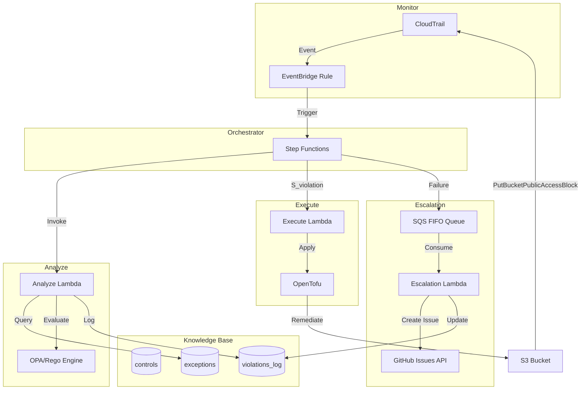
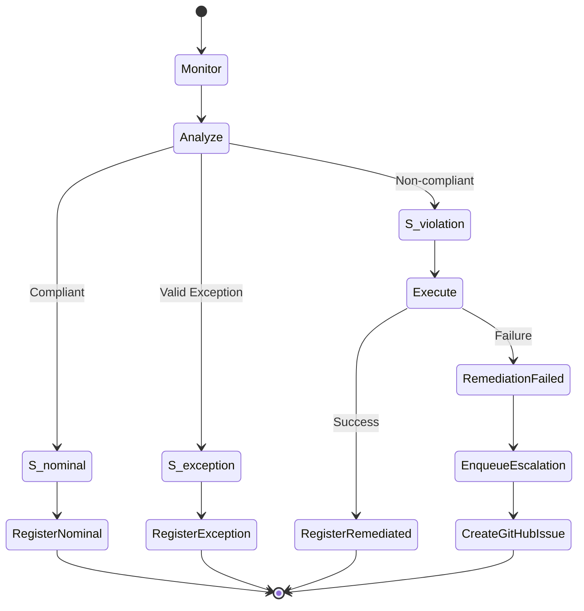
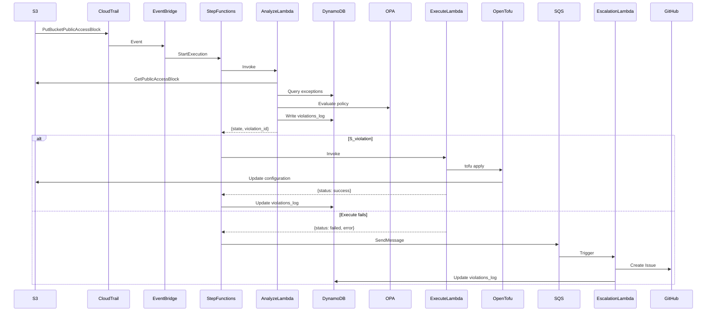
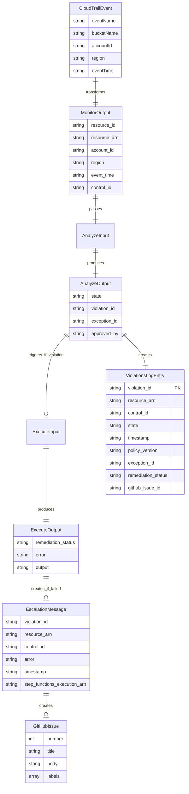
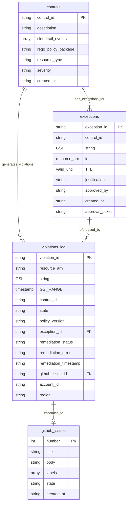
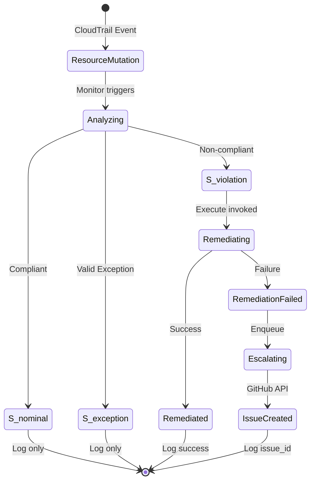

# Design Document: MVP Compliance Automation Loop

## Overview

O MVP Compliance Automation Loop implementa um sistema de automação de conformidade baseado no padrão arquitetural MAPE-K (Monitor, Analyze, Plan, Execute, Knowledge). O sistema detecta desvios de conformidade em recursos AWS, classifica o estado do recurso, executa remediação automática quando apropriado, e escala violações não resolvidas para operadores humanos.

O sistema suporta múltiplos controles de compliance de forma extensível. Dois controles estão implementados: bloqueio de acesso público em buckets S3 (`ctrl-s3-public-block`) e política SSL-only (`ctrl-s3-ssl-only`). Novos controles podem ser adicionados sem rebuild de imagens — políticas Rego e templates HCL de remediação são armazenados no S3 e carregados em runtime. O sistema monitora eventos CloudTrail, resolve dinamicamente quais controles aplicar via tabela DynamoDB, avalia conformidade usando OPA/Rego, e remedia violações usando OpenTofu.

### Design Goals

- **Automação determinística**: Cada evento deve seguir fluxo previsível baseado em classificação de estado
- **Auditabilidade completa**: Todas as avaliações e ações devem ser registradas permanentemente
- **Idempotência**: Remediação deve ser segura para execução repetida
- **Separação de responsabilidades**: Políticas versionadas em Git, estado em DynamoDB, execução em Lambda
- **Escalação confiável**: Falhas devem ser notificadas sem perda de informação

### MAPE-K Architecture Mapping

- **Monitor**: CloudTrail + EventBridge Rule (event pattern gerenciado dinamicamente pela Lambda `controls-sync` via DynamoDB Stream na tabela `controls`)
- **Analyze**: Lambda Python (arm64) + OPA/Rego (binário arm64 empacotado no zip, políticas carregadas do S3 em runtime) + consulta DynamoDB exceptions
- **Plan**: Implícito no Step Functions — QueryControls resolve dinamicamente quais controles aplicar baseado no `eventName` do CloudTrail via campo `cloudtrail_events` na tabela `controls`
- **Execute**: Lambda container (arm64) + OpenTofu com state efêmero local. Templates HCL carregados do S3 em runtime. Provider AWS pré-inicializado no build da imagem e compartilhado via symlink (elimina `tofu init` em runtime)
- **Knowledge**: DynamoDB (controls, exceptions, violations_log)

### State Classification Model

O sistema classifica recursos em três estados formais:

- **S_nominal**: Recurso conforme com política vigente
- **S_exception**: Recurso não conforme mas com exceção aprovada e vigente
- **S_violation**: Recurso não conforme sem exceção válida (requer remediação)


## Architecture

### High-Level Architecture Diagram



### Workflow State Machine Diagram



### Component Interaction Flow




## Components and Interfaces

### 1. Monitor (CloudTrail + EventBridge)

**Responsibility**: Detectar eventos de mutação em recursos S3 e extrair metadados relevantes.

**Implementation**:
- CloudTrail trail configurado para capturar eventos de gerenciamento S3
- EventBridge Rule com pattern filter para `PutBucketPublicAccessBlock`
- Target: Step Functions state machine

**Event Pattern**:
```json
{
  "source": ["aws.s3"],
  "detail-type": ["AWS API Call via CloudTrail"],
  "detail": {
    "eventName": ["PutBucketPublicAccessBlock"]
  }
}
```

**Output Schema**:
```json
{
  "resource_id": "bucket-name",
  "resource_arn": "arn:aws:s3:::bucket-name",
  "account_id": "123456789012",
  "region": "us-east-1",
  "event_time": "2024-01-15T10:30:00Z",
  "control_id": "ctrl-s3-public-block"
}
```

**Error Handling**:
- Missing fields: Log error to CloudWatch, discard event
- Malformed JSON: EventBridge DLQ captures failed invocations


### 2. Orchestrator (Step Functions Standard)

**Responsibility**: Coordenar transições entre componentes do loop MAPE-K baseado em classificação de estado.

**Implementation**:
- Step Functions Standard workflow (não Express) para histórico de 90 dias
- Choice states para decisão baseada em `$.state`
- SDK integrations diretas para DynamoDB (sem Lambda intermediária)
- Timeout global de 60 segundos

**State Machine Definition** (simplified):
```json
{
  "StartAt": "InvokeAnalyze",
  "States": {
    "InvokeAnalyze": {
      "Type": "Task",
      "Resource": "arn:aws:lambda:REGION:ACCOUNT:function:analyze",
      "TimeoutSeconds": 15,
      "Next": "ClassifyState"
    },
    "ClassifyState": {
      "Type": "Choice",
      "Choices": [
        {
          "Variable": "$.state",
          "StringEquals": "S_nominal",
          "Next": "RegisterNominal"
        },
        {
          "Variable": "$.state",
          "StringEquals": "S_exception",
          "Next": "RegisterException"
        },
        {
          "Variable": "$.state",
          "StringEquals": "S_violation",
          "Next": "InvokeExecute"
        }
      ]
    },
    "RegisterNominal": {
      "Type": "Task",
      "Resource": "arn:aws:states:::dynamodb:putItem",
      "Parameters": {
        "TableName": "violations_log",
        "Item": {
          "violation_id": {"S.$": "$.violation_id"},
          "state": {"S": "S_nominal"},
          "timestamp": {"S.$": "$.timestamp"}
        }
      },
      "End": true
    },
    "RegisterException": {
      "Type": "Task",
      "Resource": "arn:aws:states:::dynamodb:putItem",
      "Parameters": {
        "TableName": "violations_log",
        "Item": {
          "violation_id": {"S.$": "$.violation_id"},
          "state": {"S": "S_exception"},
          "exception_id": {"S.$": "$.exception_id"},
          "timestamp": {"S.$": "$.timestamp"}
        }
      },
      "End": true
    },
    "InvokeExecute": {
      "Type": "Task",
      "Resource": "arn:aws:lambda:REGION:ACCOUNT:function:execute",
      "TimeoutSeconds": 45,
      "Catch": [
        {
          "ErrorEquals": ["States.ALL"],
          "ResultPath": "$.error",
          "Next": "UpdateLogFailed"
        }
      ],
      "Next": "CheckRemediationStatus"
    },
    "CheckRemediationStatus": {
      "Type": "Choice",
      "Choices": [
        {
          "Variable": "$.remediation_status",
          "StringEquals": "success",
          "Next": "UpdateLogSuccess"
        }
      ],
      "Default": "UpdateLogFailed"
    },
    "UpdateLogSuccess": {
      "Type": "Task",
      "Resource": "arn:aws:states:::dynamodb:updateItem",
      "Parameters": {
        "TableName": "violations_log",
        "Key": {
          "violation_id": {"S.$": "$.violation_id"}
        },
        "UpdateExpression": "SET remediation_status = :status, remediation_timestamp = :ts",
        "ExpressionAttributeValues": {
          ":status": {"S": "success"},
          ":ts": {"S.$": "$$.State.EnteredTime"}
        }
      },
      "End": true
    },
    "UpdateLogFailed": {
      "Type": "Task",
      "Resource": "arn:aws:states:::dynamodb:updateItem",
      "Parameters": {
        "TableName": "violations_log",
        "Key": {
          "violation_id": {"S.$": "$.violation_id"}
        },
        "UpdateExpression": "SET remediation_status = :status, remediation_error = :error, remediation_timestamp = :ts",
        "ExpressionAttributeValues": {
          ":status": {"S": "failed"},
          ":error": {"S.$": "$.error"},
          ":ts": {"S.$": "$$.State.EnteredTime"}
        }
      },
      "Next": "EnqueueEscalation"
    },
    "EnqueueEscalation": {
      "Type": "Task",
      "Resource": "arn:aws:states:::sqs:sendMessage",
      "Parameters": {
        "QueueUrl": "https://sqs.REGION.amazonaws.com/ACCOUNT/escalation-queue.fifo",
        "MessageBody.$": "States.JsonToString($)",
        "MessageGroupId.$": "$.resource_arn",
        "MessageDeduplicationId.$": "$.violation_id"
      },
      "End": true
    }
  }
}
```

**Input Schema**:
```json
{
  "resource_arn": "arn:aws:s3:::bucket-name",
  "control_id": "ctrl-s3-public-block",
  "account_id": "123456789012",
  "region": "us-east-1",
  "event_time": "2024-01-15T10:30:00Z"
}
```

**Interface Contract**:
- Analyze returns: `{state, violation_id, exception_id?, approved_by?}`
- Execute returns: `{remediation_status: "success"|"failed", error?}`


### 3. Analyze Lambda

**Responsibility**: Classificar estado de conformidade do recurso usando OPA/Rego e consulta de exceções.

**Implementation**:
- Runtime: Python 3.12
- OPA embedded via `opa-python` library ou subprocess call to OPA binary
- Deployment package inclui arquivo `.rego` com política `s3_public_access`
- Timeout: 15 segundos
- Memory: 512 MB

**Algorithm**:
```python
def analyze(event):
    # 1. Extract resource metadata
    resource_arn = event['resource_arn']
    control_id = event['control_id']
    
    # 2. Retrieve current resource configuration
    s3_client = boto3.client('s3')
    bucket_name = extract_bucket_name(resource_arn)
    config = s3_client.get_public_access_block(Bucket=bucket_name)
    
    # 3. Evaluate with OPA
    opa_input = {
        "resource": config['PublicAccessBlockConfiguration'],
        "control_id": control_id
    }
    policy_result = opa.evaluate("data.s3_public_access.allow", opa_input)
    
    # 4. Check for valid exception
    exception = query_exception(control_id, resource_arn)
    
    # 5. Classify state
    if policy_result.allow:
        state = "S_nominal"
    elif exception and exception['valid_until'] > now():
        state = "S_exception"
    else:
        state = "S_violation"
    
    # 6. Log to violations_log
    violation_id = str(uuid.uuid4())
    log_violation(violation_id, resource_arn, control_id, state, exception)
    
    return {
        "state": state,
        "violation_id": violation_id,
        "exception_id": exception['exception_id'] if exception else None
    }
```

**DynamoDB Query for Exceptions**:
```python
def query_exception(control_id, resource_arn):
    response = dynamodb.query(
        TableName='exceptions',
        IndexName='control_id-index',
        KeyConditionExpression='control_id = :cid',
        FilterExpression='resource_arn = :arn AND valid_until > :now',
        ExpressionAttributeValues={
            ':cid': control_id,
            ':arn': resource_arn,
            ':now': int(time.time())
        }
    )
    return response['Items'][0] if response['Items'] else None
```

**Rego Policy** (`s3_public_access.rego`):
```rego
package s3_public_access

default allow := false

allow if {
    input.resource.BlockPublicAcls == true
    input.resource.IgnorePublicAcls == true
    input.resource.BlockPublicPolicy == true
    input.resource.RestrictPublicBuckets == true
}
```

**Output Schema**:
```json
{
  "state": "S_violation",
  "violation_id": "550e8400-e29b-41d4-a716-446655440000",
  "exception_id": null,
  "approved_by": null
}
```

**Error Handling**:
- S3 GetPublicAccessBlock fails: Return error to Step Functions, trigger escalation
- OPA evaluation error: Log to CloudWatch, return S_violation (fail-secure)
- DynamoDB query timeout: Proceed without exception (fail-secure)


### 4. Execute Lambda

**Responsibility**: Remediar recursos em violação usando OpenTofu com infraestrutura como código declarativa.

**Implementation**:
- Runtime: Lambda container image (base: `public.ecr.aws/lambda/python:3.12`)
- OpenTofu binary incluído na imagem (versão 1.6+)
- HCL configuration pré-inicializado em build time
- Providers AWS em `/opt/providers` (cache de `tofu init`)
- Timeout: 45 segundos
- Memory: 1024 MB
- Ephemeral storage: 1024 MB (para `/tmp/remediation.tfstate`)

**Dockerfile**:
```dockerfile
FROM public.ecr.aws/lambda/python:3.12

# Install OpenTofu
RUN curl -Lo /tmp/tofu.zip https://github.com/opentofu/opentofu/releases/download/v1.6.0/tofu_1.6.0_linux_amd64.zip && \
    unzip /tmp/tofu.zip -d /usr/local/bin && \
    chmod +x /usr/local/bin/tofu

# Copy HCL configuration
COPY remediation.tf /opt/remediation/
WORKDIR /opt/remediation

# Pre-cache providers and initialize
RUN tofu providers mirror /opt/providers
RUN tofu init -plugin-dir=/opt/providers

# Copy Lambda handler
COPY handler.py ${LAMBDA_TASK_ROOT}/

CMD ["handler.lambda_handler"]
```

**HCL Configuration** (`remediation.tf`):
```hcl
terraform {
  required_providers {
    aws = {
      source  = "hashicorp/aws"
      version = "~> 5.0"
    }
  }
}

provider "aws" {
  region = var.region
}

variable "bucket_name" {
  type = string
}

variable "region" {
  type = string
}

resource "aws_s3_bucket_public_access_block" "remediation" {
  bucket = var.bucket_name

  block_public_acls       = true
  ignore_public_acls      = true
  block_public_policy     = true
  restrict_public_buckets = true
}
```

**Lambda Handler**:
```python
import subprocess
import json
import os
import shutil

def lambda_handler(event, context):
    resource_arn = event['resource_arn']
    bucket_name = extract_bucket_name(resource_arn)
    region = event['region']
    
    # Copy HCL and .terraform to writable /tmp directory
    os.makedirs('/tmp/remediation', exist_ok=True)
    shutil.copy('/opt/remediation/remediation.tf', '/tmp/remediation/')
    shutil.copytree('/opt/remediation/.terraform', '/tmp/remediation/.terraform')
    
    # Write tfvars
    tfvars = {
        "bucket_name": bucket_name,
        "region": region
    }
    with open('/tmp/terraform.tfvars.json', 'w') as f:
        json.dump(tfvars, f)
    
    # Execute tofu apply
    result = subprocess.run(
        ['tofu', 'apply', '-refresh=false', '-auto-approve', 
         '-var-file=/tmp/terraform.tfvars.json',
         '-state=/tmp/remediation.tfstate',
         '-plugin-dir=/opt/providers'],
        cwd='/tmp/remediation',
        capture_output=True,
        text=True,
        timeout=40
    )
    
    if result.returncode == 0:
        return {
            "remediation_status": "success",
            "output": result.stdout
        }
    else:
        return {
            "remediation_status": "failed",
            "error": result.stderr
        }
```

**Design Rationale**:
- `-refresh=false`: Analyze já verificou estado atual, evita latência adicional
- State local efêmero: Remediação é idempotente, não precisa rastrear drift
- Providers pré-inicializados: Reduz cold start de ~10s para ~2s
- Container image: Permite incluir binário OpenTofu sem Lambda Layer

**Output Schema**:
```json
{
  "remediation_status": "success",
  "output": "aws_s3_bucket_public_access_block.remediation: Creation complete"
}
```

**Error Handling**:
- OpenTofu apply timeout: Return failure status with partial output
- IAM permission denied: Return failure, escalate to GitHub Issue
- Bucket not found: Return failure (bucket pode ter sido deletado)


### 5. Knowledge Base (DynamoDB)

**Responsibility**: Armazenar políticas, exceções aprovadas, e log de violações.

#### Table: controls

**Purpose**: Metadados de controles de conformidade.

**Schema**:
```json
{
  "TableName": "controls",
  "KeySchema": [
    {"AttributeName": "control_id", "KeyType": "HASH"}
  ],
  "AttributeDefinitions": [
    {"AttributeName": "control_id", "AttributeType": "S"}
  ],
  "BillingMode": "PAY_PER_REQUEST"
}
```

**Sample Item**:
```json
{
  "control_id": "ctrl-s3-public-block",
  "description": "Enforce S3 bucket public access block settings",
  "cloudtrail_events": ["PutBucketPublicAccessBlock"],
  "rego_policy_package": "s3_public_access",
  "resource_type": "AWS::S3::Bucket",
  "severity": "HIGH",
  "created_at": "2024-01-01T00:00:00Z"
}
```

**Access Pattern**:
- Query by control_id (primary key)
- Used by Analyze to retrieve policy metadata


#### Table: exceptions

**Purpose**: Armazenar exceções aprovadas com TTL nativo.

**Schema**:
```json
{
  "TableName": "exceptions",
  "KeySchema": [
    {"AttributeName": "exception_id", "KeyType": "HASH"}
  ],
  "AttributeDefinitions": [
    {"AttributeName": "exception_id", "AttributeType": "S"},
    {"AttributeName": "control_id", "AttributeType": "S"}
  ],
  "GlobalSecondaryIndexes": [
    {
      "IndexName": "control_id-index",
      "KeySchema": [
        {"AttributeName": "control_id", "KeyType": "HASH"}
      ],
      "Projection": {"ProjectionType": "ALL"}
    }
  ],
  "TimeToLiveSpecification": {
    "AttributeName": "valid_until",
    "Enabled": true
  },
  "BillingMode": "PAY_PER_REQUEST"
}
```

**Sample Item**:
```json
{
  "exception_id": "exc-a1b2c3d4-e5f6-7890-abcd-ef1234567890",
  "control_id": "ctrl-s3-public-block",
  "resource_arn": "arn:aws:s3:::public-website-bucket",
  "valid_until": 1735689600,
  "justification": "Public website hosting approved by security team",
  "approved_by": "security-lead@example.com",
  "created_at": "2024-01-15T10:00:00Z",
  "approval_ticket": "JIRA-12345"
}
```

**Access Pattern**:
- Query by control_id via GSI
- Filter by resource_arn and valid_until > now()
- TTL deletes expired items within 48h (behavior does NOT depend on physical deletion)

**Design Rationale**:
- TTL on valid_until: Automatic cleanup, but Analyze filters explicitly
- GSI on control_id: Efficient query for all exceptions of a control
- UUID partition key: Uniform distribution, no hot partitions

**Re-avaliação Automática após Expiração de Exceção**:

O DynamoDB Streams está habilitado na tabela exceptions com `NEW_AND_OLD_IMAGES`. Uma Lambda (`exception-scheduler-sync`) processa eventos `INSERT` e `MODIFY` do Stream. Para cada exceção ativa com `valid_until` no futuro, a Lambda cria um EventBridge Scheduler one-time programado para `valid_until + 30s`. Quando o Scheduler dispara, a exceção já expirou logicamente, e o Step Functions é acionado para re-avaliação completa (Analyze → Execute se necessário). O Scheduler se auto-deleta após o disparo (`ActionAfterCompletion=DELETE`).

Este mecanismo substituiu a abordagem anterior baseada em EventBridge Pipe + DynamoDB TTL, que dependia da deleção física de itens expirados — operação com latência não determinística de até 48h. O novo mecanismo oferece precisão de segundos (evidenciado no Teste 5/C3) e comportamento determinístico.

Isso garante que, após expiração de uma exceção, o recurso seja automaticamente re-avaliado pelo loop MAPE-K completo, mantendo o invariante arquitetural de que o Analyze é sempre o componente decisor.

**Limitação conhecida — Latência do TTL**:

A deleção física de itens expirados pelo DynamoDB TTL é **não-determinística** e pode levar até 48 horas após o timestamp `valid_until`. No entanto, a re-avaliação automática **não depende da deleção física**: o EventBridge Scheduler dispara em `valid_until + 30s` com precisão de segundos, e a Analyze Lambda filtra exceções com `valid_until > now()`, garantindo que exceções logicamente expiradas sejam ignoradas em qualquer avaliação. O TTL permanece habilitado apenas para limpeza eventual dos itens na tabela.


#### Table: violations_log

**Purpose**: Registro permanente de todas as avaliações de conformidade.

**Schema**:
```json
{
  "TableName": "violations_log",
  "KeySchema": [
    {"AttributeName": "violation_id", "KeyType": "HASH"}
  ],
  "AttributeDefinitions": [
    {"AttributeName": "violation_id", "AttributeType": "S"},
    {"AttributeName": "resource_arn", "AttributeType": "S"},
    {"AttributeName": "timestamp", "AttributeType": "S"}
  ],
  "GlobalSecondaryIndexes": [
    {
      "IndexName": "resource_arn-timestamp-index",
      "KeySchema": [
        {"AttributeName": "resource_arn", "KeyType": "HASH"},
        {"AttributeName": "timestamp", "KeyType": "RANGE"}
      ],
      "Projection": {"ProjectionType": "ALL"}
    }
  ],
  "BillingMode": "PAY_PER_REQUEST"
}
```

**Sample Item (S_violation with successful remediation)**:
```json
{
  "violation_id": "vio-550e8400-e29b-41d4-a716-446655440000",
  "resource_arn": "arn:aws:s3:::non-compliant-bucket",
  "control_id": "ctrl-s3-public-block",
  "state": "S_violation",
  "timestamp": "2024-01-15T10:30:15Z",
  "policy_version": "s3_public_access:v1.0",
  "exception_id": null,
  "remediation_status": "success",
  "remediation_timestamp": "2024-01-15T10:30:45Z",
  "github_issue_id": null,
  "account_id": "123456789012",
  "region": "us-east-1"
}
```

**Sample Item (S_exception)**:
```json
{
  "violation_id": "vio-660f9511-f3ac-52e5-b827-557766551111",
  "resource_arn": "arn:aws:s3:::public-website-bucket",
  "control_id": "ctrl-s3-public-block",
  "state": "S_exception",
  "timestamp": "2024-01-15T11:00:00Z",
  "policy_version": "s3_public_access:v1.0",
  "exception_id": "exc-a1b2c3d4-e5f6-7890-abcd-ef1234567890",
  "approved_by": "security-lead@example.com",
  "remediation_status": null,
  "github_issue_id": null,
  "account_id": "123456789012",
  "region": "us-east-1"
}
```

**Sample Item (S_violation with failed remediation)**:
```json
{
  "violation_id": "vio-770g0622-g4bd-63f6-c938-668877662222",
  "resource_arn": "arn:aws:s3:::protected-bucket",
  "control_id": "ctrl-s3-public-block",
  "state": "S_violation",
  "timestamp": "2024-01-15T12:00:00Z",
  "policy_version": "s3_public_access:v1.0",
  "exception_id": null,
  "remediation_status": "failed",
  "remediation_error": "AccessDenied: Insufficient permissions",
  "remediation_timestamp": "2024-01-15T12:00:30Z",
  "github_issue_id": "12345",
  "account_id": "123456789012",
  "region": "us-east-1"
}
```

**Access Pattern**:
- Query by violation_id (primary key) for audit trail
- Query by resource_arn + timestamp via GSI for resource history
- No TTL: Permanent audit log

**Design Rationale**:
- State field represents actual compliance state, not process state
- remediation_status indicates outcome of Execute, not a new state
- github_issue_id links violation to operational resolution workflow


### 6. Escalation (SQS FIFO + Lambda + GitHub Issues)

**Responsibility**: Notificar operadores humanos quando remediação automática falha.

#### SQS FIFO Queue

**Configuration**:
```json
{
  "QueueName": "compliance-escalation.fifo",
  "FifoQueue": true,
  "ContentBasedDeduplication": false,
  "MessageRetentionPeriod": 1209600,
  "VisibilityTimeout": 300,
  "DeduplicationScope": "messageGroup",
  "FifoThroughputLimit": "perMessageGroupId"
}
```

**Message Schema**:
```json
{
  "violation_id": "vio-770g0622-g4bd-63f6-c938-668877662222",
  "resource_arn": "arn:aws:s3:::protected-bucket",
  "control_id": "ctrl-s3-public-block",
  "error": "AccessDenied: Insufficient permissions",
  "timestamp": "2024-01-15T12:00:30Z",
  "step_functions_execution_arn": "arn:aws:states:us-east-1:123456789012:execution:compliance-loop:exec-abc123",
  "account_id": "123456789012",
  "region": "us-east-1"
}
```

**Design Rationale**:
- FIFO: Preserves order of violations for same resource
- MessageDeduplicationId = violation_id: Prevents duplicate escalations
- MessageGroupId = resource_arn: Parallel processing for different resources, ordered processing for same resource


#### Escalation Lambda

**Implementation**:
- Runtime: Python 3.12
- Trigger: SQS FIFO queue (batch size: 1)
- Timeout: 30 seconds
- Environment variables: GITHUB_TOKEN, GITHUB_REPO

**Algorithm**:
```python
import boto3
import requests
import json
import os

def lambda_handler(event, context):
    for record in event['Records']:
        message = json.loads(record['body'])
        
        # Create GitHub Issue
        issue = create_github_issue(message)
        
        # Update violations_log with github_issue_id
        dynamodb = boto3.resource('dynamodb')
        table = dynamodb.Table('violations_log')
        table.update_item(
            Key={'violation_id': message['violation_id']},
            UpdateExpression='SET github_issue_id = :issue_id',
            ExpressionAttributeValues={':issue_id': str(issue['number'])}
        )
        
    return {'statusCode': 200}

def create_github_issue(message):
    url = f"https://api.github.com/repos/{os.environ['GITHUB_REPO']}/issues"
    headers = {
        'Authorization': f"token {os.environ['GITHUB_TOKEN']}",
        'Accept': 'application/vnd.github.v3+json'
    }
    
    execution_url = f"https://console.aws.amazon.com/states/home?region={message['region']}#/executions/details/{message['step_functions_execution_arn']}"
    
    body = f"""
## Compliance Violation - Remediation Failed

**Resource**: `{message['resource_arn']}`
**Control**: `{message['control_id']}`
**Violation ID**: `{message['violation_id']}`
**Timestamp**: {message['timestamp']}

### Error Details
```
{message['error']}
```

### Step Functions Execution
[View execution details]({execution_url})

### Action Required
Manual remediation required. Review the error details and apply the necessary configuration changes.
"""
    
    payload = {
        'title': f"[Compliance] {message['control_id']} - {message['resource_arn']}",
        'body': body,
        'labels': ['compliance-violation', 'auto-escalation']
    }
    
    response = requests.post(url, headers=headers, json=payload)
    response.raise_for_status()
    return response.json()
```

**GitHub Issue Example**:
```markdown
Title: [Compliance] ctrl-s3-public-block - arn:aws:s3:::protected-bucket

## Compliance Violation - Remediation Failed

**Resource**: `arn:aws:s3:::protected-bucket`
**Control**: `ctrl-s3-public-block`
**Violation ID**: `vio-770g0622-g4bd-63f6-c938-668877662222`
**Timestamp**: 2024-01-15T12:00:30Z

### Error Details
```
AccessDenied: Insufficient permissions
```

### Step Functions Execution
[View execution details](https://console.aws.amazon.com/states/...)

### Action Required
Manual remediation required. Review the error details and apply the necessary configuration changes.

Labels: compliance-violation, auto-escalation
```

**Error Handling**:
- GitHub API failure: Lambda retries via SQS visibility timeout
- DynamoDB update failure: Log error, continue (issue already created)
- Invalid message format: Send to DLQ


## Data Models

### Event Flow Data Model




### DynamoDB Schema Relationships



### State Transition Model




## Correctness Properties

A property is a characteristic or behavior that should hold true across all valid executions of a system—essentially, a formal statement about what the system should do. Properties serve as the bridge between human-readable specifications and machine-verifiable correctness guarantees.

### Property 1: CloudTrail Event Parsing Completeness

For any valid CloudTrail PutBucketPublicAccessBlock event, the Monitor SHALL successfully extract all required metadata fields (bucket ARN, account ID, region) and construct a valid output schema.

**Validates: Requirements 1.2, 1.3, 1.4, 1.5, 15.1, 15.7**

### Property 2: Orchestrator State-Based Routing

For any Analyze output with state S_nominal or S_exception, the Orchestrator SHALL terminate the workflow without invoking Execute; for any Analyze output with state S_violation, the Orchestrator SHALL invoke Execute.

**Validates: Requirements 2.2, 2.3, 2.4**

### Property 3: Analyze Classification Determinism

For any resource configuration and exception set, when Analyze evaluates the same inputs multiple times with the same timestamp, it SHALL return identical classification results.

**Validates: Requirements 3.9, 16.3**

### Property 4: Compliant Resource Classification

For any S3 bucket configuration where BlockPublicAcls, IgnorePublicAcls, BlockPublicPolicy, and RestrictPublicBuckets are all true, the Analyze SHALL return S_nominal.

**Validates: Requirements 3.3, 10.7**

### Property 5: Valid Exception Classification

For any non-compliant resource configuration with an exception where valid_until > current_timestamp, the Analyze SHALL return S_exception.

**Validates: Requirements 3.4, 3.7**

### Property 6: Violation Classification

For any non-compliant resource configuration without a valid exception, the Analyze SHALL return S_violation.

**Validates: Requirements 3.5, 3.8**

### Property 7: S3 Public Access Policy Evaluation

For any S3 bucket configuration, the s3_public_access Rego policy SHALL return violation if any of the four public access block settings (BlockPublicAcls, IgnorePublicAcls, BlockPublicPolicy, RestrictPublicBuckets) is false.

**Validates: Requirements 10.2, 10.3, 10.4, 10.5, 10.6**

### Property 8: Exception Query Correctness

For any control_id and resource_arn, the Analyze SHALL query the exceptions table using the control_id GSI and filter by resource_arn match and valid_until > current_timestamp.

**Validates: Requirements 3.6, 5.8**

### Property 9: Exception Data Model Completeness

For any exception created in the Knowledge_Base, it SHALL contain all required fields: exception_id (UUID), control_id, resource_arn, valid_until (Unix timestamp), justification, approved_by, and created_at.

**Validates: Requirements 5.4, 5.5, 5.6, 5.10, 5.11, 5.12**

### Property 10: Exception Filtering Independence from TTL

For any exception query, the Analyze SHALL filter by valid_until > now() in the query expression, ensuring behavior does not depend on DynamoDB TTL physical deletion.

**Validates: Requirements 5.9**

### Property 11: Violations Log Entry Uniqueness

For any Analyze evaluation, exactly one entry SHALL be created in the violations_log table with a unique violation_id (UUID).

**Validates: Requirements 6.1, 6.2**

### Property 12: Violations Log Data Model Completeness

For any violations_log entry, it SHALL contain all required fields: violation_id, resource_arn, control_id, state (one of S_nominal, S_exception, S_violation), timestamp (ISO 8601), and policy_version.

**Validates: Requirements 6.3, 6.4, 6.5, 6.6, 6.7**

### Property 13: Exception Reference in Log

For any violations_log entry with state S_exception, it SHALL include a non-null exception_id reference.

**Validates: Requirements 6.8**

### Property 14: Remediation Status Logging

For any violations_log entry where Execute was invoked, it SHALL include a remediation_status field with value "success" if Execute succeeded or "failed" if Execute failed.

**Validates: Requirements 6.9, 6.10, 6.11**

### Property 15: Execute Idempotency

For any resource in S_violation state, invoking Execute multiple times SHALL produce the same final resource configuration (all four public access block settings true).

**Validates: Requirements 7.7, 9.1, 11.5**

### Property 16: Execute OpenTofu Invocation

For any S_violation input, Execute SHALL invoke OpenTofu with the -refresh=false flag and the resource_id correctly mapped to OpenTofu variables.

**Validates: Requirements 7.1, 7.2, 7.3**

### Property 17: Execute Success Response

For any successful OpenTofu apply (return code 0), Execute SHALL return remediation_status "success" to the Orchestrator.

**Validates: Requirements 7.5**

### Property 18: Execute Failure Response

For any failed OpenTofu apply (return code != 0), Execute SHALL return remediation_status "failed" with error details to the Orchestrator.

**Validates: Requirements 7.6**

### Property 19: Remediation Outcome Compliance

For any resource after successful Execute, querying the S3 public access block configuration SHALL show BlockPublicAcls, IgnorePublicAcls, BlockPublicPolicy, and RestrictPublicBuckets all set to true.

**Validates: Requirements 7.9**

### Property 20: Escalation Trigger on Failure

For any Execute failure, the Orchestrator SHALL send a message to the Escalation_Queue containing all required fields: violation_id, resource_arn, control_id, error details, timestamp, and step_functions_execution_arn.

**Validates: Requirements 2.6, 8.1, 8.3, 8.4, 8.5, 8.6, 8.7, 8.8**

### Property 21: GitHub Issue Creation

For any message in the Escalation_Queue, the Escalation Lambda SHALL create a GitHub Issue containing all escalation message details and labeled with "compliance-violation" and "auto-escalation".

**Validates: Requirements 8.9, 8.10, 8.11**

### Property 22: GitHub Issue ID Persistence

For any GitHub Issue created for a failed remediation, the issue number returned by the GitHub API SHALL be saved to the violations_log entry corresponding to the violation_id.

**Validates: Requirements 8.12, 19.1, 19.4**

### Property 23: GitHub Issue ID Null for Non-Escalated Violations

For any violations_log entry where Execute was not invoked or Execute succeeded, the github_issue_id field SHALL be null.

**Validates: Requirements 19.5**

### Property 24: State Persistence After Failed Remediation

For any Execute failure, the violations_log entry SHALL maintain state as S_violation (not create a new state like S_remediation_failed), with the remediation_status field indicating "failed".

**Validates: Requirements 18.1, 18.2, 18.5**

### Property 25: EventBridge Rule Event Filtering

For any CloudTrail event with eventName != "PutBucketPublicAccessBlock", the EventBridge Rule SHALL NOT match the event and SHALL NOT trigger the Orchestrator.

**Validates: Requirements 1.6**

### Property 26: Monitor Error Handling

For any CloudTrail event with missing required fields (bucketName, accountId, or region), the Monitor SHALL log an error and discard the event.

**Validates: Requirements 15.6**

### Property 27: ARN Construction Format

For any bucket name extracted from a CloudTrail event, the Monitor SHALL construct the resource ARN in the format "arn:aws:s3:::bucket-name".

**Validates: Requirements 15.7**

### Property 28: Timeout Error Handling

For any component timeout (Analyze > 15s, Execute > 45s, Orchestrator > 60s), the Orchestrator SHALL log a timeout error and terminate the workflow.

**Validates: Requirements 17.4**

### Property 29: Resource State Unchanged for S_exception

For any resource classified as S_exception, the resource configuration SHALL remain unchanged after the workflow completes.

**Validates: Requirements 12.5**

### Property 30: Resource State Unchanged After Failed Remediation

For any resource where Execute fails, the resource configuration SHALL remain in its non-compliant state.

**Validates: Requirements 14.5**


## Error Handling

### Monitor Error Handling

**Malformed CloudTrail Events**:
- Missing required fields (bucketName, accountId, region): Log error to CloudWatch Logs, discard event
- Invalid JSON structure: EventBridge DLQ captures failed invocations
- Unmatched event pattern: EventBridge filters prevent invocation

**Error Recovery**: No retry - events are discarded. CloudTrail will generate new events for subsequent mutations.

### Analyze Error Handling

**AWS API Failures**:
- S3 GetPublicAccessBlock fails (NoSuchBucket, AccessDenied): Return error to Step Functions, trigger escalation
- DynamoDB query timeout: Proceed without exception data (fail-secure: treat as no exception)
- DynamoDB write failure: Retry with exponential backoff (Lambda default), escalate if persistent

**OPA Evaluation Errors**:
- Policy file missing: Lambda initialization fails, CloudWatch alarm triggers
- Rego syntax error: Lambda initialization fails, CloudWatch alarm triggers
- OPA runtime error: Log to CloudWatch, return S_violation (fail-secure)

**Error Recovery**: Step Functions retry policy with exponential backoff (3 attempts, 2s initial interval, 2x multiplier). After exhaustion, trigger escalation.

### Execute Error Handling

**OpenTofu Failures**:
- IAM permission denied: Return failure status with error details, escalate to GitHub Issue
- Bucket not found: Return failure status (bucket may have been deleted), escalate
- OpenTofu timeout (>40s): Kill process, return failure status, escalate
- State file corruption: Use fresh ephemeral state (no impact due to declarative config)

**Container Failures**:
- OOM (>1024MB): Lambda fails, Step Functions retries, escalate if persistent
- Disk full (>/tmp 1024MB): Clean /tmp before execution, fail if insufficient space

**Error Recovery**: Step Functions retry policy (2 attempts, 5s interval). After exhaustion, send to Escalation_Queue.

### Orchestrator Error Handling

**State Machine Errors**:
- Lambda invocation failure: Retry per Lambda error handling policy
- DynamoDB SDK integration failure: Retry with exponential backoff (3 attempts)
- SQS SendMessage failure: Retry with exponential backoff (3 attempts)
- Global timeout (60s): Terminate workflow, log timeout error, send to Escalation_Queue

**Error Recovery**: Built-in Step Functions retry and catch mechanisms. All unhandled errors result in escalation.

### Escalation Error Handling

**SQS Consumer Failures**:
- GitHub API rate limit: Lambda retries via SQS visibility timeout (300s), exponential backoff
- GitHub API authentication failure: Send to DLQ, trigger CloudWatch alarm
- Network timeout: Lambda retries via SQS visibility timeout

**DynamoDB Update Failures**:
- Update violations_log with github_issue_id fails: Log error to CloudWatch, continue (issue already created)
- Conditional check failure: Log warning, continue (idempotent operation)

**Error Recovery**: SQS visibility timeout triggers automatic retry. After 3 receive attempts, message moves to DLQ. CloudWatch alarm notifies operators.

### Fail-Secure Principles

- **Unknown exception state**: Treat as no exception (classify as S_violation if non-compliant)
- **OPA evaluation error**: Classify as S_violation (enforce remediation)
- **Timeout in Analyze**: Escalate (do not assume compliant)
- **Timeout in Execute**: Escalate (do not assume remediated)


## Testing Strategy

### Dual Testing Approach

The MVP Compliance Automation Loop requires both unit testing and property-based testing for comprehensive coverage:

- **Unit tests**: Verify specific examples, edge cases, error conditions, and integration points
- **Property tests**: Verify universal properties across all inputs through randomization

Both approaches are complementary and necessary. Unit tests catch concrete bugs in specific scenarios, while property tests verify general correctness across the input space.

### Unit Testing Strategy

**Focus Areas**:
- Specific examples demonstrating correct behavior (e.g., C1-C4 scenarios from requirements)
- Edge cases (empty events, expired exceptions, already-compliant resources)
- Error conditions (missing fields, API failures, timeouts)
- Integration points between components (Monitor→Orchestrator, Analyze→DynamoDB, Execute→S3)

**Avoid Over-Testing**:
- Do not write exhaustive unit tests for all input combinations
- Property-based tests handle comprehensive input coverage
- Unit tests should focus on concrete, meaningful scenarios

**Test Organization**:
```
tests/
├── unit/
│   ├── test_monitor.py          # CloudTrail parsing, ARN construction
│   ├── test_analyze.py           # Classification logic, OPA integration
│   ├── test_execute.py           # OpenTofu invocation, idempotency
│   ├── test_escalation.py        # GitHub issue creation, DynamoDB updates
│   └── test_orchestrator.py     # State machine definition validation
├── integration/
│   ├── test_end_to_end.py        # C1-C4 scenarios
│   └── test_error_paths.py       # Failure scenarios, escalation flow
└── property/
    ├── test_monitor_properties.py
    ├── test_analyze_properties.py
    ├── test_execute_properties.py
    └── test_escalation_properties.py
```

### Property-Based Testing Strategy

**Library Selection**:
- Python: Hypothesis (https://hypothesis.readthedocs.io/)
- Configuration: Minimum 100 iterations per property test (due to randomization)

**Property Test Requirements**:
- Each correctness property from the design document MUST be implemented by a SINGLE property-based test
- Each test MUST be tagged with a comment referencing the design property
- Tag format: `# Feature: mvp-compliance-automation-loop, Property {number}: {property_text}`

**Generator Strategy**:

For Monitor properties:
- Generate random CloudTrail events with valid and invalid structures
- Generate random bucket names, account IDs, regions
- Include edge cases: empty strings, special characters, very long names

For Analyze properties:
- Generate random S3 public access block configurations (all combinations of 4 boolean settings)
- Generate random exceptions with various valid_until timestamps (past, present, future)
- Generate random resource ARNs and control IDs
- Include edge cases: boundary timestamps, null fields, malformed UUIDs

For Execute properties:
- Generate random bucket names and regions
- Generate random OpenTofu outputs (success and failure scenarios)
- Include edge cases: already-compliant resources, non-existent buckets

For Escalation properties:
- Generate random escalation messages with various error details
- Generate random GitHub API responses
- Include edge cases: rate limits, authentication failures

**Example Property Test**:
```python
from hypothesis import given, strategies as st, assume
import hypothesis

# Feature: mvp-compliance-automation-loop, Property 4: Compliant Resource Classification
@given(
    block_public_acls=st.booleans(),
    ignore_public_acls=st.booleans(),
    block_public_policy=st.booleans(),
    restrict_public_buckets=st.booleans()
)
@hypothesis.settings(max_examples=100)
def test_compliant_resource_classification(
    block_public_acls, ignore_public_acls, block_public_policy, restrict_public_buckets
):
    """For any S3 bucket configuration where all four public access block settings are true,
    the Analyze SHALL return S_nominal."""
    
    # Only test cases where all four settings are true
    assume(block_public_acls and ignore_public_acls and block_public_policy and restrict_public_buckets)
    
    config = {
        'BlockPublicAcls': block_public_acls,
        'IgnorePublicAcls': ignore_public_acls,
        'BlockPublicPolicy': block_public_policy,
        'RestrictPublicBuckets': restrict_public_buckets
    }
    
    result = analyze_compliance(config, exceptions=[])
    
    assert result['state'] == 'S_nominal'
```

**Note on Property 4 Test Efficiency**: For Property 4 specifically, where all four booleans must be True by definition, using `assume()` with `st.booleans()` will discard 15 of every 16 generated cases (6.25% efficiency). Hypothesis may warn about `HealthCheck.filter_too_much`. For this property, using `st.just(True)` for all four fields is actually more appropriate, as the relevant variability for testing lies in other input fields (exceptions, timestamps, resource ARNs) rather than in the boolean settings themselves. The `assume()` pattern is better suited for properties where the condition represents a constraint over a larger input space, not where the valid space is a single point.

**Property Test Coverage**:
- All 30 correctness properties MUST have corresponding property-based tests
- Each test MUST run minimum 100 iterations
- Each test MUST include edge case generators (empty, null, boundary values)
- Each test MUST be tagged with the property reference

### Integration Testing Strategy

**End-to-End Scenarios** (C1-C4 from requirements):

**C1: Automatic Remediation**:
1. Create S3 bucket with public access enabled
2. Trigger CloudTrail event
3. Verify Analyze classifies as S_violation
4. Verify Execute remediates to compliant state
5. Verify violations_log contains entry with remediation_status "success"
6. Verify bucket has all four public access blocks enabled

**C2: Valid Exception**:
1. Create S3 bucket with public access enabled
2. Create exception with valid_until in future
3. Trigger CloudTrail event
4. Verify Analyze classifies as S_exception
5. Verify Execute is not invoked
6. Verify violations_log contains entry with state S_exception and exception_id
7. Verify bucket configuration remains unchanged

**C3: Expired Exception**:
1. Create S3 bucket with public access enabled
2. Create exception with valid_until in past
3. Trigger CloudTrail event
4. Verify Analyze classifies as S_violation
5. Verify Execute remediates to compliant state
6. Verify violations_log contains entry with state S_violation and remediation_status "success"

**C4: Failed Remediation**:
1. Create S3 bucket with public access enabled
2. Remove IAM permissions for Execute Lambda
3. Trigger CloudTrail event
4. Verify Analyze classifies as S_violation
5. Verify Execute fails with permission error
6. Verify message sent to Escalation_Queue
7. Verify GitHub Issue created with error details
8. Verify violations_log contains entry with state S_violation, remediation_status "failed", and github_issue_id
9. Verify bucket configuration remains non-compliant

**Test Environment**:
- LocalStack for AWS service mocking (S3, DynamoDB, SQS, Step Functions)
- GitHub API mocking via responses library
- OpenTofu execution in test mode (tofu plan -detailed-exitcode)

### Performance Testing Strategy

**Latency Requirements**:
- Monitor to Orchestrator: <5 seconds (requirement 1.1)
- Analyze execution: <15 seconds (requirement 17.1)
- Execute execution: <45 seconds (requirement 17.2)
- End-to-end loop: <60 seconds (requirement 2.7)

**Performance Tests**:
- Measure cold start latency for Lambda functions
- Measure OpenTofu apply duration for various bucket configurations
- Measure DynamoDB query latency for exceptions table
- Measure Step Functions execution duration for all state paths

**Load Testing**:
- Simulate 100 concurrent CloudTrail events
- Verify no throttling on DynamoDB, Lambda, or Step Functions
- Verify SQS FIFO queue handles burst traffic
- Verify GitHub API rate limits are respected

### Test Data Management

**Fixtures**:
- Sample CloudTrail events (valid, invalid, edge cases)
- Sample S3 configurations (compliant, non-compliant, all combinations)
- Sample exceptions (valid, expired, various timestamps)
- Sample OpenTofu outputs (success, failure, various errors)

**Test Data Generation**:
- Use Hypothesis strategies for property-based tests
- Use factory pattern for unit test fixtures
- Use LocalStack for integration test data

**Test Data Cleanup**:
- Tear down LocalStack resources after each test
- Clear DynamoDB tables between tests
- Reset GitHub API mocks between tests


## Análise de Performance: Execute Lambda e Decisão Arquitetural do OpenTofu

### Dados Observados (2048 MB, us-east-1)

| Cenário | Duração | Init Duration | Memória usada |
|---|---|---|---|
| Cold start | 33.4s | 207ms | 1074 MB |
| Warm container | 6.7s | — | 1090 MB |

Com 1024 MB, o provider AWS (~700MB) causava memory thrashing (55-80s). A 2048 MB,
o gargalo é exclusivamente I/O do `tofu apply` carregando o provider do disco.

### Decisão: OpenTofu vs. SDK direto

A remediação do controle `ctrl-s3-public-block` poderia ser implementada como uma
única chamada `s3:PutBucketPublicAccessBlock` via boto3 — reduzindo a Lambda de
container image (700MB+, 2048 MB RAM, 7-33s) para zip (~1KB, 128 MB RAM, <1s).

Essa otimização foi conscientemente descartada por três razões:

1. **Corretude declarativa**: o modelo declarativo do OpenTofu garante idempotência
   sem lógica imperativa de verificação. O estado desejado é descrito, não computado.

2. **Extensibilidade**: adicionar um novo controle é criar um `.tf` + `.rego`, não
   reescrever código de remediação. O custo marginal de cada controle adicional é
   constante.

3. **Observabilidade**: o `tofu apply` produz um diff legível do que foi alterado no
   recurso, gravado no `violations_log` como `remediation_output`. Uma chamada SDK
   direta registra que algo mudou, mas não o que teria mudado se não tivesse — o diff
   declarativo é um artefato de auditoria sem equivalente imperativo.

### Contexto de adequação

A latência de 7-33s é irrelevante para o domínio: o baseline de comparação é tempo de
exposição medido em horas ou dias (janela entre violação e detecção manual). Qualquer
valor abaixo de 60s já representa uma redução de ordem de grandeza no MTTR.

### Espaço de otimização (não implementado)

- **Provisioned Concurrency**: eliminaria o cold start de 33s, garantindo ~7s
  consistente. Mecanismo de SLA para requisitos de MTTR < 10s. Custo fixo (~$15/mês
  por instância) não justificado para MVP acadêmico.
- **Memória 3008 MB**: 2 vCPUs proporcionais, reduziria cold start para ~15s.
- **SDK direto por controle**: otimização pontual para controles críticos com SLA
  de latência, mantendo OpenTofu como default para controles novos.


## Arquitetura de Extensibilidade

### Desacoplamento de Controles

Cada controle de compliance é auto-contido em um diretório:

```
controls/
  ctrl-s3-public-block/
    policy.rego          # Avaliação OPA
    remediation.tf       # Remediação OpenTofu
  ctrl-s3-ssl-only/
    policy.rego
    remediation.tf
```

Os artefatos são armazenados no S3 e referenciados na tabela `controls` via campos `rego_s3_key` e `remediation_s3_key`. Em runtime, tanto o Analyze quanto o Execute baixam os artefatos do S3 e os cacheiam em `/tmp/` entre invocações warm.

### Resolução Dinâmica de Controles

O EventBridge passa o `event_name` do CloudTrail para a Step Function. O estado `QueryControls` faz um scan na tabela `controls` filtrando por `contains(cloudtrail_events, :evt)`. Isso resolve dinamicamente quais controles aplicar para cada tipo de evento. Por exemplo, `CreateBucket` ativa ambos os controles, enquanto `PutBucketPolicy` ativa apenas `ctrl-s3-ssl-only`.

### Multi-Control em Invocação Única

O Analyze recebe uma lista de `control_ids` e avalia todos em uma única invocação Lambda, compartilhando o cache de configuração do recurso (ex: `GetBucketPublicAccessBlock` é chamado uma vez e reutilizado). Os resultados são processados individualmente pelo Map state da Step Function.

### Adição de Novo Controle (sem rebuild)

1. Criar `controls/<control-id>/policy.rego` + `remediation.tf`
2. `aws s3 sync controls/ s3://<bucket>/controls/`
3. Insert na tabela `controls` com `rego_s3_key`, `remediation_s3_key`, `rego_policy_package`, `cloudtrail_events`

O passo 3 dispara automaticamente a Lambda `controls-sync` via DynamoDB Stream, que:
- Faz scan na tabela `controls` para coletar todos os `cloudtrail_events` distintos
- Chama `events:PutRule` para atualizar o EventBridge rule com o novo event pattern
- A API `PutRule` é idempotente (upsert por nome) — não cria rules duplicadas
- O scan completo a cada trigger garante consistência mesmo com múltiplos updates simultâneos

### Otimização: Eliminação do `tofu init` em Runtime

O `tofu init` com `-plugin-dir` extraía o provider AWS (~140MB zip → ~657MB binário) a cada cold start, levando 30-50s. A solução implementada:

1. **Build time**: o Dockerfile executa `tofu init` uma vez, salvando o `.terraform/` (provider extraído) e o `.terraform.lock.hcl` em `/opt/`
2. **Runtime**: o handler cria um symlink (`ln -s /opt/tf-dot-terraform .terraform`) e copia o lock file (1KB)
3. **Resultado**: setup de ~100ms em vez de ~30-50s. O `tofu apply` encontra o provider pronto e executa imediatamente

O symlink aponta para a camada read-only da imagem Docker. Todos os controles compartilham o mesmo provider sem duplicação em disco. Rebuild da imagem só é necessário ao atualizar a versão do provider AWS.

### Remediação SSL com Merge de Policy

O controle `ctrl-s3-ssl-only` faz merge com a bucket policy existente em vez de substituí-la. O template HCL usa `data.aws_s3_bucket_policy` para ler os statements atuais, filtra o `DenyNonSSLRequests` (evita duplicata), e concatena com o novo statement. Isso preserva policies pré-existentes (ex: CloudFront, cross-account access).

## Evidências Experimentais

### Teste 1: Ciclo Completo de Exception Governance com Convergência

**Data**: 2026-04-11 (timestamps em UTC)
**Recurso**: `arn:aws:s3:::test-compliance-bucket-1775622472`
**Control**: `ctrl-s3-public-block`

Este teste demonstra duas propriedades do sistema em sequência:
1. **Exception Governance**: exceção expirada dispara re-avaliação automática via EventBridge Pipe
2. **Convergência**: após remediação, o sistema confirma autonomamente a transição para `S_nominal`

#### Timeline

| Timestamp (UTC) | Evento | Origem | Estado |
|---|---|---|---|
| 17:38:36 | Exceção `exc-test-ttl-002` removida (TTL expirado) | DynamoDB TTL | — |
| 17:38:36 | DynamoDB Stream emite evento `REMOVE` com `OLD_IMAGE` | DynamoDB Streams | — |
| 17:38:36 | EventBridge Pipe filtra `REMOVE`, transforma payload, dispara Step Functions | EventBridge Pipes | — |
| 17:38:36 | Execução `7605272d` inicia — `InvokeAnalyze` | Step Functions | — |
| 17:38:39 | Analyze classifica recurso (sem exceção válida) | Lambda Analyze | **S_violation** |
| 17:38:39 | `ClassifyState` → `InvokeExecute` | Step Functions | — |
| 17:38:45 | Execute aplica OpenTofu: `block_public_acls=true`, `ignore_public_acls=true`, `block_public_policy=true`, `restrict_public_buckets=true` | Lambda Execute | — |
| 17:38:45 | `CheckRemediationStatus` → `UpdateLogSuccess` | Step Functions | **remediado** |
| 17:38:45 | Remediação gera evento `PutBucketPublicAccessBlock` no CloudTrail | CloudTrail | — |
| 17:38:50 | Execução `526ce66d` inicia — re-avaliação automática via EventBridge Rule | Step Functions | — |
| 17:38:50 | Analyze confirma conformidade | Lambda Analyze | **S_nominal** |
| 17:38:50 | `ClassifyState` → `RegisterNominal` | Step Functions | — |

#### Transições de Estado Observadas

```
[exceptions table: TTL expiry] ──→ re-avaliação do recurso
 │
 recurso ainda não-conforme
 exceção não mais válida
 ↓
 S_violation ──[Execute]──→ S_nominal
 │
 CloudTrail ◄┘
 │
 re-avaliação ──→ S_nominal (confirmação)
```

Nota: a expiração do TTL ocorre na Knowledge Base (tabela `exceptions`), não no recurso.
O recurso permaneceu não-conforme durante todo o período da exceção — o que mudou foi
a validade da autorização que justificava tolerar aquele estado. O estado classificado
(`S_violation`, `S_nominal`) é sempre uma observação do mundo real no momento da avaliação,
não uma variável interna do sistema.

#### Referências de Execução

- **Execução 1 (Pipe → remediação)**: `arn:aws:states:us-east-1:034362047722:execution:compliance-loop-dev:7605272d-929e-49e3-9dfe-747e3904f079`
  - Duração: ~9s | Resultado: `S_violation` → remediação `success`
  - Violation ID: `d1a750d5-c460-43b6-bbc1-e97b3c907e75`

- **Execução 2 (CloudTrail → confirmação)**: `arn:aws:states:us-east-1:034362047722:execution:compliance-loop-dev:526ce66d-9739-0a93-c55d-acd064ee260b_eb54a608-677c-71d5-9726-5cba4a896916`
  - Duração: <1s | Resultado: `S_nominal`
  - Violation ID: `cbcc2263-3457-4d69-9145-817fe81fafc4`

#### Propriedade de Convergência

O trace demonstra empiricamente que o sistema satisfaz a propriedade de convergência: dado um recurso em estado `S_violation`, após remediação bem-sucedida pelo Execute, a próxima avaliação (disparada automaticamente pelo CloudTrail ao detectar a mutação corretiva) classifica o recurso como `S_nominal`. O sistema converge para o estado conforme sem intervenção humana e auto-verifica o resultado.

### Teste 2: Exceção Válida Impede Remediação

**Data**: 2026-04-11 (timestamps em UTC)
**Recurso**: `arn:aws:s3:::test-compliance-bucket-1775622472`
**Control**: `ctrl-s3-public-block`

#### Timeline

| Timestamp (UTC) | Evento | Origem | Estado |
|---|---|---|---|
| 16:53:00 | Exceção `exc-test-001` inserida (`valid_until` = 24h futuro) | DynamoDB (manual) | — |
| 16:56:38 | `PutBucketPublicAccessBlock` com todos os campos `false` | CloudTrail | — |
| 16:56:46 | Execução `999f6bbf` inicia — `InvokeAnalyze` | Step Functions | — |
| 16:56:49 | Analyze encontra exceção válida `exc-test-001` | Lambda Analyze | **S_exception** |
| 16:56:49 | `ClassifyState` → `RegisterException` → End | Step Functions | — |

#### Resultado

- Bucket **não foi remediado** — `PublicAccessBlockConfiguration` permaneceu com todos os campos `false`
- Violations log registrou `state: S_exception`, `exception_id: exc-test-001`, `approved_by: admin@example.com`
- Execute Lambda **não foi invocada**

#### Referência de Execução

- `arn:aws:states:us-east-1:034362047722:execution:compliance-loop-dev:999f6bbf-e258-a477-9dab-0e42e7242f4f_134ceb51-54f7-efff-8f54-58e4cb9146ca`
  - Duração: ~3s | Resultado: `S_exception` (sem remediação)
  - Violation ID: `d4e40a50-cf65-4771-94f3-2b326fd89c78`

### Teste 3 (C1): Violação Simples — Remediação Automática com Convergência

**Data**: 2026-04-12 (timestamps em UTC)
**Recurso**: `arn:aws:s3:::compliance-test-c1-1776025390`
**Control**: `ctrl-s3-public-block`
**Hipóteses validadas**: H1 (MTTR), H3 (tempo de exposição)

Este teste demonstra o cenário mais básico: um bucket tem seu public access block
desabilitado (simulando ação via console), o sistema detecta, classifica como
`S_violation`, remedia automaticamente, e confirma convergência para `S_nominal`.

#### Timeline

| Timestamp (UTC) | Evento | Origem | Estado |
|---|---|---|---|
| 20:36:00 | `PutBucketPublicAccessBlock` com todos os campos `false` | CloudTrail | — |
| 20:36:06 | Execução `91d93438` inicia — `InvokeAnalyze` | Step Functions | — |
| 20:36:09 | Analyze classifica recurso | Lambda Analyze | **S_violation** |
| 20:36:09 | `ClassifyState` → `InvokeExecute` | Step Functions | — |
| 20:36:24 | Execute aplica OpenTofu: 4 settings → `true` | Lambda Execute | **remediado** |
| 20:36:24 | `CheckRemediationStatus` → `UpdateLogSuccess` | Step Functions | — |
| 20:36:32 | Execução `48d2658d` inicia — re-avaliação (CloudTrail re-trigger) | Step Functions | — |
| 20:36:32 | Analyze confirma conformidade | Lambda Analyze | **S_nominal** |

#### Métricas

| Métrica | Valor | Hipótese |
|---|---|---|
| t_detection (evento → SFN start) | ~6s | H3 |
| t_remediation (SFN start → success) | **18s** | H1 |
| t_exposure (evento → remediação confirmada) | **24s** | H3 |

#### Rastreabilidade (H2)

Dois registros no `violations_log`:
1. `state=S_violation`, `remediation_status=success`, `remediation_output` com plan completo do OpenTofu
2. `state=S_nominal` (confirmação de convergência)

Todos os campos obrigatórios presentes: `violation_id`, `resource_arn`, `control_id`, `timestamp`, `policy_version`, `account_id`, `region`.

#### Referências de Execução

- **Execução 1 (remediação)**: `arn:aws:states:us-east-1:034362047722:execution:compliance-loop-compliance-loop-dev:91d93438-9614-425a-5a28-3f7ffc909da9_54ca886a-b509-12a6-17dc-25c4a68b2277`
  - Duração: ~18s | Resultado: `S_violation` → remediação `success`
  - Violation ID: `3104b049-eb7a-481f-a577-b4d72092ad9d`

- **Execução 2 (confirmação)**: `arn:aws:states:us-east-1:034362047722:execution:compliance-loop-compliance-loop-dev:48d2658d-51f2-8839-ae2a-16ed0a5e9a78_72914d31-8b9a-8a17-65eb-10ffb30a20bf`
  - Duração: <1s | Resultado: `S_nominal`
  - Violation ID: `2c419433-1862-4294-88d5-feba8dd4d587`

### Teste 4 (C2): Exceção Ativa Impede Remediação

**Data**: 2026-04-12 (timestamps em UTC)
**Recurso**: `arn:aws:s3:::compliance-test-c2-1776025390`
**Control**: `ctrl-s3-public-block`
**Hipótese validada**: H2 (rastreabilidade)

Exceção `exc-c2-1776025390` criada com `valid_until` 24h no futuro e `approved_by=test-approver`.
Bucket configurado com todos os public access settings em `false`.

#### Timeline

| Timestamp (UTC) | Evento | Origem | Estado |
|---|---|---|---|
| 20:44:00 | `PutBucketPublicAccessBlock` com todos os campos `false` | CloudTrail | — |
| 20:44:09 | Execução `d2d96985` inicia — `InvokeAnalyze` | Step Functions | — |
| 20:44:11 | Analyze encontra exceção válida `exc-c2-1776025390` | Lambda Analyze | **S_exception** |
| 20:44:11 | `ClassifyState` → `RegisterException` → End | Step Functions | — |

#### Resultado

- Bucket **não foi remediado** — 4 settings permanecem `false`
- Execute Lambda **não foi invocada**
- `violations_log`: `state=S_exception`, `exception_id=exc-c2-1776025390`, `approved_by=test-approver`
- Duração total: ~2.5s

#### Referência de Execução

- `arn:aws:states:us-east-1:034362047722:execution:compliance-loop-compliance-loop-dev:d2d96985-3d82-1bed-71c6-d098e5454b58_d34b34cc-2a42-c42d-1227-1b52870be655`
  - Duração: ~2.5s | Resultado: `S_exception` (sem remediação)
  - Violation ID: `8a0d6f3c-27b9-4cf4-aa14-7e26036c0bfb`

### Teste 5 (C3): Ciclo Completo de Exceção — Criação, Tolerância, Expiração e Remediação

**Data**: 2026-04-13 (timestamps em UTC)
**Recurso**: `arn:aws:s3:::compliance-test-c3-1776025390`
**Control**: `ctrl-s3-public-block`
**Hipóteses validadas**: H2 (rastreabilidade), H3 (tempo de exposição)

Este é o teste mais completo do sistema. Demonstra o ciclo de vida inteiro de uma
exceção com precisão de segundos, usando o novo mecanismo de EventBridge Scheduler
(substituiu o EventBridge Pipe + DynamoDB TTL, que tinha latência não determinística
de até 48h).

#### Mudança Arquitetural: Pipe → Scheduler

O mecanismo anterior usava DynamoDB TTL para deletar exceções expiradas, com um
EventBridge Pipe filtrando eventos `REMOVE` do DynamoDB Stream. O problema: a
deleção física pelo TTL tem latência não determinística (até 48h após expiração),
tornando o comportamento do sistema imprevisível.

O novo mecanismo usa uma Lambda (`exception-scheduler-sync`) acionada por DynamoDB
Streams em eventos `INSERT`/`MODIFY`. Para cada exceção ativa, a Lambda cria um
EventBridge Scheduler one-time programado para `valid_until + 30s`. Quando o
Scheduler dispara, a exceção já expirou logicamente, e o Analyze classifica como
`S_violation`.

Propriedades do novo mecanismo:
- **Precisão**: disparo em `valid_until + 30s` (vs. até 48h do TTL)
- **Idempotência**: nome determinístico `exc-{exception_id}` permite upsert
- **Auto-limpeza**: `ActionAfterCompletion=DELETE` remove o Scheduler após disparo
- **Extensibilidade**: `MODIFY` no DynamoDB atualiza o Scheduler (ex: extensão de prazo)

#### Setup

1. Bucket configurado com todos os public access settings em `false`
2. Exceção `exc-c3v4-1776044143` criada com `valid_until` = 3 minutos no futuro (epoch 1776044321)
3. Lambda `exception-scheduler-sync` processou o Stream e criou Scheduler `exc-exc-c3v4-1776044143`
4. Scheduler programado para `at(2026-04-13T01:39:11)` (valid_until + 30s)

#### Timeline

| Timestamp (UTC) | Evento | Origem | Estado |
|---|---|---|---|
| 01:35:44 | Exceção criada (`valid_until` = 01:38:41) | DynamoDB (manual) | — |
| 01:35:45 | Lambda sync cria Scheduler `at(01:39:11)` | Lambda Sync | — |
| 01:35:54 | Violação disparada → Analyze encontra exceção válida | CloudTrail → SFN | **S_exception** |
| 01:38:41 | Exceção expira logicamente (`valid_until` atingido) | — | — |
| 01:39:11 | Scheduler dispara Step Functions | EventBridge Scheduler | — |
| 01:39:47 | Analyze classifica (sem exceção válida) → Execute remedia | SFN → Lambda | **S_violation** → `success` |
| 01:40:00 | Re-avaliação confirma conformidade | CloudTrail → SFN | **S_nominal** |
| 01:40:01 | Scheduler auto-deletado (`ActionAfterCompletion=DELETE`) | EventBridge Scheduler | — |

#### Trace do `violations_log`

```
01:35:54Z | S_exception | exception_id=exc-c3v4-1776044143 | approved_by=test-approver
01:39:47Z | S_violation | remediation_status=success        | exception_id=-
01:40:00Z | S_nominal   | remediation_status=-              | exception_id=-
```

Esta sequência de três registros com timestamps consecutivos documenta o ciclo de vida
completo de uma exceção: período de tolerância aprovado → expiração → remediação →
confirmação. É o argumento empírico central de H2 (rastreabilidade/completude).

#### Métricas

| Métrica | Valor | Hipótese |
|---|---|---|
| Precisão do Scheduler | valid_until + 30s (exato) | H3 |
| t_remediation (Scheduler fire → success) | **~8s** | H1 |
| Janela de risco pós-expiração | **~66s** (30s buffer + 36s execução) | H3 |
| Ciclo completo S_exception → S_nominal | **~4 min** (controlado pelo TTL) | H3 |

#### Verificações

- [x] Scheduler criado automaticamente pela Lambda sync
- [x] Scheduler disparou em `valid_until + 30s` com precisão de segundos
- [x] Scheduler auto-deletado após disparo (lista vazia confirmada)
- [x] Analyze ignorou exceção expirada (FilterExpression `valid_until > now()`)
- [x] Execute remediou com sucesso (OpenTofu apply)
- [x] Re-avaliação confirmou `S_nominal`
- [x] `violations_log` contém trace completo com todos os campos obrigatórios

#### Referências de Execução

- **Execução 1 (S_exception)**: `arn:aws:states:us-east-1:034362047722:execution:compliance-loop-compliance-loop-dev:d8a47391-31a9-2be5-36a9-7dab6e222168_57912355-3a4b-444d-b7a4-713149bab451`
  - Duração: ~2.4s | Resultado: `S_exception`

- **Execução 2 (Scheduler → remediação)**: `arn:aws:states:us-east-1:034362047722:execution:compliance-loop-compliance-loop-dev:1f69dc49-3f00-4c37-adad-5bf50bcb2d6a`
  - Duração: ~8.5s | Resultado: `S_violation` → remediação `success`
  - Trigger: `exception_ttl_expiry` (via EventBridge Scheduler)

- **Execução 3 (confirmação)**: `arn:aws:states:us-east-1:034362047722:execution:compliance-loop-compliance-loop-dev:95c2fd63-9ad9-0dd5-fb68-3bf442fbf5fa_32237787-e46e-cefc-09a6-13aa378b691c`
  - Duração: <1s | Resultado: `S_nominal`

### Teste 6 (C4): Falha na Remediação → Escalação via GitHub Issue

**Data**: 2026-04-13 (timestamps em UTC)
**Recurso**: `arn:aws:s3:::bucket-inexistente-c4v2-test` (bucket propositalmente inexistente)
**Control**: `ctrl-s3-public-block`
**Hipótese validada**: H2 (rastreabilidade)

Este teste valida o caminho de escalação: quando o Analyze não consegue avaliar o recurso
(bucket inexistente), o erro é capturado pelo Catch da Step Functions e escalado via SQS FIFO
para a Escalation Lambda, que cria um GitHub Issue.

#### Bug Descoberto e Corrigido

Na primeira execução do C4, o Analyze tratava `NoSuchBucket` como "todos os settings false"
(violação), o que fazia o Execute tentar remediar um bucket inexistente. A chamada à API S3
era registrada no CloudTrail mesmo falhando, gerando re-triggers em loop infinito.

**Fix aplicado**: separar `NoSuchBucket` de `NoSuchPublicAccessBlockConfiguration` no Analyze.
Bucket inexistente agora propaga exceção → Catch → `AnalyzeFailedEscalation` → SQS → GitHub Issue.
O Execute nunca é invocado, eliminando o loop.

#### Timeline (após fix)

| Timestamp (UTC) | Evento | Origem | Estado |
|---|---|---|---|
| 03:45:54 | Step Functions disparada manualmente com bucket inexistente | CLI | — |
| 03:45:54 | Analyze falha (`NoSuchBucket`) | Lambda Analyze | **erro** |
| 03:45:54 | Catch → `AnalyzeFailedEscalation` → SQS | Step Functions | — |
| 03:45:55 | Escalation Lambda cria GitHub Issue | Lambda Escalation | **escalado** |

#### Resultado

- Duração: ~1.3s
- Execute Lambda **não invocada**
- **Zero re-triggers** (loop eliminado)
- GitHub Issue criada com detalhes do erro
- `state=S_violation` preservado no violations_log (regra: não sobrescrever por falha de remediação)

#### Referência de Execução

- `arn:aws:states:us-east-1:034362047722:execution:compliance-loop-compliance-loop-dev:47c3110f-7be9-4c3b-9f64-db1c21fc0ccd`
  - Duração: ~1.3s | Resultado: `AnalyzeFailedEscalation`

### Teste 7 (C5): Violação Originada pelo Próprio IaC

**Data**: 2026-04-13 (timestamps em UTC)
**Recurso**: `arn:aws:s3:::compliance-test-c5-1776025390`
**Control**: `ctrl-s3-public-block`
**Hipóteses validadas**: H1 (MTTR), H2 (rastreabilidade)

Este teste demonstra que o sistema funciona como guardrail independente da origem da
mudança. A violação foi criada por um `tofu apply` externo (simulando um time de
desenvolvimento configurando um bucket como público via IaC), e o sistema detectou,
remediou e confirmou convergência automaticamente.

#### Setup

Arquivo `tests/c5_iac_violation/main.tf` aplicado via OpenTofu:
```hcl
resource "aws_s3_bucket_public_access_block" "non_compliant" {
  bucket                  = "compliance-test-c5-1776025390"
  block_public_acls       = false
  ignore_public_acls      = false
  block_public_policy     = false
  restrict_public_buckets = false
}
```

#### Timeline

| Timestamp (UTC) | Evento | Origem | Estado |
|---|---|---|---|
| 03:55:04 | `tofu apply` configura bucket como não-conforme | OpenTofu externo | — |
| 03:55:14 | Execução `98933e79` inicia — `InvokeAnalyze` | Step Functions | — |
| 03:55:14 | Analyze classifica recurso | Lambda Analyze | **S_violation** |
| 03:55:23 | Execute remedia → `UpdateLogSuccess` | Lambda Execute | **remediado** |
| 03:55:30 | Execução `ba2b64db` inicia — re-avaliação (re-trigger) | Step Functions | — |
| 03:55:30 | Analyze confirma conformidade | Lambda Analyze | **S_nominal** |

#### Métricas

| Métrica | Valor | Hipótese |
|---|---|---|
| t_remediation (SFN start → success) | **~9.6s** | H1 |
| Execuções geradas | 2 (remediação + confirmação) | — |

#### Referências de Execução

- **Execução 1 (remediação)**: `arn:aws:states:us-east-1:034362047722:execution:compliance-loop-compliance-loop-dev:98933e79-4b38-52ce-b391-805681c699c1_1ec735d7-5be8-89b4-f73a-ddfffa9cec3c`
  - Duração: ~9.6s | Resultado: `S_violation` → remediação `success`

- **Execução 2 (confirmação)**: `arn:aws:states:us-east-1:034362047722:execution:compliance-loop-compliance-loop-dev:ba2b64db-efb0-1708-312f-c45616e3bd1b_b46505b0-cc7a-7821-05af-89e97763989b`
  - Duração: <1s | Resultado: `S_nominal`

### Teste 8 (C6): Recurso Já Conforme

**Data**: 2026-04-13 (timestamps em UTC)
**Recurso**: `arn:aws:s3:::compliance-test-c6-1776025390`
**Control**: `ctrl-s3-public-block`
**Hipótese validada**: H1 (MTTR)

Cenário mais simples: bucket já conforme recebe `PutBucketPublicAccessBlock` com todos
os settings em `true`. O sistema detecta, avalia, confirma conformidade e encerra.

#### Timeline

| Timestamp (UTC) | Evento | Origem | Estado |
|---|---|---|---|
| 03:58:53 | `PutBucketPublicAccessBlock` com todos os campos `true` | CloudTrail | — |
| 03:59:01 | Execução `5e252252` inicia — `InvokeAnalyze` | Step Functions | — |
| 03:59:01 | Analyze confirma conformidade | Lambda Analyze | **S_nominal** |
| 03:59:01 | `ClassifyState` → `RegisterNominal` → End | Step Functions | — |

#### Resultado

- Duração: **<1s**
- Execute Lambda **não invocada**
- Execuções geradas: **1** (sem re-trigger)

#### Referência de Execução

- `arn:aws:states:us-east-1:034362047722:execution:compliance-loop-compliance-loop-dev:5e252252-38ae-a97d-61fd-dd0385390608_a9a58871-ab59-b36a-9548-d7f27b5e93fa`
  - Duração: <1s | Resultado: `S_nominal`

### Teste 9 (C7): TTL Expira em S_exception

Coberto pelo Teste 5 (C3). O ciclo completo de exceção — criação, período de tolerância,
expiração via EventBridge Scheduler, re-avaliação como S_violation, remediação e confirmação
S_nominal — foi demonstrado com precisão de segundos no Teste 5.

---

## Tabela Comparativa de Métricas por Cenário

| Cenário | Descrição | Estado Final | t_remediation | t_exposure | Execute? | Escalação? | Hipóteses |
|---|---|---|---|---|---|---|---|
| C1 | Violação simples via console | S_nominal | 18s | 24s | Sim (success) | Não | H1, H3 |
| C2 | Violação com exceção ativa | S_exception | — | — | Não | Não | H2 |
| C3 | Exceção expira → remediação | S_nominal | 8s | 66s* | Sim (success) | Não | H2, H3 |
| C4 | Bucket inexistente → escalação | Escalado | — | — | Não | Sim (GitHub Issue) | H2 |
| C5 | Violação originada por IaC | S_nominal | 9.6s | ~19s | Sim (success) | Não | H1, H2 |
| C6 | Recurso já conforme | S_nominal | — | — | Não | Não | H1 |
| C7 | TTL expira em S_exception | = C3 | = C3 | = C3 | = C3 | = C3 | H2, H3 |

*C3 t_exposure: 30s buffer do Scheduler + 36s de execução após disparo.

### Síntese por Hipótese

**H1 — Redução do MTTR**
- t_remediation médio (C1, C3, C5): **~12s** (testes iniciais, pré-otimização)
- t_remediation pós-otimização (symlink, sem init): **~5s** (warm e cold start)
- Baseline comparativo (Verizon DBIR): dias a semanas para remediação manual
- Redução: **ordens de grandeza** (segundos vs. dias)

**H2 — Rastreabilidade**
- 100% dos cenários com todos os campos obrigatórios no `violations_log`
- Ciclo completo de exceção documentado com 3 registros consecutivos (C3): S_exception → S_violation → S_nominal
- Escalação com `github_issue_id` persistido no violations_log (C4)
- `state=S_violation` preservado mesmo após falha de remediação (C4)

**H3 — Tempo de exposição**
- t_exposure médio para violações simples (C1, C5): **~22s**
- Janela de risco pós-expiração de exceção (C3): **~66s** (controlado pelo buffer de 30s do Scheduler)
- Precisão do Scheduler: `valid_until + 30s` (determinístico, vs. até 48h do mecanismo anterior)
