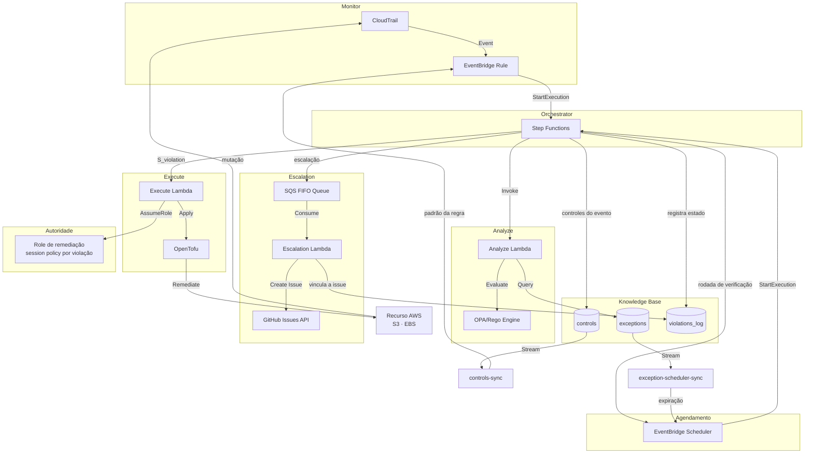
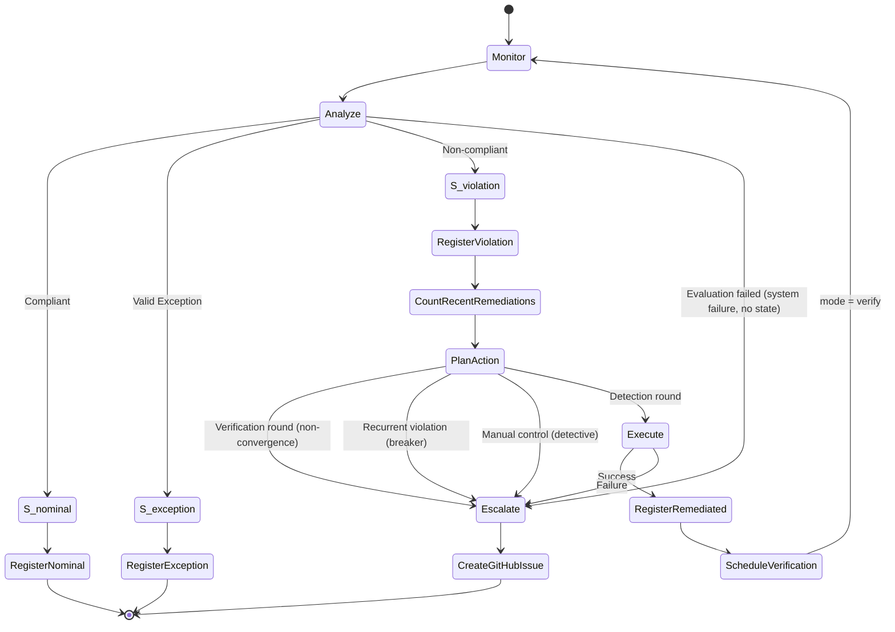
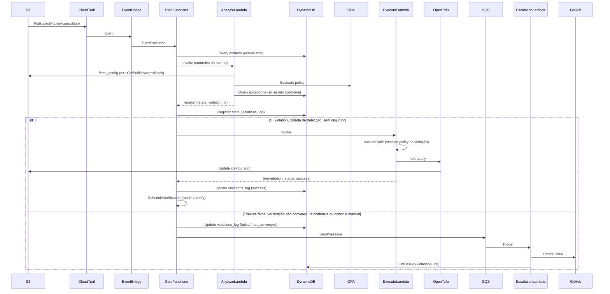
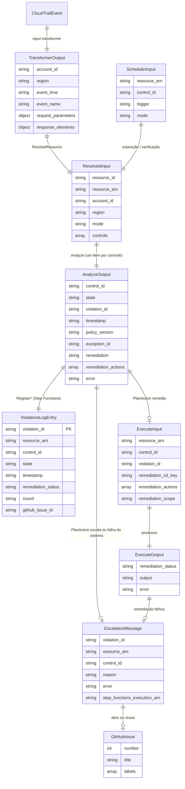
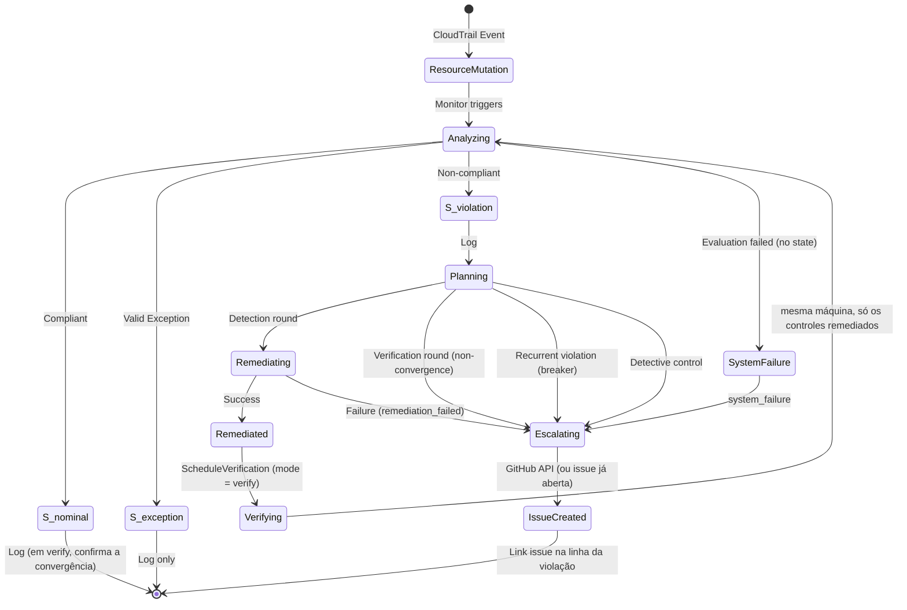

# Design Document: MVP Compliance Automation Loop

## Overview

O MVP Compliance Automation Loop implementa um sistema de automação de conformidade baseado no padrão arquitetural MAPE-K (Monitor, Analyze, Plan, Execute, Knowledge). O sistema detecta desvios de conformidade em recursos AWS, classifica o estado do recurso, executa remediação automática quando apropriado, e escala violações não resolvidas para operadores humanos.

O sistema suporta múltiplos controles de compliance de forma extensível e multi-serviço. Seis controles estão implementados, em dois serviços: bloqueio de acesso público S3 (`ctrl-s3-public-block`), política SSL-only (`ctrl-s3-ssl-only`), versionamento S3 (`ctrl-s3-versioning`), encryption S3 (`ctrl-s3-encryption`) e EBS encryption by default (`ctrl-ebs-encryption-default`), com remediação automática, e volume EBS sem criptografia (`ctrl-ebs-volume-encrypted`), detectivo — classifica e escala, sem remediar. Novos controles podem ser adicionados sem rebuild de imagens — políticas Rego e templates HCL de remediação são armazenados no S3 e carregados em runtime. O sistema monitora eventos CloudTrail de múltiplos serviços AWS, resolve dinamicamente quais controles aplicar via tabela DynamoDB, avalia conformidade usando OPA/Rego com fetcher genérico parametrizado por `fetch_config`, e remedia violações usando OpenTofu.

### Design Goals

- **Automação determinística**: Cada evento deve seguir fluxo previsível baseado em classificação de estado
- **Auditabilidade completa**: Todas as avaliações e ações devem ser registradas permanentemente
- **Idempotência**: Remediação deve ser segura para execução repetida
- **Separação de responsabilidades**: Políticas versionadas em Git, estado em DynamoDB, execução em Lambda
- **Escalação confiável**: Falhas devem ser notificadas sem perda de informação

### MAPE-K Architecture Mapping

- **Monitor**: CloudTrail + EventBridge Rule (event pattern gerenciado dinamicamente pela Lambda `controls-sync` via DynamoDB Stream na tabela `controls`)
- **Analyze**: Lambda Python 3.14 (arm64, 512 MB) + OPA/Rego 1.21.0 (binário arm64 via Lambda Layer, políticas carregadas do S3 em runtime) + fetcher genérico via `fetch_config` (chamadas boto3 parametrizadas pela tabela `controls`) + consulta DynamoDB exceptions + role com só as leituras que os controles fazem
- **Plan**: estado `PlanAction` do Step Functions — decide, para cada `S_violation`, entre remediar e escalar: escala a rodada de verificação (não convergência), a violação reincidente (disjuntor, a partir do histórico do `violations_log`) e o controle detectivo; remedia o resto. Antes dele, `QueryControls` resolve quais controles se aplicam ao `eventName` do CloudTrail via `cloudtrail_events` na tabela `controls`
- **Execute**: Lambda Python 3.14 (arm64, 3008 MB) + OpenTofu 1.12.6 (binário via Lambda Layer) com state efêmero local. Templates HCL carregados do S3 em runtime. Provider AWS 6.66.0 pré-inicializado, armazenado no S3 como cache em zstd, baixado e extraído em `/tmp` na fase de init e compartilhado via symlink (elimina `tofu init` em runtime). Cada remediação roda com uma sessão assumida por violação (ver *Autoridade por incidente*)
- **Knowledge**: DynamoDB (controls, exceptions, violations_log)

### State Classification Model

O sistema classifica recursos em três estados formais:

- **S_nominal**: Recurso conforme com política vigente
- **S_exception**: Recurso não conforme mas com exceção aprovada e vigente
- **S_violation**: Recurso não conforme sem exceção válida (requer remediação)

Não há quarto estado. Um controle que não pôde ser avaliado — leitura da configuração falhou, OPA falhou, a consulta de exceções falhou, o orçamento de tempo acabou — tem estado **desconhecido**: é uma falha do sistema, não uma propriedade do recurso, e fica fora do modelo formal. O Analyze devolve esse controle sem `state`, e o orquestrador o escala como `system_failure`, sem registrá-lo no `violations_log` como se fosse um estado. Tampouco é uma `S_violation`: com a consulta de exceções falhando, o recurso pode estar autorizado, e com a leitura falhando pode estar conforme — remediar seria agir sem observação.

A rodada (detecção ou verificação) também não é estado: não muda a classificação do recurso, só a ação que o loop toma diante dela (ver *Orchestrator*). O mesmo vale para o disjuntor de reincidência e para os controles detectivos: uma violação reincidente e uma violação sem remediação automática continuam sendo `S_violation` — o que muda é o que o Plan decide fazer.


## Metodologia de Pesquisa: Design Science Research

Este trabalho segue a Design Science Research (DSR): produz um **artefato** para um problema real e gera conhecimento ao construí-lo e avaliá-lo (HEVNER et al., 2004). O processo é o de Peffers et al. (2007); os ciclos, os de Hevner (2007); a estratégia de avaliação, a do FEDS (VENABLE; PRIES-HEJE; BASKERVILLE, 2016). As seções seguintes deste documento são as atividades desse processo — esta seção diz qual é qual.

### Ciclos

| Ciclo (HEVNER, 2007) | Neste trabalho |
|---|---|
| **Relevância** — o problema vem do ambiente | Desvios de configuração em nuvem ficam expostos por dias a semanas até a remediação manual (Verizon DBIR), sem trilha que ligue detecção, decisão e correção |
| **Rigor** — a base de conhecimento | MAPE-K (KEPHART; CHESS, 2003); policy-as-code (OPA/Rego); infraestrutura como código (OpenTofu); menor privilégio (SALTZER; SCHROEDER, 1975; NIST SP 800-207); validade experimental (WOHLIN et al., 2012) |
| **Design** — construir e avaliar em iteração | Nove séries de medição, cada uma um ciclo de construção e avaliação (*Episódios de avaliação*, abaixo) |

### O artefato

Pelos tipos de March e Smith (1995):

| Tipo | Neste trabalho | Onde |
|---|---|---|
| **Construto** | Os três estados formais (`S_nominal`, `S_violation`, `S_exception`) e as métricas `t_detection`, `t_remediation`, `t_exposure`, `t_verified` | *State Classification Model*; *Metodologia de Medição* |
| **Modelo** | O mapeamento do MAPE-K para serviços AWS, o grafo de estados e o modelo de dados do Knowledge | *MAPE-K Architecture Mapping*; *Data Models* |
| **Método** | O laço em duas rodadas (detecção e verificação), a autoridade por incidente, o disjuntor de reincidência, a exceção com expiração | *Components and Interfaces*; *Autoridade por incidente* |
| **Instanciação** | A prova de conceito na AWS: 6 controles em 2 serviços (S3 e EC2) | o repositório |

Na matriz de Gregor e Hevner (2013), a contribuição é de **melhoria**: solução nova — laço autônomo com verificação e autoridade restrita ao incidente — para um problema conhecido, a remediação de conformidade.

### Processo

| Atividade (PEFFERS et al., 2007) | Neste trabalho |
|---|---|
| 1. Identificar o problema | Exposição longa e sem trilha de auditoria na remediação manual — ponto de entrada da pesquisa |
| 2. Definir os objetivos | *Design Goals* e três hipóteses: **H1** — o laço reduz o MTTR de dias para segundos; **H2** — toda avaliação e toda ação deixam registro completo e encadeado; **H3** — o tempo de exposição cai na mesma proporção |
| 3. Projetar e desenvolver | `requirements.md` e este documento, com 30 propriedades de corretude (*Correctness Properties*) |
| 4. Demonstrar | 16 cenários na conta real (C1–C10, CTRL-01–06) e traces de execução (*Evidências Experimentais*) |
| 5. Avaliar | *Estratégia de avaliação*, abaixo |
| 6. Comunicar | o TCC, este documento e a página de resultados |

As atividades 3 a 5 se repetiram nove vezes.

### Estratégia de avaliação

**Technical Risk & Efficacy** (VENABLE; PRIES-HEJE; BASKERVILLE, 2016): avaliação **artificial**, **formativa** ao longo das séries e **somativa** na última. É a estratégia indicada quando o risco principal é técnico — o laço convergir, não oscilar, não ampliar privilégio — e não de aceitação por usuários.

**Métodos** (tipologia de HEVNER et al., 2004):

| Método | Aplicação | Evidência |
|---|---|---|
| **Experimental** — experimento controlado | 9 séries × 10 execuções da suíte completa; entre séries, teste de Welch, teste de permutação e g de Hedges; IC 95% por amostra e por rodada | `results/*/`, *Validação estatística das comparações* |
| **Experimental** — simulação | Falhas injetadas na camada de operação; experimento de variantes de desempenho do Execute | *Falhas injetadas*; *Otimização do Execute* |
| **Teste** — caixa-preta | 16 cenários na conta real, 160/160 por série | `scripts/integration_test.py` |
| **Teste** — caixa-branca | 168 testes (unitários, de propriedade, de contrato) e 44 de política Rego, no CI a cada push | *Testing Strategy* |
| **Analítico** — estático | Propriedades do grafo verificadas sem executar: no máximo duas execuções por incidente, a verificação nunca remedia, issue só em linha escalada (P23) | *Testes estruturais do grafo* |
| **Analítico** — arquitetura e otimização | Custo medido por incidente, dimensionamento das Lambdas, tempo por fase do Execute | *Custo em dinheiro, medido*; *Dimensionamento das Lambdas* |
| **Descritivo** | Cenários com traces reais; argumentação sobre alternativas (Standard vs. Express, OpenTofu vs. SDK, fetcher genérico vs. código carregado) | *Evidências Experimentais*; seções de decisão |

### Episódios de avaliação

Cada série mediu o sistema como estava, e o resultado orientou a iteração seguinte. Δ é a variação do MTTR quente, no patamar lento, sobre a série anterior:

| Série | Mudança | Δ MTTR | O que a avaliação ensinou |
|---|---|---|---|
| eco | confirmação pelo eco do CloudTrail | — | converge, mas a confirmação depende de um evento que o próprio sistema provoca |
| duas rodadas | verificação explícita, espera de 15 s | +0,18 s | a verificação é barata; a espera custava 15 s na convergência |
| leitura imediata | espera removida | +0,04 s (n.s.) | nenhuma leitura desatualizada — a espera era desnecessária |
| três estados | grafo com os estados formais | +0,02 s (n.s.) | formalizar o modelo não custa |
| sessão escopada | disjuntor, controle detectivo, autoridade por incidente | +0,28 s | o menor privilégio tem preço, e ele é pequeno |
| final | identidades de serviço endurecidas | 0,00 s (n.s.) | condições de IAM não custam |
| upgrade | OPA, OpenTofu e provider AWS novos | +1,06 s | a dependência pesa mais que qualquer mudança de desenho |
| Python 3.14 | runtime | −0,01 s (n.s.) | a linguagem dos handlers não é gargalo |
| **otimizada** | Execute a 3008 MB, cache no init | −0,97 s | **avaliação somativa**: o segundo perdido no upgrade volta |

### Resultado da avaliação somativa

| Hipótese | Resultado (série `results/optimized/`) |
|---|---|
| **H1** | **6,61 s** ± 0,11 de remediação, contra dias a semanas do processo manual |
| **H2** | 1.160 linhas de auditoria, todas completas; 430 remediações, cada uma com exatamente uma verificação; cada escrita no CloudTrail leva o `violation_id` como nome da sessão |
| **H3** | **13,87 s** ± 1,71 de exposição, dos quais 7,90 s são a entrega do CloudTrail, fora do sistema |

O detalhe, com intervalos e testes, está em *Síntese por Hipótese*; as ameaças à validade, em *Ameaças à validade*.

### Limites da avaliação

1. **Nenhum episódio naturalista.** Uma conta, uma região, violações sintéticas; sem uso em produção nem avaliação com praticantes (L6). Pelo FEDS, o próximo episódio seria naturalista — um piloto em conta real ou uma avaliação com especialistas.
2. **O baseline manual não foi medido.** Vem do Verizon DBIR; a comparação de H1 é de ordem de grandeza.
3. **Utilidade percebida não foi avaliada.** A avaliação cobre eficácia e eficiência técnica, não aceitação.

### Conhecimento de desenho

Além do artefato, a avaliação produziu conhecimento reaproveitável em outros laços de remediação:

- **O custo da remediação está na ferramenta, não no serviço**: remediar S3 e EC2 custa o mesmo, porque o tempo é a inicialização do OpenTofu e do provider
- **A exposição é dominada pela detecção**: reduzi-la exige trocar o Monitor, não otimizar o laço
- **Menor privilégio por incidente é viável**: +0,28 s, e mais estreito que o controle por atributo — as APIs usadas nem aceitam condição de tag (*Modelo de Permissões*)
- **Verificação sem espera**: 2.760 leituras imediatas após a escrita, todas consistentes
- **Um laço automático precisa de disjuntor**: sem ele, uma remediação que a política não aceita oscila sem limite (L11)

## Architecture

### High-Level Architecture Diagram



### Workflow State Machine Diagram



### Component Interaction Flow




## Components and Interfaces

### 1. Monitor (CloudTrail + EventBridge)

**Responsibility**: Detectar eventos de mutação em recursos AWS e extrair metadados relevantes.

**Implementation**:
- CloudTrail trail com eventos de gerenciamento de escrita (`ReadWriteType: WriteOnly`) e validação de integridade dos arquivos
- EventBridge Rule com pattern filter dinâmico (gerenciado por `controls-sync`)
- Input transformer genérico: extrai `request_parameters` e `response_elements` do CloudTrail; `ResolveResource` na Step Function deriva `resource_id` e `resource_arn`
- Target: Step Functions state machine, com retentativas limitadas a 1 h e a fila `intake-failures` para o que não puder ser entregue

**Event Pattern** (gerenciado dinamicamente):
```json
{
  "source": [{"prefix": "aws."}],
  "detail-type": ["AWS API Call via CloudTrail"],
  "detail": {
    "eventName": ["CreateBucket", "PutBucketPublicAccessBlock", "PutBucketVersioning", "DisableEbsEncryptionByDefault", "..."]
  }
}
```

**Proveniência do evento.** Uma versão anterior removeu o filtro `source` para aceitar vários serviços (S3, EC2) na mesma regra, com o argumento de que o `eventName` é específico o bastante para evitar falsos positivos. Especificidade, porém, não é proveniência. O `detail-type` é texto livre: quem tiver `events:PutEvents` no barramento padrão da conta pode publicar um "AWS API Call via CloudTrail" com qualquer `eventName` e quaisquer parâmetros, e a regra casava — medido com `aws events test-event-pattern` sobre a regra ativa, com um evento de `source` `fault.injection`: **True**. Um evento forjado não altera a classificação, porque o Analyze lê o estado real do recurso, mas inicia avaliações e remediações a pedido de quem não mudou nada, e grava na trilha de auditoria um gatilho que nunca aconteceu.

O prefixo `aws.` fecha a brecha sem perder o multi-serviço. O `PutEvents` recusa toda origem que começa com `aws.` (`NotAuthorizedForSourceException`, medido na conta), então só o que a própria AWS emite — as entregas do CloudTrail — casa com a regra. Depois da mudança, o mesmo evento forjado dá **False** na regra ativa, e `tests/contract/test_event_pattern.py` mantém os dois casos.

O padrão gerado pelo `controls-sync` inclui ainda uma cláusula de identidade: eventos cuja sessão foi emitida pela role de remediação — a que o Execute assume para cada violação — são descartados, para que as escritas da própria remediação não reiniciem o loop. A cláusula usa `$or` com `exists: false`, porque identidades sem emissor de sessão (usuários IAM, root) não casariam com um `anything-but` simples — ver *Fechamento do laço em duas rodadas*.

**Output Schema** (o que o *input transformer* entrega à máquina; `ResolveResource` deriva o recurso a partir dele):
```json
{
  "account_id": "123456789012",
  "region": "us-east-1",
  "event_time": "2026-09-25T02:04:54Z",
  "event_name": "CreateBucket",
  "request_parameters": {"bucketName": "bucket-name", "Host": "bucket-name.s3.amazonaws.com"},
  "response_elements": null
}
```

`ResolveResource` produz `resource_id` e `resource_arn` (`arn:aws:s3:::bucket-name`; para volumes, `responseElements.volumeId`; para controles de conta, o identificador sintético da conta — L3). As rotas do Scheduler (expiração de exceção, rodada de verificação) chegam com `resource_arn` e `control_id` já definidos.

**Error Handling**:
- Evento sem campo de recurso: recebe o identificador sintético da conta em vez de ser descartado (Req. 15.6 revisado) — o EventBridge só admite eventos de controles cadastrados, que sempre trazem o recurso
- Evento que a regra não consegue entregar (role sem permissão, máquina indisponível, throttling por mais de 1 h): vai para a fila `intake-failures`, dispara o alarme `intake-failed` e é reprocessado por `scripts/replay_intake.py` (ver *Operação*)


### 2. Orchestrator (Step Functions Standard)

**Responsibility**: Coordenar transições entre componentes do loop MAPE-K baseado em classificação de estado.

**Implementation**:
- Step Functions **Standard** (não Express) — ver *Por que Standard e não Express*
- Definição em JSONata (`infra/state_machine_definition.json`); `Choice` pelos três estados formais, e o `PlanAction` decide a ação
- SDK integrations diretas para DynamoDB, SQS e o próprio Step Functions (sem Lambda intermediária); o Step Functions é o único componente que grava no `violations_log`
- Log de execução em `level: ALL` com `includeExecutionData`, retenção de 30 dias
- Timeout global de 600 segundos (ver a cadeia de timeouts em *Correctness Properties*)
- Estados terminais explícitos: `ExecutionSucceeded` (Succeed) e `ExecutionFailed` (Fail com `Error: ComplianceEscalation`)
- **Laço fechado em duas rodadas**: uma rodada de detecção que remediou algo agenda exatamente uma rodada de verificação (`mode = verify`), que confirma `S_nominal` ou escala — nunca remedeia de novo. Ver *Fechamento do laço em duas rodadas*
- Após o Map state, `EvaluateOutcome` verifica se algum controle foi escalado — se sim, a execução termina como FAILED

#### Por que Standard e não Express

A escolha não é por custo — nesse quesito o Express ganharia —, e sim por três propriedades de que o projeto depende. Nenhum recurso de orquestração exclusivo do Standard é usado (`.sync`, callback com token, `Wait` longo), então são essas três que justificam o tipo.

| Propriedade | Standard | Express | Onde o projeto depende dela |
|---|---|---|---|
| **Histórico consultável por API** | `DescribeExecution`, `GetExecutionHistory` e `ListExecutions`, por 90 dias | Não disponíveis; o histórico existe apenas nos CloudWatch Logs | Toda a medição — `integration_test.py`, `benchmark.py`, `classify_cold_starts.py`, `verification_consistency.py` — lê o histórico por API. Na auditoria (H2), a issue aponta o ARN da execução, que o Standard mantém consultável |
| **Semântica de execução** | Exatamente uma vez por disparo | Pelo menos uma vez quando iniciada de forma assíncrona (EventBridge, `startExecution`) | Uma violação deve gerar uma remediação, uma linha de `S_violation` e, se falhar, uma issue. Uma execução duplicada teria outro `violation_id` — gerado pelo Analyze a cada avaliação —, então nem a deduplicação da fila FIFO nem a de issues a pegariam: duas linhas e duas escalações para o mesmo incidente |
| **Duração máxima** | 1 ano | 5 minutos | O `TimeoutSeconds` global é 600 s porque o pior caso serial é 550 s (ver *Property 28*). O caso típico caberia com folga — a execução mais longa de uma rodada da suíte levou 19,4 s —, mas o limite existiria só no caso típico |

As três propriedades vêm da documentação do Step Functions; a primeira e a segunda são exercitadas por construção em cada execução da suíte, e a terceira pelo orçamento de timeouts.

**Custo, medido numa rodada real do benchmark** (`results/three-state/`, rodada 05, 43 execuções):

| | Transições por execução | Standard (US$ 0,025 por 1.000 transições) | Express (US$ 1 por milhão de requisições + GB-s; estimativa) |
|---|---|---|---|
| Rodada de detecção | 19,8 em média (máx. 30) | ~US$ 0,00050 | ~US$ 0,000006 |
| Rodada de verificação | 10,4 em média | ~US$ 0,00026 | ~US$ 0,000002 |
| Rodada inteira da suíte | 673 transições, 225 s somados | **~US$ 0,017** | **~US$ 0,0002** |

O Express seria ~100× mais barato. Em valor absoluto é irrelevante para a avaliação: as 4.000 transições mensais gratuitas cobrem ~6 rodadas da suíte. Em produção, a 100 mil incidentes por mês (~30 transições cada), o Standard custaria ~US$ 75/mês contra menos de US$ 1 do Express. A diferença encolhe por um motivo: o log da máquina já está em `level: ALL` com `includeExecutionData`, e o Express dependeria dele para ter qualquer histórico — o custo de ingestão no CloudWatch Logs passaria a pesar mais que as transições.

**Quando o Express seria a escolha**: alto volume de eventos curtos, com deduplicação própria (por exemplo, `violation_id` derivado do evento em vez de gerado por avaliação), auditoria reconstruída a partir dos logs e o pior caso de duração abaixo de 5 minutos. Nenhuma das três condições vale neste escopo.

**State Machine Definition** (estrutura real):

A máquina de estados usa JSONata e processa múltiplos controles via Map state. Fluxo:

```
ResolveResource          # extrai resource_id/resource_arn dos request_parameters do CloudTrail;
                         # normaliza mode (detect|verify) e a origem da rodada de verificação
  → RouteControlLookup   # Choice, em ordem:
       ├─ mode = verify e há controles → InvokeAnalyze   # lê imediatamente: consistência medida
       │                          # usa as definições dos controles remediados que a rodada
       │                          # de detecção carregou; não há consulta a fazer
       ├─ mode = verify sem controles → UnverifiableRemediationEscalation → ExecutionFailed
       │                          # uma verificação sem controles reavaliaria nada e passaria
       ├─ input tem control_id (re-avaliação de exceção) → GetControlById
       │          → CheckRequestedControlFound
       │               ├─ achou → InvokeAnalyze
       │               └─ não   → RequestedControlNotFound (SQS) → ExecutionFailed
       │                          # controle referenciado por exceção foi renomeado/removido:
       │                          # erro de governança, NUNCA sucesso silencioso
       │          (lookup falhou → ControlLookupFailedEscalation → ExecutionFailed)
       └─ não → QueryControls             # scan na tabela controls por cloudtrail_events
                  (falhou → ControlLookupFailedEscalation → ExecutionFailed)
                  → CheckControlsFound    # Choice: há controles? senão → ExecutionSucceeded
  → InvokeAnalyze        # Lambda; recebe controls completos, retorna results[] (um por controle)
       (Catch States.ALL → AnalyzeFailedEscalation → ExecutionFailed)
  → ProcessResults       # Map sobre results[], MaxConcurrency=1
       └─ ClassifyState  # Choice pelos três estados formais — e só por eles; a rodada não entra aqui
            ├─ S_nominal   → RegisterNominal   (putItem) → outcome=nominal | verified
            │                          # em mode=verify grava também round, origin_execution e
            │                          # verifies_violation_id: é a confirmação da convergência
            ├─ S_exception → RegisterException (putItem) → outcome=exception
            ├─ S_violation → RegisterViolation (putItem; em verify + remediation_status=not_converged)
            │     → CountRecentRemediations  # query no GSI: remediações com sucesso deste
            │     │                          # (recurso, controle) na janela do disjuntor
            │     → PlanAction   # Choice: o que fazer com a violação
            │          ├─ mode = verify        → Escalate (non_convergence) → outcome=escalated
            │          │                          # primeira regra de propósito: numa rodada de
            │          │                          # verificação uma violação nunca alcança InvokeExecute
            │          ├─ reincidências ≥ N    → Escalate (recurrent_violation)
            │          │                          # disjuntor: alguém desfaz a remediação; remediar
            │          │                          # de novo só manteria a gangorra
            │          ├─ controle detectivo   → Escalate (manual_remediation_required)
            │          │                          # remediation = manual: a correção é disruptiva
            │          └─ senão → InvokeExecute
            │                → CheckRemediationStatus
            │                     ├─ success → UpdateLogSuccess (updateItem) → outcome=remediated
            │                     └─ default → UpdateLogFailed  (updateItem) → Escalate (remediation_failed)
            │                                  # qualquer coisa que não seja success explícito
            │                (Catch States.ALL → UpdateLogFailed → Escalate)
            └─ default (sem estado) → Escalate (system_failure) → outcome=escalated
                                       # falha do sistema, fora do modelo: sem registro de estado
  → ScheduleVerificationIfNeeded   # Choice, em ordem:
       ├─ detecção, remediou, e os controles a verificar cobrem todos os remediados
       │     → ScheduleVerification  # states:startExecution na própria máquina (mode=verify)
       │          (Catch → UnverifiableRemediationEscalation → ExecutionFailed)
       ├─ detecção, remediou, mas faltam controles → UnverifiableRemediationEscalation
       │                          # uma verificação parcial passaria sem checar os que faltam
       └─ default → EvaluateOutcome
  → EvaluateOutcome      # Choice: algum outcome=escalated? → ExecutionFailed; senão → ExecutionSucceeded
```

#### Fechamento do laço em duas rodadas

Até esta versão, o laço se fechava por **eco**: cada escrita do Execute (`PutBucketPolicy`, `PutBucketVersioning`…) gerava o próprio evento no CloudTrail, e cada evento abria uma execução nova só para confirmar. O histórico de 6 buckets do C5 mostrou o custo: 2 eventos do teste produziam 4 remediações e 4 execuções de confirmação — 6 execuções por bucket, uma confirmação por controle remediado, sem ligação explícita com a violação confirmada. E, sem disjuntor, uma política mais estrita que a sua remediação oscilaria indefinidamente (L11).

O laço agora é explícito:

1. **O eco é filtrado na origem.** A regra do EventBridge descarta eventos cuja sessão foi emitida pela role de remediação, que o Execute assume para cada violação (ver *Autoridade por incidente*; antes da session policy, era a role da própria Lambda). Toda escrita de remediação chega ao CloudTrail como `AssumedRole` dessa role — verificado no CloudTrail da conta — enquanto mudanças humanas chegam como `IAMUser`, **sem** `sessionContext.sessionIssuer`.
2. **A rodada de detecção agenda uma única verificação.** Se remediou algo, ela inicia a própria máquina em `mode = verify`, levando as definições dos controles remediados e o mapa controle → `violation_id`.
3. **A rodada de verificação não remedeia.** Reavalia imediatamente exatamente os controles remediados e registra `S_nominal` ligado à violação que confirma, ou registra a não convergência e escala.

Um incidente custa, portanto, **no máximo duas execuções**, e oscilar é estruturalmente impossível. Essas propriedades são verificadas estaticamente sobre o grafo em `tests/unit/test_state_machine.py`: a classificação tem exatamente os três estados formais e nenhuma regra por rodada; toda saída de `RegisterViolation` passa pelo `PlanAction`, cuja primeira regra manda a rodada de verificação para a escalação, de modo que ela não alcança `InvokeExecute`; e só uma rodada de detecção agenda verificação.

**A armadilha do filtro.** Um `anything-but` simples sobre o emissor da sessão descartaria justamente os eventos humanos, porque num campo ausente ele não casa. Medido com `aws events test-event-pattern`:

| padrão | IAMUser | role de remediação | outro role |
|---|---|---|---|
| só `anything-but` | **False** | False | True |
| `$or` com `exists: false` | True | False | True |

O primeiro padrão faria o sistema parar de detectar toda violação feita pelo console — o cenário C1 — sem nenhum erro. O `controls-sync` gera o segundo, e `tests/contract/test_event_pattern.py` avalia o padrão gerado no próprio EventBridge para as quatro identidades e para uma origem forjada (ver *Proveniência do evento*).

**Consistência de leitura: medida, não presumida.** A configuração de bucket do S3 é eventualmente consistente, e o eco escondia a questão — o evento chegava segundos depois da escrita. A primeira versão do laço explícito compensava com uma espera fixa de 15 s antes de reavaliar, um valor escolhido e não medido. A espera foi removida depois de medir o que acontece sem ela, com `scripts/verification_consistency.py`, que liga cada rodada de verificação ao fim da última remediação da execução de origem:

| | espera de 15 s | leitura imediata | três estados | sessão escopada | final | atualização | Python 3.14 | otimizada |
|---|---|---|---|---|---|---|---|---|
| rodadas de verificação | 160 | 161 | 190 | 270 | 270 | 269 | 274 | 270 |
| leituras de controle `verified` | 280/280 | **283/283** | **320/320** | **430/430** | **430/430** | **429/429** | **438/438** | **430/430** |
| intervalo escrita → leitura | 15,41 s | **0,37 s** | **0,37 s** | **0,36 s** | **0,35 s** | **0,35 s** | **0,36 s** | **0,35 s** (0,24–0,49) |

Nenhuma leitura desatualizada nas **2.760 leituras imediatas das sete séries sem espera**, feitas ~0,35 s depois da escrita: pela regra de três, a taxa de leitura desatualizada é inferior a ~0,11% por leitura, com 95% de confiança. A afirmação tem dois limites. Vale para os controles que foram de fato remediados e verificados — os três S3 (public-block, ssl-only, versioning) e, com 10 leituras, o de EBS; o `ctrl-s3-encryption` nunca precisou de remediação. E, se uma leitura desatualizada ocorrer, o erro cai do lado seguro — uma escalação de não convergência indevida, nunca um `S_nominal` falso. Para um controle futuro com propagação mais lenta, a mitigação é reavaliar com novas tentativas limitadas antes de escalar, não voltar a uma espera fixa para todos (ver L13).

#### Disjuntor de reincidência

As duas rodadas limitam **um incidente**; não limitam uma sequência deles. Um processo externo que reaplique a configuração violadora — um pipeline de outro time com tfstate próprio, um script agendado — produz uma gangorra: detecção, remediação, verificação `S_nominal`, reversão, tudo de novo. Cada incidente converge, o MTTR fica ótimo, nada escala, e o conflito de dono nunca chega a uma pessoa.

Antes de remediar, o `CountRecentRemediations` consulta o GSI `resource_arn-timestamp-index` e conta as remediações **bem-sucedidas deste mesmo par (recurso, controle)** na janela configurada. Passando do limiar, o `PlanAction` escala com `reason = recurrent_violation` em vez de remediar: o recurso fica como está e a decisão volta para quem pode resolver o conflito — corrigir a origem ou registrar uma exceção.

É o ponto em que o **Knowledge realimenta o Plan**: o histórico deixa de ser só registro de auditoria e passa a mudar a decisão. Até aqui, o `violations_log` era escrito e nunca lido para decidir.

Dois cuidados no desenho:

- **Falha aberta**: se a consulta falhar, a contagem vai a zero e o fluxo remedeia como antes. Um erro transitório do DynamoDB não deve transformar uma violação remediável numa violação parada.
- **Limiar e janela são parâmetros** (`recurrence_threshold`, `recurrence_window_minutes`, por padrão 3 e 10 minutos). A corrida `CreateBucket` + violação (L6) já produz duas remediações legítimas do mesmo par em segundos, então o limiar precisa ficar acima disso. A calibração é operacional, não medida (L16).

#### Controles detectivos

Nem toda violação tem remediação automática aceitável. Um volume EBS sem criptografia não pode ser corrigido no lugar: a correção é snapshot → cópia criptografada → volume novo → troca na instância, com parada e ID novo. Aplicar isso sozinho seria pior que a violação.

Um controle marca isso no próprio cadastro, com `"remediation": {"S": "manual"}` e sem `remediation.tf`. O Analyze repassa o campo, e o `PlanAction` roteia para `Escalate` com `reason = manual_remediation_required`. A classificação não muda: o recurso está em `S_violation` como qualquer outro, e a linha de auditoria é a mesma — o que muda é a ação planejada, que é avisar uma pessoa.

O `scripts/deploy_control.sh` recusa um controle sem `remediation.tf` que não se declare manual, e um teste de contrato exige a mesma coisa: um controle que simplesmente esqueceu a remediação não vira detectivo por acidente.

**O que continua possível**: duas mudanças *externas* simultâneas sobre o mesmo controle (a corrida `CreateBucket` + violação do C1/C5) ainda produzem duas rodadas de detecção e duas de verificação — limitado, mas não deduplicado (ver L6).

Estados terminais explícitos:
- `ExecutionSucceeded` (`Succeed`)
- `ExecutionFailed` (`Fail`, `Error: ComplianceEscalation`) — execuções que escalam terminam como FAILED no console

Persistência no `violations_log`: o **Step Functions é o único componente que grava** (o Analyze é função pura, sem side-effects). `RegisterNominal/Exception/Violation` fazem `putItem` com todos os campos obrigatórios; `UpdateLogSuccess/Failed` fazem `updateItem` (não sobrescrevem o registro, apenas adicionam `remediation_status`/`remediation_output`/`remediation_error`).

**Invariante de completude (H2)**: toda avaliação que produz um estado gera um registro completo no `violations_log` ANTES de qualquer ação ou escalação. Uma falha de sistema não produz estado e, portanto, não gera linha: o seu rastro é o histórico da execução e a issue, cuja mensagem carrega `reason = system_failure`, o erro e o ARN da execução. A Escalation Lambda usa `ConditionExpression attribute_exists(violation_id)`: nunca cria registros, apenas anota os existentes — para uma falha de sistema, a issue é aberta e fica sem vínculo no log, em vez de criar um item fantasma (só com os campos da issue, invisível ao GSI de auditoria), que era o defeito original.


### 3. Analyze Lambda

**Responsibility**: Classificar estado de conformidade do recurso usando OPA/Rego e consulta de exceções.

**Implementation**:
- Runtime: Python 3.14, arm64, 512 MB (a 256 MB a avaliação ficou 2,4× mais lenta — *Otimização do Execute*)
- OPA 1.21.0 via Lambda Layer (`/opt/bin/opa`, ~26 MB comprimido, binário estático arm64); políticas Rego carregadas do S3 em runtime e mantidas em cache por `policy_version`
- Deployment package: `handler.py` (~5,6 KB)
- Timeout: 60 s — cobre o pior caso de vários controles por invocação; o orçamento do OPA é recalculado a cada controle a partir do tempo restante
- Medido na série atual: 0,13 s p50 por invocação quente (OPA ~0,10 s, leitura da configuração ~0,06 s); ~1,2–1,6 s no frio

**Algorithm** (estrutura real, simplificada):
```python
def lambda_handler(event, context):
    # Uma invocação avalia TODOS os controles que o evento dispara (event['controls'],
    # já resolvidos pelo Step Functions). Função pura: não grava nada.
    resource_id = extract_resource_id(event['resource_arn'])
    now = canonical_timestamp()            # um instante por invocação (Property 3)
    results = []
    for control in event['controls']:
        try:
            # 1. Configuração atual, pelo fetcher genérico: o controle diz qual chamada
            #    boto3 fazer (só get_/describe_/list_) e onde está o dado no retorno
            config = fetch_resource_config(control['fetch_config'], resource_id)
            # 2. Política Rego do controle, com a mesma versão do OPA dos testes
            compliant = evaluate_policy_with_opa(control['rego_policy_package'], config, ...,
                                                 timeout=opa_budget(context))
            # 3. Exceção só é consultada se não conforme; falha na consulta levanta
            exception = None if compliant else query_exception(control['control_id'], event['resource_arn'])
            results.append({'control_id': ..., 'state': classify_state(compliant, exception),
                            'violation_id': str(uuid.uuid4()), 'timestamp': now, ...})
        except Exception as e:
            # Sem 'state': falha do sistema, fora do modelo; o Step Functions escala
            results.append({'control_id': ..., 'violation_id': str(uuid.uuid4()), 'error': str(e)})
    return {'resource_arn': event['resource_arn'], 'results': results}
```

**DynamoDB Query for Exceptions**:
```python
def query_exception(control_id, resource_arn):
    response = dynamodb.query(
        TableName='exceptions',
        IndexName='resource-control-index',
        KeyConditionExpression='resource_arn = :arn AND control_id = :cid',
        FilterExpression='valid_until > :now',
        ExpressionAttributeValues={
            ':arn': resource_arn,
            ':cid': control_id,
            ':now': int(time.time())
        }
    )
    return response['Items'][0] if response['Items'] else None
```

**Rego Policy** (`s3_public_access.rego`):
```rego
package s3_public_access

default allow := false

allow if {
    input.resource.BlockPublicAcls == true
    input.resource.IgnorePublicAcls == true
    input.resource.BlockPublicPolicy == true
    input.resource.RestrictPublicBuckets == true
}
```

**Output Schema** (um item de `results[]`):
```json
{
  "control_id": "ctrl-s3-public-block",
  "state": "S_violation",
  "violation_id": "550e8400-e29b-41d4-a716-446655440000",
  "timestamp": "2026-09-25T02:09:16.658Z",
  "policy_version": "s3_public_access:v1.0",
  "exception_id": null,
  "approved_by": null,
  "remediation_s3_key": "controls/ctrl-s3-public-block/remediation.tf",
  "remediation": "automatic",
  "remediation_actions": ["s3:GetBucketPublicAccessBlock", "s3:PutBucketPublicAccessBlock"],
  "remediation_scope": "resource"
}
```

**Error Handling** — nenhuma falha vira estado:
- Leitura da configuração falhou (erro que o controle não mapeou em `error_defaults`): o controle volta sem `state` e escala como `system_failure`
- OPA falhou ou estourou o orçamento de tempo: idem — o estado é desconhecido, não `S_violation`
- Consulta de exceções falhou: idem (`ExceptionQueryError`). Tratar a falha como "sem exceção" remediaria um recurso que pode estar autorizado
- `error_defaults` é o único caminho em que um erro vira dado: códigos que significam "configuração ausente" (por exemplo, `NoSuchBucketPolicy`, `ServerSideEncryptionConfigurationNotFoundError`) viram a configuração vazia correspondente, que a política avalia normalmente


### 4. Execute Lambda

**Responsibility**: Remediar recursos em violação usando OpenTofu com infraestrutura como código declarativa, com autoridade restrita à violação.

**Implementation**:
- Runtime: Python 3.14, arm64, **3008 MB** (teto da conta; medido — ver *Otimização do Execute*)
- OpenTofu 1.12.6 via Lambda Layer (`/opt/bin/tofu`, ~29 MB comprimido), gerada por `scripts/build_execute.sh`, que fixa a versão e confere o `SHA256SUMS` oficial
- Provider AWS 6.66.0 pré-inicializado, no S3 como `tf-dot-terraform.tar.zst` (~123 MB; 780 MB extraído), baixado e descompactado em `/tmp` **na fase de init**
- Deployment package: `handler.py` (~4 KB)
- Templates HCL carregados do S3 em runtime
- Timeout: 90 s; `tofu apply` com timeout próprio de 65 s
- Ephemeral storage: 2048 MB (o provider extraído e o arquivo, enquanto é descompactado)
- Nenhuma permissão de escrita própria: assume `compliance-loop-remediation-<env>` com uma session policy por violação
- Medido na série atual (`results/optimized/`): 5,51 s p50 quente, 7,14 s no máximo; no frio, ~3,8 s de init + ~6,1 s de handler

**Provider Cache Strategy**:

O provider AWS extraído (780 MB no 6.66.0; 657 MB no 5.100.0, usado até a série final) não cabe numa Lambda Layer (limite 250 MB descomprimido). A solução usa S3 como cache:

1. **Build time**: o pacote oficial `linux_arm64` do provider é baixado com `tofu providers mirror` (assinatura verificada) e extraído na estrutura de um `.terraform/`; o `.terraform.lock.hcl` vem de `tofu providers lock -platform=linux_arm64`. Os dois são empacotados em zstd como `tf-dot-terraform.tar.zst` e armazenados no S3 — o procedimento está em `lambdas/execute/README.md`.
2. **Init (cold start)**: o módulo baixa e descompacta o cache ao ser importado, dentro da Lambda. A fase de init roda com CPU cheia seja qual for a memória configurada: o frio caiu de 12,6 s para 10,9 s à mesma memória, e para 9,9 s a 3008 MB. Uma falha no init é deixada para o handler, que tenta de novo e reporta a remediação como falha.
3. **Warm start**: `/tmp` persiste entre invocações — o provider já está disponível, custo zero.
4. **Setup por controle**: o handler recria um diretório de trabalho limpo, cria um symlink para o `.terraform` pré-inicializado e copia o lock file.

Essa abordagem elimina tanto o `tofu init` em runtime quanto a necessidade de container image (ECR).

**Lambda Handler** (estrutura real, simplificada):
```python
ALLOWED_ACTIONS = frozenset(json.loads(os.environ['ALLOWED_ACTIONS']))  # do Terraform: a mesma
                                                                        # lista que a role concede

if os.environ.get('AWS_LAMBDA_FUNCTION_NAME'):      # só dentro da Lambda, nunca nos testes
    ensure_provider_cache()                         # init: baixa e descompacta o .tar.zst

def lambda_handler(event, context):
    # 1. Autoridade da violação: ações do controle (validadas contra ALLOWED_ACTIONS) sobre o
    #    recurso que o Analyze classificou; RoleSessionName = violation_id
    creds = remediation_credentials(event['remediation_actions'], event['resource_arn'],
                                    event['remediation_scope'], event['violation_id'])
    # 2. Diretório de trabalho limpo: tfstate efêmero a cada invocação
    work_dir = setup_remediation(event['control_id'], event['remediation_s3_key'])
    tfvars = {"bucket_name": ..., "region": ..., "resource_id": ...}
    # 3. Só o ssl-only lê antes de escrever: a policy existente, para o merge. O cliente assina
    #    com as credenciais da violação; qualquer erro que não seja NoSuchBucketPolicy recusa
    if event['control_id'] == 'ctrl-s3-ssl-only':
        tfvars['existing_policy'] = scoped_s3(creds, region).get_bucket_policy(...)['Policy']
    # 4. O tofu roda com as credenciais da sessão, não com as da Lambda
    result = subprocess.run(['/opt/bin/tofu', 'apply', '-refresh=false', '-auto-approve', ...],
                            env={**os.environ, **creds}, timeout=65)
    return ({"remediation_status": "success", "output": result.stdout} if result.returncode == 0
            else {"remediation_status": "failed", "error": result.stderr})
    # Toda invocação grava uma linha JSON com o tempo de cada fase
    # (assume_role, provider_cache, setup, policy_read, tofu, total).
```

**Design Rationale**:
- `-refresh=false`: o Analyze acabou de ler o estado atual; o refresh repetiria a leitura
- **tfstate efêmero por invocação**: o `work_dir` é recriado a cada execução. Sem isso, `-refresh=false` compararia contra um state obsoleto de um warm start, e um recurso re-violado seria reportado como "No changes" e não remediado
- **`skip_*` no provider** dos `remediation.tf` (`skip_credentials_validation`, `skip_requesting_account_id`, `skip_metadata_api_check`): o provider deixa de consultar o STS a cada `apply` — −0,17 s medido. As credenciais vêm prontas da sessão assumida; não há o que validar
- **Onde o tempo está**: no Execute quente, o `tofu` leva 97% do tempo; o que é Python e SDK soma ~0,2 s (*Otimização do Execute*)
- ARN parsing genérico: S3 deriva `bucket_name` do ARN; outros serviços usam `resource_id`
- Symlink para provider: todos os controles compartilham o mesmo provider sem duplicação em disco

**Output Schema**:
```json
{
  "remediation_status": "success",
  "output": "aws_s3_bucket_public_access_block.remediation: Creation complete"
}
```

**Error Handling** — toda falha volta estruturada (`remediation_status: failed`), e o Step Functions escala com `reason = remediation_failed`:
- Controle pede ação fora de `ALLOWED_ACTIONS`, ou o STS recusa a sessão: falha antes de rodar o `tofu`
- Leitura da policy do ssl-only falhou por outro motivo que não `NoSuchBucketPolicy`: recusa remediar — seguir sem a policy existente apagaria os statements do cliente
- `tofu apply` falhou (por exemplo, `AccessDenied` sobre um alvo fora da sessão, como no C10) ou estourou os 65 s: falha com a saída de erro
- Preparação falhou (cache do provider, download do template): falha com `Setup failed`


### 5. Knowledge Base (DynamoDB)

**Responsibility**: Armazenar políticas, exceções aprovadas, e log de violações.

#### Table: controls

**Purpose**: Metadados de controles de conformidade.

**Schema**:
```json
{
  "TableName": "controls",
  "KeySchema": [
    {"AttributeName": "control_id", "KeyType": "HASH"}
  ],
  "AttributeDefinitions": [
    {"AttributeName": "control_id", "AttributeType": "S"}
  ],
  "BillingMode": "PAY_PER_REQUEST"
}
```

**Sample Item**:
```json
{
  "control_id": "ctrl-s3-public-block",
  "description": "S3 bucket must have all public access block settings enabled",
  "cloudtrail_events": ["PutBucketPublicAccessBlock", "DeleteBucketPublicAccessBlock", "CreateBucket"],
  "rego_policy_package": "s3_public_access",
  "rego_s3_key": "controls/ctrl-s3-public-block/policy.rego",
  "remediation_s3_key": "controls/ctrl-s3-public-block/remediation.tf",
  "resource_type": "aws_s3_bucket",
  "severity": "HIGH",
  "policy_version": "v1.0",
  "fetch_config": {
    "service": "s3",
    "method": "get_public_access_block",
    "params": {"Bucket": "{resource_id}"},
    "result_path": "PublicAccessBlockConfiguration",
    "error_defaults": {
      "NoSuchPublicAccessBlockConfiguration": {
        "BlockPublicAcls": false, "IgnorePublicAcls": false,
        "BlockPublicPolicy": false, "RestrictPublicBuckets": false
      }
    }
  },
  "remediation_actions": ["s3:PutBucketPublicAccessBlock", "s3:GetBucketPublicAccessBlock"],
  "remediation_scope": "resource"
}
```

(O arquivo `controls/<id>/control.json` guarda o mesmo item no formato tipado do DynamoDB. Um controle detectivo tem `"remediation": "manual"` e nenhum `remediation.tf`.)

**Access Pattern**:
- `QueryControls` (Step Functions): scan filtrado por `cloudtrail_events` contendo o `eventName` do evento (L2)
- `GetControlById` (Step Functions): getItem pelo `control_id`, nas rotas do Scheduler
- DynamoDB Stream → `controls-sync`: regenera o padrão da regra do EventBridge a cada mudança
- O Analyze não lê a tabela: recebe as definições prontas do Step Functions


#### Table: exceptions

**Purpose**: Armazenar exceções aprovadas com TTL nativo.

**Schema**:
```json
{
  "TableName": "exceptions",
  "KeySchema": [
    {"AttributeName": "exception_id", "KeyType": "HASH"}
  ],
  "AttributeDefinitions": [
    {"AttributeName": "exception_id", "AttributeType": "S"},
    {"AttributeName": "resource_arn", "AttributeType": "S"},
    {"AttributeName": "control_id", "AttributeType": "S"}
  ],
  "GlobalSecondaryIndexes": [
    {
      "IndexName": "resource-control-index",
      "KeySchema": [
        {"AttributeName": "resource_arn", "KeyType": "HASH"},
        {"AttributeName": "control_id", "KeyType": "RANGE"}
      ],
      "Projection": {
        "ProjectionType": "INCLUDE",
        "NonKeyAttributes": ["valid_until", "exception_id", "approved_by"]
      }
    }
  ],
  "TimeToLiveSpecification": {
    "AttributeName": "valid_until",
    "Enabled": true
  },
  "BillingMode": "PAY_PER_REQUEST"
}
```

**Sample Item**:
```json
{
  "exception_id": "exc-a1b2c3d4-e5f6-7890-abcd-ef1234567890",
  "control_id": "ctrl-s3-public-block",
  "resource_arn": "arn:aws:s3:::public-website-bucket",
  "valid_until": 1735689600,
  "justification": "Public website hosting approved by security team",
  "approved_by": "security-lead@example.com",
  "created_at": "2024-01-15T10:00:00Z",
  "approval_ticket": "JIRA-12345"
}
```

**Access Pattern**:
- Query no GSI `resource-control-index` pela chave exata (`resource_arn`, `control_id`), com `FilterExpression valid_until > now` e **sem `Limit`**: o `Limit` é aplicado antes do filtro e poderia descartar uma exceção válida atrás de uma expirada
- TTL apaga os itens expirados em até 48 h — o comportamento não depende da deleção física
- DynamoDB Stream (`NEW_AND_OLD_IMAGES`) → `exception-scheduler-sync`

**Design Rationale**:
- TTL em `valid_until`: limpeza automática, mas o Analyze filtra explicitamente
- GSI por (`resource_arn`, `control_id`): consulta pontual do par avaliado, em vez de ler todas as exceções de um controle e filtrar por recurso (Req. 5.3 revisado)
- `exception_id` como chave primária: cada concessão tem registro próprio e imutável de quem aprovou (H2)
- Recuperação pontual (PITR, 35 dias): a tabela guarda aprovações, que não se reconstroem de outra fonte

**Re-avaliação Automática após Expiração de Exceção**:

O DynamoDB Streams está habilitado na tabela exceptions com `NEW_AND_OLD_IMAGES`. Uma Lambda (`exception-scheduler-sync`) processa eventos `INSERT` e `MODIFY` do Stream. Para cada exceção ativa com `valid_until` no futuro, a Lambda cria um EventBridge Scheduler one-time programado para `valid_until + 30s`. Quando o Scheduler dispara, a exceção já expirou logicamente, e o Step Functions é acionado para re-avaliação completa (Analyze → Execute se necessário). O Scheduler se auto-deleta após o disparo (`ActionAfterCompletion=DELETE`).

O input enviado ao Step Functions carrega o `control_id` da exceção (não um `event_name` sintético). O estado `RouteControlLookup` detecta a presença de `control_id` e resolve o controle exato via `GetControlById` (getItem), em vez do scan por `cloudtrail_events`. Isso garante que a re-avaliação atinja precisamente o controle da exceção expirada — inclusive controles não-S3 (ex: `ctrl-ebs-encryption-default`), cujos eventos CloudTrail não se relacionam com nenhum evento S3 — sem disparar controles alheios contra o recurso.

Este mecanismo substituiu a abordagem anterior baseada em EventBridge Pipe + DynamoDB TTL, que dependia da deleção física de itens expirados — operação com latência não determinística de até 48h. O novo mecanismo reduz essa latência em ordens de grandeza, mas **não é preciso ao segundo**: medido em nove séries de 10 execuções (C3), o disparo ocorre em média **17,9 s a 29,5 s após o instante agendado**, conforme a série, com extremos de 0,1 s e 48,1 s. O ganho real é de latência **limitada e observável** (dezenas de segundos) contra **ilimitada** (até 48 h) — não de determinismo.

Isso garante que, após expiração de uma exceção, o recurso seja automaticamente re-avaliado pelo loop MAPE-K completo, mantendo o invariante arquitetural de que o Analyze é sempre o componente decisor.

**Limitação conhecida — Latência do TTL**:

A deleção física de itens expirados pelo DynamoDB TTL é **não-determinística** e pode levar até 48 horas após o timestamp `valid_until`. No entanto, a re-avaliação automática **não depende da deleção física**: o EventBridge Scheduler é agendado para `valid_until + 30s` e dispara dentro de algumas dezenas de segundos desse instante (atraso médio entre 17,9 s e 29,5 s em nove séries de 10 execuções, até 48,1 s observados), e a Analyze Lambda filtra exceções com `valid_until > now()`, garantindo que exceções logicamente expiradas sejam ignoradas em qualquer avaliação. O TTL permanece habilitado apenas para limpeza eventual dos itens na tabela.


#### Table: violations_log

**Purpose**: Registro permanente de todas as avaliações de conformidade.

**Schema**:
```json
{
  "TableName": "violations_log",
  "KeySchema": [
    {"AttributeName": "violation_id", "KeyType": "HASH"}
  ],
  "AttributeDefinitions": [
    {"AttributeName": "violation_id", "AttributeType": "S"},
    {"AttributeName": "resource_arn", "AttributeType": "S"},
    {"AttributeName": "timestamp", "AttributeType": "S"}
  ],
  "GlobalSecondaryIndexes": [
    {
      "IndexName": "resource_arn-timestamp-index",
      "KeySchema": [
        {"AttributeName": "resource_arn", "KeyType": "HASH"},
        {"AttributeName": "timestamp", "KeyType": "RANGE"}
      ],
      "Projection": {"ProjectionType": "ALL"}
    }
  ],
  "BillingMode": "PAY_PER_REQUEST"
}
```

Os exemplos abaixo são linhas reais da série atual (`results/optimized/`), com as saídas longas cortadas.

**Sample Item (S_violation com remediação bem-sucedida)**:
```json
{
  "violation_id": "f17fafc7-078d-415d-9b89-7f669803ea99",
  "resource_arn": "arn:aws:s3:::compliance-inttest-c1-1790466952",
  "control_id": "ctrl-s3-public-block",
  "state": "S_violation",
  "timestamp": "2026-09-26T23:56:02.148Z",
  "policy_version": "s3_public_access:v1.0",
  "account_id": "034362047722",
  "region": "us-east-1",
  "remediation_status": "success",
  "remediation_timestamp": "2026-09-26T23:56:15.825Z",
  "remediation_output": "OpenTofu used the selected providers to generate the following execution plan…"
}
```

**Sample Item (S_exception)**:
```json
{
  "violation_id": "b47c82f2-c3db-40fd-8fe1-3852e65c7bf4",
  "resource_arn": "arn:aws:s3:::compliance-inttest-c2-1790475375",
  "control_id": "ctrl-s3-public-block",
  "state": "S_exception",
  "timestamp": "2026-09-27T02:16:26.218Z",
  "policy_version": "s3_public_access:v1.0",
  "exception_id": "exc-test-3f48997a",
  "approved_by": "test-approver",
  "account_id": "034362047722",
  "region": "us-east-1"
}
```

**Sample Item (S_violation com remediação falha e escalada — C8)**:
```json
{
  "violation_id": "e89cc9ac-4bee-4697-bdee-77e22cab2406",
  "resource_arn": "arn:aws:s3:::compliance-inttest-c8-1790469812",
  "control_id": "ctrl-s3-public-block",
  "state": "S_violation",
  "timestamp": "2026-09-27T00:44:30.387Z",
  "policy_version": "s3_public_access:v1.0",
  "remediation_status": "failed",
  "remediation_timestamp": "2026-09-27T00:44:34.818Z",
  "remediation_error": "Error: creating S3 Bucket (compliance-inttest-c8-1790469812) Public Access Block: operation error S3…",
  "github_issue_id": "450",
  "github_issue_url": "https://github.com/ricardoandreh/poc-tcc/issues/450",
  "account_id": "034362047722",
  "region": "us-east-1"
}
```

**Sample Item (rodada de verificação: confirma a convergência de uma remediação)**:
```json
{
  "violation_id": "4c2c4881-a8fe-46f6-bed1-d24dd30fe8c3",
  "resource_arn": "arn:aws:s3:::compliance-ctrl04-1790461235",
  "control_id": "ctrl-s3-versioning",
  "state": "S_nominal",
  "timestamp": "2026-09-26T22:20:59.751Z",
  "policy_version": "s3_versioning:v1.0",
  "round": "verification",
  "origin_execution": "arn:aws:states:us-east-1:034362047722:execution:compliance-loop-compliance-loop-dev:36093fdc-…",
  "verifies_violation_id": "bf5dc005-2828-41bb-8cd4-4a7a800c8226",
  "account_id": "034362047722",
  "region": "us-east-1"
}
```

Campos ausentes não são gravados como `null`: uma linha só tem os campos que se aplicam a ela. A auditoria de completude (`scripts/audit_log_completeness.py`) confere, em todas as linhas de uma série, os campos obrigatórios de cada tipo.

**Access Pattern**:
- Query by violation_id (primary key) for audit trail
- Query by resource_arn + timestamp via GSI for resource history — usada também pelo disjuntor (`CountRecentRemediations`) e pela deduplicação de issues
- No TTL: Permanent audit log; recuperação pontual (PITR, 35 dias)

**Design Rationale**:
- State field represents actual compliance state, not process state
- remediation_status indicates outcome of Execute, not a new state
- github_issue_id links violation to operational resolution workflow


### 6. Escalation (SQS FIFO + Lambda + GitHub Issues)

**Responsibility**: Levar a uma pessoa tudo o que o laço não resolve sozinho — violações escaladas (remediação falha, não convergência, reincidência, controle detectivo, falha do sistema) e os alarmes da operação —, como issues no GitHub.

#### SQS FIFO Queue

**Configuration** (`infra/modules/escalation_queue`):
```json
{
  "QueueName": "compliance-loop-escalation-dev.fifo",
  "FifoQueue": true,
  "ContentBasedDeduplication": false,
  "MessageRetentionPeriod": 1209600,
  "VisibilityTimeout": 300,
  "DeduplicationScope": "messageGroup",
  "FifoThroughputLimit": "perMessageGroupId",
  "RedrivePolicy": {"deadLetterTargetArn": "compliance-loop-escalation-dlq-dev.fifo", "maxReceiveCount": 3}
}
```

**Message Schema** (montado pelo estado `Escalate`):
```json
{
  "violation_id": "e89cc9ac-4bee-4697-bdee-77e22cab2406",
  "resource_arn": "arn:aws:s3:::compliance-inttest-c8-1790469812",
  "control_id": "ctrl-s3-public-block",
  "reason": "remediation_failed",
  "error": "Error: creating S3 Bucket (…) Public Access Block: … AccessDenied …",
  "timestamp": "2026-09-27T00:44:34.917Z",
  "step_functions_execution_arn": "arn:aws:states:us-east-1:034362047722:execution:…",
  "account_id": "034362047722",
  "region": "us-east-1"
}
```

`reason` é um de `remediation_failed`, `non_convergence`, `recurrent_violation`, `manual_remediation_required` e `system_failure`, e o `error` explica o motivo em texto (a saída do `tofu`, a execução de origem da verificação, quantas remediações o disjuntor contou).

**Design Rationale**:
- `MessageDeduplicationId = violation_id`: a fila só descarta a reentrega da **mesma** mensagem. Deduplicar por recurso e controle — como numa versão anterior — descartava a mensagem da segunda violação do mesmo par, e a linha dela nunca era vinculada à issue: uma quebra da trilha de auditoria. A deduplicação de **issues** é da Lambda (abaixo), não da fila
- `MessageGroupId = resource_id#control_id`: ordena as mensagens do mesmo par e processa pares diferentes em paralelo
- Três recebimentos e a mensagem vai para a DLQ, com o alarme `escalation-dlq`

#### Escalation Lambda

**Implementation**:
- Runtime: Python 3.14 (arm64), 256 MB, timeout 30 s
- Dois gatilhos (batch size 1, `ReportBatchItemFailures`): a fila de escalação e a fila `alarm-notifications`, onde o tópico dos alarmes entrega as transições de estado
- HTTP via `urllib.request`; credenciais do GitHub no SSM Parameter Store (`/compliance/github/*`)

**Algorithm** (estrutura real, simplificada):
```python
def lambda_handler(event, context):
    params = get_github_params()                     # SSM: token, owner, repo
    failures = []
    for record in event['Records']:
        try:
            body = json.loads(record['body'])
            if 'AlarmName' in body:                   # transição de um alarme da operação
                handle_alarm(body, params)            # ALARM abre/comenta; OK só comenta
            else:
                handle_escalation(body, params)
        except Exception:
            failures.append({'itemIdentifier': record['messageId']})   # volta para a fila
    return {'batchItemFailures': failures}

def handle_escalation(body, params):
    title = f"[VIOLATION] {body['control_id']} — {resource_id(body['resource_arn'])}"
    # 1. A issue já aberta para este recurso e controle, pelo próprio log (GSI por recurso,
    #    sem Limit, paginando): sem o atraso de indexação da Search API (L5)
    existing = open_issue_from_log(body['resource_arn'], body['control_id'], ...)
    # 2. Só para falhas do sistema, que não têm linha própria: a Search API, pelo título
    existing = existing or find_open_issue(title, ...)
    if not existing:
        existing = create_github_issue(title, body_markdown(body),
                                       labels=['compliance-violation', 'auto-escalation'])
    # 3. Vincula a linha da violação à issue — nunca cria linha (ConditionExpression
    #    attribute_exists(violation_id)): uma falha de sistema fica sem vínculo, não vira item fantasma
    link_issue(body['violation_id'], existing)
```

**GitHub Issue Example** (issue real, aberta pelo C8 e fechada pela suíte):
```markdown
Title: [VIOLATION] ctrl-s3-public-block — compliance-inttest-c8-1790469812
Labels: compliance-violation, auto-escalation

- **Recurso**: arn:aws:s3:::compliance-inttest-c8-1790469812
- **Controle**: ctrl-s3-public-block
- **Violação ID**: e89cc9ac-4bee-4697-bdee-77e22cab2406
- **Erro**: Error: creating S3 Bucket (compliance-inttest-c8-1790469812) Public Access Block: …
  api error AccessDenied: User: arn:aws:sts::034362047722:assumed-role/compliance-loop-remediation-dev/
  e89cc9ac-4bee-4697-bdee-77e22cab2406 is not authorized to perform: s3:PutBucketPublicAccessBlock …
  with an explicit deny in a resource-based policy
- **Execução**: arn:aws:states:us-east-1:034362047722:execution:compliance-loop-compliance-loop-dev:67f96c36-…
- **Timestamp**: 2026-09-27T00:44:34.917Z
- **Conta / Região**: 034362047722 / us-east-1
```

O nome da sessão no erro é o `violation_id`: a própria mensagem da AWS liga a recusa à violação que a motivou.

**Issues de alarme**: título `[ALARM] <nome do alarme>`, rótulo `operations-alarm`, corpo com a descrição do alarme, o motivo, o link do console e o ponteiro do runbook. Um novo disparo comenta na issue aberta; a volta a OK comenta e não fecha (ver *Operação*).

**Error Handling**:
- GitHub indisponível ou token inválido: o registro volta para a fila (`batchItemFailures`); depois de 3 recebimentos, a mensagem de escalação vai para a DLQ e o alarme `escalation-dlq` dispara. As notificações de alarme ficam na fila delas até 14 dias
- Vínculo falhou porque a linha não existe (falha de sistema, identificador sintético): registrado no log, sem retentativa
- Issue duplicada: evitada pela consulta ao log antes de criar; a Search API é só o fallback

## Data Models

### Event Flow Data Model



Uma saída do Analyze **sem** `state` (controle que não pôde ser avaliado) não gera linha no log: vai direto para a escalação como `system_failure`.

### DynamoDB Schema Relationships

```mermaid
erDiagram
    controls ||--o{ exceptions : "has_exceptions_for"
    controls ||--o{ violations_log : "generates_violations"
    exceptions ||--o{ violations_log : "referenced_by"
    violations_log ||--o{ violations_log : "verifies (rodada de verificação)"
    violations_log ||--o| github_issues : "escalates_to"

    controls {
        string control_id PK
        string description
        array cloudtrail_events
        string rego_policy_package
        string rego_s3_key
        string remediation_s3_key
        string policy_version
        map fetch_config
        array remediation_actions
        string remediation_scope
        string remediation
    }

    exceptions {
        string exception_id PK
        string resource_arn GSI_HASH
        string control_id GSI_RANGE
        int valid_until TTL
        string status
        string justification
        string approved_by
    }

    violations_log {
        string violation_id PK
        string resource_arn GSI_HASH
        string timestamp GSI_RANGE
        string control_id
        string state
        string policy_version
        string exception_id FK
        string approved_by
        string remediation_status
        string remediation_output
        string remediation_error
        string remediation_timestamp
        string round
        string origin_execution
        string verifies_violation_id FK
        string github_issue_id
        string github_issue_url
        string account_id
        string region
    }

    github_issues {
        int number PK
        string title
        array labels
        string state
    }
```

### State Transition Model




## Correctness Properties

A property is a characteristic or behavior that should hold true across all valid executions of a system—essentially, a formal statement about what the system should do. Properties serve as the bridge between human-readable specifications and machine-verifiable correctness guarantees.

> **Nota**: As Properties 4, 7 e 19 foram especificadas para o controle inicial (`ctrl-s3-public-block`) e usam-no como exemplo concreto. O sistema evoluiu para multi-controle e multi-serviço (S3, EC2) — essas propriedades generalizam para qualquer controle: a avaliação de conformidade é delegada à política Rego do controle, e a remediação ao seu template HCL. A Property 25 foi atualizada para refletir o event pattern dinâmico multi-serviço. As propriedades revisadas por decisão de projeto trazem a nota **Revisado**, com o comportamento que vale; a matriz `traceability.md` liga cada uma à evidência.

### Property 1: CloudTrail Event Parsing Completeness

For any valid CloudTrail PutBucketPublicAccessBlock event, the Monitor SHALL successfully extract all required metadata fields (bucket ARN, account ID, region) and construct a valid output schema.

**Validates: Requirements 1.2, 1.3, 1.4, 1.5, 15.1, 15.7**

### Property 2: Orchestrator State-Based Routing

For any Analyze output with state S_nominal or S_exception, the Orchestrator SHALL terminate the workflow without invoking Execute; for any Analyze output with state S_violation, the Orchestrator SHALL invoke Execute.

**Validates: Requirements 2.2, 2.3, 2.4**

**Revisado**: uma `S_violation` passa pelo `PlanAction`, que invoca o Execute só numa rodada de detecção, fora do disjuntor e para controles com remediação automática; nos demais casos escala (não convergência, reincidência, controle detectivo). Verificado estaticamente sobre o grafo (`tests/unit/test_state_machine.py`).

### Property 3: Analyze Classification Determinism

For any resource configuration and exception set, when Analyze evaluates the same inputs multiple times with the same timestamp, it SHALL return identical classification results.

**Validates: Requirements 3.9, 16.3**

### Property 4: Compliant Resource Classification

For any S3 bucket configuration where BlockPublicAcls, IgnorePublicAcls, BlockPublicPolicy, and RestrictPublicBuckets are all true, the Analyze SHALL return S_nominal.

**Validates: Requirements 3.3, 10.7**

### Property 5: Valid Exception Classification

For any non-compliant resource configuration with an exception where valid_until > current_timestamp, the Analyze SHALL return S_exception.

**Validates: Requirements 3.4, 3.7**

### Property 6: Violation Classification

For any non-compliant resource configuration without a valid exception, the Analyze SHALL return S_violation.

**Validates: Requirements 3.5, 3.8**

### Property 7: S3 Public Access Policy Evaluation

For any S3 bucket configuration, the s3_public_access Rego policy SHALL return violation if any of the four public access block settings (BlockPublicAcls, IgnorePublicAcls, BlockPublicPolicy, RestrictPublicBuckets) is false.

**Validates: Requirements 10.2, 10.3, 10.4, 10.5, 10.6**

### Property 8: Exception Query Correctness

For any control_id and resource_arn, the Analyze SHALL query the exceptions table and return only exceptions with valid_until > current_timestamp.

**Revisado**: a consulta usa o GSI `resource-control-index` pela chave exata (`resource_arn`, `control_id`), sem `Limit` antes do filtro (Req. 3.6 e 5.3 revisados).

**Validates: Requirements 3.6, 5.8**

### Property 9: Exception Data Model Completeness

For any exception created in the Knowledge_Base, it SHALL contain all required fields: exception_id (UUID), control_id, resource_arn, valid_until (Unix timestamp), justification, approved_by, and created_at.

**Validates: Requirements 5.4, 5.5, 5.6, 5.10, 5.11, 5.12**

### Property 10: Exception Filtering Independence from TTL

For any exception query, the Analyze SHALL filter by valid_until > now() in the query expression, ensuring behavior does not depend on DynamoDB TTL physical deletion.

**Validates: Requirements 5.9**

### Property 11: Violations Log Entry Uniqueness

For any Analyze evaluation, exactly one entry SHALL be created in the violations_log table with a unique violation_id (UUID).

**Validates: Requirements 6.1, 6.2**

**Revisado**: uma linha por avaliação de controle **que produz estado**, gravada pelo Step Functions; um controle que não pôde ser avaliado não tem estado e não gera linha (Req. 6.1 revisado). Medido: violation_id único nas 1.160 linhas da série atual.

### Property 12: Violations Log Data Model Completeness

For any violations_log entry, it SHALL contain all required fields: violation_id, resource_arn, control_id, state (one of S_nominal, S_exception, S_violation), timestamp (ISO 8601), and policy_version.

**Validates: Requirements 6.3, 6.4, 6.5, 6.6, 6.7**

### Property 13: Exception Reference in Log

For any violations_log entry with state S_exception, it SHALL include a non-null exception_id reference.

**Validates: Requirements 6.8**

### Property 14: Remediation Status Logging

For any violations_log entry where Execute was invoked, it SHALL include a remediation_status field with value "success" if Execute succeeded or "failed" if Execute failed.

**Validates: Requirements 6.9, 6.10, 6.11**

### Property 15: Execute Idempotency

For any resource in S_violation state, invoking Execute multiple times SHALL produce the same final resource configuration (all four public access block settings true).

**Validates: Requirements 7.7, 9.1, 11.5**

### Property 16: Execute OpenTofu Invocation

For any S_violation input, Execute SHALL invoke OpenTofu with the -refresh=false flag and the resource_id correctly mapped to OpenTofu variables.

**Validates: Requirements 7.1, 7.2, 7.3**

### Property 17: Execute Success Response

For any successful OpenTofu apply (return code 0), Execute SHALL return remediation_status "success" to the Orchestrator.

**Validates: Requirements 7.5**

### Property 18: Execute Failure Response

For any failed OpenTofu apply (return code != 0), Execute SHALL return remediation_status "failed" with error details to the Orchestrator.

**Validates: Requirements 7.6**

### Property 19: Remediation Outcome Compliance

For any resource after successful Execute, querying the S3 public access block configuration SHALL show BlockPublicAcls, IgnorePublicAcls, BlockPublicPolicy, and RestrictPublicBuckets all set to true.

**Validates: Requirements 7.9**

### Property 20: Escalation Trigger on Failure

For any Execute failure, the Orchestrator SHALL send a message to the Escalation_Queue containing all required fields: violation_id, resource_arn, control_id, error details, timestamp, and step_functions_execution_arn.

**Validates: Requirements 2.6, 8.1, 8.3, 8.4, 8.5, 8.6, 8.7, 8.8**

**Ampliado**: a mesma mensagem, com o campo `reason`, é enviada nos cinco casos de escalação — `remediation_failed`, `non_convergence`, `recurrent_violation`, `manual_remediation_required` e `system_failure`.

### Property 21: GitHub Issue Creation

For any message in the Escalation_Queue, the Escalation Lambda SHALL create a GitHub Issue containing all escalation message details and labeled with "compliance-violation" and "auto-escalation".

**Validates: Requirements 8.9, 8.10, 8.11**

### Property 22: GitHub Issue ID Persistence

For any GitHub Issue created for a failed remediation, the issue number returned by the GitHub API SHALL be saved to the violations_log entry corresponding to the violation_id.

**Validates: Requirements 8.12, 19.1, 19.4**

### Property 23: GitHub Issue ID Only on Escalated Violations

For any violations_log entry, github_issue_id SHALL be present only if the entry was escalated — remediation_status = failed, or state = S_violation without remediation_status (PlanAction escalated it: breaker, manual or detective control, non-convergence). Entries in S_nominal, S_exception, or with remediation_status = success SHALL have no github_issue_id.

*Por que mudou*: o enunciado original ("nula quando o Execute não foi invocado ou teve sucesso") ficou falso quando entraram os controles detectivos, o disjuntor e a rodada de verificação — os três escalam **sem** invocar o Execute, e a linha ganha a issue corretamente.

*Como é garantida*, por construção, em três pontos verificados estaticamente (`tests/unit/test_state_machine.py`):
1. Só a Lambda de escalação escreve `github_issue_id`, e só por `UpdateItem` condicionado a `attribute_exists(violation_id)` — nunca cria linha
2. Na máquina de estados, `Escalate` só é alcançado a partir de `PlanAction` (depois de `RegisterViolation`, linha em `S_violation` sem status), de `UpdateLogFailed` (status `failed`) ou do ramo padrão de `ClassifyState` (nenhuma linha gravada); `RegisterNominal`, `RegisterException` e `UpdateLogSuccess` são estados finais
3. As escalações fora do Map usam `violation_id` sintético (`analyze-failed-*`, `control-lookup-failed-*`, `control-not-found-*`, `unverifiable-remediation-*`), que não tem linha — a condição do item 1 impede o vínculo

*E medida*: a auditoria de completude (`scripts/audit_log_completeness.py`) confere a propriedade em todas as linhas de cada série — 0 violações nas 1.160 linhas da série otimizada, 30 delas com issue.

**Validates: Requirements 19.5**

### Property 24: State Persistence After Failed Remediation

For any Execute failure, the violations_log entry SHALL maintain state as S_violation (not create a new state like S_remediation_failed), with the remediation_status field indicating "failed".

**Validates: Requirements 18.1, 18.2, 18.5**

### Property 25: EventBridge Rule Event Filtering

For any CloudTrail event whose `eventName` is NOT in the union of `cloudtrail_events` across all registered controls, the EventBridge Rule SHALL NOT match the event and SHALL NOT trigger the Orchestrator. O event pattern é gerenciado dinamicamente pela Lambda `controls-sync` e cobre múltiplos serviços (S3, EC2). A mesma regra SHALL NOT casar com um evento que não foi emitido pela AWS: o `source` é fixado pelo prefixo `aws.`, que o `PutEvents` recusa (ver *Proveniência do evento*).

**Validates: Requirements 1.6**

### Property 26: Monitor Error Handling

For any CloudTrail event with missing required fields (bucketName, accountId, or region), the Monitor SHALL log an error and discard the event.

**Validates: Requirements 15.6**

**Revisado**: um evento sem campo de recurso recebe o identificador sintético da conta em vez de ser descartado (Req. 15.6 revisado, L3); o EventBridge só admite eventos de controles cadastrados, que sempre trazem o recurso.

### Property 27: ARN Construction Format

For any bucket name extracted from a CloudTrail event, the Monitor SHALL construct the resource ARN in the format "arn:aws:s3:::bucket-name".

**Validates: Requirements 15.7**

### Property 28: Timeout Error Handling

For any component timeout (Analyze task > 75s, Execute task > 90s, Orchestrator global > 600s), the Orchestrator SHALL log a timeout error and terminate the workflow.

A cadeia é monotônica em dois ramos, cada um com folga para o cold start:

- **Execute**: subprocess do tofu (65s) + o resto do handler frio (~1 s; o cache do provider é baixado no init, que tem limite próprio de 10 s) ≈ 66s ≤ Execute Lambda (90s) ≤ Execute task SFN (90s). A folga garante que um timeout do tofu sempre retorne erro estruturado (`subprocess.TimeoutExpired`) antes de o Lambda ser morto com `States.Timeout` genérico
- **Analyze**: orçamento de OPA derivado do tempo restante (ver *Analyze Error Handling*) ≤ Analyze Lambda (60s) ≤ InvokeAnalyze task SFN (75s). O task fica **acima** do Lambda para que o retorno estruturado do handler vença a corrida contra o Step Functions

O **global (600s)** precisa cobrir o pior caso serial, porque `ProcessResults` roda com `MaxConcurrency=1`: `75 + n_controles × (90 + escritas ~5) = 550s` com 5 controles no mesmo evento — hoje o maior fan-out é o `CreateBucket`, com 4. Adicionar controles que compartilhem um evento CloudTrail, ou elevar o timeout do Execute, exige revisitar esse valor.

**Validates: Requirements 17.4**

### Property 29: Resource State Unchanged for S_exception

For any resource classified as S_exception, the resource configuration SHALL remain unchanged after the workflow completes.

**Validates: Requirements 12.5**

### Property 30: Resource State Unchanged After Failed Remediation

For any resource where Execute fails, the resource configuration SHALL remain in its non-compliant state.

**Validates: Requirements 14.5**


## Error Handling

### Monitor Error Handling

**Eventos**:
- Evento sem campo de recurso: recebe o identificador sintético da conta (Req. 15.6 revisado)
- Evento fora do padrão, ou forjado (`source` sem o prefixo `aws.`): a regra não casa
- Evento da própria remediação: descartado pela cláusula de identidade (sem eco)

**Entrega à máquina de estados**: o alvo da regra tenta por até 1 h; o que não puder ser entregue — role sem permissão, máquina indisponível, throttling persistente — vai para a fila `intake-failures` (14 dias) em vez de ser descartado, com o alarme `intake-failed`. Um erro de permissão não é retentado: vai para a fila na hora (medido: 18–24 s depois da mutação). `scripts/replay_intake.py` inicia depois a execução que cada evento deveria ter iniciado, no máximo uma por evento.

**Error Recovery**: o que não chega ao EventBridge (evento que o CloudTrail não entrega) não é recuperado — L15.

### Analyze Error Handling

**AWS API Failures**:
- Resource fetch fails (NoSuchBucket, AccessDenied): tratado via `error_defaults` no `fetch_config` quando aplicável; senão o controle volta sem estado → escalação como falha de sistema
- DynamoDB exception query timeout: **escala como falha de sistema, sem estado** — NÃO assume "sem exceção". Assumir ausência de exceção remediaria um recurso potencialmente autorizado (destrutivo). A query de exceção só ocorre para recursos não-conformes
- DynamoDB write failure: o Step Functions (não o Analyze) grava. As integrações SDK de DynamoDB **não** possuem retry implícito no Step Functions; ver *Limitações Conhecidas*

**OPA Evaluation Errors**:
- Policy file missing / Rego syntax error / OPA runtime error: **escala como falha de sistema, sem estado**, via `PolicyEvaluationError`. Falha de avaliação NÃO é o mesmo que não-conformidade: classificar como `S_violation` dispararia remediação sem nenhuma decisão de política — para controles que reescrevem configuração (ex: bucket policy do ssl-only), isso seria destrutivo. Mesma lógica aplicada à falha de leitura de exceções
- Cache de políticas Rego em `/tmp` é **versionado** (`{package}@{policy_version}.rego`): container warm nunca avalia um `.rego` obsoleto após bump de `policy_version` na tabela controls — sem isso, o log afirmaria uma `policy_version` que não foi a executada

**Orçamento de tempo (completude H2)**:

Cada controle custa um subprocesso OPA. Com timeout fixo por controle, o pior caso é `n_controles x timeout_OPA` — e um timeout da Lambda **mata a invocação inteira**, perdendo os registros por controle de *todos* os controles, não só do lento. Isso violaria a invariante de completude do log (H2): um controle que não pôde ser avaliado precisa voltar sem estado e ser escalado, não sumir com os outros.

O orçamento é portanto derivado do tempo restante, não fixo:

```python
OPA_MAX_TIMEOUT = 5.0
TIME_RESERVE_MS = 3000   # espaço para montar a resposta e retornar

def opa_budget(lambda_context) -> float:
    remaining_ms = lambda_context.get_remaining_time_in_millis() - TIME_RESERVE_MS
    return max(0.0, min(OPA_MAX_TIMEOUT, remaining_ms / 1000.0))
```

Recalculado a cada iteração: um controle lento no início não pode consumir o tempo necessário para reportar os seguintes. Com orçamento zerado, o controle volta sem estado ("no time budget left") em vez de iniciar um subprocesso que será morto no meio.

Dimensionamento correspondente:

| Parâmetro | Valor | Restrição |
|---|---|---|
| Timeout da Lambda Analyze | 60s | > `n_controles x OPA_MAX_TIMEOUT`; `CreateBucket` já aciona 4 controles S3 |
| `InvokeAnalyze.TimeoutSeconds` | 75s | **acima** do timeout da Lambda, para que o retorno estruturado da Lambda vença a corrida |
| Timeout global da máquina | 600s | `MaxConcurrency=1` ⇒ pior caso serial: `75 + 5 x (90 + 5) = 550s` |

O valor anterior (Lambda 15s) não cobria sequer o pior caso nominal de 4 controles (20s), e o timeout global de 300s já era insuficiente antes desta correção (410s com o timeout de 30s do `InvokeAnalyze`).

**Error Recovery**: `InvokeAnalyze` retenta erros do serviço Lambda (`ServiceException`, `AWSLambdaException`, `SdkClientException`, `TooManyRequestsException`) — 3 tentativas, 2 s, ×2; qualquer outro erro, inclusive timeout da função, vai ao `Catch` → `AnalyzeFailedEscalation`.

### Execute Error Handling

**OpenTofu Failures**:
- IAM permission denied: Return failure status with error details, escalate to GitHub Issue
- Leitura de policy existente falha (ssl-only): **aborta** com failure. Apenas `NoSuchBucketPolicy` é tratado como "sem policy"; qualquer outro erro (AccessDenied, throttling) interrompe a remediação — prosseguir sem a policy existente a sobrescreveria apenas com a statement SSL, destruindo silenciosamente as statements do cliente
- Bucket not found: Return failure status (bucket may have been deleted), escalate
- OpenTofu timeout (>65s no subprocess): Kill process, return failure status estruturado, escalate. O timeout de 65s deixa folga de ~25s sobre os 90s do Lambda, para o resto do handler e um retorno limpo (o cache do provider é baixado no init, fora desse tempo)
- State file corruption: Use fresh ephemeral state (no impact due to declarative config)

**Falhas do ambiente de execução**:
- Memória esgotada (>3008 MB; o uso medido chega a 1.477 MB): erro da função, sem retentativa — `Catch` → `UpdateLogFailed` → escalação
- `/tmp` cheio (2048 MB; o provider extraído ocupa 780 MB): o cache ou o `tofu` falham, e a remediação volta como falha
- Cache do provider indisponível no S3: o init registra o erro e o handler tenta de novo; se falhar, `Setup failed` → escalação

**Error Recovery**: `InvokeExecute` retenta só erros do serviço Lambda — 2 tentativas, 5 s, ×2. Erros da função e timeout vão ao `Catch` → `UpdateLogFailed` → escalação `remediation_failed`. Uma remediação não é repetida às cegas: a próxima tentativa é da pessoa, com a issue em mãos.

### Orchestrator Error Handling

**State Machine Errors**:
- Lambda invocation failure: `Retry` explícito em `InvokeAnalyze` e `InvokeExecute`, com `Catch States.ALL` para escalação
- Lambda: `Retry` em `Lambda.ServiceException`, `Lambda.AWSLambdaException`, `Lambda.SdkClientException` e `Lambda.TooManyRequestsException` — o último, throttling, faltava na lista
- Leitura da tabela `controls` (`QueryControls` / `GetControlById`): `Retry` em `DynamoDb.ProvisionedThroughputExceededException`, `DynamoDb.RequestLimitExceededException` e `DynamoDb.InternalServerErrorException` + `Catch` → `ControlLookupFailedEscalation`. **Correção**: o `Retry` anterior usava o prefixo `DynamoDB.`, que é o da integração otimizada; a integração `aws-sdk` nomeia os erros `DynamoDb.*` (observado com `test-state` nas duas integrações), então o retry nunca casava e um throttling na leitura dos controles escalava na primeira tentativa. `tests/unit/test_state_machine.py` agora exige o prefixo de cada integração
- Rodada de verificação que não pode verificar tudo: não iniciou, carregaria menos controles que os remediados, ou chegou sem controles → `UnverifiableRemediationEscalation`. Antes, uma rodada de verificação sem controles reavaliava nada e terminava `SUCCEEDED`
- Todo `Choice` tem `Default` e todo estado é alcançável — verificado estaticamente
- Global timeout (600s): encerra a execução como `FAILED`

**Nota sobre retry nas escritas**: o Step Functions aplica retry *default* apenas às integrações otimizadas de **Lambda**. Integrações DynamoDB e SQS **não** têm retry implícito — o retry precisa ser declarado estado a estado. Hoje **toda** escrita declara `Retry`: as gravações de auditoria apenas sobre erros transitórios (`ProvisionedThroughputExceeded`, `RequestLimitExceeded`, `InternalServerError`), para que um `ConditionalCheckFailed` ou um erro de validação não seja repetido, e as escalações sobre `States.ALL`, já que uma mensagem que não entra na fila merece nova tentativa qualquer que seja a causa — o `MessageDeduplicationId` torna a repetição idempotente, então não há risco de escalar duas vezes. O que permanece em aberto é o `Catch`: nenhum desses estados o declara, e o `ProcessResults` também não (ver L1).

**Error Recovery**: `Retry` e `Catch` declarados por estado nos pontos listados acima. Erros não capturados resultam em execução `FAILED`, visível no console e nas métricas do Step Functions.

### Escalation Error Handling

**SQS Consumer Failures**:
- GitHub indisponível, rate limit ou falha de rede: o registro volta à fila (`batchItemFailures`) e é reprocessado depois do visibility timeout (300 s)
- Token inválido ou expirado: idem; depois de 3 recebimentos a mensagem vai para a DLQ e o alarme `escalation-dlq` dispara. Como os alarmes também chegam como issues pela mesma Lambda, esse aviso depende do canal que falhou — o painel é o último recurso (ver *Operação*)

**Deduplicação (H2)**:

O `MessageDeduplicationId` é o `violation_id` (uuid4 por avaliação), **não** `resource_arn#control_id`. Com a chave por par recurso+controle, a janela fixa de 5 minutos do SQS FIFO descartava a segunda violação do mesmo par — e aquele `violation_id` nunca recebia `github_issue_url`, abrindo um buraco exatamente na cadeia de auditoria que o `link_issue` fora criado para fechar.

A deduplicação de **issues** continua existindo, uma camada acima, na Lambda de escalação: primeiro `open_issue_from_log()`, que acha no próprio `violations_log` (GSI por recurso, sem `Limit`) a issue ainda aberta deste recurso e controle — sem o atraso de indexação da Search API (L5); só para falhas de sistema, sem linha própria, `find_open_issue()` busca pelo título. É a camada correta para deduplicação semântica — a do SQS faz apenas o que lhe cabe, proteger contra entrega duplicada da mesma mensagem.

O `MessageGroupId` permanece `resource_id#control_id`, serializando o processamento por par e evitando que duas escalações concorrentes criem duas issues.

**DynamoDB Update Failures**:
- Update violations_log with github_issue_id fails: Log error to CloudWatch, continue (issue already created)
- Conditional check failure: Log warning, continue (idempotent operation)

**Error Recovery**: SQS visibility timeout triggers automatic retry. After 3 receive attempts, message moves to DLQ. CloudWatch alarm notifies operators.

### Fail-Secure Principles

- **Unknown exception state**: falha na **leitura** de exceção (timeout DynamoDB) escala como falha de sistema, não remedia — evita derrubar recurso com autorização legítima
- **OPA evaluation error**: escala como falha de sistema — não remedia sem decisão de política avaliada; remediação sem avaliação seria destrutiva para controles que reescrevem configuração
- **Timeout in Analyze**: Escalate (do not assume compliant)
- **Timeout in Execute**: Escalate (do not assume remediated)


## Testing Strategy

A estratégia planejada no início (LocalStack, mocks do GitHub, testes de carga) foi substituída por uma que testa o que importa onde importa: a lógica sem nuvem, o que depende da AWS **contra a própria AWS**, e o laço inteiro na conta real, repetido para medir. A matriz `traceability.md` liga cada requisito e cada propriedade à evidência abaixo.

| Camada | Onde | Quantidade | Precisa da AWS | O que prova |
|---|---|---|---|---|
| Unitários | `tests/unit` | 129 | não | handlers (Analyze, Execute, escalação, sincronizações, reprocessamento do intake) e propriedades estruturais do grafo da máquina de estados |
| Propriedade (Hypothesis, 100 exemplos cada) | `tests/property` | 13 | não | Properties 3–6, 8 e 15–18 sobre entradas geradas |
| Contrato | `tests/contract` | 26 | parte | permissões de leitura da Analyze × leituras dos controles; remediação × política (o estado que cada `remediation.tf` produz, avaliado pela política com o OPA da layer); padrão do EventBridge e estado `ResolveResource` avaliados pela própria AWS (`test-event-pattern`, `test-state`) |
| Política (Rego) | `controls/*/policy_test.rego` | 44 | não | cada política aceita e recusa o que deve |
| Integração | `scripts/integration_test.py` | 16 cenários + auditoria | sim | o laço inteiro, na conta real |
| Séries | `scripts/benchmark.py` | 10 execuções da suíte por configuração | sim | as hipóteses, com intervalo de confiança e teste estatístico |
| Operação | `scripts/ops_fault_injection.py` | 2 falhas injetadas | sim | os alarmes disparam, publicam e viram issue |

O CI (`.github/workflows/tests.yml`) roda a cada push as camadas que não precisam de conta — Rego, pytest (os testes de contrato que chamam a AWS se pulam sem credenciais: 158 passam e 10 são pulados) e `tofu fmt`/`validate` — com versões fixadas: Python 3.14, OPA lido do script da layer, OpenTofu 1.12.6.

### Testes de política (Rego)

Cada controle tem um `policy_test.rego` com os casos conformes, os violados e as formas de entrada que costumam enganar uma política — campo ausente, booleano como string, configuração vazia (44 testes, `scripts/test_policies.sh`, com a mesma versão do OPA da layer). Eles complementam o teste de contrato: o contrato garante que a remediação produz um estado que a política aceita; os testes de política garantem que a política aceita o que deve aceitar.

**O que eles encontraram**: a política do `ctrl-s3-encryption` (v1.0) aceitava apenas `AES256` e `aws:kms`. Um bucket com DSSE-KMS (`aws:kms:dsse`), a criptografia mais forte que o S3 oferece, seria classificado como violação, e a remediação o reescreveria para `AES256` — o laço **rebaixaria** a criptografia e registraria convergência. Nenhum cenário da suíte usava DSSE-KMS, então nenhuma série teria mostrado o defeito. A v1.1 aceita os três algoritmos.

### Testes estruturais do grafo

`tests/unit/test_state_machine.py` lê a definição da máquina e verifica propriedades que nenhum teste de exemplo cobriria: a classificação tem exatamente os três estados formais; todo `Choice` tem `Default`; todo estado é alcançável; toda saída de `RegisterViolation` passa pelo `PlanAction`, cuja primeira regra impede a rodada de verificação de alcançar `InvokeExecute`; só uma rodada de detecção agenda verificação; só uma linha escalada pode receber issue (P23); e cada `Retry` usa o prefixo de erro da sua integração (`DynamoDb.*` na `aws-sdk`, `DynamoDB.*` na otimizada).

### Integração e medição

A suíte de integração cria recursos reais, provoca a violação e espera o laço: detecção pelo CloudTrail, classificação, remediação, verificação, escalação. Cada cenário afirma o estado final do recurso **e** a linha de auditoria, e toda rodada termina com a auditoria de execuções falhas inesperadas (AUDIT). Os cenários estão em *Tabela Comparativa de Métricas por Cenário*; a metodologia de medição, em *Metodologia de Medição*.

**O que não foi testado**: carga. As séries rodam um cenário por vez; rajadas de eventos, limites de concorrência e throttling de API não foram exercitados (*Ameaças à validade*, validade externa).

## Análise de Performance: Execute Lambda e Decisão Arquitetural do OpenTofu

### Dados Observados (us-east-1)

**Arquitetura atual** (Layer + cache do provider no S3 em zstd, baixado no init; 3008 MB; série `results/optimized/` e experimento `results/perf/`):

| Cenário | Init | Handler | Memória máx. usada |
|---|---|---|---|
| Cold start | ~3,8 s (download + extração do provider) | ~6,1 s | — |
| Warm invocation | — | 5,51 s p50 · 6,87 s p99 | 1.477 MB |

**Evolução** (mesma função, medidas das séries e do experimento):

| Versão | Cold start (total) | Warm | Memória |
|---|---|---|---|
| Container image (ECR) | 33,4 s | 6,7 s | 2048 MB |
| Layer + cache gzip no handler, provider 5.100.0 | ~10,6 s | ~5,5 s | 2048 MB |
| Layer + cache gzip no handler, provider 6.66.0 | ~12,6 s | ~6,5 s | 2048 MB |
| **Layer + cache zstd no init, provider 6.66.0** | **~9,9 s** | **~5,5 s** | **3008 MB** |

A migração de container para Layer + S3 reduziu o cold start de **33 s para ~11 s** (~3×); levar o cache para a fase de init, com zstd, e dar mais CPU à função o trouxe a ~10 s com um provider 19% maior. No warm start o provider já está em `/tmp`, e 97% do tempo é o `tofu apply` (*Otimização do Execute*).

Com 1024 MB, o provider AWS (~628 MB extraído à época) causava memory thrashing (55–80 s). A 2048 MB o gargalo passou a ser I/O e CPU; a 3008 MB, o que a função aproveita é a CPU, não a memória (usa 49%).

### Decisão: OpenTofu vs. SDK direto

A remediação do controle `ctrl-s3-public-block` poderia ser implementada como uma
única chamada `s3:PutBucketPublicAccessBlock` via boto3 — reduzindo a Lambda para
zip (~1KB, 128 MB RAM, <1s) sem necessidade de Layer ou provider cache.

Essa otimização foi conscientemente descartada por três razões:

1. **Corretude declarativa**: o modelo declarativo do OpenTofu garante idempotência
   sem lógica imperativa de verificação. O estado desejado é descrito, não computado.

2. **Extensibilidade**: adicionar um novo controle é criar um `.tf` + `.rego`, não
   reescrever código de remediação. O custo marginal de cada controle adicional é
   constante.

3. **Observabilidade**: o `tofu apply` produz um diff legível do que foi alterado no
   recurso, gravado no `violations_log` como `remediation_output`. Uma chamada SDK
   direta registra que algo mudou, mas não o que teria mudado se não tivesse — o diff
   declarativo é um artefato de auditoria sem equivalente imperativo.

### Contexto de adequação

A latência de 5-11s é irrelevante para o domínio: o baseline de comparação é tempo de
exposição medido em horas ou dias (janela entre violação e detecção manual) — ver a
referência ao Verizon DBIR na *Síntese por Hipótese*. Qualquer valor abaixo de 60s já
representa uma redução de ordem de grandeza no MTTR.

### Espaço de otimização

**Implementado** (medido em `results/perf/`, confirmado em `results/optimized/`): memória de 3008 MB, cache do provider em zstd baixado no init, `skip_*` no provider e cliente escopado só onde é usado — ver *Otimização do Execute*.

**Não implementado**:
- **Provisioned Concurrency**: eliminaria o cold start (~10 s). Não move a média — na série atual, nenhuma das 80 amostras foi fria — e custa um valor fixo por instância. Serviria só a um SLA sobre a cauda.
- **SnapStart**: não se aplica ao Execute. A documentação da AWS o suporta para Python 3.12+, mas não com armazenamento efêmero acima de 512 MB, e o Execute precisa de 2048 MB para o provider extraído; também não combina com provisioned concurrency e exige versões publicadas. No Analyze seria possível, mas o init dele é de ~0,5 s e o SnapStart é cobrado à parte no Python.
- **Mais memória**: 3008 MB é o teto desta conta; acima disso exigiria pedir aumento de cota.
- **Paralelizar os controles de um mesmo evento** (`MaxConcurrency > 1` no `ProcessResults`): reduziria o tempo de um incidente com vários controles violados (o fan-out do `CreateBucket`), não o MTTR de uma violação isolada. Exigiria revisar o orçamento de timeouts (Property 28) e a concorrência na policy do ssl-only.
- **SDK direto por controle**: a alavanca grande (de ~5,5 s para décimos) — mas é uma troca de desenho, não uma otimização; ver acima.


## Arquitetura de Extensibilidade

### Desacoplamento de Controles

Cada controle de compliance é auto-contido em um diretório:

```
controls/
  ctrl-s3-public-block/
    control.json         # Item da tabela controls (formato tipado do DynamoDB)
    policy.rego          # Avaliação OPA
    policy_test.rego     # Testes da política
    remediation.tf       # Remediação OpenTofu (ausente num controle detectivo)
  ctrl-s3-ssl-only/
    ...
```

Os artefatos são armazenados no S3 e referenciados na tabela `controls` via `rego_s3_key` e `remediation_s3_key`. O Analyze mantém a política em cache em `/tmp`, por `policy_version`, entre invocações warm; o Execute baixa o `remediation.tf` a cada remediação, num diretório de trabalho recriado (o tfstate precisa ser efêmero).

### Resolução Dinâmica de Controles

O EventBridge passa o `event_name` e `request_parameters` do CloudTrail para a Step Function. O estado `ResolveResource` extrai `resource_id` e `resource_arn` dos parâmetros do evento (ex: `requestParameters.bucketName` para S3, `account-level` para EBS). O estado `QueryControls` faz um scan na tabela `controls` filtrando por `contains(cloudtrail_events, :evt)`. Isso resolve dinamicamente quais controles aplicar para cada tipo de evento. Por exemplo, `CreateBucket` ativa todos os controles S3, enquanto `DisableEbsEncryptionByDefault` ativa apenas `ctrl-ebs-encryption-default`.

**Limitação conhecida — pseudo-ARN de recursos account-level**: para eventos sem recurso nomeável (ex: EBS encryption by default), o `ResolveResource` sintetiza `arn:aws:{region}:{account_id}` — um identificador interno, não um ARN AWS válido. Esse pseudo-ARN é a chave usada na consulta de exceções e no `violations_log`; uma exceção cadastrada com qualquer outro formato (ex: um ARN "correto" inventado pelo operador) é silenciosamente ignorada e o recurso é remediado apesar da aprovação. Ao cadastrar exceções para controles account-level, o `resource_arn` DEVE ser exatamente o pseudo-ARN sintetizado. Formalizar esse identificador (ou derivá-lo do controle) é melhoria futura.

### Multi-Control em Invocação Única

O Analyze recebe os items completos da tabela `controls` (passados pela Step Function via `QueryControls`), eliminando a necessidade de consultar DynamoDB. Avalia todos os controles em uma única invocação Lambda, compartilhando o cache de configuração do recurso (ex: `GetBucketPublicAccessBlock` é chamado uma vez e reutilizado por múltiplos controles). Os resultados são processados individualmente pelo Map state da Step Function.

### Adição de Novo Controle (sem rebuild de Lambda)

1. Criar `controls/<control-id>/` com `control.json`, `policy.rego`, `policy_test.rego` e `remediation.tf` (ou `"remediation": "manual"`, sem template)
2. `scripts/deploy_control.sh <control-id>`: valida o cadastro, publica os artefatos no S3 e grava o item na tabela `controls`
3. Só se necessário, uma mudança de infraestrutura (`tofu apply`): uma **leitura** de serviço novo entra na role do Analyze (`infra/modules/analyze`); uma **ação de remediação** nova entra em `local.remediation_actions` (`infra/modules/execute`), a lista única que concede a ação à role de remediação e alimenta a checagem do Execute. Um controle é um dado e não pode ampliar sozinho as próprias permissões

O passo 2 dispara automaticamente a Lambda `controls-sync` via DynamoDB Stream, que:
- Faz scan paginado na tabela `controls` para coletar todos os `cloudtrail_events` distintos
- Chama `events:PutRule` para atualizar o EventBridge rule com o novo event pattern (com o prefixo `aws.` e a cláusula de identidade); com a tabela vazia, desabilita a regra em vez de gerar um padrão inválido
- A API `PutRule` é idempotente (upsert por nome) — não cria rules duplicadas
- O scan completo a cada trigger garante consistência mesmo com múltiplos updates simultâneos

### Otimização: Eliminação do `tofu init` em Runtime e do Container Image

O `tofu init` com `-plugin-dir` extraía o provider AWS (~140MB zip → ~628MB binário) a cada cold start, levando 30-50s. A evolução arquitetural passou por duas fases:

**Fase 1 — Container image com provider pré-inicializado (eliminada)**:
1. O Dockerfile executava `tofu init` uma vez, salvando o `.terraform/` e o `.terraform.lock.hcl` em `/opt/`
2. Em runtime, o handler criava um symlink para a camada read-only da imagem
3. Cold start: ~33s (dominado pelo pull da imagem ECR de ~700MB)

**Fase 2 — Lambda Layer + S3 provider cache**:
1. O binário OpenTofu é distribuído via Lambda Layer (`/opt/bin/tofu`, ~29MB comprimido)
2. O `.terraform/` pré-inicializado (provider extraído + lock file) é empacotado e armazenado no S3
3. No cold start, a função baixa o arquivo do S3 e extrai para `/tmp` usando `tarfile` do Python
4. Em invocações warm, `/tmp` persiste — custo zero
5. O symlink funciona igual à fase anterior: `ln -s /tmp/tf-dot-terraform .terraform`

**Resultado**: cold start de ~33s → ~11s. ECR eliminado. Pipeline de build simplificado (sem `docker build` + `docker push`).

**Fase 3 — cache em zstd, baixado na fase de init (atual)**: o arquivo passou a zstd (123 MB contra 156 MB em gzip) e o download e a extração saíram do handler para o import do módulo, que roda com CPU cheia; a 3008 MB, o cold start ficou em ~10 s com o provider 6.66.0, 19% maior (*Otimização do Execute*).

O provider cache no S3 só precisa ser regenerado ao atualizar a versão do provider AWS. O binário tofu na Layer só precisa ser atualizado ao mudar a versão do OpenTofu.

### Remediação SSL com Merge de Policy

O controle `ctrl-s3-ssl-only` faz merge com a bucket policy existente em vez de substituí-la. O template HCL recebe a policy existente como variável `existing_policy` (passada pelo handler do Execute via `get_bucket_policy`), filtra o statement `DenyNonSSLRequests` (evita duplicata), e concatena com o novo statement. Se o bucket não tem policy, a variável fica vazia e o `try()` no HCL trata o default, criando a policy apenas com o statement SSL. Isso preserva policies pré-existentes (ex: CloudFront, cross-account access) sem depender de `data source` que falha em buckets sem policy.

### Decisão Arquitetural: Fetcher Genérico via `fetch_config`

O Analyze Lambda usa um fetcher genérico que executa chamadas boto3 parametrizadas com base no campo `fetch_config` da tabela `controls`. Cada controle declara como buscar a configuração do recurso:

```json
{
  "control_id": "ctrl-s3-public-block",
  "fetch_config": {
    "service": "s3",
    "method": "get_public_access_block",
    "params": {"Bucket": "{resource_id}"},
    "result_path": "PublicAccessBlockConfiguration",
    "error_defaults": {
      "NoSuchPublicAccessBlockConfiguration": {
        "BlockPublicAcls": false, "IgnorePublicAcls": false,
        "BlockPublicPolicy": false, "RestrictPublicBuckets": false
      }
    }
  }
}
```

O fetcher genérico:
1. Recusa qualquer `method` que não seja leitura (`get_`, `describe_`, `list_`): um controle é dado e não pode dirigir uma API de escrita pela role que avalia
2. Instancia `boto3.client(fetch_config['service'])`
3. Chama `getattr(client, fetch_config['method'])(**params)` com `{resource_id}` substituído
4. Navega `result_path` para extrair o campo relevante da resposta (um segmento numérico indexa listas, como `Volumes.0`)
5. Trata erros conhecidos via `error_defaults` (ex: `NoSuchPublicAccessBlockConfiguration` → defaults)
6. Cacheia resultados por invocação (múltiplos controles compartilham a mesma chamada; ver L19)

Essa abordagem eliminou os fetchers hardcoded (`RESOURCE_FETCHERS` dict). Novos controles para serviços já suportados não requerem redeploy do Analyze — basta declarar o `fetch_config` no DynamoDB.

**Alternativa avaliada e descartada — Fetchers dinâmicos via S3 (`importlib`)**:

Carregar scripts Python do S3 em runtime eliminaria o último acoplamento de deploy, mas introduziria execução de código não verificado com as permissões da Lambda Analyze. Para um sistema cujo propósito é garantir postura de segurança, isso representa uma contradição arquitetural: o componente de avaliação de compliance teria um vetor de injeção de código arbitrário.

O fetcher genérico via `fetch_config` é o meio-termo: parametriza a chamada boto3 sem executar código arbitrário. O `method` precisa existir no cliente boto3 e ser de leitura — não existe injeção de código, apenas chamadas de leitura a APIs AWS dentro do escopo das permissões IAM.

### Modelo de Permissões: leitura exata + sessão por incidente

**Leitura (Analyze)**: exatamente as seis chamadas que os `fetch_config` dos controles fazem, nomeadas uma a uma em `local.resource_read_actions` (`infra/modules/analyze/main.tf`):
- S3: `GetBucketPublicAccessBlock`, `GetBucketPolicy`, `GetEncryptionConfiguration`, `GetBucketVersioning` — em qualquer bucket, com `aws:ResourceAccount` igual à conta (um controle adulterado não lê bucket de outra conta)
- EC2: `DescribeVolumes` e `GetEbsEncryptionByDefault` — sem escopo de recurso, porque essas APIs não o aceitam (ver a correção abaixo)
- `s3:GetObject` só em `controls/*/policy.rego` do bucket de políticas, e `dynamodb:Query` só no índice `resource-control-index` da tabela de exceções

**Escrita (Execute)**: a role de remediação é o teto, e cada remediação recebe uma sessão restrita ao recurso classificado e às ações do controle — ver *Autoridade por incidente*.

**Permissões à frente dos controles foram removidas.** A role concedia leituras que nenhum dos seis controles usa — RDS (`DescribeDBInstances`) e CloudTrail (`GetTrailStatus`, `DescribeTrails`) com condição de tag, `iam:GetAccountPasswordPolicy`, `ec2:DescribeSecurityGroups`, `ec2:DescribeSecurityGroupRules` e `s3:GetBucketLogging` —, além de `Query` na tabela de exceções inteira e em todos os índices. Saíram todas. Um controle novo que leia outra coisa acrescenta a ação à lista junto com o controle, o mesmo critério da lista de remediação; o teste de contrato `tests/contract/test_analyze_permissions.py` compara as duas direções — falha se um controle lê algo que a role não concede e se a role concede algo que nenhum controle lê.

**Por que não há ABAC.** O desenho previa controle de acesso por atributo — leituras condicionadas ao tag `compliance-managed = true`. Ele nunca decidiu uma leitura real: as únicas statements com condição de tag eram as de RDS e CloudTrail, que nenhum controle usa, e as APIs que os controles usam não a aceitam — nas do EC2 a condição nunca casa e nega em silêncio (correção abaixo), e as leituras de configuração de bucket do S3 ficaram fora dela desde o início. O escopo que o ABAC daria veio de outro lugar, e mais estreito: na leitura, a lista exata de ações e `aws:ResourceAccount`; na escrita, a sessão por incidente, que libera um ARN só, derivado da avaliação, em vez de todo recurso com um tag. Se um controle futuro ler um serviço que aceita condição de tag (RDS, CloudTrail), o ABAC pode voltar naquela leitura, junto com o controle.

**Correção — `ec2:Describe*` nunca esteve coberto pelo ABAC.** As APIs `Describe*` do EC2 não suportam permissões por recurso nem as chaves de condição de tag: uma statement com `aws:ResourceTag` simplesmente nunca casa, e o efeito é negar, em silêncio, a leitura. O `ctrl-ebs-volume-encrypted` (CTRL-06) falhou exatamente assim na primeira execução — `UnauthorizedOperation` no `DescribeVolumes`, que o loop reportou como falha de sistema, sem estado, como deve. O `GetEbsEncryptionByDefault` só funcionava porque estava numa statement separada, sem condição. As ações passaram todas para essa statement; a pergunta "este volume interessa?" é da política Rego, não do IAM, e o preço é uma leitura sem escopo — apenas de leitura, e de metadados de configuração.

### Autoridade por incidente: session policy na remediação

Até esta versão, a Lambda Execute carregava autoridade permanente: `s3:PutBucketPolicy`, `s3:PutBucketPublicAccessBlock`, `s3:PutBucketVersioning` e `s3:PutEncryptionConfiguration` sobre `arn:aws:s3:::*`. Ou seja, podia reescrever a policy de **qualquer** bucket da conta — inclusive o do CloudTrail, que guarda a evidência do próprio laço. A permissão não olhava o alvo: era a mesma para o bucket sob avaliação e para todos os outros.

Agora a autoridade é derivada da avaliação e dura uma remediação:

1. A Lambda Execute **não tem permissão de escrita**. A sua role só baixa os artefatos (`s3:GetObject` no template e no cache do provider) e faz `sts:AssumeRole` numa role dedicada, `compliance-loop-remediation-<env>`.
2. Antes de rodar o `tofu`, a Execute assume essa role passando uma **session policy** com duas coisas: as ações que *aquele controle* declarou (`remediation_actions`, validadas contra uma allowlist que vem do mesmo `local.remediation_actions` do Terraform que concede as ações à role — uma lista só; uma API nova é uma mudança de infraestrutura, nunca de código, e nunca de um controle sozinho) e o **recurso que o Analyze classificou** — nunca o que o controle disser. O `RoleSessionName` é o `violation_id`.
3. O `tofu` roda com essas credenciais temporárias, e a leitura prévia da bucket policy do ssl-only também.

A garantia vem da forma como o IAM combina as duas políticas: **a session policy só intersecta a da role, nunca amplia**. O pior caso de um controle adulterado na tabela é pedir menos do que a role já tem.

**A role de remediação é o teto**, e ela também encolheu: dez ações de configuração — oito do S3, restritas à própria conta (`aws:ResourceAccount`), e duas do EC2 para a criptografia padrão de EBS —, com um `Deny` explícito sobre o bucket do CloudTrail e o do tfstate. O laço não consegue reescrever a própria evidência nem o estado de onde foi implantado.

**Efeito na auditoria (H2)**: como o `RoleSessionName` carrega o `violation_id`, cada chamada de API da remediação aparece no CloudTrail como `assumed-role/compliance-loop-remediation-dev/<violation_id>`. O `violations_log` diz o que o sistema entende que fez; o CloudTrail passa a confirmar, com a mesma identidade, o que ele de fato fez — e a correspondência entre os dois é verificável por qualquer auditor.

**Efeito no filtro do eco**: a identidade das escritas de remediação passou a ser a da role nova, então o `REMEDIATION_ROLE_ARN` do `controls_sync` aponta para ela. O padrão continua sendo gerado e testado da mesma forma (`tests/contract/test_event_pattern.py`).

**O que o cenário C10 demonstra**, invocando a Execute diretamente:

| Tentativa | Resultado |
|---|---|
| `remediation.tf` adulterado, com outro bucket fixo no código | `AccessDenied`; o outro bucket permanece intacto |
| Controle que declara menos ações do que a remediação usa | `AccessDenied`; a sessão é a interseção, não a role inteira |
| Mesma remediação, recurso e ações corretos | Aplica normalmente |

A primeira linha é a ameaça que a session policy fecha e que nenhuma outra camada pegava: o template é um artefato no S3, e quem o adulterasse mandaria a remediação em qualquer bucket da conta.

**Custo medido**: a autoridade dinâmica custa uma chamada `sts:AssumeRole` por remediação. Comparando as duas séries de 10 execuções, no mesmo tipo de ambiente de execução, o `t_remediation` quente foi de **6,26 s ± 0,11 para 6,54 s ± 0,11** — **+0,28 s, ou 4,5%**. A atribuição fecha: os cinco caminhos que remedeiam subiram juntos (C1 +0,30 · C3 +0,26 · C5 +0,28 · CTRL-05 +0,27 · C8 +0,24) e os que não remedeiam ficaram parados (C4 0,46 s · C2 0,49 s · C6 0,47 s). Nas linhas REPORT do Execute, a duração mediana subiu de 5,348 s para 5,545 s (~0,20 s dentro da própria Lambda); os ~0,08 s restantes ficam sem atribuição medida.

**Evidência no CloudTrail**: uma escrita de remediação da série aparece como

```
PutBucketVersioning  bucket compliance-ctrl04-1789943137
  userIdentity.arn: arn:aws:sts::034362047722:assumed-role/compliance-loop-remediation-dev/d0f8b861-9353-4b82-8198-345802f263bc
  sessionIssuer:    arn:aws:iam::034362047722:role/compliance-loop-remediation-dev
```

e `d0f8b861-9353-4b82-8198-345802f263bc` é a chave de uma linha real do `violations_log`: `S_violation`, `ctrl-s3-versioning`, `remediation_status = success`. A cadeia da H2 passa a fechar pelos dois lados — o log diz o que o sistema entende que fez, e o provedor confirma, com a mesma identidade, o que de fato foi feito.

**Limites, para constar**:

- **O teto ainda é a role** (L17). Se ela for ampla, a sessão pode ser ampla; por isso o `Deny` e o `aws:ResourceAccount` continuam sendo necessários.
- **O STS entra no caminho crítico** da remediação: é mais uma chamada que pode falhar ou sofrer throttling, e a falha se manifesta como remediação falha, com escalação (o caminho do C8).
- **A session policy cabe em 2.048 caracteres**, o que é folgado para um recurso e duas ações, mas limita um controle futuro que precise nomear muitos ARNs.

**Endurecimento das identidades de serviço**: as roles assumidas por serviço declaram `aws:SourceAccount` e, onde o serviço fornece o contexto, `aws:SourceArn` — a mitigação de *confused deputy* recomendada pela AWS. O Step Functions aceita o ARN da própria máquina (escrito por extenso, já que referenciá-lo criaria ciclo no Terraform) e o EventBridge aceita o ARN da regra. O `iam:PassRole` do `exception_scheduler` ficou restrito a `scheduler.amazonaws.com` via `iam:PassedToService`, e as leituras do Analyze no S3 exigem `aws:ResourceAccount` igual à conta — impedindo que um controle adulterado aponte para um bucket de outra conta.

**Duas condições que não podem ser usadas**, ambas descobertas por teste e não por inspeção:

- **`aws:ResourceAccount` nos `ec2:Describe*`**: essas APIs não aceitam escopo por recurso e não trazem o recurso no contexto da requisição, então a condição nunca casa e o efeito é negar em silêncio — foi assim que o CTRL-06 falhou na primeira execução.
- **`aws:SourceArn` na role do EventBridge Scheduler**: o serviço valida a trust policy no momento do `CreateSchedule`, e essa validação não carrega `aws:SourceArn`. Com a condição, todo `CreateSchedule` falha com *"the execution role you provide must allow AWS EventBridge Scheduler to assume the role"*, e as exceções passam a expirar sem reavaliação. O C3 pegou.

A lição é a mesma nos dois casos: condição de IAM que não casa **nega**, e o sintoma aparece longe da causa. Por isso cada mudança de permissão passa pela suíte antes de ser dada como boa.

**Decisão: Permissões declarativas no Terraform, não derivadas de dados runtime**

Foi avaliada a possibilidade de derivar permissões IAM automaticamente a partir dos `fetch_config.service` na tabela `controls` (via Lambda `controls-sync` + `iam:PutRolePolicy`). Essa abordagem foi descartada porque transforma a tabela `controls` em um vetor de privilege escalation: quem tem `dynamodb:PutItem` na tabela efetivamente controlaria as permissões da Lambda Analyze. Para um sistema de compliance, o componente que garante segurança não pode ter sua superfície de ataque controlável por dados runtime.

O tradeoff aceito: adicionar um novo controle para um serviço AWS ainda não suportado requer `tofu apply` para atualizar a policy IAM. Controles adicionais para serviços já suportados não requerem nenhum redeploy.

### Checklist: Adição de Novo Controle

| Passo | Artefato | Onde | Redeploy? |
|---|---|---|---|
| 1 | `control.json`, `policy.rego`, `policy_test.rego`, `remediation.tf` | `controls/<id>/` | Não |
| 2 | `scripts/deploy_control.sh <id>` | S3 + tabela `controls` | Não |
| 3a | Leitura de um serviço novo | `infra/modules/analyze` | Sim (`tofu apply`) |
| 3b | Ação de remediação nova | `local.remediation_actions` em `infra/modules/execute` | Sim (`tofu apply`); nenhuma mudança de código |

O passo 2 dispara automaticamente `controls-sync` → EventBridge rule atualizado. Um controle que só usa leituras e ações já concedidas (ex.: outro controle de S3 sobre as mesmas APIs) não tem passo 3.

| Artefato | Onde vive | Redeploy ao adicionar controle? |
|---|---|---|
| Política Rego | S3 (`controls/*/policy.rego`) | Não |
| Template HCL | S3 (`controls/*/remediation.tf`) | Não |
| Metadados + `fetch_config` | DynamoDB (`controls`) | Não |
| EventBridge rule | Gerenciado por `controls-sync` | Não |
| Binário OPA | Lambda Layer (`opa-binary`) | Não |
| Binário OpenTofu | Lambda Layer (`tofu-binary`) | Não |
| Provider AWS cache | S3 (`provider-cache/tf-dot-terraform.tar.zst`) | Não |
| Permissão de leitura | `infra/modules/analyze` | Sim (apenas para leitura de serviço novo) |
| Ação de remediação | `local.remediation_actions` (`infra/modules/execute`) | Sim (apenas para ação nova) |

## Evidências Experimentais

> **Como ler esta seção.** Os Testes 1 a 11 são traces de abril de 2026, de execuções únicas, e vários são anteriores ao laço em duas rodadas: neles, a confirmação da convergência vinha pelo **eco** do CloudTrail (a escrita da remediação disparava uma nova execução), mecanismo hoje filtrado e substituído pela rodada de verificação. Ficam como registro da evolução e das propriedades que já demonstravam — convergência, exceção respeitada, falha escalada —, não como medida: os valores reportáveis são os agregados de 10 execuções (*Tabela Comparativa* e *Síntese por Hipótese*). O trace abaixo é da série atual.

### Trace atual (série `results/optimized/`): C1 com a corrida de criação

O C1 cria um bucket e, em seguida, desliga o acesso público bloqueado. Os dois eventos chegam juntos: o `CreateBucket` avalia os quatro controles S3 e o `PutBucketPublicAccessBlock`, o public-block — duas rodadas de detecção concorrentes (L6). Linhas reais do `violations_log` para `compliance-inttest-c1-1790466952`, em 2026-09-26 (UTC):

| Hora | Controle | Rodada | Estado | Remediação | `violation_id` | Verifica |
|---|---|---|---|---|---|---|
| 23:56:02.024 | public-block | detecção (violação) | S_violation | success, 23:56:08.696 | `10ac5f96…` | — |
| 23:56:02.148 | public-block | detecção (criação) | S_violation | success, 23:56:15.825 | `f17fafc7…` | — |
| 23:56:02.148 | ssl-only | detecção (criação) | S_violation | success, 23:56:09.137 | `e6528c36…` | — |
| 23:56:02.148 | versioning | detecção (criação) | S_violation | success, 23:56:23.677 | `c24739fe…` | — |
| 23:56:02.148 | encryption | detecção (criação) | S_nominal | — | `b566c91c…` | — |
| 23:56:09.092 | public-block | verificação | S_nominal | — | `fce715e6…` | `10ac5f96…` |
| 23:56:24.171 | versioning | verificação | S_nominal | — | `167b93a4…` | `c24739fe…` |
| 23:56:24.171 | ssl-only | verificação | S_nominal | — | `ca54d7f4…` | `e6528c36…` |
| 23:56:24.171 | public-block | verificação | S_nominal | — | `bcfc07d5…` | `f17fafc7…` |

O que o trace mostra:
- **Cada remediação tem exatamente uma verificação**, ligada pelo `verifies_violation_id` — quatro remediações, quatro linhas de verificação, duas rodadas (uma por detecção). É a bijeção medida em toda a série.
- **A verificação lê logo depois da escrita**: 0,40 s depois da remediação do public-block, 0,49 s depois da última remediação da rodada da criação.
- **Nenhum eco**: as escritas da remediação não iniciaram execuções; só as duas rodadas de verificação agendadas.
- **A corrida é limitada, não deduplicada** (L6): o public-block foi remediado duas vezes — o mesmo estado final, idempotente — e cada remediação foi verificada.
- **Os controles de um evento rodam em série** (`MaxConcurrency = 1`): da criação, o ssl-only terminou em 7 s, o public-block em 13,7 s e o versioning em 21,5 s.

### Teste 1: Ciclo Completo de Exception Governance com Convergência

> **Nota histórica**: Este teste foi executado com o mecanismo original (EventBridge Pipe + DynamoDB TTL `REMOVE`), posteriormente substituído pelo EventBridge Scheduler devido à latência não determinística do TTL (até 48h). Veja o Teste 5 (C3) para o mecanismo atual. O trace é mantido como registro da evolução arquitetural; a propriedade de convergência demonstrada permanece válida.

**Data**: 2026-04-11 (timestamps em UTC)
**Recurso**: `arn:aws:s3:::test-compliance-bucket-1775622472`
**Control**: `ctrl-s3-public-block`

Este teste demonstra duas propriedades do sistema em sequência:
1. **Exception Governance**: exceção expirada dispara re-avaliação automática via EventBridge Pipe
2. **Convergência**: após remediação, o sistema confirma autonomamente a transição para `S_nominal`

#### Timeline

| Timestamp (UTC) | Evento | Origem | Estado |
|---|---|---|---|
| 17:38:36 | Exceção `exc-test-ttl-002` removida (TTL expirado) | DynamoDB TTL | — |
| 17:38:36 | DynamoDB Stream emite evento `REMOVE` com `OLD_IMAGE` | DynamoDB Streams | — |
| 17:38:36 | EventBridge Pipe filtra `REMOVE`, transforma payload, dispara Step Functions | EventBridge Pipes | — |
| 17:38:36 | Execução `7605272d` inicia — `InvokeAnalyze` | Step Functions | — |
| 17:38:39 | Analyze classifica recurso (sem exceção válida) | Lambda Analyze | **S_violation** |
| 17:38:39 | `ClassifyState` → `InvokeExecute` | Step Functions | — |
| 17:38:45 | Execute aplica OpenTofu: `block_public_acls=true`, `ignore_public_acls=true`, `block_public_policy=true`, `restrict_public_buckets=true` | Lambda Execute | — |
| 17:38:45 | `CheckRemediationStatus` → `UpdateLogSuccess` | Step Functions | **remediado** |
| 17:38:45 | Remediação gera evento `PutBucketPublicAccessBlock` no CloudTrail | CloudTrail | — |
| 17:38:50 | Execução `526ce66d` inicia — re-avaliação automática via EventBridge Rule | Step Functions | — |
| 17:38:50 | Analyze confirma conformidade | Lambda Analyze | **S_nominal** |
| 17:38:50 | `ClassifyState` → `RegisterNominal` | Step Functions | — |

#### Transições de Estado Observadas

```
[exceptions table: TTL expiry] ──→ re-avaliação do recurso
 │
 recurso ainda não-conforme
 exceção não mais válida
 ↓
 S_violation ──[Execute]──→ S_nominal
 │
 CloudTrail ◄┘
 │
 re-avaliação ──→ S_nominal (confirmação)
```

Nota: a expiração do TTL ocorre na Knowledge Base (tabela `exceptions`), não no recurso.
O recurso permaneceu não-conforme durante todo o período da exceção — o que mudou foi
a validade da autorização que justificava tolerar aquele estado. O estado classificado
(`S_violation`, `S_nominal`) é sempre uma observação do mundo real no momento da avaliação,
não uma variável interna do sistema.

#### Referências de Execução

- **Execução 1 (Pipe → remediação)**: `arn:aws:states:us-east-1:034362047722:execution:compliance-loop-dev:7605272d-929e-49e3-9dfe-747e3904f079`
  - Duração: ~9s | Resultado: `S_violation` → remediação `success`
  - Violation ID: `d1a750d5-c460-43b6-bbc1-e97b3c907e75`

- **Execução 2 (CloudTrail → confirmação)**: `arn:aws:states:us-east-1:034362047722:execution:compliance-loop-dev:526ce66d-9739-0a93-c55d-acd064ee260b_eb54a608-677c-71d5-9726-5cba4a896916`
  - Duração: <1s | Resultado: `S_nominal`
  - Violation ID: `cbcc2263-3457-4d69-9145-817fe81fafc4`

#### Propriedade de Convergência

O trace demonstra empiricamente que o sistema satisfaz a propriedade de convergência: dado um recurso em estado `S_violation`, após remediação bem-sucedida pelo Execute, a próxima avaliação (disparada automaticamente pelo CloudTrail ao detectar a mutação corretiva) classifica o recurso como `S_nominal`. O sistema converge para o estado conforme sem intervenção humana e auto-verifica o resultado.

### Teste 2: Exceção Válida Impede Remediação

**Data**: 2026-04-11 (timestamps em UTC)
**Recurso**: `arn:aws:s3:::test-compliance-bucket-1775622472`
**Control**: `ctrl-s3-public-block`

#### Timeline

| Timestamp (UTC) | Evento | Origem | Estado |
|---|---|---|---|
| 16:53:00 | Exceção `exc-test-001` inserida (`valid_until` = 24h futuro) | DynamoDB (manual) | — |
| 16:56:38 | `PutBucketPublicAccessBlock` com todos os campos `false` | CloudTrail | — |
| 16:56:46 | Execução `999f6bbf` inicia — `InvokeAnalyze` | Step Functions | — |
| 16:56:49 | Analyze encontra exceção válida `exc-test-001` | Lambda Analyze | **S_exception** |
| 16:56:49 | `ClassifyState` → `RegisterException` → End | Step Functions | — |

#### Resultado

- Bucket **não foi remediado** — `PublicAccessBlockConfiguration` permaneceu com todos os campos `false`
- Violations log registrou `state: S_exception`, `exception_id: exc-test-001`, `approved_by: admin@example.com`
- Execute Lambda **não foi invocada**

#### Referência de Execução

- `arn:aws:states:us-east-1:034362047722:execution:compliance-loop-dev:999f6bbf-e258-a477-9dab-0e42e7242f4f_134ceb51-54f7-efff-8f54-58e4cb9146ca`
  - Duração: ~3s | Resultado: `S_exception` (sem remediação)
  - Violation ID: `d4e40a50-cf65-4771-94f3-2b326fd89c78`

### Teste 3 (C1): Violação Simples — Remediação Automática com Convergência

**Data**: 2026-04-12 (timestamps em UTC)
**Recurso**: `arn:aws:s3:::compliance-test-c1-1776025390`
**Control**: `ctrl-s3-public-block`
**Hipóteses validadas**: H1 (MTTR), H3 (tempo de exposição)

Este teste demonstra o cenário mais básico: um bucket tem seu public access block
desabilitado (simulando ação via console), o sistema detecta, classifica como
`S_violation`, remedia automaticamente, e confirma convergência para `S_nominal`.

#### Timeline

| Timestamp (UTC) | Evento | Origem | Estado |
|---|---|---|---|
| 20:36:00 | `PutBucketPublicAccessBlock` com todos os campos `false` | CloudTrail | — |
| 20:36:06 | Execução `91d93438` inicia — `InvokeAnalyze` | Step Functions | — |
| 20:36:09 | Analyze classifica recurso | Lambda Analyze | **S_violation** |
| 20:36:09 | `ClassifyState` → `InvokeExecute` | Step Functions | — |
| 20:36:24 | Execute aplica OpenTofu: 4 settings → `true` | Lambda Execute | **remediado** |
| 20:36:24 | `CheckRemediationStatus` → `UpdateLogSuccess` | Step Functions | — |
| 20:36:32 | Execução `48d2658d` inicia — re-avaliação (CloudTrail re-trigger) | Step Functions | — |
| 20:36:32 | Analyze confirma conformidade | Lambda Analyze | **S_nominal** |

#### Métricas

| Métrica | Valor | Hipótese |
|---|---|---|
| t_detection (evento → SFN start) | ~6s | H3 |
| t_remediation (SFN start → success) | **18s** | H1 |
| t_exposure (evento → remediação confirmada) | **24s** | H3 |

> **Ressalva de medição**: valores de uma execução única, mantidos como trace. O
> `t_remediation` de 18s aqui é compatível com uma invocação de container frio
> (~10s de Execute frio contra ~5s quente). Os valores reportáveis são o agregado
> de 10 execuções, separados em regime quente e frio, na *Síntese por Hipótese*. Nenhuma cifra
> desta seção deve ser citada como o valor de H1 ou H3.

#### Rastreabilidade (H2)

Dois registros no `violations_log`:
1. `state=S_violation`, `remediation_status=success`, `remediation_output` com plan completo do OpenTofu
2. `state=S_nominal` (confirmação de convergência)

Todos os campos obrigatórios presentes: `violation_id`, `resource_arn`, `control_id`, `timestamp`, `policy_version`, `account_id`, `region`.

#### Referências de Execução

- **Execução 1 (remediação)**: `arn:aws:states:us-east-1:034362047722:execution:compliance-loop-compliance-loop-dev:91d93438-9614-425a-5a28-3f7ffc909da9_54ca886a-b509-12a6-17dc-25c4a68b2277`
  - Duração: ~18s | Resultado: `S_violation` → remediação `success`
  - Violation ID: `3104b049-eb7a-481f-a577-b4d72092ad9d`

- **Execução 2 (confirmação)**: `arn:aws:states:us-east-1:034362047722:execution:compliance-loop-compliance-loop-dev:48d2658d-51f2-8839-ae2a-16ed0a5e9a78_72914d31-8b9a-8a17-65eb-10ffb30a20bf`
  - Duração: <1s | Resultado: `S_nominal`
  - Violation ID: `2c419433-1862-4294-88d5-feba8dd4d587`

### Teste 4 (C2): Exceção Ativa Impede Remediação

**Data**: 2026-04-12 (timestamps em UTC)
**Recurso**: `arn:aws:s3:::compliance-test-c2-1776025390`
**Control**: `ctrl-s3-public-block`
**Hipótese validada**: H2 (rastreabilidade)

Exceção `exc-c2-1776025390` criada com `valid_until` 24h no futuro e `approved_by=test-approver`.
Bucket configurado com todos os public access settings em `false`.

#### Timeline

| Timestamp (UTC) | Evento | Origem | Estado |
|---|---|---|---|
| 20:44:00 | `PutBucketPublicAccessBlock` com todos os campos `false` | CloudTrail | — |
| 20:44:09 | Execução `d2d96985` inicia — `InvokeAnalyze` | Step Functions | — |
| 20:44:11 | Analyze encontra exceção válida `exc-c2-1776025390` | Lambda Analyze | **S_exception** |
| 20:44:11 | `ClassifyState` → `RegisterException` → End | Step Functions | — |

#### Resultado

- Bucket **não foi remediado** — 4 settings permanecem `false`
- Execute Lambda **não foi invocada**
- `violations_log`: `state=S_exception`, `exception_id=exc-c2-1776025390`, `approved_by=test-approver`
- Duração total: ~2.5s

#### Referência de Execução

- `arn:aws:states:us-east-1:034362047722:execution:compliance-loop-compliance-loop-dev:d2d96985-3d82-1bed-71c6-d098e5454b58_d34b34cc-2a42-c42d-1227-1b52870be655`
  - Duração: ~2.5s | Resultado: `S_exception` (sem remediação)
  - Violation ID: `8a0d6f3c-27b9-4cf4-aa14-7e26036c0bfb`

### Teste 5 (C3): Ciclo Completo de Exceção — Criação, Tolerância, Expiração e Remediação

**Data**: 2026-04-13 (timestamps em UTC)
**Recurso**: `arn:aws:s3:::compliance-test-c3-1776025390`
**Control**: `ctrl-s3-public-block`
**Hipóteses validadas**: H2 (rastreabilidade), H3 (tempo de exposição)

Este é o teste mais completo do sistema. Demonstra o ciclo de vida inteiro de uma
exceção em escala de dezenas de segundos, usando o novo mecanismo de EventBridge
Scheduler (substituiu o EventBridge Pipe + DynamoDB TTL, que tinha latência não
determinística de até 48h).

> **Ressalva de medição**: este trace é de uma execução única, na qual o Scheduler
> disparou próximo ao instante agendado. As agregações posteriores (nove séries de
> 10 execuções) mostram atraso médio de **17,9 a 29,5 s** sobre `valid_until + 30s`,
> conforme a série, com extremos de 0,1 e 48,1 s. A convergência demonstrada aqui
> permanece válida; a caracterização de "precisão de segundos" não.

#### Mudança Arquitetural: Pipe → Scheduler

O mecanismo anterior usava DynamoDB TTL para deletar exceções expiradas, com um
EventBridge Pipe filtrando eventos `REMOVE` do DynamoDB Stream. O problema: a
deleção física pelo TTL tem latência não determinística (até 48h após expiração),
tornando o comportamento do sistema imprevisível.

O novo mecanismo usa uma Lambda (`exception-scheduler-sync`) acionada por DynamoDB
Streams em eventos `INSERT`/`MODIFY`. Para cada exceção ativa, a Lambda cria um
EventBridge Scheduler one-time programado para `valid_until + 30s`. Quando o
Scheduler dispara, a exceção já expirou logicamente, e o Analyze classifica como
`S_violation`.

Propriedades do novo mecanismo:
- **Precisão**: agendado para `valid_until + 30s`, disparo efetivo em `+30s` mais um atraso de entrega do Scheduler de 17,9 a 29,5 s em média, conforme a série (0,1–48,1 s em nove séries de 10) — contra até 48 h do TTL
- **Idempotência**: nome determinístico `exc-{exception_id}` permite upsert
- **Auto-limpeza**: `ActionAfterCompletion=DELETE` remove o Scheduler após disparo
- **Extensibilidade**: `MODIFY` no DynamoDB atualiza o Scheduler (ex: extensão de prazo)

#### Setup

1. Bucket configurado com todos os public access settings em `false`
2. Exceção `exc-c3v4-1776044143` criada com `valid_until` = 3 minutos no futuro (epoch 1776044321)
3. Lambda `exception-scheduler-sync` processou o Stream e criou Scheduler `exc-exc-c3v4-1776044143`
4. Scheduler programado para `at(2026-04-13T01:39:11)` (valid_until + 30s)

#### Timeline

| Timestamp (UTC) | Evento | Origem | Estado |
|---|---|---|---|
| 01:35:44 | Exceção criada (`valid_until` = 01:38:41) | DynamoDB (manual) | — |
| 01:35:45 | Lambda sync cria Scheduler `at(01:39:11)` | Lambda Sync | — |
| 01:35:54 | Violação disparada → Analyze encontra exceção válida | CloudTrail → SFN | **S_exception** |
| 01:38:41 | Exceção expira logicamente (`valid_until` atingido) | — | — |
| 01:39:11 | Scheduler dispara Step Functions | EventBridge Scheduler | — |
| 01:39:47 | Analyze classifica (sem exceção válida) → Execute remedia | SFN → Lambda | **S_violation** → `success` |
| 01:40:00 | Re-avaliação confirma conformidade | CloudTrail → SFN | **S_nominal** |
| 01:40:01 | Scheduler auto-deletado (`ActionAfterCompletion=DELETE`) | EventBridge Scheduler | — |

#### Trace do `violations_log`

```
01:35:54Z | S_exception | exception_id=exc-c3v4-1776044143 | approved_by=test-approver
01:39:47Z | S_violation | remediation_status=success        | exception_id=-
01:40:00Z | S_nominal   | remediation_status=-              | exception_id=-
```

Esta sequência de três registros com timestamps consecutivos documenta o ciclo de vida
completo de uma exceção: período de tolerância aprovado → expiração → remediação →
confirmação. É o argumento empírico central de H2 (rastreabilidade/completude).

#### Métricas

| Métrica | Valor | Hipótese |
|---|---|---|
| Precisão do Scheduler | valid_until + 30s (exato) | H3 |
| t_remediation (Scheduler fire → success) | **~8s** | H1 |
| Janela de risco pós-expiração | **~66s** (30s buffer + 36s execução) | H3 |
| Ciclo completo S_exception → S_nominal | **~4 min** (controlado pelo buffer do Scheduler + execução) | H3 |

#### Verificações

- [x] Scheduler criado automaticamente pela Lambda sync
- [x] Scheduler disparou próximo a `valid_until + 30s` nesta execução (nas séries: +17,9 a +29,5 s de atraso médio sobre o instante agendado)
- [x] Scheduler auto-deletado após disparo (lista vazia confirmada)
- [x] Analyze ignorou exceção expirada (FilterExpression `valid_until > now()`)
- [x] Execute remediou com sucesso (OpenTofu apply)
- [x] Re-avaliação confirmou `S_nominal`
- [x] `violations_log` contém trace completo com todos os campos obrigatórios

#### Referências de Execução

- **Execução 1 (S_exception)**: `arn:aws:states:us-east-1:034362047722:execution:compliance-loop-compliance-loop-dev:d8a47391-31a9-2be5-36a9-7dab6e222168_57912355-3a4b-444d-b7a4-713149bab451`
  - Duração: ~2.4s | Resultado: `S_exception`

- **Execução 2 (Scheduler → remediação)**: `arn:aws:states:us-east-1:034362047722:execution:compliance-loop-compliance-loop-dev:1f69dc49-3f00-4c37-adad-5bf50bcb2d6a`
  - Duração: ~8.5s | Resultado: `S_violation` → remediação `success`
  - Trigger: `exception_ttl_expiry` (via EventBridge Scheduler)

- **Execução 3 (confirmação)**: `arn:aws:states:us-east-1:034362047722:execution:compliance-loop-compliance-loop-dev:95c2fd63-9ad9-0dd5-fb68-3bf442fbf5fa_32237787-e46e-cefc-09a6-13aa378b691c`
  - Duração: <1s | Resultado: `S_nominal`

### Teste 6 (C4): Falha do Sistema (Bucket Inexistente) → Escalação via GitHub Issue

> **Nota de nomenclatura**: este cenário se chamou "Falha na Remediação", mas nunca remediou — um bucket inexistente faz o Analyze falhar ao ler a configuração, e o Execute não é invocado. É o caminho de **falha do sistema**: o controle fica sem estado e escala com `reason = system_failure`, sem linha de estado no `violations_log`. A falha de remediação propriamente dita é o Teste 11 (C8).

**Data**: 2026-04-13 (timestamps em UTC)
**Recurso**: `arn:aws:s3:::bucket-inexistente-c4v2-test` (bucket propositalmente inexistente)
**Control**: `ctrl-s3-public-block`
**Hipótese validada**: H2 (rastreabilidade)

Este teste valida o caminho de escalação: quando o Analyze não consegue avaliar o recurso
(bucket inexistente), o erro é capturado pelo Catch da Step Functions e escalado via SQS FIFO
para a Escalation Lambda, que cria um GitHub Issue.

#### Bug Descoberto e Corrigido

Na primeira execução do C4, o Analyze tratava `NoSuchBucket` como "todos os settings false"
(violação), o que fazia o Execute tentar remediar um bucket inexistente. A chamada à API S3
era registrada no CloudTrail mesmo falhando, gerando re-triggers em loop infinito.

**Fix aplicado**: separar `NoSuchBucket` de `NoSuchPublicAccessBlockConfiguration` no Analyze.
Bucket inexistente agora propaga exceção → Catch → `AnalyzeFailedEscalation` → SQS → GitHub Issue.
O Execute nunca é invocado, eliminando o loop.

#### Timeline (após fix)

| Timestamp (UTC) | Evento | Origem | Estado |
|---|---|---|---|
| 03:45:54 | Step Functions disparada manualmente com bucket inexistente | CLI | — |
| 03:45:54 | Analyze falha (`NoSuchBucket`) | Lambda Analyze | **erro** |
| 03:45:54 | Catch → `AnalyzeFailedEscalation` → SQS | Step Functions | — |
| 03:45:55 | Escalation Lambda cria GitHub Issue | Lambda Escalation | **escalado** |

#### Resultado

- Duração: ~1.3s
- Execute Lambda **não invocada**
- **Zero re-triggers** (loop eliminado)
- GitHub Issue criada com detalhes do erro
- Nenhum registro de estado no violations_log: o controle não foi avaliado. Uma versão anterior deste registro afirmava `state=S_violation` preservado, o que não se aplica aqui — a preservação de `S_violation` após falha de remediação é demonstrada no Teste 11 (C8)

#### Referência de Execução

- `arn:aws:states:us-east-1:034362047722:execution:compliance-loop-compliance-loop-dev:47c3110f-7be9-4c3b-9f64-db1c21fc0ccd`
  - Duração: ~1.3s | Resultado: `AnalyzeFailedEscalation`

### Teste 7 (C5): Violação Originada pelo Próprio IaC

**Data**: 2026-04-13 (timestamps em UTC)
**Recurso**: `arn:aws:s3:::compliance-test-c5-1776025390`
**Control**: `ctrl-s3-public-block`
**Hipóteses validadas**: H1 (MTTR), H2 (rastreabilidade)

Este teste demonstra que o sistema funciona como guardrail independente da origem da
mudança. A violação foi criada por um `tofu apply` externo (simulando um time de
desenvolvimento configurando um bucket como público via IaC), e o sistema detectou,
remediou e confirmou convergência automaticamente.

#### Setup

Arquivo `tests/c5_iac_violation/main.tf` aplicado via OpenTofu:
```hcl
resource "aws_s3_bucket_public_access_block" "non_compliant" {
  bucket                  = "compliance-test-c5-1776025390"
  block_public_acls       = false
  ignore_public_acls      = false
  block_public_policy     = false
  restrict_public_buckets = false
}
```

#### Timeline

| Timestamp (UTC) | Evento | Origem | Estado |
|---|---|---|---|
| 03:55:04 | `tofu apply` configura bucket como não-conforme | OpenTofu externo | — |
| 03:55:14 | Execução `98933e79` inicia — `InvokeAnalyze` | Step Functions | — |
| 03:55:14 | Analyze classifica recurso | Lambda Analyze | **S_violation** |
| 03:55:23 | Execute remedia → `UpdateLogSuccess` | Lambda Execute | **remediado** |
| 03:55:30 | Execução `ba2b64db` inicia — re-avaliação (re-trigger) | Step Functions | — |
| 03:55:30 | Analyze confirma conformidade | Lambda Analyze | **S_nominal** |

#### Métricas

| Métrica | Valor | Hipótese |
|---|---|---|
| t_remediation (SFN start → success) | **~9.6s** | H1 |
| Execuções geradas | 2 (remediação + confirmação) | — |

#### Referências de Execução

- **Execução 1 (remediação)**: `arn:aws:states:us-east-1:034362047722:execution:compliance-loop-compliance-loop-dev:98933e79-4b38-52ce-b391-805681c699c1_1ec735d7-5be8-89b4-f73a-ddfffa9cec3c`
  - Duração: ~9.6s | Resultado: `S_violation` → remediação `success`

- **Execução 2 (confirmação)**: `arn:aws:states:us-east-1:034362047722:execution:compliance-loop-compliance-loop-dev:ba2b64db-efb0-1708-312f-c45616e3bd1b_b46505b0-cc7a-7821-05af-89e97763989b`
  - Duração: <1s | Resultado: `S_nominal`

**Limitação conhecida — Conflito de propriedade recorrente**

O Teste C5 demonstra apenas um ciclo: apply externo → detecção → remediação → confirmação. O sistema não diferencia drift pontual de console de conflito recorrente com outro sistema IaC que reivindica o mesmo atributo. Toda violação recebe tratamento idêntico: remediação automática. Em cenários onde um pipeline externo com tfstate próprio continua reaplicando a configuração violadora após cada remediação (ex.: um deploy periódico de outro time), o sistema entra em ciclo de reversão silenciosa sem ponto de convergência — cada lado desfazendo o outro indefinidamente, sem custo associado à persistência.

**Implementado depois deste teste**: o disjuntor de reincidência (*Disjuntor de reincidência*; cenário C9). Antes de remediar, o `CountRecentRemediations` conta, no GSI `resource_arn-timestamp-index`, as remediações bem-sucedidas do mesmo `(resource_arn, control_id)` na janela; acima do limiar, o Plan escala com `reason = recurrent_violation` em vez de remediar. Na série atual, o disjuntor disparou na 4ª violação em 10 de 10 rodadas.

### Teste 8 (C6): Recurso Já Conforme

**Data**: 2026-04-13 (timestamps em UTC)
**Recurso**: `arn:aws:s3:::compliance-test-c6-1776025390`
**Control**: `ctrl-s3-public-block`
**Hipótese validada**: H1 (MTTR)

Cenário mais simples: bucket já conforme recebe `PutBucketPublicAccessBlock` com todos
os settings em `true`. O sistema detecta, avalia, confirma conformidade e encerra.

#### Timeline

| Timestamp (UTC) | Evento | Origem | Estado |
|---|---|---|---|
| 03:58:53 | `PutBucketPublicAccessBlock` com todos os campos `true` | CloudTrail | — |
| 03:59:01 | Execução `5e252252` inicia — `InvokeAnalyze` | Step Functions | — |
| 03:59:01 | Analyze confirma conformidade | Lambda Analyze | **S_nominal** |
| 03:59:01 | `ClassifyState` → `RegisterNominal` → End | Step Functions | — |

#### Resultado

- Duração: **<1s**
- Execute Lambda **não invocada**
- Execuções geradas: **1** (sem re-trigger)

#### Referência de Execução

- `arn:aws:states:us-east-1:034362047722:execution:compliance-loop-compliance-loop-dev:5e252252-38ae-a97d-61fd-dd0385390608_a9a58871-ab59-b36a-9548-d7f27b5e93fa`
  - Duração: <1s | Resultado: `S_nominal`

### Teste 9: TTL Expira em S_exception

Coberto pelo Teste 5 (C3). O ciclo completo de exceção — criação, período de tolerância,
expiração via EventBridge Scheduler, re-avaliação como S_violation, remediação e confirmação
S_nominal — foi demonstrado no Teste 5, em janela de dezenas de segundos. Na série atual
(`results/optimized/`, n = 10), da expiração lógica à remediação passam 63,38 s ± 13,51
(43,5–80,8 s) e à convergência verificada, 63,66 s ± 13,54 — a dispersão vem do atraso de
entrega do Scheduler, não do laço.

---


### Teste 10 (C7 na suíte automatizada): Atualização Dinâmica do EventBridge via Controls Sync

**Objetivo**: Validar que INSERT, MODIFY e DELETE na tabela `controls` atualizam automaticamente o EventBridge rule.

**Procedimento (MODIFY)**:
1. Verificar event pattern atual (5 eventos)
2. Adicionar `PutBucketVersioning` ao `cloudtrail_events` do `ctrl-s3-public-block`
3. Aguardar DynamoDB Stream → Lambda `controls-sync`
4. Verificar event pattern atualizado (6 eventos)
5. Remover `PutBucketVersioning`
6. Verificar event pattern restaurado (5 eventos)

**Resultado (MODIFY)**:
- Lambda `controls-sync` invocada via Stream em <10s
- `events:PutRule` atualizou o event pattern corretamente
- Adição: `['CreateBucket', 'DeleteBucketPolicy', 'DeleteBucketPublicAccessBlock', 'PutBucketPolicy', 'PutBucketPublicAccessBlock', 'PutBucketVersioning']`
- Remoção: `['CreateBucket', 'DeleteBucketPolicy', 'DeleteBucketPublicAccessBlock', 'PutBucketPolicy', 'PutBucketPublicAccessBlock']`
- Idempotência confirmada: mesma rule atualizada, sem duplicação

**Procedimento (INSERT + DELETE)**:
1. Inserir controle fictício `ctrl-test-delete` com `cloudtrail_events: ["PutBucketEncryption"]`
2. Verificar event pattern (6 eventos — `PutBucketEncryption` adicionado)
3. Deletar `ctrl-test-delete`
4. Verificar event pattern restaurado (5 eventos)

**Resultado (INSERT + DELETE)**:
- INSERT: event pattern atualizado para 6 eventos em <10s — `PutBucketEncryption` presente
- DELETE: event pattern restaurado para 5 eventos em <10s — `PutBucketEncryption` removido
- Scan completo da tabela a cada trigger garante consistência: controle deletado não persiste no event pattern

**Propriedades validadas**: extensibilidade sem rebuild, idempotência do `PutRule`, consistência via scan completo, cobertura de INSERT/MODIFY/DELETE (CDC completo).

---

### Teste 11 (C8): Falha na Remediação → S_violation Preservado → Escalação

**Data**: 2026-09-14 (execução isolada, depois do benchmark de 10 rodadas)
**Recurso**: `arn:aws:s3:::compliance-inttest-c8-1789351669`
**Control**: `ctrl-s3-public-block`
**Hipótese validada**: H2 (rastreabilidade do caminho de falha)

**Como a falha é induzida**: sem mock. Uma bucket policy nega exatamente uma ação, `s3:PutBucketPublicAccessBlock`, a exatamente um principal, a role de remediação que o Execute assume (`aws:PrincipalArn`). O Analyze, com outra role, continua lendo o bucket; o runner, um usuário IAM, continua violando e apagando. O teste espera a rodada do `CreateBucket` terminar antes de gravar a policy — a remediação do ssl-only faz merge na policy e, se tivesse lido antes, descartaria o `Deny` — e confere que o `Deny` sobreviveu antes de disparar a violação.

#### Timeline da execução

| t (s) | Estado | Resultado |
|---|---|---|
| 0,00 | `ResolveResource` → `QueryControls` | evento `PutBucketPublicAccessBlock` |
| 0,14 | `InvokeAnalyze` | `S_violation` |
| 0,40 | `RegisterViolation` → `PlanAction` | rodada de detecção → remediar |
| 0,52 | `InvokeExecute` | `tofu apply` → `AccessDenied` em `PutPublicAccessBlock` |
| 5,92 | `UpdateLogFailed` | `remediation_status = failed`, erro gravado |
| 6,05 | `Escalate` | `reason = remediation_failed` |
| 6,19 | `EvaluateOutcome` → `ExecutionFailed` | sem rodada de verificação agendada |

#### Resultado

- `t_escalation` = **6,23 s** — dominado pelo Execute, que tenta a remediação antes de falhar; no C4 a escalação leva ~0,5 s porque nada é tentado. Na série de 10 rodadas (`results/three-state/`): **6,03 s** ± 0,13, 10 de 10 aprovadas
- `state = S_violation` preservado, com `remediation_status = failed` e `remediation_error` contendo o `AccessDenied` do provider (Property 24)
- `github_issue_url` gravado na mesma linha pela Escalation Lambda (Property 22), issue #217 — fechada pelo próprio teste
- Bucket permaneceu violado; nenhuma rodada de verificação foi agendada para a remediação que falhou
- AUDIT: nenhuma execução falha além da esperada

#### Referência de Execução

- `arn:aws:states:us-east-1:034362047722:execution:compliance-loop-compliance-loop-dev:46d87f8e-150d-ff75-3693-f461529f1674_0160f296-3513-9312-fa71-f5e2fd7be488`
  - Duração: 6,23 s | Resultado: `FAILED` / `ComplianceEscalation`, `reason = remediation_failed`

A primeira execução acima foi isolada; a série de 10 rodadas com o C8 está na *Tabela Comparativa*.

## Tabela Comparativa de Métricas por Cenário

Agregado de **10 execuções da suíte na configuração atual** (`results/optimized/`: grafo de três estados, leitura imediata na verificação, disjuntor de reincidência, controle detectivo, autoridade de remediação por sessão, identidades de serviço endurecidas, OPA 1.21.0, OpenTofu 1.12.6, provider AWS 6.66.0, Python 3.14 e o Execute otimizado), média ± desvio amostral, **separado em regime quente e frio** por evidência de `Init Duration`. Todos os 16 cenários aprovados em 10/10 (160/160), e **nenhuma das 80 amostras foi fria**.

Nesta série os **dois patamares de ambiente de execução** aparecem: 123 das 470 invocações do Execute caíram no patamar rápido, todas em 1 dos 4 ambientes (L12). As médias quentes por cenário abaixo misturam os dois patamares — daí os desvios de ~0,8 s —, e a comparação entre séries é feita só no patamar lento (*Validação estatística das comparações*).

| Cenário | Descrição | Estado final | Métrica | Quente | Hipóteses |
|---|---|---|---|---|---|
| C1 | Acesso público do S3 desligado pelo console → remediação | S_nominal | `t_remediation` | **5,87 s** ± 0,81 | H1 |
| | | | `t_exposure` | **13,71 s** ± 1,45 | H3 |
| | | | `t_verified` | **14,01 s** ± 1,46 | H3 |
| | | | `t_detection` | sem classe: 7,84 s ± 1,50 | H3 |
| C2 | Acesso público do S3 com exceção ativa → S_exception, sem remediar | S_exception | `t_classification` | **0,49 s** ± 0,04 | H2 |
| C3 | Exceção de acesso público expira → reavaliação e remediação | S_nominal | `t_remediation` | **6,09 s** ± 0,77 | H1 |
| | | | `t_remediation_post_expiry`\* | 63,38 s ± 13,51 | H2, H3 |
| | | | `t_verified_post_expiry`\* | 63,66 s ± 13,54 | H3 |
| | | | `t_scheduler_fire` | sem classe: 57,29 s ± 13,31 | H3 |
| C4 | Bucket inexistente → escalação por falha do sistema | Sem estado, escalado | `t_escalation` | **0,45 s** ± 0,04 | H2 |
| C5 | Acesso público do S3 desligado por IaC externo → remediação | S_nominal | `t_remediation` | **5,68 s** ± 0,71 | H1 |
| | | | `t_exposure` | **13,64 s** ± 1,32 | H3 |
| | | | `t_verified` | **13,91 s** ± 1,31 | H3 |
| | | | `t_detection` | sem classe: 7,95 s ± 1,51 | H3 |
| C6 | Bucket já conforme → S_nominal, sem remediar | S_nominal | `t_classification` | **0,49 s** ± 0,04 | H1 |
| C7 | Controle publicado e removido → regra do EventBridge atualizada | — | `t_sync_insert` | não classificado: 15,62 s ± 0,01 | Extensibilidade |
| C8 | Remediação negada pelo IAM → escalação com estado preservado | S_violation, escalado | `t_escalation` | **5,98 s** ± 0,77 | H2 |
| C9 | Mesma violação repetida → disjuntor escala na 4ª | S_violation, escalado sem remediar | `t_escalation` | **0,73 s** ± 0,06 | H2 |
| | | | `violations_until_break` | **4,00** ± 0,00 | H2 |
| C10 | Template adulterado para outro bucket → sessão escopada nega | — (invoca o Execute diretamente) | — | template adulterado barrado por IAM em 10/10 | H2 |

n = 10 em todas as linhas. **O disjuntor disparou na quarta violação em 10 de 10 rodadas**, como em todas as séries desde que foi introduzido: com limiar 3, as três primeiras violações do mesmo par são remediadas e a quarta é a primeira a enxergar três remediações na janela.

\*C3: janelas pós-expiração, não comparáveis às demais — incluem o buffer de 30 s do Scheduler mais o seu atraso de entrega (27,3 s em média nesta série, faixa 8,1–44,1 s), que é a fonte do desvio de ~13,5 s.

**As nove séries**, todas com 10 execuções da suíte, no patamar lento de ambiente de execução:

| Série | `t_remediation` quente | O que mudou nela |
|---|---|---|
| `results/echo/` | 6,03 s ± 0,11 | confirmação por eco do CloudTrail |
| `results/two-round/` | 6,20 s ± 0,10 | laço em duas rodadas, com espera de 15 s |
| `results/no-wait/` | 6,24 s ± 0,10 | leitura imediata na verificação |
| `results/three-state/` | 6,26 s ± 0,11 | grafo com os três estados formais, C8 e CTRL-05 |
| `results/session-policy/` | 6,54 s ± 0,11 | disjuntor, controle detectivo e **autoridade por sessão** |
| `results/final/` | 6,54 s ± 0,14 | identidades de serviço endurecidas |
| `results/upgrade/` | 7,59 s ± 0,15 | versões: OPA 1.21.0, OpenTofu 1.12.6, provider AWS 6.66.0 (ver *Atualização de versões*) |
| `results/py314/` | 7,58 s ± 0,15 | runtime Python 3.13 → 3.14 |
| **`results/optimized/`** | **6,61 s ± 0,11** | **Execute a 3008 MB, cache zstd no init, `skip_*` e cliente sob demanda (atual)** |

### Validação por Controle

| Teste | Controle | Serviço | Resultado | Métrica (n = 10) |
|---|---|---|---|---|
| CTRL-01 | S3: acesso público bloqueado (`ctrl-s3-public-block`) | S3 | As 4 opções = true | `t_total` 29,10 s ± 1,82 |
| CTRL-02 | S3: TLS obrigatório na bucket policy (`ctrl-s3-ssl-only`) | S3 | `DenyNonSSLRequests` presente | `t_total` 27,33 s ± 1,35 |
| CTRL-03 | S3: versioning ativo (`ctrl-s3-versioning`) | S3 | Versioning = Enabled | `t_total` 27,12 s ± 0,71 |
| CTRL-04 | S3: encryption padrão (`ctrl-s3-encryption`) | S3 | Classificado conforme (AES256 padrão) | `t_total` 26,97 s ± 0,17 |
| CTRL-05 | EBS: criptografia padrão da conta (`ctrl-ebs-encryption-default`) | EC2 | EbsEncryptionByDefault = true | `t_remediation` 5,77 s ± 0,79 · `t_total` 29,44 s ± 0,69 |
| CTRL-06 | EBS: volume sem criptografia → escalação (`ctrl-ebs-volume-encrypted`, detectivo) | EC2 | Escala sem remediar | `t_escalation` 0,86 s ± 0,12 |

O `t_total` mede o **teste**, não o loop: inclui criação de bucket, esperas de CloudTrail e a espera pelas rodadas de verificação. Não é comparável ao `t_remediation` e, por medir o teste inteiro, não é classificado em quente/frio.

**CTRL-05 (EBS, recurso de conta)**: remediar a configuração de conta do EC2 custa o mesmo que remediar um bucket — a média de 5,77 s ± 0,79 mistura os dois patamares de ambiente, como as demais desta série. O tempo do loop é dominado pela inicialização do `tofu` e do provider, não pelo serviço remediado.

**CTRL-06 (detectivo)**: escala em **0,86 s** ± 0,12 sem tocar no volume. O cenário registra uma exceção aprovada para o CTRL-05 enquanto dura o teste, para poder desligar a criptografia padrão e criar um volume sem criptografia — é o único ponto da suíte que exercita o mecanismo de exceção sobre um recurso de conta (L3).

### Metodologia de Medição

As métricas de cada cenário são extraídas do histórico de execuções do Step Functions (`start`/`stop` por execução) e dos timestamps do `violations_log`, não de instrumentação interna — o que mede o comportamento observável do sistema, não o caminho feliz do código.

**Definição das métricas**:

| Métrica | Intervalo medido |
|---|---|
| `t_detection` | evento CloudTrail → início da execução do Step Functions |
| `t_remediation` | início da execução → confirmação de sucesso da remediação |
| `t_exposure` | evento CloudTrail → recurso reconvergido (fim da execução) |
| `t_classification` | duração da execução para recursos já conformes (sem remediação) |
| `t_escalation` | início da execução → mensagem na fila de escalação |
| `t_verified` | evento CloudTrail → fim da rodada de verificação que confirma `S_nominal`. É quando a convergência foi *confirmada*; o recurso já tinha convergido no fim da remediação (`t_exposure`). A rodada lê imediatamente, sem espera (ver *Consistência de leitura*) |

**Alinhamento de relógio**: `t_detection` e `t_exposure` subtraem um timestamp do runner de um timestamp da AWS (`startDate`/`stopDate` do Step Functions). Os dois relógios são independentes, e qualquer desvio entra direto no resultado — um runner adiantado faz o sistema parecer mais rápido do que é, enviesando H1/H3 a favor da própria hipótese. Medição real neste ambiente (WSL2): **+0,9s adiantado**, o que subestimaria `t_detection` em ~11%.

O runner mede o desvio contra o header `Date` das respostas da AWS no início da suíte e o compensa (`aws_now()`). Como esse header tem resolução de 1 segundo e é truncado, `(local − header)` cai sempre em `[desvio, desvio + 1)`; o mínimo entre amostras é o estimador correto, aproximando o valor real por cima. Resta portanto uma **incerteza sistemática sub-segundo que a repetição não elimina** — relevante ao interpretar `t_detection`, cuja ordem de grandeza é de poucos segundos, e irrelevante para `t_exposure` e `t_remediation`, medidos entre dois instantes da própria AWS.

O mesmo desvio causava um falso negativo no cenário C4: a busca por execuções filtra `startDate > referência_local`, e a execução do C4 — iniciada diretamente por `StartExecution` e concluída em 0,6s — caía fora do filtro. Os demais cenários absorviam o desvio nos ~8s de latência do CloudTrail. O C4 passou a acompanhar o `executionArn` que o próprio `StartExecution` devolve, eliminando a busca por tempo onde ela é dispensável.

**Agregação sobre repetições**: `scripts/benchmark.py` executa a suíte N vezes, preserva o JSON bruto de cada execução (`results/<série>/run-NN.json`, uma pasta por configuração do sistema — nove séries, de `echo` a `optimized`) e reporta n, média, desvio amostral (n−1), mediana, amplitude e intervalo de confiança de 95% pela distribuição t de Student — por cenário e agrupado por hipótese.

Duas decisões afetam a interpretação dos números:

1. **Latências consideram apenas execuções em que o cenário passou.** Incluir os tempos parciais de uma execução que falhou favoreceria artificialmente o resultado. As falhas não são omitidas: cada linha traz a taxa de sucesso (`k/N`) ao lado da latência, de modo que confiabilidade e latência são lidas juntas.
2. **n=1 é reportado como observação única**, com traços nas colunas de desvio e intervalo — nunca como média com precisão inventada. O agregador emite aviso explícito nomeando as métricas nessa condição.

### Ameaças à validade

Organizadas pelas quatro categorias usuais em experimentação em engenharia de software (WOHLIN et al., 2012). Cada ameaça traz o que foi feito para mitigá-la e o que resta.

**Validade de construto** — as métricas medem o que dizem medir?

- **MTTR é a duração da execução, não o tempo até um humano perceber.** `t_remediation` vai do início da execução à confirmação da remediação; não inclui a detecção (que está em `t_detection` e `t_exposure`) nem o tempo até alguém notar a violação num processo manual. A comparação com o baseline manual (dias a semanas) é de ordem de grandeza, não de precisão. *Mitigação*: a exposição total (`t_exposure`) é reportada ao lado, e a decomposição `t_detection + t_remediation = t_exposure` fecha em todas as execuções.
- **O baseline manual não foi medido.** Vem de relatório de mercado (Verizon DBIR). *Mitigação*: nenhuma afirmação depende do valor exato; a conclusão é de ordens de grandeza, e se sustenta mesmo com um baseline de horas.
- **Convergência é o que a política aceita.** `t_verified` confirma que a política Rego avalia o recurso como conforme — não que o recurso seja seguro num sentido mais amplo. *Mitigação*: o teste de contrato garante que remediação e política concordam para cada controle (L11).

**Validade interna** — as diferenças observadas vêm das mudanças no sistema?

- **O instrumento errou antes de acertar.** Nove defeitos de medição foram encontrados e corrigidos: os seis de L10 e da seção *Como estes números foram obtidos* da página de resultados, o limiar fixo entre patamares de ambiente, que misturou os patamares depois da atualização de versões (*Atualização de versões*), e dois no modelo de custo — precificava o Execute a 2 GB depois de ele passar a 3008 MB (a memória agora é lida da linha `REPORT` de cada invocação) e somava o log ingerido em períodos de um dia, cobrando de cada série o log de outra rodada no mesmo dia (o período agora é o menor que o CloudWatch guarda: 1 minuto). *Mitigação*: correlação por identidade do evento e não por proximidade temporal, conferência de duração no classificador, e a auditoria de execuções falhas inesperadas (AUDIT) em toda rodada.
- **O ambiente de execução da Lambda varia** (L12), e numa série isso sozinho produziu uma "melhoria" de 0,64 s. *Mitigação*: comparações feitas só no patamar lento, com o ambiente de cada amostra registrado em `series_facts.json`, e o limiar entre patamares tirado dos dados de cada série — o fixo deixou de valer quando a atualização de versões moveu os dois patamares (ver *Atualização de versões*).
- **Cold start confunde tempo de sistema com tempo de plataforma.** *Mitigação*: classificação por evidência (`Init Duration` na invocação exata), sem corte de duração.
- **Relógio do runner** (L8). *Mitigação*: compensação medida contra o header `Date`; afeta apenas `t_detection`.
- **O artefato mudou ao longo das séries.** Cada série descreve o sistema como estava quando foi medido, e as mudanças entre elas estão atribuídas na tabela de séries. *Mitigação*: a série atual, `results/optimized/`, foi medida com o artefato implantado hoje — camada de operação (alarmes que viram issue, filas, retenção, PITR, validação do CloudTrail), prefixo `aws.` na regra, allowlist de uma fonte só, versões novas (OPA 1.21.0, OpenTofu 1.12.6, provider AWS 6.66.0, Python 3.14), instrumentação dos handlers e o Execute otimizado. Entre rodadas funcionais isoladas (`results/post_ops_check.json`, `results/post_upgrade_check.json`) e séries, nenhuma mudança deixou de passar pela suíte completa.

**Validade de conclusão** — as inferências estatísticas se sustentam?

- **Amostras de uma mesma rodada não são independentes**: compartilham a janela de tempo e, em geral, o ambiente de execução. O intervalo por amostra assume independência. *Mitigação*: o intervalo foi recalculado sobre a média de cada rodada (n = 10, a unidade independente) — ver *Validação estatística das comparações*. Ele é até 1,5× mais largo, e nenhuma conclusão muda.
- **Comparações "a olho" entre intervalos.** *Mitigação*: teste de Welch, teste de permutação e tamanho de efeito para cada comparação que o texto faz (`scripts/compare_series.py`).
- **n = 1 no regime frio.** *Mitigação*: reportado como observação única, sem desvio nem intervalo.

**Validade externa** — os resultados generalizam?

- **Uma conta, uma região, violações sintéticas** induzidas pelo próprio runner (L6). Violações reais podem vir em rajada, de vários recursos ao mesmo tempo, o que a suíte não exercita.
- **Seis controles em dois serviços**, com S3 dominante. O custo do laço se mostrou independente do serviço (S3 e EBS custam o mesmo), mas a consistência de leitura só foi medida em S3 e EBS (L13).
- **Volume de teste**, muito abaixo de uma conta de produção: limites de concorrência, throttling de API e paginação (L2) não foram exercitados.

A variância de `t_remediation` no regime quente **depende do ambiente de execução** em que a invocação do Execute cai (L12). Na série de leitura imediata, um ambiente remediou em **5,08 s** ± 0,08 (n = 17) e os outros em **6,24 s** ± 0,10 (n = 12); a média agregada daquela série (5,56 s ± 0,59) misturava dois patamares e não deve ser lida como melhoria do sistema. O patamar rápido não apareceu nas séries de três estados e de sessão escopada, reapareceu na final (49 de 470 invocações) e em todas as seguintes (45, 174 e 123), sempre concentrado em um ou dois ambientes. Dentro de cada patamar a variância é pequena (~1,7–2%).

O cold start também não se espalha pela amostra: aparece como observação isolada — nenhuma em 80 na série atual, duas na final e na de atualização, uma nas anteriores do laço explícito —, por isso é reportado em separado em vez de diluído na média. Frio e quente são classificados por evidência de `Init Duration` na invocação exata, não por duração — ver *Síntese por Hipótese*. A hipótese inicial de cold start como fonte principal da dispersão foi **refutada** (ver L10). A dispersão relevante do sistema está em `t_detection` (desvio de ~1,5 s nas séries), fora do seu controle.

**Nem toda amostra fria custa o mesmo.** Na série de sessão escopada, uma amostra fria custou só +1,93 s sobre a média quente, contra ~8 s das outras: ali só o Analyze iniciou um ambiente novo (`Init Duration` 0,57 s), enquanto o Execute estava quente — no caso comum, o Execute também sobe do zero e precisa do cache do provider, que é o grosso do custo. Desde que o cache passou para a fase de init, esse custo ficou em ~3,8 s de init.

**Janelas de rodada**: cada rodada é delimitada pela duração registrada no `benchmark.log`, e não pelo fim da rodada anterior. Uma tentativa que falhou entre duas rodadas (token expirado) deixou um bucket cujas execuções casavam com o prefixo do cenário; a conferência de duração do classificador detectou a divergência (6,25 s contra 5,21 s gravados) antes de qualquer número ser publicado.

### Validação estatística das comparações

Cada afirmação de "esta mudança custou X" ou "esta mudança não mexeu no MTTR" foi testada formalmente, em vez de comparar intervalos a olho. Amostras quentes, no patamar lento de ambiente de execução, C1 · C3 · C5 (`scripts/compare_series.py`, resultado em `results/comparisons.json`):

| De → para | Mudança | Δ | t de Welch (gl) | p (permutação) | g de Hedges |
|---|---|---|---|---|---|
| eco → duas rodadas | verificação explícita | **+0,177 s** | 6,53 (56,9) | **< 0,0001** | 1,68 |
| duas rodadas → leitura imediata | remoção da espera de 15 s | +0,039 s | 1,16 (21,0) | 0,25 | 0,39 |
| leitura imediata → três estados | grafo com três estados formais | +0,017 s | 0,50 (22,7) | 0,63 | 0,16 |
| três estados → sessão escopada | autoridade de remediação por sessão | **+0,280 s** | 9,93 (56,0) | **< 0,0001** | 2,57 |
| sessão escopada → final | identidades de serviço endurecidas | −0,001 s | −0,03 (45,7) | 0,98 | −0,01 |
| final → atualização | OPA 1.21.0, OpenTofu 1.12.6, provider AWS 6.66.0 | **+1,056 s** | 25,76 (47,6) | **< 0,0001** | 7,18 |
| atualização → Python 3.14 | runtime das Lambdas | −0,010 s | −0,21 (36,0) | 0,83 | −0,07 |
| Python 3.14 → otimizada | memória, cache e chamadas do Execute | **−0,972 s** | −21,36 (30,5) | **< 0,0001** | −7,08 |

As mudanças que o texto atribui são as únicas significativas, com efeito grande (|g| > 1,6) — as maiores são a atualização de versões e a otimização do Execute que a desfez, nenhuma delas uma mudança de desenho; as três que o texto diz não terem mexido no MTTR não são distinguíveis de zero. O teste de permutação não assume forma para a distribuição, e concorda com o de Welch em todas as linhas.

**Dependência entre amostras.** As três amostras de uma rodada compartilham a janela e, em geral, o ambiente de execução. Recalculando o intervalo sobre as médias por rodada (n = 10):

| Série | IC 95% por amostra | IC 95% por rodada | Razão |
|---|---|---|---|
| eco | 6,025 ± 0,040 (n = 30) | 6,025 ± 0,061 | 1,52 |
| duas rodadas | 6,202 ± 0,038 (n = 29) | 6,197 ± 0,046 | 1,22 |
| leitura imediata | 6,241 ± 0,062 (n = 12) | 6,221 ± 0,068 (n = 9) | 1,10 |
| três estados | 6,258 ± 0,041 (n = 29) | 6,261 ± 0,054 | 1,30 |
| sessão escopada | 6,538 ± 0,040 (n = 29) | 6,536 ± 0,050 | 1,23 |
| final | 6,537 ± 0,058 (n = 26) | 6,540 ± 0,049 | 0,85 |
| atualização | 7,594 ± 0,061 (n = 24) | 7,571 ± 0,079 | 1,28 |
| Python 3.14 | 7,584 ± 0,075 (n = 18) | 7,585 ± 0,089 | 1,19 |
| otimizada | 6,612 ± 0,061 (n = 15) | 6,636 ± 0,052 | 0,86 |

Os intervalos por amostra subestimam a incerteza em até 1,5×, o que é esperado com amostras correlacionadas. Nenhuma conclusão muda: os degraus significativos estão a mais de 6 erros-padrão, e os não significativos continuam longe de sê-lo.

### Atualização de versões (série `results/upgrade/`)

Depois da série final, as dependências do caminho medido foram atualizadas para as versões mais recentes, todas fixadas explicitamente: OPA 1.4.2 → 1.21.0 (layer do Analyze), OpenTofu → 1.12.6 (layer do Execute, agora gerada por `scripts/build_execute.sh`), provider AWS 5.100.0 → 6.66.0 (cache do Execute e infra) e `/tmp` do Execute de 1024 para 2048 MB. Uma nova série de 10 execuções mediu o efeito, com a mesma suíte e o mesmo pipeline de análise.

- **Funcionalmente, nada mudou**: 160/160 cenários aprovados, auditoria de 1.155 linhas todas completas, 269 rodadas de verificação todas confirmadas.
- **A remediação quente ficou 1,056 s mais lenta** (6,54 → 7,59 s, p < 0,0001, g = 7,18) — o maior degrau de todas as séries, e não vem de uma mudança de desenho.
- **O custo está no Execute**: a invocação quente, no patamar lento, passou de 5,51 s para 6,49 s (+0,97 s); o Analyze com o OPA novo, de 0,147 s para 0,175 s (+0,03 s). O provider 6.66.0 tem 780 MB contra 657 MB do 5.100.0, e o OpenTofu o carrega a cada `apply`.
- **O frio ficou mais caro**: as duas amostras frias levaram 16,2 e 17,2 s.
- **Custo por incidente**: US$ 0,001295 → 0,001345 (+3,9%), puxado pelos 18% a mais de GB-s do Execute.

**O limiar dos patamares estava errado nesta série, e o erro foi achado depois.** A separação entre o patamar rápido e o lento de ambiente de execução (L12) usava um limiar fixo de 4,8 s para a duração do Execute, ajustado às primeiras séries. A atualização subiu os dois patamares: o rápido foi para 5,1–5,4 s, e o limiar passou a chamar tudo de lento — a primeira versão desta seção dizia que o patamar rápido "não apareceu" e reportava +0,871 s, com desvio de 0,48 s, misturando os dois. O limiar agora vem de cada série: o meio do maior vão entre as durações quentes das amostras comparadas, quando esse vão passa de 0,5 s (`scripts/report/collect_series_facts.py`). Nas séries antigas ele reproduz o fixo (4,77 s na final; nenhum patamar rápido em sessão escopada e três estados); nesta, fica em 5,83 s e acha 45 das 470 invocações no patamar rápido. Separados, o desvio volta a 0,15 s, igual ao das outras séries.

A hipótese H1 continua sustentada — segundos contra dias —, mas o número que descreve o artefato implantado passa a ser o desta série. Manter as versões antigas economizaria ~1 s por remediação ao preço de ficar atrás em correções de segurança do provider e do OPA; a atualização foi mantida — e a otimização do Execute devolveu esse segundo (ver abaixo).

### Python 3.14 (série `results/py314/`)

As cinco funções e as duas layers passaram para `python3.14`. Funcionalmente nada mudou (160/160; auditoria e verificação completas). A remediação quente, no patamar lento, ficou igual: −0,010 s, p = 0,83. Com o limiar fixo antigo, que misturava os patamares, a mesma série parecia 0,28 s mais rápida — um artefato de classificação, não do runtime. O dimensionamento ficou igual ao da série anterior (`results/py314/lambda_sizing.json`).

### Otimização do Execute (experimento)

A instrumentação dos handlers (cada invocação registra o tempo de cada fase) e um experimento com variantes (`scripts/perf_experiment.py`, resultados em `results/perf/`) responderam onde o tempo do Execute está e o que o reduz. Cada variante rodou o C1 nove vezes (uma de aquecimento), com ambientes frios forçados em três delas; os tempos vêm das linhas que os próprios handlers gravam. Medianas:

| Variante | Execute quente | Execute frio (init + handler) | GB-s quente |
|---|---|---|---|
| base (2048 MB) | 6,53 s | 0,52 + 12,10 = 12,6 s | 13,1 |
| + cliente escopado sob demanda e `skip_*` no provider | **6,24 s** | 0,51 + 11,89 = 12,4 s | 12,5 |
| + cache em zstd baixado no init | 6,29 s | **4,02 + 6,83 = 10,9 s** | 12,6 |
| idem, 1769 MB (1 vCPU) | 7,06 s | 4,13 + 7,55 = 11,7 s | 12,2 |
| **idem, 3008 MB** (teto da conta) | **5,64 s** | **3,81 + 6,07 = 9,9 s** | 16,6 |

- **O Python não é gargalo.** No Execute quente, o `tofu` leva 6,32 dos 6,53 s (97%); o que é Python e SDK soma 0,21 s — assume role 0,015, cliente escopado 0,091, preparo do diretório 0,069, leitura da policy 0,038. Reescrever os handlers em outra linguagem mexeria nesses 3%.
- **`skip_*` e cliente sob demanda: −0,29 s.** Sem as validações de credencial do provider, o `tofu` perde 0,17 s; e o cliente escopado, que só o ssl-only usa, deixa de ser criado nas outras remediações (0,09 s). O cliente sai da sessão padrão com as credenciais da violação: a session policy vem nas credenciais, não na sessão, e o C10 continua barrando o alvo adulterado.
- **zstd no init: −1,7 s no frio.** O cache de 780 MB descompactado passa do handler (5,1 s com gzip) para a fase de init, que tem CPU cheia seja qual for a memória, e o zstd descompacta mais rápido (arquivo 21% menor).
- **Memória compra CPU.** 1769 MB é mais lento; 3008 MB tira mais 0,6 s. Carregar o provider a cada `apply` é trabalho de CPU. O custo sobe 32% em GB-s — cerca de US$ 0,00005 por remediação.
- **O Analyze fica em 512 MB.** A 256 MB ele passa de 0,18 para 0,43 s, com o OPA de 0,10 para 0,24 s: menos memória, menos CPU.

As três primeiras mudanças e os 3008 MB foram adotados, e as chaves do experimento saíram do código — há um caminho só. **A série de confirmação (`results/optimized/`, 160/160, nenhuma amostra fria em 80) mediu 6,61 s ± 0,11 na remediação quente**: −0,972 s em relação ao Python 3.14 (p < 0,0001), de volta ao nível da série final (6,54 s) com as versões novas. O Execute quente, no patamar lento, foi a 5,53 s — o mesmo 5,51 s da série final. O custo por incidente subiu para US$ 0,001401 (+5,7% sobre o Python 3.14): 3008 MB custam 47% a mais por segundo que 2048 MB, e o tempo faturado do Execute não caiu na mesma proporção. Uma primeira conta dava US$ 0,001283 (uma queda), porque o modelo de custo supunha 2 GB para o Execute. O cache em gzip continua no bucket só para que as variantes de base do experimento possam ser repetidas.

### Dimensionamento das Lambdas

Memória configurada contra a máxima que alguma invocação usou, e a distribuição de duração contra o timeout, na série atual `results/optimized/` — lido das linhas `REPORT` de todas as invocações da janela (`scripts/lambda_sizing.py`, resultado em `results/optimized/lambda_sizing.json`; a mesma tabela das séries `upgrade` e `py314` está nas respectivas pastas):

| Lambda | Memória | Máx. usada | Uso | Invocações | Duração p50 · p99 · máx | Timeout |
|---|---|---|---|---|---|---|
| analyze | 512 MB | 176 MB | 34% | 620 | 0,13 · 0,52 · 1,52 s | 60 s |
| **execute** | **3008 MB** | **1477 MB** | **49%** | 470 | **5,51 · 6,87 · 7,14 s** | 90 s |
| escalation | 256 MB | 106 MB | 41% | 40 | 0,94 · 1,33 · 1,33 s | 30 s |
| controls-sync | 128 MB | 100 MB | 78% | 20 | 0,50 · 0,78 · 0,78 s | 15 s |
| exception-scheduler-sync | 128 MB | 101 MB | 79% | 60 | 0,46 · 0,58 · 0,58 s | 30 s |

As três funções fora do caminho medido estão no piso ou perto dele, com timeouts folgados. O Execute concentra o tempo e a memória: o provider de 780 MB é carregado a cada `apply`. A 2048 MB ele usava 80% da memória; a 3008 MB usa 49%, e não é a memória que ele aproveita, é a CPU que vem com ela (ver *Otimização do Execute*). Na Lambda, memória também compra CPU (cerca de 1 vCPU a 1.769 MB), então uso baixo de memória não quer dizer função superdimensionada — o Analyze usa 34% da memória, mas a avaliação do OPA é CPU — e a tabela diz onde olhar, não o que configurar.

**Onde o tempo do Execute está.** O handler é Python, mas quase todo o tempo é do `tofu apply` e do provider AWS, que são binários Go; a avaliação de política do Analyze é o binário do OPA, também Go. Reescrever os handlers em Go só mexeria na fração Python — medida em 0,21 s (3%) do Execute quente — e o ganho grande, se desejado, estaria em trocar o OpenTofu por chamadas diretas ao SDK, uma decisão de desenho (ver *OpenTofu vs. SDK direto*), não de linguagem.

### Síntese por Hipótese

> **Base**: 10 execuções completas da suíte na configuração otimizada (`results/optimized/`, 160/160 cenários aprovados), comparadas às oito séries anteriores, cada uma também com 10 execuções. As três últimas mudaram só dependências e dimensionamento, não o laço: **upgrade** (OPA 1.21.0, OpenTofu 1.12.6, provider AWS 6.66.0), **Python 3.14** (runtime) e **otimizada** (Execute a 3008 MB, cache de provider em zstd baixado no init, `skip_*` no bloco do provider, cliente S3 escopado construído sob demanda — ver *Análise de Performance*).
>
> **Frio e quente são separados por evidência, não por um corte de duração** — `Init Duration` na linha REPORT da invocação exata (`scripts/classify_cold_starts.py`, que também confere a duração de cada execução contra o valor gravado na rodada). Na série otimizada foram classificadas 80 amostras, **nenhuma fria**; na final, 3 (C1 11,69 s, C5 10,43 s, C6 1,22 s).
>
> **Quente também não é um regime só**: na série otimizada, 123 das 470 invocações do Execute caíram no patamar rápido, todas em 1 dos 4 ambientes de execução. O corte entre patamares não é fixo: é o maior intervalo (> 0,5 s) entre as durações quentes do Execute das duas séries comparadas (`fast_threshold()` em `scripts/report/collect_series_facts.py`). Um corte fixo de 4,8 s, usado antes, deixou de separar os patamares quando o upgrade deslocou os dois para cima e misturou amostras — a diferença final → upgrade saía +0,87 s em vez de +1,06 s. **As séries são comparadas no patamar lento**, o único presente em todas (L12).

**H1 — Redução do MTTR** (`t_remediation`; C1 · C3 · C5)

| série | quente · ambiente lento | quente · ambiente rápido | frio |
|---|---|---|---|
| **otimizada (atual)** | **6,61 s** ± 0,11 · IC 95% [6,55 · 6,67] · n = 15 | 5,15 s ± 0,13 · n = 15 | nenhuma |
| Python 3.14 | 7,58 s ± 0,15 · IC 95% [7,51 · 7,66] · n = 18 | 6,46 s ± 0,12 · n = 12 | nenhuma |
| upgrade | 7,59 s ± 0,15 · IC 95% [7,53 · 7,66] · n = 24 | 6,30 s ± 0,08 · n = 4 | 16,17 e 17,16 s |
| final | 6,54 s ± 0,14 · IC 95% [6,48 · 6,60] · n = 26 | 5,28 s (n = 2) | 10,43 e 11,69 s |
| sessão escopada | 6,54 s ± 0,11 · IC 95% [6,50 · 6,58] · n = 29 | nenhuma | 8,45 s |
| três estados | 6,26 s ± 0,11 · IC 95% [6,22 · 6,30] · n = 29 | nenhuma | 14,44 s |
| leitura imediata | 6,24 s ± 0,10 · IC 95% [6,18 · 6,30] · n = 12 | 5,08 s ± 0,08 · n = 17 | 14,56 s |
| espera de 15 s | 6,20 s ± 0,10 · IC 95% [6,16 · 6,24] · n = 29 | nenhuma | 14,78 s |
| eco | 6,03 s ± 0,11 · IC 95% [5,98 · 6,07] · n = 30 | nenhuma | nenhuma |

- **O upgrade custou +1,06 s e a otimização o devolveu**: final → upgrade **+1,056 s** (Welch t = 25,8, permutação p < 10⁻⁴, g = 7,2); upgrade → Python 3.14 **−0,010 s** (p = 0,83, g = −0,07 — sem efeito); Python 3.14 → otimizada **−0,972 s** (t = −21,4, p < 10⁻⁴, g = −7,1). O saldo final → otimizada é +0,07 s, dentro da variação entre séries. A diferença está toda no Execute (patamar lento: 5,51 s → 6,49 s → 5,53 s); o custo do Python no Execute é 0,21 s (3%), por isso o runtime não mexeu no MTTR
- **Frios desapareceram na série otimizada** (0 de 80, contra 2 de 80 no upgrade, com 16–17 s): baixar e descompactar o cache de provider no init, com zstd, tira ~1,7 s do caminho frio medido no experimento (12,6 → 10,9 s), e a memória maior tira mais ~1 s (9,9 s a 3008 MB). Ambientes frios continuam possíveis — a suíte só não os provocou
- **O endurecimento das identidades de serviço não teve efeito mensurável**: 6,54 s ± 0,14 contra 6,54 s ± 0,11 da série anterior, no mesmo patamar de ambiente. É o esperado — `aws:SourceAccount`, `iam:PassedToService` e `aws:ResourceAccount` são avaliados pelo IAM junto com a autorização que já acontecia
- **Toda a variação acumulada do eco até a série final é atribuível, estado a estado**: +0,18 s do `ScheduleVerification` (medido em 0,156 s no histórico) e **+0,28 s da autoridade por sessão** (4,5%, medida entre as duas séries). As demais mudanças — leitura imediata, grafo de três estados, disjuntor, controle detectivo, endurecimento de IAM — não mexeram no MTTR
- **Concordância entre rotas independentes e entre serviços**, medida no patamar lento de cada série, por cenário:

  | | C1 (console) | C3 (exceção) | C5 (IaC) | CTRL-05 (EBS) | amplitude |
  |---|---|---|---|---|---|
  | otimizada | 6,63 s (n = 5) | 6,67 s (n = 6) | 6,50 s (n = 4) | 6,67 s (n = 4) | 0,17 s |
  | final | 6,50 s (n = 8) | 6,57 s (n = 9) | 6,53 s (n = 9) | 6,35 s (n = 7) | 0,22 s |
  | sessão escopada | 6,56 s (n = 10) | 6,53 s (n = 10) | 6,52 s (n = 9) | 6,51 s (n = 10) | 0,05 s |

  A amplitude entre caminhos (0,05–0,22 s) é da mesma ordem que a variação do **mesmo** caminho entre séries (até 0,16 s no CTRL-05), então nenhuma diferença entre rotas ou entre serviços é sustentada pelos dados. O que os dados sustentam é o contrário do intuitivo: remediar uma configuração de conta do EC2 custa o mesmo que remediar um bucket, porque o custo é a inicialização do `tofu` e do provider, não o serviço
- **Custo de ambiente frio** (série final; o upgrade teve dois frios, de 16,2 e 17,2 s, +9 s sobre o quente, antes do cache ir para o init; a otimizada, nenhum): +4 a +5 s quando o Execute sobe do zero e baixa o cache de provider; +1,9 s quando só o Analyze está frio; +0,7 s numa classificação sem remediação (C6)
- Baseline comparativo (Verizon DBIR): dias a semanas para remediação manual. Redução de **ordens de grandeza** (segundos vs. dias), em qualquer regime

**H2 — Rastreabilidade**
- 100% dos cenários com todos os campos obrigatórios no `violations_log`
- Ciclo completo de exceção documentado com 3 registros consecutivos (C3): S_exception → S_violation → S_nominal
- Escalação com `github_issue_url` persistido na linha da violação (C8, 10 de 10)
- `state=S_violation` preservado após falha de remediação, com `remediation_status=failed` e o erro (C8): `t_escalation` **5,98 s** ± 0,77 (os dois patamares juntos: a falha acontece no `apply`, depois da inicialização do `tofu`)
- Violação reincidente escalada **sem remediar** (C9): **0,73 s** ± 0,06, com o disjuntor disparando na quarta violação em 10 de 10 rodadas
- Controle detectivo escalado sem tocar no recurso (CTRL-06): **0,86 s** ± 0,12
- Falha do sistema escalada sem registro de estado (C4): **0,45 s** ± 0,04
- **A cadeia fecha pelos dois lados**: cada escrita de remediação aparece no CloudTrail como `assumed-role/compliance-loop-remediation-dev/<violation_id>`, e esse identificador é a chave da linha correspondente no `violations_log` — ver *Autoridade por incidente*
- Nenhuma rodada de verificação escalou: **2.760 leituras de controle imediatas em 7 séries, todas `verified`**; na otimizada, 430 leituras em 270 rodadas, lidas 0,35 s (0,24–0,49 s) depois da escrita
- **Completude medida sobre a série inteira, não inferida dos cenários** (`scripts/audit_log_completeness.py`, `results/optimized/log_audit.json`): as **1.160 linhas** gravadas durante a série otimizada (650 `S_nominal`, 460 `S_violation`, 50 `S_exception`; 430 remediações bem-sucedidas, 10 falhas, 30 linhas com issue) estão todas completas — campos obrigatórios, timestamp no formato canônico, estado dentro do modelo, exceção com aprovador, falha com erro, verificação com vínculo —, com `violation_id` único e **nenhuma issue em linha que não foi escalada** (P23)
- **A cadeia remediação → verificação é uma bijeção**: as 430 remediações bem-sucedidas da série têm, cada uma, exatamente uma linha de verificação que aponta para ela (`verifies_violation_id`), nenhuma verificação aponta para algo que não foi remediado, e as 430 confirmaram `S_nominal`

**H3 — Tempo de exposição** (`t_exposure`; C1 · C5)

| série | quente · ambiente lento | frio |
|---|---|---|
| **otimizada (atual)** | **13,87 s** ± 1,71 · IC 95% [12,56 · 15,19] · n = 9 | nenhuma |
| Python 3.14 | 15,66 s ± 1,98 · n = 12 | nenhuma |
| upgrade | 15,37 s ± 1,63 · n = 16 | 21,72 e 25,11 s |
| final | 14,56 s ± 1,74 · IC 95% [13,67 · 15,46] · n = 17 | 18,52 e 18,95 s |
| sessão escopada | 14,24 s ± 1,63 · IC 95% [13,46 · 15,02] · n = 19 | 15,90 s |
| três estados | 13,31 s ± 1,77 · n = 19 | 23,50 s |
| leitura imediata | 14,16 s ± 0,73 · n = 9 | 20,98 s |
| espera de 15 s | 13,90 s ± 1,87 · n = 19 | 20,06 s |
| eco | 14,15 s ± 1,48 · n = 20 | nenhuma |

- **Detecção** (`t_detection`, sem classe — termina antes de qualquer Lambda): atual **7,90 s** ± 1,46 · IC 95% [7,21 · 8,58]; as oito séries anteriores ficam entre 7,16 s e 8,13 s (upgrade 7,79, Python 3.14 7,81), com intervalos sobrepostos. É latência de entrega do CloudTrail, fora do sistema
- **A exposição é dominada pela detecção**: desvio de 1,46 s na detecção contra 0,11 s na remediação. Por isso a queda de 0,97 s no MTTR aparece na exposição (15,66 → 13,87 s) com intervalo largo: n = 9 e o ruído da detecção. A decomposição fecha exatamente — `t_detection + t_remediation = t_exposure` em todas as execuções. Reduzir `t_exposure` de forma significativa exigiria trocar o Monitor, não otimizar Analyze ou Execute
- **Convergência verificada** (`t_verified`): **14,19 s** ± 1,70 no patamar lento (n = 9), **0,32 s** acima da exposição — o custo da própria rodada de verificação. Com a espera fixa de 15 s eram 29,26 s, 15,4 s acima da exposição
- Janela de risco pós-expiração de exceção (C3): **63,38 s** ± 13,51 — buffer de 30 s do Scheduler, mais o atraso de entrega dele, mais a execução
- **Atraso de entrega do Scheduler** (sem classe): **27,3 s** em média nesta série (faixa 8,1–44,1 s); 19,3 s na final, 21,8 s no upgrade, 25,2 s no Python 3.14; entre 17,9 s e 29,5 s nas nove séries, com extremos de 0,1 s e 48,1 s. É ele, não o laço, que move a janela de risco. A média muda mais entre séries do que qualquer alteração do sistema — o mecanismo é **limitado**, não determinístico

**Custo em dinheiro, medido** (`scripts/cost_model.py`, `results/optimized/cost_model.json`): todas as grandezas variáveis foram medidas na conta durante a série otimizada — 7.170 transições em 350 execuções de detecção (20,5 por execução) e 2.750 em 270 de verificação (10,2), o tempo faturado de cada Lambda pelas linhas REPORT e o volume de log ingerido —, e convertidas com preços de lista de us-east-1, sem descontar camadas gratuitas:

| Componente | Custo da série | Participação |
|---|---|---|
| Transições do Step Functions | US$ 0,248 | **66%** |
| Processamento das Lambdas (7.449 GB-s só do Execute, 2,94 GB × ~5,4 s faturados) | US$ 0,100 | 27% |
| Ingestão de logs (57 MB do Step Functions em `level: ALL`) | US$ 0,030 | 8% |
| Requisições às Lambdas | US$ 0,0002 | < 1% |
| **Total da série** | **US$ 0,38** | |

Dividido pelas 270 detecções que remediaram, dá **US$ 0,0014 por incidente remediado** — cerca de **US$ 1,40 a cada mil**. Nas séries anteriores: US$ 0,001295 (final), 0,001345 (upgrade), 0,001326 (Python 3.14), 0,001401 (otimizada). A otimização deixou a remediação ~1 s mais rápida e ~6% mais cara que no Python 3.14: a 3008 MB cada segundo do Execute custa 47% a mais, e o tempo faturado caiu menos que isso. É um limite superior: o total inclui as avaliações de recursos conformes, as escalações e o *fan-out* do `CreateBucket` que a suíte provoca.

A hipótese de que o log `ALL` do Step Functions dominaria o custo não se confirmou: são 8% em todas as séries. O item dominante são as transições do Standard — coerente com a análise *Por que Standard e não Express*, que estima o Express ~100× mais barato nessa parcela. O custo fixo mensal da camada de operação é de US$ 1,30 (13 alarmes a US$ 0,10) mais US$ 3,00 do painel acima dos três gratuitos da conta; o PITR custa US$ 0,20 por GB-mês, desprezível no volume das tabelas. **Em volume de avaliação, o custo fixo da operação supera o variável do laço** — em produção a relação se inverte a partir de alguns milhares de incidentes por mês.

**Custo operacional do laço**
- **Execuções por rodada da suíte**: 48,5 (eco) → 36,0 (espera de 15 s) → 35,9 (leitura imediata) → 43,0 (três estados) → **62,0** desde a sessão escopada (cinco séries). As altas são da suíte, não do sistema: entraram C8, CTRL-05, C9, C10 e CTRL-06, e só o C9 provoca quatro violações em sequência. O ganho estrutural permanece: um incidente com N controles remediados custava 1 + N execuções e custa **no máximo 2**, qualquer que seja N
- **Duração de uma rodada da suíte**: ~530 s (eco) → ~660 s (espera de 15 s) → 508 s (leitura imediata) → 625 s (três estados) → 946 s (final) → 976 s (upgrade) → 963 s (Python 3.14) → **955 s** (otimizada; 16 cenários, medianas). Os valores medem o teste, não a latência de remediação

## Operação: alarmes e runbook

Um laço de conformidade que falha em silêncio é pior que nenhum: dá a impressão de cobertura. Os alarmes abaixo (módulo `infra/modules/operations`) cobrem exatamente as falhas que **não** aparecem como escalação — o laço parado, e não o laço trabalhando. Todos publicam no tópico `compliance-loop-alerts-dev`, e cada disparo vira uma **issue no GitHub** (rótulo `operations-alarm`), aberta pela mesma Lambda que abre as escalações: um canal só para tudo o que exige uma pessoa. Um novo disparo comenta na issue aberta; a volta a OK também comenta, mas não fecha — a métrica se recuperou, o que não quer dizer que a causa foi tratada (o `exception-sync-failures` volta em um minuto com o registro ainda na fila). Quem fecha é quem seguiu o runbook. Os alarmes aparecem também no painel `compliance-loop-dev-loop` do CloudWatch.

**O caminho até a issue** é tópico → fila `alarm-notifications` → Lambda de escalação → GitHub. A fila no meio faz uma queda do GitHub atrasar as notificações em vez de perdê-las: a transição que a Lambda não consegue entregar volta à fila e é tentada de novo a cada 3 minutos, por até 14 dias. A deduplicação lista as issues abertas pelo rótulo, sem a Search API e o seu atraso de índice (L5). **O canal não avisa a própria falha**: se o token do GitHub expirar, escalações e alarmes param juntos, e um alarme sobre a fila parada viajaria pelo mesmo canal parado. Por isso a fila não tem alarme: aparece no painel, que é o último recurso nesse caso. Uma segunda assinatura no tópico (e-mail, por exemplo) cobriria essa falha; ficou de fora por decisão — um canal só, o mesmo das escalações.

Escalações não são alarmadas: uma execução `FAILED` com issue no GitHub é o laço funcionando como projetado (C4, C8, C9, CTRL-06).

São **13 alarmes**, todos com ação no tópico (alarme e volta a OK):

| Alarme | O que significa | Primeira ação |
|---|---|---|
| `intake-failed` | O EventBridge casou um evento mas não conseguiu iniciar a máquina de estados: **detecção não avaliada**. A entrada que a regra montou está na fila `intake-failures`; o alarme se mantém enquanto houver mensagem na fila, e também dispara se um evento se perder de vez (falha sem fila, ou a fila recusou) | Conferir a trust e a policy da role `eventbridge-sfn`; depois, `scripts/replay_intake.py`, que inicia a execução que cada evento teria iniciado |
| `scheduler-target-errors`, `scheduler-dropped` | Um agendamento disparou e não iniciou a execução: **exceção expirada sem reavaliação** | Conferir a role do Scheduler; reavaliar à mão os recursos cujas exceções expiraram no período |
| `exception-sync-failures` | A mudança numa exceção não virou agendamento (filtro de métrica sobre o log — a Lambda reporta a falha por registro, então o `Errors` fica em zero) | Ler o log da `exception-scheduler-sync`; é o modo de falha que o C3 revelou |
| `stream-dlq` | Um registro de stream (controle ou exceção) foi abandonado depois das tentativas | A mensagem identifica o lote (shard e intervalo de sequência), **não** traz o registro. Ler o log da Lambda para achar o item, corrigir a causa e reescrevê-lo: uma nova escrita gera um novo registro. Para exceção, regravar a linha; para controle, `deploy_control.sh` |
| `escalation-dlq` | Uma escalação não virou issue depois de 3 tentativas | Conferir o token do GitHub no SSM; reprocessar a mensagem |
| `<função>-errors` (5) | Uma Lambda **caiu** (timeout, memória, erro de runtime) — falhas estruturadas não contam aqui | Ler o log da função; no Execute, verificar o tempo do `tofu` |
| `executions-timed-out` | Uma execução estourou os 600 s globais | Rever a cadeia de timeouts (*Property 28*): um controle novo pode ter mudado o pior caso |
| `executions-throttled` | O Step Functions limitou execuções: rajada acima da cota da conta | Ver o volume de eventos no painel; considerar agrupar eventos |

**Três falhas silenciosas foram fechadas junto com os alarmes**:

- **O stream de controles tentava para sempre.** Sem limite de tentativas, um registro que falhasse sempre (por exemplo, o padrão com lista vazia que o EventBridge rejeita) seria reprocessado por até 24 h, bloqueando o shard: a regra ficaria congelada por um dia. Agora são 3 tentativas com bisseção e, depois, a fila `stream-failures`.
- **O stream de exceções descartava o registro depois de 3 tentativas.** A exceção expiraria sem agendamento e sem rastro — o modo de falha do C3 em produção. Agora o registro vai para a mesma fila, e o alarme `stream-dlq` dispara.
- **Uma detecção que o EventBridge não entregava era descartada.** O alvo da regra não tinha fila: o EventBridge tentava por 24 h e descartava o evento — e, num erro de permissão, descartava na hora, sem tentar. Restava uma métrica; a violação nunca era avaliada. É o modo de falha mais grave para um laço de conformidade, e o mais provável aqui: uma condição de trust mal posta nega em silêncio, como o `aws:SourceArn` já fez com o Scheduler. Agora as tentativas duram no máximo 1 h (o mesmo limite dos streams), e o que sobra vai para a fila `intake-failures`, com retenção de 14 dias. A fila guarda a entrada que a regra já montou — não o evento bruto do CloudTrail —, com a recusa nos atributos (`ERROR_CODE`, `ERROR_MESSAGE`). A primeira versão do reprocessamento esperava o evento bruto e falhou na injeção de falha; o achado simplificou o desenho: `scripts/replay_intake.py` inicia a execução com o corpo da mensagem como está, sem uma cópia do *input transformer* que pudesse divergir da regra. A execução reprocessada recebe o nome da mensagem, então cada evento inicia no máximo uma execução, mesmo que o reprocessamento seja interrompido e repetido (`tests/unit/test_replay_intake.py`).

**O que continua sem fila**: os alvos do EventBridge Scheduler. Os alarmes `scheduler-target-errors` e `scheduler-dropped` avisam, mas a reavaliação é manual. Na rodada de verificação, a fila exigiria mudar o agendamento que a máquina de estados cria, no caminho medido — e, com isso, repetir a série. Na expiração de exceção, caberia na Lambda de sincronização, fora do caminho medido (o `DeadLetterConfig` do agendamento apontando para a mesma fila, e o reprocessamento aceitando a entrada já montada); fica como trabalho futuro.

**Retenção e durabilidade**: os log groups das Lambdas passaram a ter retenção de 30 dias (antes, nunca expiravam); o `violations_log` e a tabela de exceções têm recuperação pontual (PITR, 35 dias), porque são os dados de auditoria que não se reconstroem de outra fonte; e a trilha do CloudTrail tem validação de integridade dos arquivos, para que a evidência independente citada na H2 seja à prova de adulteração. Verificado com `aws cloudtrail validate-logs`: **2 de 2 digests e 11 de 11 arquivos de log válidos**, nas duas primeiras horas depois de ligar a validação, que incluem as injeções de falha (`results/cloudtrail_validate_logs.txt`). A cadeia começa quando a validação é ligada: o que o CloudTrail entregou antes — inclusive durante a série final — não tem digest, e a sua integridade não pode ser demonstrada retroativamente.

### Falhas injetadas

Um alarme que nunca disparou é uma suposição. `scripts/ops_fault_injection.py` provoca na conta real as duas falhas silenciosas que motivaram esta camada e mede quanto cada uma leva para ser acusada — se o alarme **executou a ação** de publicar no tópico, não apenas mudou de estado (histórico de ações do CloudWatch), e se a publicação chegou até a issue no GitHub. Resultado em `results/ops_fault_injection.json`.

| | `sync` | `intake` |
|---|---|---|
| Falha injetada | exceção sem `control_id` e com validade vencida: a sincronização não consegue agendá-la (o modo de falha do C3) | `Deny` explícito em `states:StartExecution` na role da regra, por 48 s, e um `CreateBucket` nesse intervalo |
| Primeira evidência | `exception-sync-failures` em ALARM após **52,9 s** | a detecção na fila `intake-failures` após **17,9 s**, com `ERROR_CODE = NO_PERMISSIONS`, sem retentativa e sem nenhuma execução iniciada |
| Contenção | o registro na fila `stream-failures` após 4 invocações (`RetryAttemptsExhausted`); `stream-dlq` em ALARM após **157,5 s** | `intake-failed` em ALARM após **176,1 s** |
| Recuperação | apagar a linha e esvaziar a fila: OK após **63,8 s** e **356,5 s** | `replay_intake.py`: a execução reprocessada avaliou os 4 controles do `CreateBucket`, remediou 2, e a verificação confirmou os 2; OK **415,6 s** depois |
| Ações publicadas no tópico | 4 de 4 transições | 2 de 2 |
| Issue no GitHub | uma por alarme, com a volta a OK comentada nas duas | uma, com a volta a OK comentada |

**Os tempos são do período das métricas, não da falha.** A detecção recusada chegou à fila em 17,9 s (18 a 24 s nas três injeções), mas o alarme lê a profundidade da fila em janelas de 5 minutos — e disparou entre 124 e 176 s; o filtro de log, em janelas de 1 minuto. Nas quatro execuções completas do cenário `sync`, o primeiro alarme veio entre 43 e 84 s e o da fila entre 158 e 221 s, conforme a falha caiu na janela. Encurtar isso é trocar para alarmes de alta resolução, mais caros.

**Até uma pessoa.** Cada alarme abriu a sua issue no mesmo segundo em que a publicação foi registrada — a diferença medida, de −0,3 a +0,5 s, fica abaixo da resolução de 1 s do `created_at` do GitHub —, e a volta a OK virou comentário na mesma issue. O script fecha as issues que provocou. Numa das execuções, uma queda de DNS da máquina derrubou o script depois dos disparos: as issues já estavam abertas e receberam o comentário de OK quando a falha foi limpa à mão — o canal não depende de quem provocou a falha. O que ainda depende de alguém é ler o GitHub; e, se o próprio canal cair, só o painel mostra a fila de notificações parada.

**O que a injeção encontrou** — três premissas erradas, todas corrigidas:

- **O reprocessamento esperava o evento bruto do CloudTrail na fila**; a fila guarda a entrada já montada pela regra. A primeira injeção falhou nesse ponto, com a detecção retida na fila e o alarme disparado. O runbook, executado à mão com o script corrigido, a recuperou: a execução reprocessada terminou em SUCCEEDED e a verificação confirmou os dois controles remediados. Foi a primeira recuperação real desse caminho, feita pelo procedimento documentado.
- **A listagem (`--dry-run`) escondia a mensagem do alarme.** Ela recebia a mensagem com 120 s de invisibilidade, e nesse intervalo a mensagem sumia da métrica que o alarme lê. Uma listagem não pode silenciar o alarme; agora esconde por 10 s.
- **Supunha-se que, com fila, o `FailedInvocations` deixasse de contar os eventos enviados a ela.** Contou: nas duas injeções de `intake`, 2 recusas, 2 `FailedInvocations` e 2 `InvocationsSentToDlq`. O alarme continua certo, mas pelo motivo que agora está escrito: só com o `FailedInvocations`, ele voltaria a OK depois de um período, com o evento ainda sem tratamento; a profundidade da fila o mantém disparado até o reprocessamento.

## Posicionamento: camadas de controle da governança programática

Material de indústria descreve a governança programática de nuvem como camadas sobrepostas de controle, cada uma com lacunas próprias — motores de política como código no deploy, RBAC/ABAC, controles nativos do provedor e remediação automática retrospectiva (GARTNER, 2025). É o argumento clássico de defesa em profundidade, em que a proteção vem da sobreposição e não de uma camada isolada (REASON, 2000). Situar o trabalho nessas camadas delimita o que ele cobre e o que declaradamente não cobre.

| Camada | O que este trabalho entrega | Lacuna declarada |
|---|---|---|
| Política como código no deploy | Políticas em Rego versionadas e portáveis; o teste de contrato (`tests/contract/test_remediation_contract.py`) já é um portão pré-deploy: deriva o estado que cada `remediation.tf` produz e o avalia com a mesma versão do OPA, recusando controle novo sem contrato | Não há avaliação do IaC de terceiros antes do `apply`, nem *admission control*. O artefato de política é o mesmo; falta o ponto de uso |
| RBAC/ABAC | Leitura restrita às chamadas que os controles fazem (conferida por teste de contrato), escopada à conta onde a API aceita, e **autoridade por incidente** via session policy — escopo derivado da avaliação, expirando com a sessão (NIST SP 800-207; SALTZER; SCHROEDER, 1975) | Sem *permissions boundary* (L17); sem operação multi-conta (L6) |
| Controles nativos do provedor | O laço **opera** controles desse tipo: `EbsEncryptionByDefault` é uma configuração nativa gerida pelo loop, com verificação e auditoria | Não gere SCP, Organizations nem Control Tower — numa conta única essa camada é fraca por construção (L6) |
| Remediação automática retrospectiva | É o núcleo: detecção por evento, classificação em três estados, remediação declarativa, **rodada de verificação**, exceções com reavaliação temporal, escalação rastreável, disjuntor de reincidência e controles detectivos | Reconciliação periódica não ativada: o laço só fecha para o que o CloudTrail entrega. Ativá-la é configuração de um agendamento, não mudança de modelo (L15) |

Duas observações que o modelo em camadas não captura e que este trabalho evidencia:

1. **Remediar não é fechar o laço.** Sem a rodada de verificação, o sistema registra convergência que não confirmou — e a versão anterior deste projeto dependia do eco do CloudTrail para isso, o que é frágil e caro (ver *Fechamento do laço em duas rodadas*).
2. **Uma camada retrospectiva sem disjuntor oscila.** Contra um processo externo que reaplica a violação, cada incidente "converge" e o conflito nunca chega a uma pessoa (ver *Disjuntor de reincidência*).

**Nota sobre a fonte**: o material do Gartner é literatura cinzenta, usado aqui como contexto de prática de mercado e não como sustentação de afirmação. A figura original é de uso restrito; se reproduzida, deve ser redesenhada e creditada como adaptação.

## Limitações Conhecidas e Trabalhos Futuros

Esta seção registra lacunas **identificadas e não fechadas**, com a justificativa da decisão. Distinguem-se de bugs: são pontos onde o comportamento é conhecido, delimitado e aceito no escopo avaliado.

### L1. Ausência de `Catch` nas escritas do Step Functions *(Retry resolvido)*

> **Estado atual**: o `Retry` foi declarado em todas as escritas — DynamoDB apenas sobre erros transitórios, SQS sobre `States.ALL`, porque o `MessageDeduplicationId` torna a repetição idempotente. Um teste estrutural exige isso de toda integração de DynamoDB e SQS do grafo. O que segue em aberto é o `Catch`.

**O que**: nenhuma escrita declara `Catch`, e o `ProcessResults` (Map) também não. Se uma gravação falhar depois das retentativas, a iteração falha; sem `Catch` no Map, a execução termina `FAILED` sem remediação e sem escalação. Com `MaxConcurrency=1`, os controles seguintes daquela avaliação não chegam a ser processados — num evento `CreateBucket` são 4 controles.

**Por que não foi fechado**: o modo de falha exige throttling persistente do DynamoDB numa tabela `PAY_PER_REQUEST` com 6 controles e volume de teste, ou seja, além do que as três retentativas absorvem. Não é alcançável nos cenários de avaliação, portanto a correção não seria **demonstrável** — apenas afirmada. Fechá-la sem poder exercitá-la adicionaria superfície não verificada ao artefato.

**Como fechar**: o princípio é que nenhum estado dentro do Map pode lançar exceção — toda saída termina num `outcome`. Isso exige `Catch` por estado, com destino coerente: `RegisterViolation` → `CountRecentRemediations` (a remediação não pode ser bloqueada pela auditoria), `RegisterNominal`/`RegisterException` → escalação de auditoria degradada, `UpdateLogFailed` → `Escalate`. Um `Catch` no próprio `ProcessResults` cobre o resto. Observação: `ToleratedFailureCount` **não** resolve — só existe em Distributed Map, e `ProcessResults` é `INLINE`.

**Efeito colateral a tratar junto**: se `RegisterViolation` falhar e o fluxo seguir para a remediação, os `UpdateLog*` viram *upsert* e criam linha fantasma — o mesmo defeito que o `ConditionExpression attribute_exists(violation_id)` corrigiu na Lambda de escalação. A correção é simétrica: aplicar a mesma condição aos dois `UpdateLog*`.

### L2. `Scan` sem paginação na resolução de controles *(metade resolvida)*

> **Estado atual**: o `controls_sync` pagina o scan, então a regra do EventBridge sempre inclui os eventos de todos os controles. Continua em aberto o `QueryControls` da máquina de estados.

`QueryControls` (integração SDK, que não pagina automaticamente) lê apenas a primeira página de 1 MB. Irrelevante com 6 controles; ao crescer, controles seriam detectados pela regra mas omitidos da avaliação. Fechar exige paginação explícita no grafo ou, preferencialmente, um GSI por `cloudtrail_event` que substitua o scan por query — mudança no caminho medido, por isso não feita depois da série final.

### L3. Pseudo-ARN de recursos account-level

Recursos sem ARN nomeável (ex: EBS encryption by default) usam o identificador sintético `arn:aws:{region}:{account_id}`, que não é um ARN AWS válido. É a chave usada na consulta de exceções e no `violations_log`: uma exceção cadastrada em qualquer outro formato é silenciosamente ignorada e o recurso é remediado apesar da aprovação.

Há ainda divergência entre os dois caminhos de entrada: via CloudTrail o `resource_id` resolve para `'account-level'`; via scheduler de exceção resolve para o pseudo-ARN completo. Hoje é inócuo (o `remediation.tf` do EBS não usa `resource_id`, e o Analyze recalcula o identificador), mas torna-se defeito assim que um controle account-level usar `resource_id` na remediação.

### L4. TTL na tabela `exceptions` versus retenção do registro de aprovação

O TTL sobre `valid_until` permanece habilitado para limpeza eventual. Como a deleção é física, o registro de *quem aprovou* uma exceção desaparece até 48h após a expiração. O rastro de auditoria não se perde — `RegisterException` copia `exception_id` e `approved_by` para o `violations_log`, que não tem TTL —, mas a tabela `exceptions` não deve ser tratada como fonte histórica de aprovações.

### L5. Latência de indexação na deduplicação de issues *(resolvido)*

> **Estado atual**: resolvido. Antes de abrir uma issue, a Lambda de escalação consulta o GSI `resource_arn-timestamp-index` do `violations_log` pelas linhas recentes do mesmo recurso e controle que já carreguem `github_issue_id`, e lê o estado da issue direto (`GET /repos/{owner}/{repo}/issues/{n}`), sem passar pelo índice de busca. A Search API continua como *fallback* para escalações que não têm linha própria — uma falha de sistema tem `violation_id` sintético. Coberto por `tests/unit/test_escalation_lambda.py`.

**Aresta corrigida depois**: a primeira versão da consulta ao log usava `Limit=20` antes do `FilterExpression` — o mesmo erro que o `query_exception` do Analyze documenta e evita. As 20 linhas mais recentes de um bucket podiam ser todas de outros controles, o filtro esvaziava a página e a issue aberta passava despercebida. A consulta agora pagina sem limite e confere cada issue uma única vez (`tests/unit/test_escalation_lambda.py`).

`find_open_issue()` usava a Search API do GitHub, cujo índice tem atraso de segundos a minutos. Uma issue recém-criada podia não ser encontrada, gerando duplicata. O `MessageGroupId` serializa o processamento por par recurso+controle, o que reduzia a janela, mas não a eliminava.

### L6. Escopo da validação empírica

Conta e região únicas, 6 controles em 2 serviços, violações sintéticas induzidas pelo runner. Não foram exercitados: operação multi-conta (AWS Organizations), nem controles cujo `fetch_config` exija paginação da API de origem.

Concorrência sobre o mesmo recurso **foi** exercitada — de forma incidental, não planejada. Em toda execução do C1 e do C5, `CreateBucket` e a violação induzida pelo teste chegam juntos, e duas execuções remedeiam `ctrl-s3-public-block` no mesmo bucket em paralelo. O resultado converge, porque a remediação é declarativa e idempotente, mas tem duas consequências observáveis: o Execute roda duas vezes para o mesmo ajuste, e o `violations_log` registra **dois** `S_violation` (e duas confirmações `S_nominal`) para o que operacionalmente é uma única violação. Com o laço fechado em duas rodadas, as confirmações por eco deixam de existir, mas a corrida entre as duas mudanças *externas* permanece: são duas rodadas de detecção, cada uma com sua rodada de verificação. O log é correto como registro de *avaliações*; contar violações por número de linhas superestima incidentes. Concorrência adversarial — remediações não idempotentes, ou duas remediações que escrevem estados diferentes — não foi exercitada; o merge de policy do ssl-only é o candidato mais sensível a isso. A generalização do fetcher genérico está demonstrada para 2 serviços (S3, EC2), mas com força de evidência desigual: as séries repetidas (10 execuções cada) cobrem **apenas S3**. O controle de EC2 (`ctrl-ebs-encryption-default`) tem teste na `integration_test.py` (CTRL-05), incluído depois das séries e exercitado uma vez, a frio. Portanto, a afirmação sustentada por medição repetida é sobre S3; EC2 sustenta a afirmação de *extensibilidade do mecanismo* — o mesmo laço, com verificação e auditoria, sobre outro serviço e um recurso de conta —, não a de desempenho.

### L7. Comparação com soluções gerenciadas *(fora do escopo, por decisão)*

O trabalho **não se propõe** a comparar ferramentas. O objeto é uma arquitetura de referência para o laço de conformidade — política portável em Rego, remediação declarativa com diff auditável, exceções com re-avaliação temporal e um laço MAPE-K explícito, com verificação e escalação —, e a avaliação mede o comportamento dessa arquitetura, não a sua posição num comparativo de mercado.

Fica registrado aqui como delimitação, e não como lacuna: não há medição contra AWS Config Rules + SSM Automation, Cloud Custodian ou Prowler, e nenhuma afirmação do texto depende de tal comparação. Um estudo comparativo de MTTR e de completude de auditoria contra essas ferramentas é trabalho independente, com desenho experimental próprio.

### L8. Incerteza residual no alinhamento de relógio

A compensação de desvio entre o relógio do runner e o da AWS (ver *Metodologia de Medição*) usa o header `Date`, de resolução 1s. O estimador de mínimo converge por cima do valor real, deixando uma incerteza sistemática sub-segundo que a repetição de execuções **não** reduz — ao contrário do ruído aleatório, ela não aparece no desvio amostral nem no intervalo de confiança.

Isso afeta apenas `t_detection`, a única métrica que cruza os dois relógios num intervalo de poucos segundos. `t_remediation` e `t_exposure` são medidos entre dois instantes da própria AWS e não carregam esse erro. Eliminá-lo exigiria uma fonte de tempo comum (NTP sincronizado com a AWS, ou derivar o instante do evento do próprio registro do CloudTrail em vez do relógio local) — esta última é a correção estruturalmente certa e fica como trabalho futuro.

### L9. Fragilidade da busca por execuções recentes *(resolvido)*

> **Estado atual**: resolvido. Toda busca do harness é feita por `executions_for`, que pagina a listagem e filtra pela entrada da execução (o nome do bucket, ou o nome do evento para recursos de conta). `wait_for_executions` passou a esperar pelas execuções *daquele recurso* — incluindo as rodadas de verificação, que carregam o recurso — em vez de olhar as 15 mais recentes da máquina inteira. `pick_execution` deixou de ter fallback: se nenhuma execução corresponde ao evento esperado, o teste falha, em vez de medir a mais recente com um aviso. Pelo mesmo motivo, o C3 falha se a execução disparada pelo Scheduler não aparecer, em vez de pular as métricas. O texto a seguir descreve o problema como foi identificado.

`wait_for_executions` listava as 15 execuções mais recentes e filtrava por horário de início. A própria propriedade de convergência do loop faz cada remediação gerar novos eventos CloudTrail e, portanto, novas execuções — foram observadas 36 execuções numa única rodada da suíte. Cenários cuja verificação demorasse o suficiente podiam ter sua execução empurrada para fora dessa janela de 15, produzindo falha de teste sem falha de sistema.

**Efeito sobre o `t_total` das CTRL-\***: a espera deixou de incluir execuções de outros recursos ainda em andamento. Como os cenários rodam em sequência e cada um aguarda o próprio teardown, a diferença esperada é pequena, mas séries coletadas antes e depois dessa mudança medem o teste de forma ligeiramente diferente.

### L10. Correlação entre métrica e execução (corrigido, com lição residual)

Quatro defeitos de medição foram encontrados e corrigidos; ficam registrados porque explicam por que os números desta versão divergem dos anteriores, e porque a classe de erro é fácil de reintroduzir.

**O caso mais grave.** C1 e C5 selecionavam a execução a cronometrar por `max(duration)` entre as recentes. Isso escolhia consistentemente a execução de `CreateBucket` — emitida pela criação do bucket no próprio setup do teste, que avalia os quatro controles S3 e remedia **três** em série, em ~18,5 s: versioning e ssl-only, que um bucket novo falha, e public-block, que o próprio teste já desligou quando o evento é avaliado — `CreateBucket` e a violação chegam pelo CloudTrail praticamente no mesmo instante. Confirmado pelo histórico de execução em 6 buckets do C5, com o mesmo padrão em todos. A violação sob teste remedia **um** controle em ~6 s. O MTTR reportado era, portanto, a duração do setup, inflado por um fator de ~3, e a dispersão atribuída ao sistema era a do fan-out, não a da remediação da violação.

**A correção tem duas etapas, e a primeira sozinha erra de novo.** Filtrar por `event_name` não basta: o mesmo evento cobre a violação que remedia (~6 s) e as re-avaliações que a própria remediação dispara (~0,4 s cada). Filtrar e pegar a primeira passou a medir uma re-avaliação (0,42 s). O correto é filtrar pelo evento **e então** tomar a execução mais longa *dentro* do filtro — tomar a mais longa entre todos os eventos era o defeito original.

**Os outros três**: relógio do runner adiantado 0,9 s (ver L8); corrida no teardown do C2 que produzia uma escalação espúria por execução; e seleção por `execs[0]` em C2/C6/C3, que rendia valores bimodais (0,4 s ou 13,2 s para a mesma grandeza).

**A lição residual**: em um sistema cujo invariante de projeto é a reconvergência, *toda* remediação gera novos eventos e, portanto, novas execuções — 36 numa única rodada da suíte. Qualquer métrica correlacionada por proximidade temporal ou por extremo de duração é frágil por construção. A correlação precisa ser pela **identidade do evento que o cenário causou**. A verificação de execuções falhas inesperadas (`AUDIT`) foi o que detectou o defeito do C2, que passou por todas as asserções dos cenários — vale manter esse tipo de checagem negativa em qualquer suíte sobre sistema reativo.

### L11. O laço de remediação não tinha disjuntor *(resolvido por construção)*

> **Estado atual**: resolvido pelo fechamento do laço em duas rodadas (ver *Orchestrator*). A rodada de verificação nunca remedeia — escala a não convergência —, e o eco da remediação é filtrado no EventBridge, então não há como a cadeia recomeçar sozinha. O teste de contrato abaixo continua útil como segunda camada: ele impede que uma política e sua remediação divirjam, o que agora produziria uma escalação em vez de uma oscilação. O texto a seguir descreve o problema como foi identificado.

A convergência do loop depende de uma premissa não verificada em tempo de execução: **cada remediação produz um estado que a política aceita**. Quando isso vale, a cadeia termina sozinha — a re-avaliação encontra o recurso conforme, o Execute não roda, nenhuma chamada de API é feita, nenhum evento chega ao CloudTrail. No histórico de 6 buckets do C5 foram 24 remediações, cada uma seguida de exatamente uma confirmação `S_nominal`, sem nenhuma re-violação.

Mas nada impõe essa premissa. Se uma política e sua remediação discordarem — uma rego mais estrita que o `remediation.tf`, ou uma remediação que um processo externo desfaz — o sistema oscila: remedia → evento → violação → remedia. Cada volta é uma **execução nova**, então o timeout global de 600 s não limita o ciclo, e o MTTR medido não detectaria o problema. É a pergunta clássica de estabilidade de um laço de controle.

Hoje a premissa vale por inspeção: o `remediation.tf` do ssl-only gera exatamente o que a rego exige (Principal `*`, Action `s3:*`, os ARNs do bucket e dos objetos, `aws:SecureTransport = false`).

**Como fechar**, em ordem de custo:
1. **Teste de contrato por controle** — *implementado* em `tests/contract/test_remediation_contract.py`. Para cada controle, deriva o estado remediado do próprio `remediation.tf` (sem fixture transcrita à mão), converte-o para o formato que a API devolve ao `fetch_config` e avalia a política com a **mesma versão do OPA do layer** (1.21.0, lida do `build_analyze.sh`; 1.4.2 nas séries). Cada controle carrega também uma variante quebrada que precisa ser negada, para que o teste não passe por vacuidade, e a suíte falha se um controle novo chegar sem contrato. Validado por mutação: trocar o `status` do versioning para `"Suspended"` derruba exatamente o teste daquele controle. Execução: `scripts/test_policies.sh`. A convergência deixa de ser propriedade inspecionada e passa a ser testada — para os estados que a remediação produz; não cobre um processo externo que desfaça a remediação.
2. **Disjuntor por (recurso, controle)** — *implementado*: o `CountRecentRemediations` consulta o GSI `resource_arn-timestamp-index` antes do `PlanAction` e, acima do limiar na janela, a violação escala como `recurrent_violation` em vez de ser remediada (ver *Disjuntor de reincidência*). É o que fecha a oscilação **entre** incidentes, que as duas rodadas não alcançam; a calibração do limiar fica em L16, e a concorrência legítima de L6 é o que impede um limiar menor.

### L12. Heterogeneidade entre ambientes de execução da Lambda

**O que**: uma Lambda não roda "só no runtime": cada invocação é servida por um **ambiente de execução** — uma microVM que a AWS cria, reaproveita e descarta. O código, a layer e a memória são idênticos em todos; o hospedeiro não é, e a AWS não expõe qual é.

**A evidência é indireta, mas direta o bastante**: cada ambiente escreve num *log stream* próprio do CloudWatch, então o stream identifica o ambiente. Agrupando as invocações do Execute por stream, a separação é limpa e **binária**, não um espectro — na série final, cinco ambientes têm mediana entre 5,38 e 5,53 s e um único tem 4,44 s (p10 4,20 · p90 5,53, n = 73); na série anterior, os quatro ambientes ficam entre 5,50 e 5,56 s. Na série `results/no-wait/`, 98 das 283 invocações do Execute ficaram abaixo de 4,8 s, e elas se concentram em 2 dos 5 streams (94 de 146 num, 4 de 8 noutro); os outros três nunca ficaram abaixo disso. Na série final, 49 das 470 invocações ficaram abaixo de 4,8 s, concentradas em 1 dos 4 ambientes. Nas 280 invocações da série de 15 s, nas 280 do eco, nas 330 da série de três estados e nas 470 da série da sessão escopada, **nenhuma**. A diferença, ~1,1 s, aparece antes da primeira escrita do `tofu` (no CloudTrail, o `PutBucketPublicAccessBlock` sai 4,19 s após o início numa amostra rápida e 5,14 s numa lenta) e não se correlaciona com o tempo ocioso do ambiente. Como o artefato é o mesmo em todas as séries, a explicação compatível é o hospedeiro em que o ambiente foi criado.

Na série atual, 123 das 470 invocações caíram no patamar rápido, todas num dos 4 ambientes. Como a separação é binária, o limiar entre os patamares é tirado dos dados de cada série (o meio do maior vão entre as durações quentes): um limiar fixo deixou de valer quando a atualização de versões moveu os dois patamares.

**Consequência**: médias agregadas de `t_remediation` e `t_exposure` misturam dois patamares, e uma série pode parecer mais rápida só porque mais amostras caíram no ambiente rápido — foi o caso da série de leitura imediata, cujo agregado sugeria 0,64 s de melhoria que não existe quando se compara o mesmo tipo de ambiente. Comparações entre séries são feitas por tipo de ambiente, e a proporção de cada tipo não é controlável pelo experimento.

**Como mitigar**: reportar por tipo de ambiente, como na *Síntese por Hipótese*; para isolar o sistema do hospedeiro, forçar ambientes novos a cada amostra (o que troca heterogeneidade por cold start), ou acumular séries suficientes para que a proporção vire parte da distribuição medida em vez de um acaso da série.

### L13. Consistência de leitura demonstrada só para S3 e EBS

**O que**: a leitura imediata na rodada de verificação foi medida consistente em **2.760 de 2.760 casos**, em sete séries (taxa de leitura desatualizada < ~0,11% com 95% de confiança) — para os três controles S3 que a suíte remedeia e, com 10 leituras, para o de EBS. O `ctrl-s3-encryption` nunca foi remediado nas séries. Serviços com propagação conhecidamente mais lenta, como o IAM, não foram exercitados.

**Consequência**: um controle novo sobre um serviço mais lento pode ser lido antes de a remediação propagar. O erro cai do lado seguro — escalação de não convergência indevida, nunca `S_nominal` falso —, mas gera ruído operacional (issues para remediações que funcionaram).

**Como fechar**: quando a rodada de verificação encontrar o controle ainda violado, reavaliar com novas tentativas limitadas e espera crescente (ex.: 2, 4, 8 s) antes de registrar a não convergência. Isso preserva a leitura imediata no caminho feliz, trata a consistência eventual de forma estrutural em vez de um número fixo, e continua sem remediar na rodada de verificação. O teto das tentativas deve vir de medição por serviço, com `scripts/verification_consistency.py`.

### L14. Cobertura preventiva do controle de EBS *(complementado pelo CTRL-06)*

> **Estado atual**: a lacuna de detecção foi fechada pelo controle detectivo `ctrl-ebs-volume-encrypted` (CTRL-06), que classifica volumes sem criptografia como `S_violation` e escala com `reason = manual_remediation_required` em 0,86 s ± 0,12 na série atual (n = 10). A lacuna de **remediação** permanece por decisão: o loop não recria volumes.

**O que**: `ctrl-ebs-encryption-default` avalia e remedia a configuração `EbsEncryptionByDefault` da região, que só vale para volumes criados depois de ligada. Um volume criado enquanto ela estava desligada continua sem criptografia. O mesmo vale para a chave: `ModifyEbsDefaultKmsKeyId` troca a chave padrão (ex.: `aws/ebs` → CMK) apenas para volumes novos.

**Consequência**: "criptografia de EBS conforme" no `violations_log` significa, para o CTRL-05, "volumes novos sairão criptografados". A conformidade dos volumes existentes é afirmada pelo CTRL-06, controle por volume. A correção de um volume existente continua manual: a AWS não o criptografa nem troca a sua chave no lugar — é snapshot → cópia criptografada → volume novo → troca na instância, com parada, ID novo e referências a atualizar. Não é remediação que o loop deva aplicar sozinho.

**Como o CTRL-06 é exercitado**: criar um volume sem criptografia exige a criptografia padrão desligada, e o CTRL-05 a religa em segundos. O cenário registra uma **exceção aprovada** para o `ctrl-ebs-encryption-default` sobre o pseudo-ARN da conta enquanto dura o teste — o loop classifica `S_exception` e não remedeia —, cria o volume de 1 GiB, confirma a escalação sem remediação e desfaz tudo. De brinde, é o único ponto da suíte que exercita o mecanismo de exceção sobre um recurso de conta (L3).

### L15. Sem reconciliação periódica: o laço só fecha para o que o CloudTrail entrega *(configurável, não ativada)*

**O que**: o Monitor é puramente orientado a eventos. Se um evento do CloudTrail não chegar ao EventBridge, ou se uma mudança de configuração não gerar evento, o desvio não é detectado, e para aquele recurso o laço fica aberto até a próxima mudança que gere evento. Não há varredura periódica. (Um evento que chega e não é entregue à máquina de estados já não se perde: vai para a fila `intake-failures` — ver *Operação*.)

**Consequência**: a afirmação de laço fechado vale para as mudanças observadas. Um recurso criado antes do sistema, ou alterado num intervalo em que a entrega de eventos falhou, pode permanecer não conforme indefinidamente sem que nenhuma execução o avalie.

**Como ativar — só configuração, nenhuma mudança no modelo nem na máquina de estados.** A reconciliação é só outra origem de entrada, como já é o Scheduler das exceções, e as duas entradas de que ela precisa a máquina já aceita:

1. **Controles de conta** (`ctrl-ebs-encryption-default`): um agendamento no EventBridge Scheduler, com `rate(1 day)` por exemplo, que inicia a máquina com o `control_id` e o identificador da conta (L3). É a mesma entrada que a expiração de uma exceção usa, e a rota `GetControlById` já a atende.
2. **Controles por recurso** (buckets, volumes): o Scheduler não lista recursos, então o agendamento inicia uma listagem — uma Lambda de poucas linhas, ou uma máquina com `ListBuckets`/`DescribeVolumes` e um Map — que, para cada recurso, inicia a máquina principal com a entrada que um `CreateBucket` ou um `CreateVolume` produziria (`event_name`, `request_parameters`, `response_elements`). O fan-out por evento avalia então **todos os controles** daquele recurso, com remediação, verificação e escalação como em qualquer detecção. É o que `scripts/replay_intake.py` já faz com as entradas da fila de intake.

O caminho por eventos continua o principal — é ele que dá a exposição de segundos —, e a reconciliação vira a rede de segurança: híbrida.

**Custo estimado**: cada recurso avaliado custa uma rodada de detecção, no máximo ~20 transições (média de 20,5 na série final, incluindo as rodadas que remediam), cerca de US$ 0,0005 no Step Functions. Cem buckets de hora em hora dariam ~US$ 36 por mês; uma vez por dia, ~US$ 1,50. A frequência troca a janela máxima de exposição de um desvio não observado por execuções.

**Decisões em aberto**: se violações achadas pela varredura remedeiam automaticamente ou só escalam, já que o evento original, e portanto o autor da mudança, é desconhecido; e como marcar a origem na trilha de auditoria — hoje só o nome da execução a revelaria.

### L16. Limiar do disjuntor de reincidência não é calibrado

**O que**: o disjuntor escala quando o mesmo par (recurso, controle) acumula `recurrence_threshold` remediações bem-sucedidas em `recurrence_window_minutes` — hoje 3 em 10 minutos. Os dois valores são escolhidos, não medidos.

**O que se mediu**: com esses valores, o C9 disparou o disjuntor na **quarta violação em 10 de 10 rodadas**, sem variação — as três primeiras são remediadas e a quarta é a primeira a enxergar três remediações na janela. É previsível, mas é a previsibilidade de um valor escolhido.

**Como foram escolhidos**: o limiar precisa ficar acima das remediações legítimas em sequência — a corrida `CreateBucket` + violação já produz duas do mesmo par em segundos (L6) — e a janela precisa ser curta o bastante para que a repetição da própria suíte, que reexecuta os mesmos cenários a cada ~10 minutos sobre recursos de conta como o do CTRL-05, não seja confundida com um conflito de dono.

**Consequência**: numa conta real, um conflito mais lento que a janela (um pipeline que reaplica a configuração uma vez por hora, por exemplo) não dispara o disjuntor, e a gangorra continua invisível. Já um pico legítimo de mudanças no mesmo recurso pode escalar sem que haja conflito.

**Como fechar**: derivar os valores de dados operacionais — distribuição do intervalo entre remediações do mesmo par — em vez de fixá-los, e permitir configuração por controle, já que a frequência esperada de mudança varia (bucket de aplicação contra configuração de conta).

### L17. A session policy limita a sessão, não a role

**O que**: a autoridade efetiva de uma remediação é a interseção entre a session policy (recurso classificado + ações do controle) e a policy da role `compliance-loop-remediation-<env>`. A sessão não pode ultrapassar a role, mas também não corrige uma role mal escrita: se um dia a role ganhar `s3:*`, uma session policy ausente ou malformada volta a dar acesso amplo.

**Consequência**: o mecanismo reduz o raio de alcance por invocação, e não o raio de alcance máximo do sistema. Quem edita o Terraform continua podendo alargar tudo.

**Como mitigar**: uma *permissions boundary* na role de remediação, limitando o máximo às dez ações de configuração mesmo que a policy seja reescrita; e negar `iam:*` explicitamente na role. Não implementado — a boundary precisaria ser gerida junto com a role, e o ganho só aparece contra um erro futuro de quem tem acesso ao Terraform, que é o mesmo ator que aplicaria a boundary.

### L18. Integridade da política Rego no armazenamento

**O que**: o Analyze baixa a política de cada controle do bucket de controles e a executa. Um `remediation.tf` adulterado é barrado pela session policy (C10), mas um `policy.rego` trocado no bucket muda a **decisão** de conformidade sem deixar rastro no laço — pode classificar como conforme um recurso violado.

**Por que não foi fechado**: a verificação fica no Analyze, no caminho medido, e ficou fora do conjunto de mudanças medido pela série atual; entraria com a próxima série. O ganho também é limitado pela fronteira de confiança: quem escreve no bucket de controles é o mesmo papel que publica controles.

**Como fechar**: gravar o `sha256` da política no `control.json` (tabela `controls`) no `deploy_control.sh` e conferi-lo no Analyze depois do download, tratando divergência como falha de sistema. O atacante passaria a precisar adulterar dois armazenamentos, e a divergência escalaria. Complementarmente, versionamento com *object lock* no bucket de controles.

### L19. Cache do fetcher por método e recurso

**O que**: dentro de uma invocação, o Analyze guarda o resultado de cada chamada de leitura com a chave `método:recurso`, ignorando os `params`. Dois controles que chamassem o mesmo método sobre o mesmo recurso com parâmetros diferentes receberiam o resultado do primeiro.

**Consequência**: nenhuma hoje — nenhum par de controles tem essa forma. Um controle futuro que a tenha avaliaria o dado errado sem erro visível.

**Como fechar**: incluir os `params` serializados na chave do cache. Não feito pelo mesmo motivo do L18: mudança no Analyze, fora do conjunto medido pela série atual.

## Referências

GARTNER. *[título a completar]*. 2025. — citado em *Posicionamento*; a referência completa está na bibliografia do TCC.

GREGOR, S.; HEVNER, A. R. Positioning and presenting design science research for maximum impact. *MIS Quarterly*, v. 37, n. 2, p. 337–355, 2013.

HEVNER, A. R. A three cycle view of design science research. *Scandinavian Journal of Information Systems*, v. 19, n. 2, p. 87–92, 2007.

HEVNER, A. R.; MARCH, S. T.; PARK, J.; RAM, S. Design science in information systems research. *MIS Quarterly*, v. 28, n. 1, p. 75–105, 2004.

KEPHART, J. O.; CHESS, D. M. The vision of autonomic computing. *Computer*, v. 36, n. 1, p. 41–50, 2003.

MARCH, S. T.; SMITH, G. F. Design and natural science research on information technology. *Decision Support Systems*, v. 15, n. 4, p. 251–266, 1995.

PEFFERS, K.; TUUNANEN, T.; ROTHENBERGER, M. A.; CHATTERJEE, S. A design science research methodology for information systems research. *Journal of Management Information Systems*, v. 24, n. 3, p. 45–77, 2007.

REASON, J. Human error: models and management. *BMJ*, v. 320, n. 7237, p. 768–770, 2000.

ROSE, S.; BORCHERT, O.; MITCHELL, S.; CONNELLY, S. *Zero Trust Architecture*. NIST Special Publication 800-207. Gaithersburg: National Institute of Standards and Technology, 2020.

SALTZER, J. H.; SCHROEDER, M. D. The protection of information in computer systems. *Proceedings of the IEEE*, v. 63, n. 9, p. 1278–1308, 1975.

VENABLE, J.; PRIES-HEJE, J.; BASKERVILLE, R. FEDS: a framework for evaluation in design science research. *European Journal of Information Systems*, v. 25, n. 1, p. 77–89, 2016.

VERIZON. *Data Breach Investigations Report*. [edição a completar]. — fonte do baseline de remediação manual (H1).

WOHLIN, C.; RUNESON, P.; HÖST, M.; OHLSSON, M. C.; REGNELL, B.; WESSLÉN, A. *Experimentation in software engineering*. Berlin: Springer, 2012.
